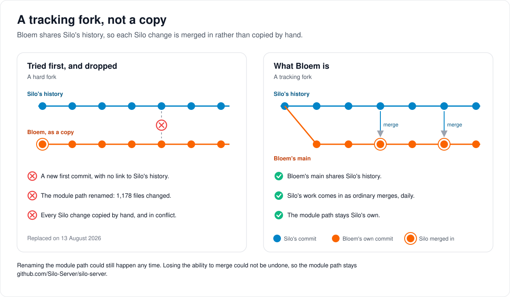

# How Bloem forks Silo

> **Provenance and status.** Bloem page, rewritten on 2026-11-01, updated on 2026-11-02
> and checked against `main` at `a7359de60`. This is Bloem's fork policy and
> provenance; Silo has no such file. Every rule, command and number is in the
> [For developers](#for-developers) section.

Bloem Server is Silo Server with Bloem's additions. This page walks through what that
means, how Bloem takes in Silo's work, where Bloem keeps its own work, what
it adds and what it took out again, and where things stand today.

## What Bloem is

**Silo Server** is a self-hosted media server for films, series, audiobooks, ebooks,
podcasts and manga, made by the Silo-Server project and licensed under AGPL-3.0.
Bloem is a **fork** of it: a copy of Silo's code that adds its own features. Bloem
keeps Silo's licence and every copyright notice.

Bloem started on 13 August 2026 under the working name Vondel Server and was renamed
Bloem on 24 August 2026, so older commit messages still say "Vondel". Silo's own
description of itself, the root `README.md`, stays exactly as Silo wrote it. Bloem's
front page is [`.github/README.md`](.github/README.md), which GitHub shows instead.

## A tracking fork, not a copy



Bloem is a **tracking fork**: its history is Silo's history, with Bloem's own commits
on top. When Silo changes something, Bloem **merges** it in, an ordinary Git step that
brings both histories together. Nobody copies Silo's changes by hand.

Bloem tried the other way first. A **hard fork** started a new history and renamed
Silo's module path in 1,178 files. After that, every Silo change was a conflict. On
13 August 2026 Bloem went back to Silo's real history, and the module path stays
Silo's own. Renaming it could still happen any day; getting the ability to merge back
could not.

A **merge bot** on Bloem's build machine takes each batch of Silo's work. It merges
it into Bloem, takes Silo's side of every conflict, checks that Bloem still works,
pushes the merge to `main`, waits for Bloem CI to pass it and deploys it. Each batch
is worked in its own thread that the owner can watch and answer. Until 2 November 2026
a daily GitHub job made clean merges by itself; it is switched off.
[How Bloem keeps up with Silo](docs/architecture/bloem-following-silo.md) explains
the routine with pictures.

## When Silo and Bloem change the same lines

**Silo wins.** In code both projects share, Bloem takes Silo's side of every conflict
it can work around, then puts its own change back in the smallest way it can, in a
file of its own. A Silo line that Bloem keeps changed conflicts again at the next
merge, and Silo changes every day. Taking Silo's version also brings Silo's own fixes
and tests.

Bloem's own apps are not released yet, so keeping them on an older shape of the API
is no reason to keep Bloem's code different from Silo's.

## Where Bloem keeps its own work

- **Its own files.** Bloem's code is in files named `bloem_*` and in whole packages
  Silo doesn't have, such as Live TV.
- **Seams.** A **seam** is a Silo file that Bloem still changes, usually by one hook
  line that calls Bloem's code. Every seam is listed, with its reason, in
  `contracts/seams.txt`. On 2 November 2026 the list held 309. The number may only go
  down, and adding one is a reviewed decision.
- **Overlays.** Where a Silo document needs a Bloem note, a separate Bloem page, an
  **overlay**, carries it, and Silo's document stays as Silo wrote it.
- **The name and the look.** The web app is given Bloem's name and artwork when it is
  built, so Silo's web source can stay as Silo wrote it.

## What Bloem adds


- **Organizations and plans.** One server serves several customers, each kept apart,
  with accounts, profiles, seats and plans
  ([how organizations work](docs/architecture/bloem-organizations.md)).
- **Domains and branding.** Each organization can be served on its own addresses,
  with its own name, logo and colours
  ([organization domains and branding](docs/architecture/bloem-organization-domains.md)).
- **Live TV.** Tuners, Xtream providers, a programme guide and recordings
  ([how Live TV works](docs/architecture/bloem-live-tv.md)).
- **Storage sources.** Libraries read from S3 or Bookwarehouse as well as folders.
  This is still experimental.
- **An API for Bloem's own apps,** with richer title pages, profile sign-ins and
  server-side search.
- **Switching with Silo.** A Silo installation can try Bloem on the same database and
  go back ([switching between Silo and Bloem](docs/architecture/bloem-silo-switching-explained.md)).

Bloem's apps, `bloem-apple` and `bloem-android`, are not forks of Silo's apps. They
are written from scratch against the server's documented interfaces.

## What Bloem took out again

Bloem has removed some of its own additions, where Silo now covers the need or where
the addition no longer paid for what it cost at each merge: a gateway for companion
apps, Pastime tracking, a music catalog, separate worker processes for presentation
rules, its own records for retrying administrative actions, its own tickets for live
sockets, a deployment switch for header-authenticated media, and keeping account
settings on organization memberships. The
[table under For developers](#what-bloem-removed) says when and why.

## Where things stand

On 2 November 2026, Bloem's `main` has all of Silo's work through `56e6f871c`, from
that evening, and the seam list holds 309 files. Production runs `e3a096b20`. From now
on the merge bot takes each new Silo batch through to production. Production has one
organization, the default one, with the server's public address registered as its
primary domain.

## Who can change what

| Who | What they decide |
| --- | --- |
| The owner | When to deploy anything the merge bot does not, whether a new seam may be added, and how a stopped batch goes on. |
| The merge bot | Merging each Silo batch with Silo winning, fixing Bloem on Bloem's own lines, pushing to `main` after the full checks pass, and deploying a batch Bloem CI passed. |
| A Bloem maintainer | Merging Silo by hand, with the same steps, when the bot cannot. |
| A repository administrator | Switching the daily GitHub sync back on, with the repository variable `BLOEM_UPSTREAM_SYNC`. It is off since 2 November 2026. |
| Silo's maintainers | Whether a change Bloem offers is taken into Silo. Bloem never pushes to Silo directly; it offers changes through a separate fork and a pull request. |

## Words used in the code

| On this page | In the repository |
| --- | --- |
| Silo's work | `upstream/main`, from the `upstream` remote |
| Tracking fork | `main` shares Silo's history and merges `upstream/main` with `--no-ff` |
| Module path | `github.com/Silo-Server/silo-server` in `go.mod` |
| The merge bot | outside this repository; its configuration, scripts and prompts live in Bloem's private infrastructure repository. It runs `scripts/bloem/silo-merge-review.py` and `scripts/bloem/local-gate.py` |
| The daily sync (switched off) | `.github/workflows/upstream-sync.yml`, landed by `upstream-sync-merge.yml`; both run only when `BLOEM_UPSTREAM_SYNC` is `true` |
| Seam, seam list | a Silo-owned file Bloem differs in; `contracts/seams.txt`, checked by `make verify-seams` |
| Overlay | a Bloem page under `docs/bloem/overlays/` |
| The name and the look | `web/bloem-brand-plugin.ts`, and Bloem's artwork in `assets/` |
| Live TV's origin | Prairie Server, listed in `docs/livetv/prairie-source-manifest.tsv` |

## For developers

- **API:** Bloem's own routes are under `/api/bloem/v1`, described by topic in
  [the native API](docs/bloem/api/README.md). Bloem adds nothing to Silo's `/api/v1`;
  the web app and the storefront call none of it
  ([leaving Silo's `/api/v1`](docs/architecture/bloem-leaving-silo-v1.md)).

### This is a TRACKING fork, deliberately

Bloem Server is a fork of [Silo Server](https://github.com/Silo-Server/silo-server),
AGPL-3.0, whose licence and copyright notices are preserved throughout. Its own
description is the root [`README.md`](README.md), which stays exactly as Silo wrote
it; Bloem's front page is [`.github/README.md`](.github/README.md). The fork started
on August 13, 2026 (`a51326741`) under the working name Vondel Server and was renamed
Bloem on August 24, 2026 (`b25394bc8`).

`main` shares real history with upstream, so every upstream release can be merged
rather than ported by hand. Git remotes are local configuration and are not copied by
`git clone`; add the protected upstream remote in each maintainer checkout:

```sh
git remote add upstream https://github.com/Silo-Server/silo-server.git
git remote set-url --push upstream DISABLED
```

An earlier attempt imported the tree as a zero-parent root commit with the Go module
path renamed to `github.com/Bloem-Studios/bloem-server`. That is a hard fork, and it
cost more than it bought: the rename touched 1,178 files, which makes every future
upstream change a conflict, while the features Bloem adds (Live TV chief among them)
are additive packages that merge cleanly without it. `a51326741` replaced it with
Silo's real history. Its commit message names a `hard-fork-archive` branch for the
earlier history; no such branch is published in this repository (checked October 27,
2026).

**The module path stays `github.com/Silo-Server/silo-server`.** It is the price of
merge-ability and it is worth paying. Renaming is a one-way door available at any
time; staying merge-able is not recoverable once lost.

Maintainer checkouts deliberately set `upstream`'s push URL to an invalid value.
Nothing from this repository is pushed directly to Silo-Server; upstream contributions
use a separate fork and pull request.

### Taking upstream changes

Since 2 November 2026 the **merge bot** takes in each Silo batch. It runs on Bloem's
build machine, outside GitHub Actions; its configuration, scripts and prompts live in
Bloem's private infrastructure repository. A free check every 10 minutes starts a
batch only when Silo's `main` has commits Bloem lacks and has been quiet for 30
minutes. The batch is everything on Silo's `main` when its thread starts; later
commits wait for the next batch. One batch runs at a time, each in its own T3 thread
and worktree, on a `merge/upstream-<sha9>` branch from `origin/main`, which the owner
can watch and answer. A person merging by hand follows the same steps.

Update the tracked fork with a normal merge so both projects' ancestry remains visible
and future merges can reuse Git's conflict resolutions. By hand:

```sh
git fetch --prune upstream
git switch main
git pull --ff-only origin main
git merge --no-ff upstream/main
```

The bot merges its batch commit instead of `upstream/main`, on its own branch, and
pushes the result with `git push origin HEAD:main`.

**Silo wins.** In shared code, take Silo's side of every conflict Bloem can adapt
around, then reapply the smallest Bloem delta in Bloem-owned files. Bloem's native
clients are unreleased, so keeping them on an older wire shape is not a reason to keep
a Bloem difference ([agent rules](BLOEM_AGENTS.md#shared-implementation-follows-silo)).
Every Silo line Bloem keeps edited conflicts again on the next merge, and Silo moves
daily; adopting Silo's implementation also brings Silo's fixes and tests. Where Silo's
version would break Bloem, Bloem's behavior goes back on Bloem's own added lines or in
a Bloem-owned file or field, with a test that fails without it. When Bloem cannot be
kept working without editing one of Silo's lines, the batch stops for the owner.

Before pushing, each batch:

1. runs `python3 scripts/bloem/silo-merge-review.py --base <old main> --silo <batch>`
   and reads each item it lists against Silo's change: the seams the batch touches,
   Bloem files beside or calling changed Silo code, overlays to bring in line, Bloem
   pages that mention changed files, and the batch's migrations;
2. regenerates the client DTOs, playback fixtures and API catalogue, with coverage
   reasons and the client digest for new Silo wire types;
3. updates the documentation the merge affects, in the same push;
4. runs the full local gate, `python3 scripts/bloem/local-gate.py run --base <old main>`,
   which runs every Bloem CI job, including the web bundle budget and CI's
   changed-line lint ([validation checks](.github/CONTRIBUTING.md#validate-your-change)).

Then it pushes to `main`, waits for Bloem CI on that exact commit (a failed job is
rerun once; a run cancelled by a newer push is followed to the new tip), deploys only
a commit CI passed, writes the receipt and sends one message: deployed, stuck or
rolled back. It stops in its thread, and blocks the next batch, when a test or check
cannot be fixed, when Bloem cannot be kept working without editing Silo's lines, when
CI stays red, or when the deploy fails or rolls back. See
[CI](docs/bloem/ci.md#the-merge-bot) for every step.

The daily `Upstream sync` workflow (`.github/workflows/upstream-sync.yml`, 05:20 UTC)
and its merge gate are switched off since 2 November 2026: their jobs run only when the
repository variable `BLOEM_UPSTREAM_SYNC` is `true`. Switched on, the sync performs this
merge on an `upstream-sync/<date>-<sha>` branch and opens a pull request; `upstream-sync-merge.yml`
merges it only when Bloem CI passed on that exact head and the head is the untouched,
conflict-free merge of a `main` commit with a Silo commit. A conflicted merge is pushed
as a draft pull request with the conflict markers committed, for a person to resolve.
See [CI](docs/bloem/ci.md#upstream-sync-merges). For an urgent isolated fix,
cherry-pick the exact upstream commit onto a Bloem topic branch instead; the next full
upstream merge will recognize that patch. Never force-push shared Bloem branches or
squash imported upstream history.

Bloem changes should remain focused downstream commits. Prefer additive packages,
migrations, routes, and build-time branding over broad rewrites of upstream-owned
files. When a merge conflict is unavoidable, preserve Silo's public compatibility
surface and reapply the smallest Bloem delta.

### Seams and overlays

A **seam** is a Silo-owned file (one that also exists in `upstream/main`) that Bloem
modifies, deletes or type-changes. Each one is declared, usually with a one-line
reason, in [`contracts/seams.txt`](contracts/seams.txt). `make verify-seams`
(`scripts/verify-seams.sh`) fails when Bloem differs from Silo in a file the ledger
does not list; it compares with the upstream tip, the last merged upstream commit and
an in-progress merge's incoming commit, so it is safe to run mid-merge. The count may
only go down, and adding an entry is a reviewed decision.

An **overlay** is the documentation equivalent: a Bloem-owned file under
[`docs/bloem/overlays/`](docs/bloem/overlays/) that records, section by section, what
Bloem adds to or replaces in the Silo document of the same path, so the Silo document
itself stays Silo's. The [documentation index](docs/bloem/README.md) lists every
overlay.

### What Bloem adds, in detail

- A tenant and identity foundation under `/api/bloem/v1`, while `/api/v1` remains the
  Silo-compatible surface. The shipped boundary includes organization lifecycle and
  membership management (with an admin UI for people and security administration),
  organization-scoped profile groups, a separate administrative-context session
  system, and OPA-bounded visibility of organization-owned or explicitly entitled media
  folders; see [the operator runbook](docs/architecture/opa-tenant-authorization.md).
  Since October 26, 2026 (`c60b7008e`) account policy lives on Silo's `users` columns
  and a membership only links an account to its one organization. A sign-in that
  started before its organization revoked the account is ended with
  `401 session_invalid` (`session_expired` on `/api/v2`), so the client signs in again
  (`25129bcbd`, November 1, 2026).
- [Organization domains and branding](docs/architecture/bloem-organization-domains.md)
  (`internal/orgdomains`, migration `20261101055208_bloem_organization_domains`,
  capability `organization_domains_v1`, November 1, 2026): an organization can be
  served on its own domains with its own name, logo and colours, managed through
  `/api/bloem/v1/admin/platform/tenants/{id}/domains` and `/branding`. Emails link to
  its primary domain; a sign-in on another organization's domain is refused with
  `409 wrong_organization_domain`, naming where to sign in; an organization without a domain
  signs in at the server's public address; a sign-in or sign-out through the OAuth
  provider stays on the domain it started on. A domain decides presentation, never
  access.
- Bloem adds nothing to Silo's `/api/v1`. The storefront (October 31, 2026) and the web
  app (November 1, 2026) call none of it; the web app's signed-out seasonal layer reads
  `GET /api/bloem/v1/ambience/public`. The `/api/v1` routes stay mounted for the phone
  apps ([leaving Silo's `/api/v1`](docs/architecture/bloem-leaving-silo-v1.md)).
- [Silo backend switching](docs/architecture/silo-backend-switching.md): a database
  limited to one organization can be served by Silo or Bloem, one at a time.
- Direct-profile login for supported native routes, plus household credential
  management. Browser direct-profile login and shared-device profile pairing remain
  unsupported; account-device activation is a separate protocol.
- A native client API surface built for Bloem's own Android/Apple clients: richer Watch
  documents (cast/crew, chapter and skip-intro markers, file editions, server-side
  search, poster resolution), a person-detail endpoint, and a batch-resolved
  similar-items endpoint. Verified by client contract conformance tests
  (`internal/clientcontract`) and an install/scan acceptance test suite
  (`internal/acceptance`).
- [Native storage](docs/architecture/bloem-native-storage.md): ebook, movie and
  audiobook libraries that read from storage plugins (S3, Bookwarehouse) alongside
  filesystem paths. It remains experimental.
- A separately maintained plugin SDK, catalog and first-party plugin set.
- Product identity: Bloem naming in user-facing copy.
- Embedded-web organization workflows, household profile-credential management,
  platform campaign/seasonal authoring and native Live TV/DVR controls. The
  [coverage matrix](docs/architecture/bloem-web-feature-coverage.md) records the shared
  seams, tested behavior and remaining limits.
- Encrypted Xtream live-provider consumption and provider-bound XMLTV, with shared
  physical-connection budgets and server-owned encoder input. This is Bloem's addition
  to the Prairie-derived subsystem, not a Silo feature or a general remote-URL player.
  See [Xtream scope](docs/architecture/xtream-live-tv.md).
- Explicit [downstream contract adjudications](docs/architecture/bloem-contract-adjudications.md)
  that preserve SHA-pinned upstream scenario and route snapshots while testing reviewed
  Bloem behavior. They do not weaken production authorization or reintroduce credential
  disclosure.

Plugin authorization and adult-scene policy are separate increments. Live TV, OTA/DVR,
and EPG are supplied by an attributed AGPL adaptation of the Prairie Server subsystem
pinned in `docs/livetv/prairie-source-manifest.tsv`.

### What Bloem removed

Bloem has removed several of its own additions where Silo now covers the need or where
the addition no longer earned its merge cost. Each removal is forward-only; the linked
pages record what stays in the database.

| Removed | When | Why, and where it is recorded |
| --- | --- | --- |
| Companion-application enrollment and the same-origin compatibility gateway | October 13, 2026 (`b8ddec9bf`); not restored on October 18 | Removed with Bloem's first removal of Jellyfin and Audiobookshelf compatibility. When Bloem went back to running Silo's compatibility servers as Silo ships them (`2393c41ee`), its own gateway stayed out. See [protocol compatibility](docs/architecture/bloem-compatibility-removal.md). |
| Pastime managed tracking | October 14, 2026 (merge `4835a698e`) | The bridge, broker and host hooks needed private triggers and writes into Silo tables. Pastime may return only as an ordinary plugin. See [Pastime removal](docs/architecture/bloem-pastime-removal.md). |
| Header-authenticated media deployment gate | October 9, 2026 (`545ed3a33`) | Bloem negotiates header-authenticated media whenever a client asks, as Silo does. |
| Membership-owned account policy and its rollout phases | October 26, 2026 (`c60b7008e`) | Policy back on `users`, where Silo keeps it; 13 seams returned to Silo's bytes. See the [changelog](docs/bloem/CHANGELOG.md#october-26-2026--account-policy-back-on-users). |
| Music catalog | October 26, 2026 (`f9e1447f3`) | Silo has no music library type; production had no music libraries. |
| Bundled presentation worker processes | October 26, 2026 (`310c545f9`) | The workers ran only Bloem's own code, without a sandbox, so the process boundary isolated nothing. See [presentation evaluators](docs/architecture/bloem-presentation-evaluators.md). |
| Lifecycle idempotency receipts | October 26, 2026 (`b017bfe84`) | Mutations follow Silo's retry-safety classes; commands with their own keys still replay. |
| v1 socket audience tickets | October 25, 2026 (`a7436b4e5`) | No Bloem client used the v1 sockets; Silo's handshake is back. |

The [integration changelog](docs/bloem/CHANGELOG.md) has the full list, including
dead-code removals.

### Current integration boundary

At `a7359de60` (November 2, 2026), Bloem `main` contains all of Silo `main` through
`56e6f871c` (2026-11-02 18:16 UTC), merged in `209447445`, and the ledger declares
**309 seams**. Production runs `e3a096b20`: the
[November 2 receipt](docs/operations/2026-11-02-silo-sync-07f0ae21c-deployment.md)
records that deployment, and the
[documentation index](docs/bloem/README.md#deployment-receipts) lists the ones before
it. A source integration is not a deployment, and a deployment is not native-client or
playback acceptance. Profile-aware playback/download APIs, migration adaptation, web
branding and bundle allowances stay in owned files. The
[adapter guide](docs/architecture/bloem-upstream-adapters.md) records the durable
contracts; the [changelog](docs/bloem/CHANGELOG.md) records each integration.

Use the Bloem binary for migration status and execution. Its `migrations.BloemFS`
adapter rewrites historical migrations a fresh database still replays before
`20261026003000_bloem_account_policy_on_users` moves account policy back onto `users`,
where Silo keeps it.

A Silo database taken over by Bloem can stay switchable: with
`public.bloem_silo_switching` enabled, either binary can serve it, one at a time.
Upstream merges that add Silo writes to tables Bloem constrains need a switching test
and a passing `make silo-switch-check`; see
[Silo backend switching](docs/architecture/silo-backend-switching.md).

History, kept as history: on November 1, 2026, at `b6039036d`, Bloem `main` had Silo
through `63ef34b23` (2026-11-01 04:45 UTC), merged in `f14332386`, with 304 seams, and
production ran `59616c4af`
([November 1 receipt](docs/operations/2026-11-01-provider-sign-out-deployment.md)). On
October 31, 2026, at `81c26179c`, Bloem `main` had Silo through `32a2f63e1`
(2026-10-31 19:48 UTC), merged in `4edbee99d`, with 303 seams, and production ran
`4edbee99d`
([October 31 receipt](docs/operations/2026-10-31-silo-sync-32a2f63e1-deployment.md)).
On October 7, 2026 production ran Bloem `c87b44545`, with
Silo through `74158b4a8` and 407 declared seams
([October 7 record](docs/operations/2026-10-07-native-storage-deployment.md)). The
October 5 merge-reduction pass had reduced the ledger to 390 paths, and a later
extraction to 387, before native onboarding and the October 7 integration added
reviewed seams. The October 13–18 removal of Jellyfin and Audiobookshelf needed 852
entries; restoring Silo's servers took it to 388, the October 23 merge to 347, and the
October 25–26 simplifications from 350 to 306. The October 29 merge took it to 304,
the AI subtitle fixes to 306 (two upstream PR candidates), the October 31 merge to
305, and keeping Silo's session-revoked hook type to 303. The November 1 merge of Silo
through `63ef34b23` kept it at 303, and organization domains took it to 304 with
`internal/auth/oauth_handler.go`, which keeps a provider sign-in and sign-out on the
organization domain it started on. The November 1 merge of Silo through `6f5be75cd`
took it to 307 with two generated playback fixtures and a library-form test
(`46354baee`); keeping Silo's preferred-version preflight line verbatim took it to 308
(`internal/api/handlers/playback_missing.go`, `f49e73147`); and two Silo tests that
failed in Bloem CI on November 2 took it to 310
(`web/src/player/components/WatchPage.test.ts`, `c27b5f0be`;
`internal/blobgc/collector_s3_db_test.go`, `6e1250062`); the merge of Silo through
`56e6f871c` took it to 309, when `internal/auth/permissions.go` went back to Silo's
bytes and Bloem's permission catalog moved to `internal/auth/bloem_permissions.go`
(`631730bb4`). The September deployment
records are historical evidence too, and no deployment record changes the normal merge
policy or certifies future builds.

### Ongoing merge cost

The seam ledger is the merge cost: 309 Silo-owned files differ at `a7359de60`, most by
a hook line or a generated artifact (the route inventory, OpenAPI and migration ledger
necessarily differ because Bloem registers more routes).

User-facing prose is rebranded at bundle time by `web/bloem-brand-plugin.ts`, so
upstream web source remains mergeable. Bloem's public icons, wordmark and repository
artwork in `assets/` are owned visual assets; the Silo paths it replaces with Bloem art
(`assets/icon.png` and the icons under `web/public/`) are declared seams. The build
adapter supplies the PWA manifest names, service-worker default notification name and
built-in component image paths in development and production output while their shared
source stays identical to upstream. Silo's reserved visual assets must not ship in a
modified distribution. `assets/`, `assets/brand/` and `web/public/` each carry a
`NOTICE` recording that the brand assets are original Bloem work rather than
derivatives of Silo's visual identity. Compatibility identifiers, module paths,
environment variables, and protocol fields retain their Silo names.

Clients are NOT forks. `bloem-apple` and `bloem-android` are clean-room projects built
from documented server interfaces; see
`docs/superpowers/specs/2026-08-12-bloem-clean-room-clients-design.md`.

### Where Bloem's documentation lives

Silo-owned files stay as close to upstream as possible. Bloem's own material is in
Bloem-owned files indexed at [docs/bloem/README.md](docs/bloem/README.md): the Bloem
front page ([.github/README.md](.github/README.md)), contribution rules
([.github/CONTRIBUTING.md](.github/CONTRIBUTING.md)), agent overrides
([BLOEM_AGENTS.md](BLOEM_AGENTS.md)), and per-document overlays under
`docs/bloem/overlays/` that record what Bloem adds to or replaces in an upstream
document of the same path.

### Prairie Server Live TV

Bloem's server-side and web Live TV, OTA tuner, guide, streaming, and DVR subsystem is
adapted from [Prairie Server](https://github.com/Prairie-Server/prairie-server) at
commit `095ecd22fbea3384a905eb9049386015db3ff4d8`, licensed under AGPL-3.0. Bloem
preserves the applicable license and identifies every imported or adapted source blob
in `docs/livetv/prairie-source-manifest.tsv`.

The adaptation changes product/module identity, migration ordering, and shared Bloem
integration points. It does not import Prairie native-client source, assets, layouts,
or tests.

### Related pages

- [How Bloem keeps up with Silo](docs/architecture/bloem-following-silo.md): each Silo
  merge and "Silo wins", with pictures.
- [Bloem CI](docs/bloem/ci.md): every job, the merge bot's CI wait and deploy, the
  switched-off daily sync and its merge gate, and the image.
- [Bloem's adapters over Silo](docs/architecture/bloem-upstream-adapters.md): how Bloem
  changes Silo's behavior without editing Silo's files.
- [BLOEM_AGENTS.md](BLOEM_AGENTS.md): the rules for changing Bloem, including Silo
  switching and upstream contributions.
- [Integration changelog](docs/bloem/CHANGELOG.md): every Silo merge and Bloem change,
  with commits and seam counts.

The pictures are SVG files under `docs/architecture/images/fork/`, drawn by
`scripts/bloem/draw-pictures.py`. Redraw them there, not by hand.
