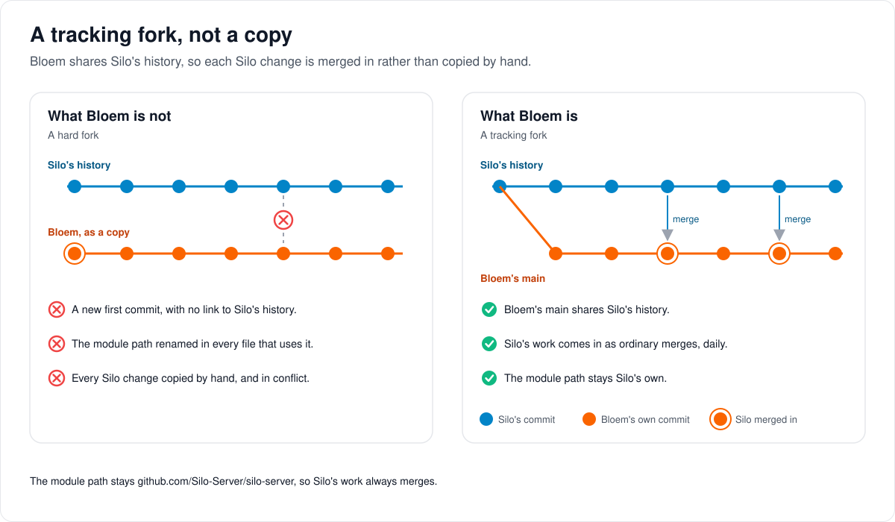
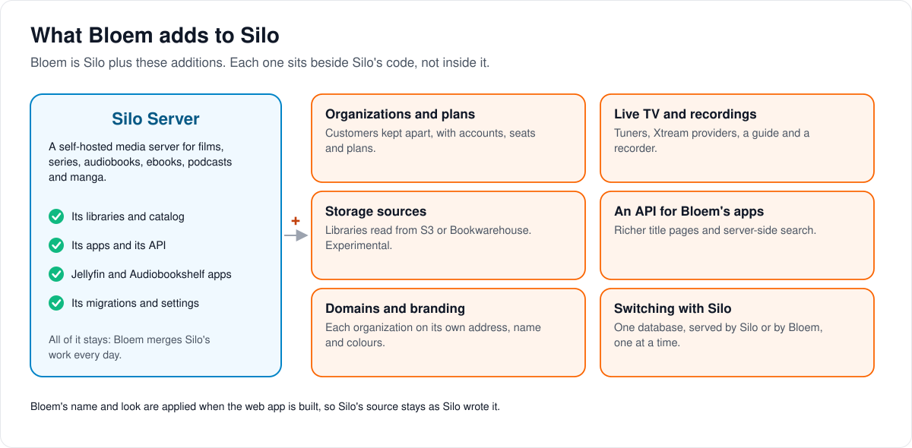

# How Bloem forks Silo

Bloem Server is Silo Server with Bloem's additions. This page sets out the fork policy: how Bloem takes in Silo's work,
where it keeps its own work and what it adds. The rules, commands and numbers are in the
[For developers](#for-developers) section.

## What Bloem is

**Silo Server** is a self-hosted media server for films, series, audiobooks, ebooks, podcasts and manga, made by the
Silo-Server project and licensed under AGPL-3.0. Bloem is a **fork** of it: a copy of Silo's code that adds its own
features. Bloem keeps Silo's licence and every copyright notice.

Silo's own description of itself, the root `README.md`, stays exactly as Silo wrote it. Bloem's front page is
[`.github/README.md`](.github/README.md), which GitHub shows instead.

## A tracking fork, not a copy



Bloem is a **tracking fork**: its history is Silo's history, with Bloem's own commits on top. When Silo changes
something, Bloem **merges** it in, an ordinary Git step that brings both histories together. Nobody copies Silo's
changes by hand.

A **hard fork**, by contrast, starts a new history and renames Silo's module path in every file, so every Silo change
is a conflict and Git cannot merge Silo at all. Bloem keeps Silo's real history, and the module path stays Silo's own.

A **merge bot** on Bloem's build machine takes each batch of Silo's work, twice a day. It merges the batch, takes Silo's
side of every conflict, checks that Bloem still works, pushes the merge to `main` and waits for Bloem CI to pass it.
[How Bloem keeps up with Silo](docs/architecture/bloem-following-silo.md) explains the routine with pictures.

## When Silo and Bloem change the same lines

**Silo wins.** In code both projects share, Bloem takes Silo's side of every conflict it can work around, then puts its
own change back in the smallest way it can, in a file of its own. A Silo line that Bloem keeps changed conflicts again
at the next merge, and Silo changes every day. Taking Silo's version also brings Silo's own fixes and tests.

Bloem's own apps are not released yet, so keeping them on an older shape of the API is no reason to keep Bloem's code
different from Silo's.

## Where Bloem keeps its own work

- **Its own files.** Bloem's code is in files named `bloem_*` and in whole packages Silo doesn't have, such as Live TV.
- **Seams.** A **seam** is a Silo file that Bloem still changes, usually by one hook line that calls Bloem's code. Every
  seam is listed, with its reason, in `contracts/seams.txt`. The number may only go down, and adding one is a reviewed
  decision.
- **Overlays.** Where a Silo document needs a Bloem note, a separate Bloem page, an **overlay**, carries it, and Silo's
  document stays as Silo wrote it.
- **The name and the look.** The web app is given Bloem's name and artwork when it is built, so Silo's web source can
  stay as Silo wrote it.

## What Bloem adds



- **Organizations and plans.** One server serves several customers, each kept apart, with accounts, profiles, seats and
  plans ([how organizations work](docs/architecture/bloem-organizations.md)).
- **Domains and branding.** Each organization can be served on its own addresses, with its own name, logo and colours
  ([organization domains and branding](docs/architecture/bloem-organization-domains.md)).
- **Live TV.** Tuners, Xtream providers, a programme guide and recordings
  ([how Live TV works](docs/architecture/bloem-live-tv.md)).
- **Storage sources.** Libraries read from S3 or Bookwarehouse as well as folders. This is still experimental.
- **An API for Bloem's own apps,** with richer title pages and server-side search.
- **Switching with Silo.** A Silo installation can try Bloem on the same database and go back
  ([switching between Silo and Bloem](docs/architecture/bloem-silo-switching-explained.md)).

Bloem's apps, `bloem-apple` and `bloem-android`, are not forks of Silo's apps. They are written from scratch against the
server's documented interfaces.

## Who can change what

| Who | What they decide |
| --- | --- |
| Bloem's maintainers | Whether a new seam may be added, how a stopped merge batch goes on, and when to deploy anything the merge bot does not. |
| The merge bot | Merging each Silo batch with Silo winning, fixing Bloem on Bloem's own lines, pushing to `main` after the fast local checks pass, and waiting for Bloem CI. |
| A repository administrator | Switching the daily GitHub sync back on, with the repository variable `BLOEM_UPSTREAM_SYNC`. It is off. |
| Silo's maintainers | Whether a change Bloem offers is taken into Silo. Bloem never pushes to Silo directly; it offers changes through a separate fork and a pull request. |

## Words used in the code

| On this page | In the repository |
| --- | --- |
| Silo's work | `upstream/main`, from the `upstream` remote |
| Tracking fork | `main` shares Silo's history and merges `upstream/main` with `--no-ff` |
| Module path | `github.com/Silo-Server/silo-server` in `go.mod` |
| The merge bot | outside this repository. It runs `scripts/bloem/silo-merge-review.py` and `scripts/bloem/local-gate.py` |
| The daily sync (switched off) | `.github/workflows/upstream-sync.yml`, landed by `upstream-sync-merge.yml`; both run only when `BLOEM_UPSTREAM_SYNC` is `true` |
| Seam, seam list | a Silo-owned file Bloem differs in; `contracts/seams.txt`, checked by `make verify-seams` |
| Overlay | a Bloem page under `docs/bloem/overlays/` |
| The name and the look | `web/bloem-brand-plugin.ts`, and Bloem's artwork in `assets/` |
| Live TV's origin | Prairie Server, listed in `docs/livetv/prairie-source-manifest.tsv` |

## For developers

- **API:** Silo's features use Silo's `/api/v2`. Bloem's own routes are under `/api/bloem/v2`, described by topic in
  [the native API](docs/bloem/api/README.md).

### This is a tracking fork, deliberately

`main` shares real history with upstream, so every upstream release can be merged rather than ported by hand. Git
remotes are local configuration and are not copied by `git clone`; add the protected upstream remote in each maintainer
checkout:

```sh
git remote add upstream https://github.com/Silo-Server/silo-server.git
git remote set-url --push upstream DISABLED
```

The invalid push URL is deliberate. Nothing from this repository is pushed directly to Silo-Server; upstream
contributions use a separate fork and pull request.

**The module path stays `github.com/Silo-Server/silo-server`.** Renaming it would touch every file that imports it and
make every upstream change a conflict, while the features Bloem adds (Live TV chief among them) are additive packages
that merge cleanly without the rename.

### Taking upstream changes

A **merge bot** takes in each Silo batch. It runs on Bloem's build machine, outside GitHub Actions. A free check starts a
batch twice a day when Silo's `main` has commits Bloem lacks and has been quiet for 10 minutes. The batch is everything
on Silo's `main` when it starts, and later commits wait for the next batch. One batch runs at a time, on a
`merge/upstream-<sha9>` branch from `origin/main`. A person merging by hand follows the same steps.

Update the tracked fork with a normal merge so both projects' ancestry stays visible and future merges can reuse Git's
conflict resolutions. By hand:

```sh
git fetch --prune upstream
git switch main
git pull --ff-only origin main
git merge --no-ff upstream/main
```

The bot merges its batch commit instead of `upstream/main`, on its own branch, and pushes the result with
`git push origin HEAD:main`.

**Silo wins.** In shared code, take Silo's side of every conflict Bloem can adapt around, then reapply the smallest Bloem
delta in Bloem-owned files ([agent rules](BLOEM_AGENTS.md#shared-implementation-follows-silo)). Where Silo's version
would break Bloem, Bloem's behaviour goes back on Bloem's own added lines or in a Bloem-owned file or field, with a test
that fails without it. When Bloem cannot be kept working without editing one of Silo's lines, the batch stops for a
maintainer.

Before pushing, each batch:

1. runs `python3 scripts/bloem/silo-merge-review.py --base <old main> --silo <batch>` and reads each item it lists
   against Silo's change: the seams the batch touches, Bloem files beside or calling changed Silo code, overlays to
   bring in line, Bloem pages that mention changed files, and the batch's migrations;
2. regenerates the client DTOs, playback fixtures and API catalogue, with coverage reasons and the client digest for new
   Silo wire types;
3. updates the documentation the merge affects, in the same push;
4. runs the fast local checks: the build, the contract and verify checks, changed-line lint and the scenario executor
   (`python3 scripts/bloem/local-gate.py run --base <old main> --only build,verify,lint,scenarios`), and the scenario
   catalog tests (`go test ./internal/scenariocatalog/`). Bloem CI runs the full suite on the pushed commit. The whole
   local gate, without `--only`, runs every Bloem CI job for a developer checking by hand
   ([validation checks](.github/CONTRIBUTING.md#validate-your-change)).

Then it pushes to `main` and waits for Bloem CI on that exact commit (a failed job is rerun once). The deploy only takes
a commit Bloem CI has passed. The bot stops, and blocks the next batch, when a test or check cannot be fixed, when Bloem
cannot be kept working without editing Silo's lines, or when CI stays red. See [CI](docs/bloem/ci.md#the-merge-bot) for
every step.

The daily `Upstream sync` workflow (`.github/workflows/upstream-sync.yml`) and its merge gate are switched off: their
jobs run only when the repository variable `BLOEM_UPSTREAM_SYNC` is `true`. Switched on, the sync performs this merge on
an `upstream-sync/<date>-<sha>` branch and opens a pull request. `upstream-sync-merge.yml` merges it only when Bloem CI
passed on that exact head and the head is the untouched, conflict-free merge of a `main` commit with a Silo commit. A
conflicted merge is pushed as a draft pull request with the conflict markers committed, for a person to resolve. See
[CI](docs/bloem/ci.md#upstream-sync-merges).

For an urgent isolated fix, cherry-pick the exact upstream commit onto a Bloem topic branch instead; the next full
upstream merge will recognise that patch. Never force-push shared Bloem branches or squash imported upstream history.
Bloem changes should remain focused downstream commits. Prefer additive packages, migrations, routes and build-time
branding over broad rewrites of upstream-owned files.

### Seams and overlays

A **seam** is a Silo-owned file (one that also exists in `upstream/main`) that Bloem modifies, deletes or type-changes.
Each one is declared, usually with a one-line reason, in [`contracts/seams.txt`](contracts/seams.txt).
`make verify-seams` (`scripts/verify-seams.sh`) fails when Bloem differs from Silo in a file the ledger does not list.
It compares with the upstream tip, the last merged upstream commit and an in-progress merge's incoming commit, so it is
safe to run mid-merge. The count may only go down, and adding an entry is a reviewed decision.

An **overlay** is the documentation equivalent: a Bloem-owned file under [`docs/bloem/overlays/`](docs/bloem/overlays/)
that records, section by section, what Bloem adds to or replaces in the Silo document of the same path, so the Silo
document itself stays Silo's. The [documentation index](docs/bloem/README.md) lists every overlay.

### What Bloem adds, in detail

- A tenant and identity foundation under `/api/bloem/v2`, while Silo's `/api/v2` remains the Silo-compatible surface:
  organization lifecycle and membership management with an admin UI, organization-scoped profile groups, a separate
  administrative-context session system, and OPA-bounded visibility of organization-owned or explicitly entitled media
  folders ([tenant authorization](docs/architecture/opa-tenant-authorization.md)). Account policy lives on Silo's
  `users` columns, and a membership only links an account to its one organization. A sign-in that started before its
  organization revoked the account is ended with `401 session_invalid` (`session_expired` on `/api/v2`), so the client
  signs in again.
- [Organization domains and branding](docs/architecture/bloem-organization-domains.md) (`internal/orgdomains`, capability
  `organization_domains_v1`): an organization can be served on its own domains with its own name, logo and colours,
  managed through `/api/bloem/v2/admin/platform/tenants/{id}/domains` and `/branding`. Emails link to its primary
  domain. A sign-in on another organization's domain is refused with `409 wrong_organization_domain`, naming where to
  sign in. An organization without a domain signs in at the server's public address. A provider sign-in or sign-out
  stays on the domain it started on. A domain decides presentation, never access.
- [Silo backend switching](docs/architecture/silo-backend-switching.md): a database limited to one organization can be
  served by Silo or Bloem, one at a time.
- A native client API surface built for Bloem's own Android and Apple clients: richer Watch documents (cast and crew,
  chapter and skip-intro markers, file editions, server-side search, poster resolution), a person-detail endpoint and a
  batch-resolved similar-items endpoint. Client contract conformance tests (`internal/clientcontract`) and an
  install/scan acceptance suite (`internal/acceptance`) verify it.
- [Native storage](docs/architecture/bloem-native-storage.md): ebook, movie and audiobook libraries that read from
  storage plugins (S3, Bookwarehouse) alongside filesystem paths. It remains experimental.
- A separately maintained plugin SDK, catalog and first-party plugin set.
- Embedded-web organization workflows, platform campaign and seasonal
  authoring, and native Live TV and DVR controls. The [coverage matrix](docs/architecture/bloem-web-feature-coverage.md)
  records the tested behaviour and remaining limits.
- Encrypted Xtream live-provider consumption and provider-bound XMLTV, with shared physical-connection budgets and
  server-owned encoder input. This is Bloem's addition to the Prairie-derived subsystem, not a Silo feature or a
  general remote-URL player ([Xtream scope](docs/architecture/xtream-live-tv.md)).
- `.strm` remote-URL items, which Silo refuses: a `.strm` file may point at any web address, with private network
  addresses refused by default ([Bloem's non-goals](docs/bloem/overlays/non-goals.md#strm-files-are-in-scope)).
- Product identity: Bloem naming in user-facing copy.

Live TV, OTA/DVR and the programme guide are an attributed AGPL adaptation of the Prairie Server subsystem (see
[Prairie Server Live TV](#prairie-server-live-tv)).

### Integration boundary

Which Silo commit Bloem includes, and which commit production runs, are kept in the status paragraph of
[How Bloem keeps up with Silo](docs/architecture/bloem-following-silo.md). A source integration is not a deployment, and a deployment is not native-client or playback
acceptance. Profile-aware playback and download APIs, migration adaptation, web branding and bundle allowances stay in
owned files. The [adapter guide](docs/architecture/bloem-upstream-adapters.md) records the durable contracts.

Use the Bloem binary for migration status and execution. Its `migrations.BloemFS` adapter rewrites the migrations a
fresh database replays before `20261026003000_bloem_account_policy_on_users` puts account policy on `users`, where Silo
keeps it.

A Silo database taken over by Bloem can stay switchable: with `public.bloem_silo_switching` enabled, either binary can
serve it, one at a time. Upstream merges that add Silo writes to tables Bloem constrains need a switching test and a
passing `make silo-switch-check`; see [Silo backend switching](docs/architecture/silo-backend-switching.md).

### Ongoing merge cost

The seam ledger is the merge cost. Most seams are a hook line or a generated artifact (the route inventory, OpenAPI and
migration ledger necessarily differ because Bloem registers more routes).

User-facing prose is rebranded at bundle time by `web/bloem-brand-plugin.ts`, so upstream web source remains mergeable.
Bloem's public icons, wordmark and repository artwork in `assets/` are owned visual assets; the Silo paths it replaces
with Bloem art (`assets/icon.png` and the icons under `web/public/`) are declared seams. The build adapter supplies the
PWA manifest names, the service worker's default notification name and built-in component image paths in development and
production output, while their shared source stays identical to upstream. Silo's reserved visual assets must not ship in
a modified distribution. `assets/`, `assets/brand/` and `web/public/` each carry a `NOTICE` recording that the brand
assets are original Bloem work rather than derivatives of Silo's visual identity. Compatibility identifiers, module
paths, environment variables and protocol fields retain their Silo names.

Clients are not forks. `bloem-apple` and `bloem-android` are clean-room projects built from documented server
interfaces.

### Where Bloem's documentation lives

Silo-owned files stay as close to upstream as possible. Bloem's own material is in Bloem-owned files indexed at
[docs/bloem/README.md](docs/bloem/README.md): the Bloem front page ([.github/README.md](.github/README.md)), the
contribution stance ([.github/CONTRIBUTING.md](.github/CONTRIBUTING.md)), agent overrides
([BLOEM_AGENTS.md](BLOEM_AGENTS.md)), and per-document overlays under `docs/bloem/overlays/` that record what Bloem adds
to or replaces in an upstream document of the same path.

### Prairie Server Live TV

Bloem's server-side and web Live TV, OTA tuner, guide, streaming and DVR subsystem is adapted from
[Prairie Server](https://github.com/Prairie-Server/prairie-server) at commit
`095ecd22fbea3384a905eb9049386015db3ff4d8`, licensed under AGPL-3.0. Bloem preserves the applicable licence and
identifies every imported or adapted source blob in `docs/livetv/prairie-source-manifest.tsv`.

The adaptation changes product and module identity, migration ordering and shared Bloem integration points. It does not
import Prairie native-client source, assets, layouts or tests.

### Related pages

- [How Bloem keeps up with Silo](docs/architecture/bloem-following-silo.md): each Silo merge and "Silo wins", with
  pictures.
- [Bloem CI](docs/bloem/ci.md): every job, the merge bot's CI wait, the switched-off daily sync and its merge gate, and
  the image.
- [Bloem's adapters over Silo](docs/architecture/bloem-upstream-adapters.md): how Bloem changes Silo's behaviour without
  editing Silo's files.
- [BLOEM_AGENTS.md](BLOEM_AGENTS.md): the rules for changing Bloem, including Silo switching and upstream
  contributions.

The pictures are SVG files under `docs/architecture/images/fork/`, drawn by `scripts/bloem/draw-pictures.py`. Redraw
them there, not by hand.
