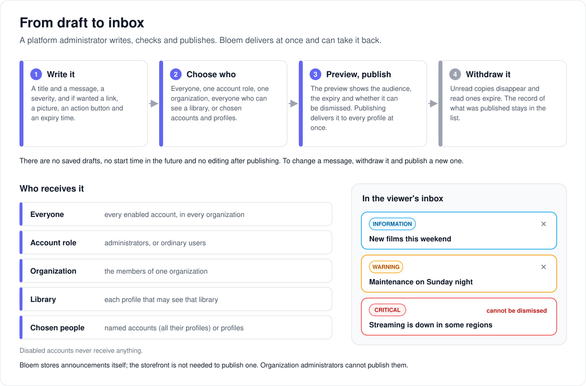

# How announcements work

> **Provenance and status.** Bloem page, rewritten on 2026-11-01, checked against
> `main` at `b6039036d` and checked again on 2026-11-11, after Silo retired its v1 API.
> Announcements are a Bloem addition: Silo has the
> notification inbox but no way to write a message to it. This page explains them in
> plain language; the technical rules are in the [For developers](#for-developers)
> section.

An **announcement** is a message a platform administrator sends to viewers' inboxes:
a planned outage, new films, a change to the service. This page walks through how one
is written and sent, who receives it, what viewers see, and how it is taken back.

## Writing and sending one



A platform administrator writes announcements in the web admin console under
**Settings → Integrations → Announcements**, in the **Platform administrative
context**: the admin console's mode for running the whole server rather than one
organization.

1. **Write it.** A title, a message and a **severity**: information, warning or
   critical. Optionally a link, a picture, an **action button** (a label and where it
   leads) and an **expiry time**, after which the message disappears by itself.
2. **Choose who receives it** (below).
3. **Preview and publish.** The preview shows the audience, the expiry, whether
   viewers can dismiss it, and every link it contains. Publishing delivers the
   message to every matching profile at once. If publishing fails, the draft stays
   on screen so nothing is lost.
4. **Withdraw it** when it is no longer true. Copies nobody has read disappear;
   copies already read expire. The record of what was published stays in the list.

There are no saved drafts, no start time in the future and no editing after
publishing. To change a message, withdraw it and publish a new one.

The storefront (Bloem Garden) can publish announcements too, but it is not needed:
Bloem stores and delivers them itself.

## Who receives it

An announcement goes to one **audience**:

- **Everyone:** every enabled account, in every organization.
- **An account role:** administrators, or ordinary users.
- **One organization:** its members.
- **Everyone who can see a library:** each profile allowed to see it.
- **Chosen people:** named accounts, which means all of their profiles, and named
  profiles.

Bloem delivers to each **profile**, the person using an account, not to the account
as a whole. Disabled accounts never receive anything. A profile whose owner switched
the inbox off does not get ordinary announcements. The admin console asks for
organizations, libraries and people by their ID numbers.

## What viewers see

The message arrives in the inbox with its title, the full text and its severity.
Viewers mark it read or unread as they do any other inbox message, and can dismiss
it, except a **critical** message, which stays until it expires or is withdrawn.

## Example: a maintenance night

This example is made up. On a Friday, a platform administrator plans maintenance for
Sunday night. They write "Maintenance on Sunday night", choose **warning**, pick
**Everyone**, and set it to expire on Monday morning. The preview says it goes to
every viewer, can be dismissed and expires on Monday at 08:00. They publish, and the
console reports how many profiles received it. On Monday morning it disappears from
every inbox by itself.

## Who can change what

| Who | What they manage |
| --- | --- |
| Platform administrator | Writing, publishing and withdrawing announcements, in the Platform context. |
| The storefront (Bloem Garden) | The same, with a platform administrator's API key. |
| Organization administrator | Nothing: they cannot publish announcements. |
| Viewer | Reading, marking read and dismissing (not critical messages). |

## Words used in the code

| On this page | In the code and database |
| --- | --- |
| Announcement | a publication record (`notifications.Announcement`, `internal/notifications/announcement_service.go`) and one inbox delivery per profile, type `system.announcement` (or `system.alert`) |
| Message body, severity, action button, expiry | `AlertBody`: `title`, `body`, `severity` (`info`, `warning`, `critical`), `dismissible`, `deeplink`, `image_url`, `cta`, `expires_at` (`internal/notifications/alert_body.go`) |
| Audience | `AnnouncementTargeting.audience`: `all`, `role`, `organization`, `library`, `explicit` (`internal/notifications/announcement_targeting.go`) |
| Withdraw | `DELETE …/announcements/{id}`, `AnnouncementService.Withdraw` |
| The settings page | `web/src/pages/admin-settings/AnnouncementsAdminSettings.tsx`, at `/admin/settings/announcements` |
| Platform administrative context | an admin-context token with scope `platform` |

## For developers

- **API:** [messages and promotions](../bloem/api/messages.md):
  `GET`, `POST /api/bloem/v2/admin/platform/announcements` and
  `DELETE /api/bloem/v2/admin/platform/announcements/{id}`, with the `Announcement`,
  `AnnouncementInput` and `AlertBody` schemas. The old routes on Silo's
  v1 API, `GET`/`POST /admin/notifications/announcements` and `DELETE …/{id}`, were retired
  on 2026-11-11; [Bloem's retired v1 routes](../bloem/api/v1-routes.md#announcements)
  records them.

### History

The admin API (`GET`/`POST /admin/notifications/announcements` and `DELETE …/{id}` on
Silo's v1 API) and the alert body rules in `internal/notifications/alert_body.go`
came first, in `06285608c` (2026-09-01), as "S-1" of Bloem's September client
engagement spec. That spec was removed on 2026-11-01; its rules still in force are on
this page.
Those routes were mounted by `mountBloemLegacyAdminV1` in
`internal/api/router_bloem_wiring.go` until Silo retired its v1 API on 2026-11-11. This page and the web authoring screen were
added in `f66a6ee3b` (2026-09-05). In `03f658ba9` (2026-09-23) the navigation and
search entries moved into `web/src/lib/bloemAdminNavigation.ts`
(`withBloemSettingsNavigation`, `withBloemAdminSettings`), so Silo's settings layout
(`web/src/pages/admin-settings/AdminSettingsLayout.tsx`) needs only a small, ledgered
edit. On 2026-10-31 (`3eb77be33`) the storefront and the settings page moved to the
native platform routes; see [leaving Silo's v1 API](bloem-leaving-silo-v1.md).

### Routes and authority

- The native routes are mounted by `mountBloemPlatformStorefront`
  (`internal/api/router_bloem_storefront.go`) under `/api/bloem/v2`. They take a
  Platform administrative context or an enabled administrator's unscoped API key
  (`bloemEitherPlatformCredential`), then `RequireBloemPlatformAdmin` rechecks on every
  request that the account is still an enabled `admin`. Organization contexts, scoped
  keys and ordinary sessions get `403 insufficient_platform_authority`; when the check
  cannot run, `503 tenant_unavailable`.
- The legacy v1 announcement routes are gone: Silo's v1 API answers `410 Gone` since
  2026-11-11. Nothing in Bloem called them by then.
- The native routes use `handlers.AdminAnnouncementsHandler`
  (`internal/api/handlers/admin_announcements.go`). The author recorded on the
  publication is the Platform context's account, or the request's user
  (`engagementActorID`).
- Errors: `400 bad_request` (invalid body or an `ErrAnnouncementInvalid` /
  `ErrAlertBodyInvalid` rule), `404 not_found` (withdrawing an unknown ID),
  `422 no_recipients` (the audience matches nobody), `503 unavailable` (no announcement
  service), `500 internal_error`. The request body is capped at 64 KiB.

### Body rules (`NormalizeAlertBody`)

- Title at most 120 characters, body at most 2,000, action label at most 40, any URL
  at most 2,048. Text is trimmed.
- `severity` is `info` (the default when empty), `warning` or `critical`. A
  `critical` body is always stored with `dismissible: false`, whatever the author sent:
  clients rely on a critical alert never arriving dismissible.
- `deeplink` and `cta.url` accept `https://` URLs, `bloem://` app deep links and
  app-relative paths (`/item/abc`); `javascript:`, `data:`, protocol-relative `//` and
  every other scheme are refused. `image_url` must be `https://`.
- `cta` needs both `label` and `url`; an empty pair is dropped.
- `expires_at` must be in the future and is stored in UTC.
- `type` is `system.announcement` (the default) or `system.alert`.

### Audience rules (`validateTargeting`, `resolveAnnouncementRecipients`)

- `role` must be `admin` or `user`; `organization_id` must be a UUID; `library_id` must
  be positive; `explicit` needs `user_ids` or `profile_ids`. Side fields outside their
  audience are dropped, not stored.
- Recipients are distinct (account, profile) pairs; disabled accounts are skipped. A
  named account (`user_ids`) includes all of its profiles. `library` keeps only the
  profiles allowed to see that library.
- A `system.announcement` honours each profile's master inbox toggle; a `system.alert`
  always lands (an outage notice is not opt-out). The web composer always sends
  `system.announcement`.
- The backend is the authority on audience resolution and authorization; the composer
  only checks that IDs are well formed.

### Publishing and withdrawal

- `AnnouncementService.Create` resolves the audience at once and commits the
  publication row, every inbox row and every outbox attempt in one transaction
  (`dispatchOperationalBatch`, `internal/notifications/bloem_operational_dispatch.go`);
  realtime `notification.created` events follow per recipient. The response carries
  `recipient_count`.
- There is no draft persistence, scheduled start or edit-published operation.
- `Withdraw` deletes unread inbox rows (their pending outbox attempts cascade away,
  cancelling undelivered pushes), expires read rows so no feed shows them again, and
  sends each affected profile a `notification.withdrawn` realtime event. It is
  idempotent and keeps the publication record; `List` includes withdrawn ones.

### The web settings page

- `AnnouncementsAdminSettings.tsx` renders only in the Platform context; otherwise it
  says "Select the platform context to publish announcements." It calls
  `/platform/announcements` through `adminV2Api` (`web/src/api/adminV2Client.ts`, prefix
  `/api/bloem/v2/admin`), with the context's captured authority and generation in the
  query key.
- It lists publication records, previews a new message before `POST`, and confirms a
  withdrawal before `DELETE`. `POST` and `DELETE` use the non-retrying transport policy
  (`"none"`); the list uses `"safe"`.
- The preview shows the audience, expiry, dismissal policy and the supplied link
  addresses. Publishing errors preserve the draft. Unsaved input is reported to the
  layout (`useReportUnsavedChanges`).
- Client-side checks: links must be `https:` or `bloem:` without credentials, images
  `https:`; an action needs both label and link; an expiry must be in the future;
  account IDs must be positive integers.
- The web notification inbox (`web/src/pages/Notifications.tsx`, a recorded seam in
  `contracts/seams.txt`) renders announcement titles, full messages and severity with
  the existing read/unread controls. Read status is separate from banner dismissal.
  The inbox is Silo's ([notifications](notifications.md)).

### Storage

Migration `20260901120000_system_alert_notifications.sql`:

- `notification_deliveries` gains `body` (jsonb, the alert body; NULL on release
  rows), `expires_at` (copied from `body.expires_at` by the delivery repository, the
  only writer, so feeds filter with a plain predicate), `dismissed_at`, and
  `announcement_id` (foreign key to `notification_announcements`, `ON DELETE SET
  NULL`). A partial unique index on `(profile_id, announcement_id)` makes a repeated
  fan-out idempotent. Silo's episode-row check is untouched.
- `notification_announcements` holds one row per publication: `type`, `body`,
  `targeting`, `created_by`, `recipient_count`, `created_at`, `withdrawn_at`.

### What viewers' apps receive

- **Two delivery types.** `system.alert` is operational and ignores the profile's
  master toggle; `system.announcement` is informational and honours
  `notification_preferences.enabled`. For an announcement the opted-out profiles are
  dropped before the publication row is stored, so `recipient_count` and a later
  withdrawal never include them, and no per-profile record of the skip exists.
- **One row shape everywhere.** The REST inbox, the realtime snapshot and
  `notification.created` all carry `DeliveryRowPayload`
  (`internal/notifications/dispatcher.go`), which gains these optional fields on system
  rows only: `title`, `body`, `severity`, `deeplink`, `image_url`, `dismissible`, `cta`
  (`{label, url}`), `expires_at`, `dismissed_at`. Release rows omit every one of them,
  `dismissible` included (it is a pointer for that reason). Generic webhooks carry the
  same object under `alert`; Discord embeds, web push and APNs derive their title, text
  and link from it (`BuildNotificationDisplay` categories `system_alert` and
  `system_announcement`, thread `announcement:{id}`).
- **Feeds hide expired rows, always.** `GET /notifications` and
  `GET /notifications/sync` filter expired rows on the server; dismissed rows are
  filtered too unless `?include_dismissed=1`. The realtime snapshot (`RecentUnread`)
  and `unread-count` apply both filters, and email and Discord digests skip expired
  rows. `GET /notifications/{id}` also applies the not-expired rule, so a withdrawn row
  answers 404.
- **Dismissing is not reading.** `POST /notifications/{id}/dismiss` answers `204`
  (repeatable), `404` for an unknown, foreign or expired row, and
  `409 not_dismissible` when the stored body says `dismissible: false` (every critical
  alert). It never touches `read_at`, and it sends the realtime event
  `notification.dismissed` (`{id, profile_id}`). Bloem's handlers are in
  `internal/api/handlers/bloem_notifications.go` and `bloem_notifications_ext.go`;
  `/api/v2` lists the same rows (`internal/apiv2/bloem_native_notifications.go`).
- **Apps discover it.** `GET /notifications/capability` adds `"announcements": true`,
  `"dismiss": true` and `supported_types`, which lists `episode.available`,
  `request.fulfilled`, `request.approved`, `request.declined`, `webhook.auto_disabled`,
  `system.alert` and `system.announcement`. An app that does not see the block keeps
  the feature dormant, and an app shows an unknown notification type as a plain row.
- `deeplink` and `cta.url` are written by administrators, so an administrator can send
  viewers to any address; the server checks the scheme, not the destination.

### Create contract

From `TestAdminAnnouncementsCreateReturnsCreatedWithRecipientCount`
(`internal/api/handlers/admin_announcements_test.go`). `type` defaults to
`system.announcement` and `severity` to `info`; `library_id` is a number, `user_ids`
numbers, `profile_ids` strings.

```json
POST /api/bloem/v2/admin/platform/announcements
{
  "type": "system.alert",
  "body": {"title": "Maintenance", "body": "Tonight", "severity": "warning",
           "deeplink": "bloem://settings/status", "image_url": "https://cdn.example/banner.png",
           "dismissible": true, "cta": {"label": "Status", "url": "https://status.example"},
           "expires_at": "2030-01-01T00:00:00Z"},
  "targeting": {"audience": "role", "role": "admin"}
}
```

`targeting` is one of `{"audience": "all"}`, `{"audience": "role", "role":
"admin|user"}`, `{"audience": "organization", "organization_id": "<uuid>"}`,
`{"audience": "library", "library_id": 5}` or `{"audience": "explicit", "user_ids":
[1, 2], "profile_ids": ["p1", "p2"]}`.

The answer is `201` with the publication: `id`, `type`, the normalized `body`,
`targeting`, `created_by` (the author's account ID), `recipient_count`, `created_at`
and `withdrawn_at` (null until withdrawn). `GET` answers `{"announcements": [...]}`,
newest first; `DELETE …/{id}` answers `204` and repeats safely.

### Boundaries

- Basic server announcements do not depend on the storefront. Campaigns, playback
  cards and seasonal effects are authored separately, in the storefront or the web
  console's **Campaigns & seasonal packs** page
  ([how messages and promotions work](bloem-messages-and-promotions.md)).
- This authoring page does not implement viewer banners, player overlays, campaign
  rendering or seasonal effects. Viewer clients interpret the structured announcement
  body themselves; authoring support alone does not establish end-to-end presentation
  support.

### Focused validation

Commands assume the repository root is the cwd.

```sh
pnpm --dir web test src/pages/admin-settings/AnnouncementsAdminSettings.test.tsx src/pages/admin-settings/AdminSettingsLayout.test.tsx
pnpm --dir web build
```

### Related pages

- [How messages and promotions work](bloem-messages-and-promotions.md): the plain
  overview of every way Bloem talks to viewers.
- [Notifications](notifications.md): Silo's inbox, which announcements arrive in.

The picture is an SVG file under `images/admin-announcements/`, drawn by
`scripts/bloem/pictures/admin_announcements.py` through
`scripts/bloem/draw-pictures.py`. Redraw it there, not by hand.
