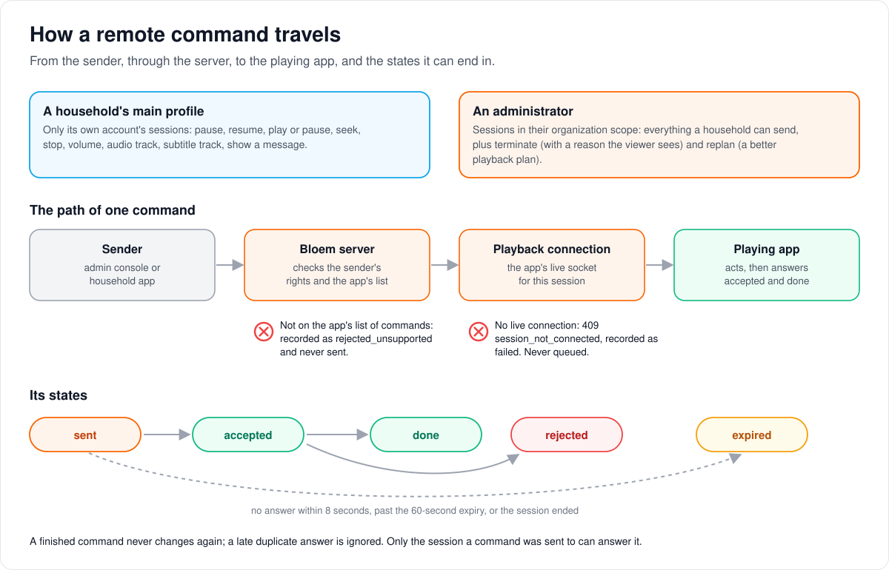

# How remote control works

> **Unreachable since 2026-11-11.** Remote control's routes (`/api/v1/admin/remote/...`,
> the household command route and `PUT /api/v1/devices/{id}/remote-control`) lived
> only on Silo's `/api/v1`, which Silo retired (Silo #3200, merged into Bloem in
> `26cf9b3e4`). The HTTP handler went with them; it returns when native routes are
> built. The rest of this page describes how it worked.

> **Provenance and status.** Bloem page, rewritten on 2026-11-01 and checked against
> `main` at `b6039036d`. Remote control is a Bloem addition: Silo's playback connection
> carries the commands, and Bloem adds who may send them, the app's list of accepted
> commands, and the record of each one. This page explains it in plain language; the
> invariants are in the [For developers](#for-developers) section.

**Remote control** lets an administrator, or a household's main profile, control an
app that is playing something: pause it, seek, stop it, change the volume or the audio
and subtitle tracks, or show a message on screen. This page walks through who can send
what, how a command reaches the app, the states a command goes through, and what the
server will never do.

## Who can send what



- **A household's main profile** can control only its own account's playing apps, with
  a reduced set: pause, resume, play or pause, seek, stop, volume, audio track, subtitle
  track and show a message.
- **An administrator** can control the sessions in their own scope. On top of the
  household set, they can **end a session**, which needs a reason the viewer sees, and
  ask the app to **replan**: pick a playback plan again, for example a lower bit rate.

## How a command reaches the app

1. **The app says what it accepts.** When it starts playing, or when it registers, an
   app lists the commands it can carry out. An app that lists nothing is never sent
   anything.
2. **The sender sends one command** to one playing session.
3. **The server checks** that the sender may reach that session and send that command,
   and that the app listed it. A command the app did not list is recorded as refused
   and never sent.
4. **The server passes it on** over the app's live **playback connection**. If the app
   has no live connection, the command fails at once: it is never kept for later.
5. **The app answers**: accepted, then done, or rejected.

## What a command goes through

A command starts as **sent**, becomes **accepted**, and ends as **done** or
**rejected**. If the app does not answer within 8 seconds, the command passes its
60-second expiry, or the session ends first, it ends as **expired**. Once a command
has ended, nothing changes it again.

## What the server will never do

- **Send a command the app did not list.**
- **Queue a command** for an app that is not connected.
- **Make playback better than the app could ask for itself.** A replan can only narrow
  the plan, such as a lower bit rate, never raise it.
- **Write personal details to its logs.** The record of each command holds only IDs.

## Example: a stuck stream

This example is made up. Anna's son is watching on the living-room TV, and the picture
keeps stalling. From her phone, as the household's main profile, Anna sees the session
and sends **pause**. The TV listed pause, so the server passes it on; the TV answers
accepted, then done. Later, a platform administrator sees that the same TV keeps
buffering and sends **replan** with a lower bit rate. The TV picks a new plan within
that cap, and keeps it until the session ends.

## Who can change what

| Who | What they manage |
| --- | --- |
| Administrator | Listing sessions in their scope (every session for a platform administrator, one organization's when acting for it), sending any session command, ending a session with a reason, replanning, reading the record of commands. |
| An account's main profile (or an admin account) | The household set of commands, on the account's own sessions. |
| The playing app | Which commands it accepts. |

## Words used in the code

| On this page | In the code and database |
| --- | --- |
| Remote control | `internal/remote` (sender) and `internal/api/handlers/remote_control.go` (routes) |
| Playback connection | Silo's per-session playback control socket, `internal/api/handlers/session_ws.go` |
| The app's list of commands | a device's remote-control capability, table `remote_device_capabilities`, or `hello.capabilities.commands` on the socket |
| A command and its record | a `remote_commands` row; states in `remote.State` |
| Ending a session | the `terminate` command |
| Replan | the `replan` command, which reaches the app as Silo's `plan_invalidated` |

## For developers

- **API:** the routes are still on Silo's `/api/v1`:
  [Bloem's routes on Silo's `/api/v1`](../bloem/api/v1-routes.md#remote-control) lists
  `PUT /api/v1/devices/{device_id}/remote-control`,
  `GET /api/v1/admin/remote/sessions`,
  `POST /api/v1/admin/remote/sessions/{session_id}/commands`,
  `POST /api/v1/profiles/household/sessions/{session_id}/commands`,
  `GET /api/v1/admin/remote/commands/{command_id}` and `GET /api/v1/admin/remote/audit`,
  with bodies and error codes. Only Bloem's phone apps use them; the web app uses Silo's
  `/api/v2` session commands. Native routes, and remote-control discovery in
  `/api/bloem/v1/capabilities`, are added when the apps move
  ([leaving Silo's `/api/v1`](bloem-leaving-silo-v1.md)). Until then the phone apps
  discover it through the `remote_control` block (`admin`, `household`) of
  `GET /api/v1/notifications/capability`.

### History

Remote control is "S-5a" in Bloem's September 2026 plan series: first commit
`e1efec046` (2026-09-02), review round `9f299bf86` the same day, and the first version
of this page in `3136d0848` (2026-09-02). `internal/remote` and `remote_control.go` are
Bloem's; Silo's playback control socket (`session_ws.go`, a ledgered seam in
`contracts/seams.txt`) carries the commands. `5ee7e9455` (2026-09-23) moved Bloem's
in-body edits of Silo handlers into hooks, including the hello filter in
`internal/api/handlers/bloem_session_ws_ext.go`. The September working spec
(`docs/specs/admin-remote-control.md`) was removed on 2026-11-01; every rule still in
force is on this page. Migration `20260901200034_remote_commands.sql` still names it
in its header comment, which stays as written because applied migrations are not
edited.

The device rail ("S-5b": queued device commands such as `play_media` and `sign_out`) is
not implemented; a device may already advertise its command names.

### Wiring

Server-issued commands to client apps: the sender side lives in `internal/remote`,
delivery rides the per-session playback control socket
(`internal/api/handlers/session_ws.go`), and the admin and household endpoints are in
`internal/api/handlers/remote_control.go`. The admin routes are mounted by
`mountBloemLegacyAdminV1` (`internal/api/router_bloem_wiring.go`); the household and
device routes sit in Silo's router (`internal/api/router.go`).

### Rules

- **No capability row, not controllable.** A device receives a command only if it
  advertised that command's name, either through
  `PUT /api/v1/devices/{device_id}/remote-control` (the device must be registered to the
  calling profile) or through the control socket's `hello.capabilities.commands`. The
  advertisement is stored in `remote_device_capabilities` keyed by
  `(user_id, profile_id, device_id)`; forgetting the device deletes it. A command the
  device did not list is recorded as `rejected_unsupported` and never sent.
- **v2 clients receive nothing.** A hello with an empty command list (every v2 client)
  leaves the device untouched, and the device registry itself is never consulted for
  capability. The upstream socket vocabulary and its validator are unchanged: the API
  layer strips the remote-control-only names (`replan`, the device-rail names;
  `upstreamHelloCommands`) before the upstream validator runs and hands the full list
  to the remote store, which validates it against its own vocabulary.
- **Household members control their own account only,** from the primary profile (or
  an admin account), with the reduced set `pause unpause play_pause seek stop
  set_volume set_audio_track set_subtitle_track display_message`. `terminate` and
  `replan` are admin-only; `terminate` (and, when it lands, `sign_out`) require a
  reason.
- **Admins see and control sessions in their tenant scope only**
  (`adminResourceOrganization`, the scoping the tenant-member device routes apply).
- **State machine.** `sent → accepted → done | rejected`, or `expired` (the 8 s socket
  deadline, the 60 s `expires_at`, or the session ending first); `rejected_unsupported`
  and `failed` are terminal at creation. Terminal rows never transition again; a late
  duplicate result is ignored. Only the session a command was sent to can ack or
  answer it. The 8 s deadline is `playback.CopySafetyInvalidationDeadline` unless
  `PlaybackHandler.RemoteCommandDeadline` overrides it; the 60 s expiry is
  `remote.DefaultConfig().CommandTTL`.
- **Session commands are never queued.** No live control socket on the target session
  means `409 session_not_connected`; the row is written as `failed`. Queueing belongs
  to the device rail only.
- **The replan pin is durable; delivery is not.** An admin `replan` pins its overrides
  on the session by way of its own command row: the client's next `/replan` reads the
  newest replan command in `sent | accepted | done` from the store, so any API instance
  serving that replan applies it, and the pin outlives the client's first replan (seek
  re-anchor and recovery keep the admin's plan) until the session ends or a newer
  replan replaces it. The socket delivery itself is per instance — the `RealtimeHub`
  only knows the sockets connected to the process that sends — so the sending instance
  must be the one holding the session's socket.
- **Overrides only narrow.** A pinned bandwidth cap is never raised above the client's
  own; codec and container pins remove decode capabilities, never add them; every plan
  an override produces is one the client could have negotiated itself.
- **Audit carries IDs only.** `issued_by` is `user:<id>` or `profile:<id>`; `reason` is
  shown to the user and is product copy, never logged with personal data.
- **Rate limit.** Each issuer may send 30 commands a minute
  (`remote.DefaultConfig().PerMinute`); beyond that, `429 rate_limited`.

### Commands and payloads

`internal/remote/commands.go` validates every payload before anything is sent: a strict
decode (`DisallowUnknownFields`, so an unknown field is `400 invalid_payload`) and the
rules below. The session rail carries these commands; the device-rail names
(`play_media`, `collect_diagnostics`, `refresh_settings`, `sign_out`) may be advertised
but are not sent yet.

| Command | Payload | Rules |
| --- | --- | --- |
| `pause`, `unpause`, `play_pause` | none | |
| `seek` | `{position_ms}` | `position_ms` ≥ 0 |
| `set_volume` | `{level}` | `level` 0..100 |
| `stop`, `terminate` | `{reason?}` | `terminate` needs a reason (`reason_required`); a reason is at most 500 characters. For both, the server also tears the session down when the command's deadline passes |
| `set_audio_track`, `set_subtitle_track` | `{track_id}` or `{off: true}` | exactly one of the two; `track_id` at most 128 characters; audio cannot be switched off |
| `display_message` | `{title, body, severity, timeout_ms?}` | `severity` `info`, `warning` or `error`; `body` required, at most 1,000 characters; `title` at most 120; `timeout_ms` 0..600000 |
| `replan` | `{overrides, reason}` | admin only; see [the replan command](#the-replan-command) |

Every command row carries `issued_by` and `reason`. `ttl_seconds` belongs to the device
rail: a non-zero value on a session command is `400 invalid_payload` ("session commands
are never queued"), not ignored.

### The replan command

`{"name": "replan", "payload": {"overrides": {"transcode": "auto|direct",
"max_bitrate_kbps": n, "video_codec": "…", "audio_codec": "…", "container": "…"},
"reason": "…"}}`. `transcode` is required; `max_bitrate_kbps` is 0..1,000,000. A
`force` override, retired on 2026-10-25 so the planner stays Silo's, is refused as an
invalid payload.

1. The server pins `playback.PlanOverridesV3` on the session and sends
   `plan_invalidated` (`reason: admin_replan`, `plan_id` = the current plan) with the
   command's own `command_id`, through the same negotiation as the copy-safety
   notifier. The attempt must have negotiated `plan_invalidated_v1` and the socket must
   be live; otherwise `409 replan_unavailable`.
2. The client's next `POST /playback/{session_id}/replan` sees its stored start request
   narrowed by `ApplyPlanOverridesV3` (`internal/playback/plan_overrides_v3.go`): the
   bandwidth cap is lowered, never raised; `direct` clears the cap, estimate and
   metered flag and asks for original quality; codec and container pins filter the
   advertised decode capabilities, so they decide what is directly playable. The
   transcode recipe stays the server's h264/aac. Below the source's bitrate,
   `max_bitrate_kbps` still forces a transcode, and Silo lowers Auto quality itself when
   playback keeps buffering.
3. The command becomes `done` when a client replan commits (`OnSessionReplanned`,
   result `{status, plan_id}`). Any replan of the session counts, a seek re-anchor or a
   recovery included, because every replan after the pin plans with the overrides.
   `done` keeps the pin; `rejected`, `expired` and `failed` release it; a newer replan
   replaces it. `Service.OpenReplanOverrides` reads the pin from the newest replan row
   in `sent | accepted | done`.

### Command contract

`POST /api/v1/admin/remote/sessions/{session_id}/commands` (and the household route)
takes `{"name": "seek", "payload": {"position_ms": 90000}, "reason": "skip recap"}` and
answers `201` with the command row, the same shape `GET /admin/remote/commands/{id}`
and each audit row return:

```json
{"command_id": "5f1c…", "scope": "session", "session_id": "sess-…", "device_id": "device-1",
 "user_id": 7, "profile_id": "profile-1", "name": "seek", "payload": {"position_ms": 90000},
 "issued_by": "user:1", "issuer_kind": "admin", "reason": "skip recap", "state": "sent",
 "created_at": "…", "sent_at": "…", "expires_at": "…"}
```

After a result, `result` is `{"status": "completed"}` or `{"status": "rejected"}` (with
the client's `error`), and for `replan` `{"status": "completed", "plan_id": "…"}`. The
frame on the control socket is the unchanged playback protocol:
`{"type": "command", "command_id", "session_id", "name", "reason", "issued_by":
{"kind": "admin"}, "deadline_ms": 8000, "payload"}`. A replan reaches the client as
`{"type": "command", "name": "plan_invalidated", "payload": {"reason": "admin_replan",
"plan_id": "…"}}`.

Errors: `400 invalid_payload | unknown_command | reason_required | bad_request`,
`403 forbidden | command_not_allowed`, `404 not_found`, `409 session_not_connected |
replan_unavailable`, `429 rate_limited`.

`PUT /api/v1/devices/{device_id}/remote-control` takes `{"version": 1, "commands":
[...]}` and answers `200 {"device_id", "version", "commands"}` with the names sorted.
Names must be ones the server knows, the device-rail names included, so an app can
announce its full list today. The session's device is `X-Silo-Device-Id` at
`/playback/start` (else the session claims' `device_id`), recorded as
`Session.DeviceID`.

### Storage

- `remote_commands`: `id`, `scope` (`session | device`), `target_session_id`,
  `target_device_id`, `target_user_id`, `target_profile_id`, `tenant_id`, `name`,
  `payload` (jsonb), `issued_by`, `issuer_kind` (`admin | household`), `reason`,
  `state`, `result` (jsonb), `error`, and `created_at`, `sent_at`, `acked_at`,
  `finished_at`, `expires_at`. Indexed on `(target_session_id, state)`,
  `(target_device_id, state)` and `created_at DESC`.
- `remote_device_capabilities`: `(user_id, profile_id, device_id)` to `version` and
  `commands` (jsonb). Kept beside the audit, not on `user_devices`, so Silo's device
  registry stays untouched.

### Known gaps

- `Service.OpenReplanOverrides`: a newest replan row that passed its TTL but is still
  `sent` (no deadline fired, for example after a restart) yields no pin instead of
  falling back to the previous live row.
- The admin device-forget paths (`admin_user_resources.go`, `admin_tenant_members.go`)
  do not call `Service.ForgetDevice`, so a stale capability row can linger. Advertising
  re-checks the device registry, so nothing new can be created from it.
- `OnSessionEnded` expires every open command, so a client that calls `/playback/stop`
  before its `result` frame arrives leaves a successful `stop` audited as `expired`.

### Related pages

- [How apps connect](bloem-apps.md#remote-control): the plain overview.

The picture is an SVG file under `images/admin-remote-control/`, drawn by
`scripts/bloem/pictures/admin_remote_control.py` through
`scripts/bloem/draw-pictures.py`. Redraw it there, not by hand.
