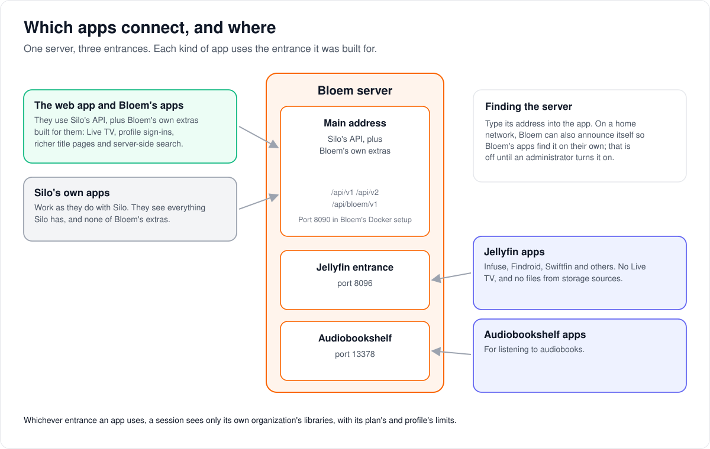
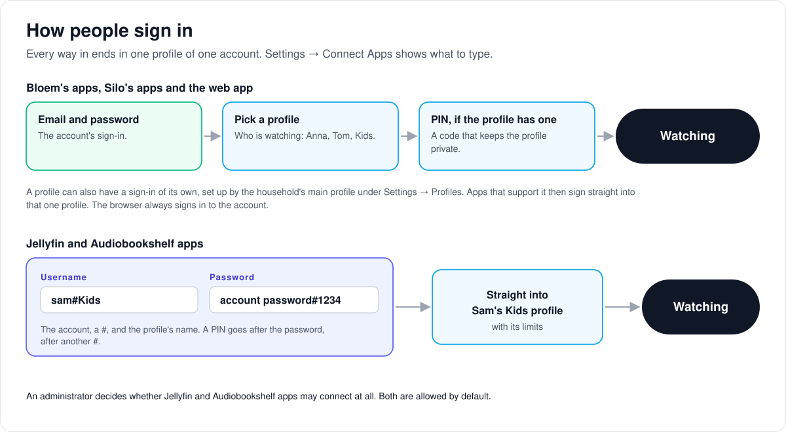

# How apps connect

> **Provenance and status.** Bloem page, written on 2026-10-31 and checked against
> `main` at `c83c424b7`. Silo's API and its Jellyfin and Audiobookshelf servers run
> in Bloem as Silo ships them. Bloem adds its own API, `/api/bloem/v1`, for its own
> apps, scopes every entrance to an organization, and adds profile sign-ins and
> remote control. This page explains it in plain language; the technical pages and
> the API are linked at the end.

## Which apps connect, and where

A Bloem server has three entrances:

- **The main address** serves the web app, Bloem's Android and Apple apps, and
  Silo's own apps. It speaks Silo's API (`/api/v1` and `/api/v2`) plus Bloem's
  own extras under `/api/bloem/v1`. In Bloem's Docker setup it is port 8090.
- **The Jellyfin entrance** (port 8096) serves Jellyfin apps such as Infuse,
  Findroid and Swiftfin. They get no Live TV and no files from storage sources.
- **The Audiobookshelf entrance** (port 13378) serves Audiobookshelf apps for
  listening to audiobooks.

Silo's apps work with Bloem as they do with Silo. They see everything Silo has
and none of Bloem's extras, because Bloem never changes what Silo's API means.
Bloem's own apps use the extras: Live TV, profile sign-ins, richer title pages
and server-side search.

Whichever entrance an app uses, a session sees only its own organization's
libraries, with its plan's and profile's limits. Apps find the server by its
address. On a home network Bloem can also announce itself so its own apps find it
by themselves; an administrator has to turn that on.

## How people sign in

Every way in ends in one profile of one account:

- **Bloem's apps, Silo's apps and the web app** sign in to the account with
  email and password, then ask who is watching, then ask for that profile's PIN
  if it has one.
- **A profile sign-in.** The household's main profile can give a profile a
  sign-in of its own under **Settings → Profiles**. Apps that support it then
  sign straight into that one profile. The browser always signs in to the
  account.
- **Jellyfin and Audiobookshelf apps** have one username box and one password
  box, so the profile goes in the username as `account#profile` (for example
  `sam#Kids`), and a PIN goes after the password as `password#PIN`.

**Settings → Connect Apps** shows each viewer exactly what to type. An
administrator decides whether Jellyfin and Audiobookshelf apps may connect at
all; both are allowed by default.

## Remote control

Bloem lets an administrator, or a household's main profile, control a playing
app: pause, resume, seek, stop, change volume or audio and subtitle tracks, or
show a message. An app has to say which commands it accepts first, and is never
sent one it didn't list. A household's main profile reaches only its own
account's sessions; an administrator reaches the sessions in their scope and can
also end a session, with a reason.

## Who can change what

| Who | What they manage |
| --- | --- |
| Platform administrator | Whether Jellyfin and Audiobookshelf apps may connect, their addresses, local network announcement, remote control of any session in scope. |
| An account's main profile | Profile sign-ins, and remote control of the household's own sessions. |
| Viewer | Which apps they sign in to. |

## Words used in the code

| On this page | In the code and database |
| --- | --- |
| Bloem's extras | `/api/bloem/v1` (`internal/api/router_bloem_client.go`) |
| Composed title pages | Watch documents (`watch_document_v1`) |
| Jellyfin entrance | Silo's `internal/jellycompat`, port `JF_PORT` |
| Audiobookshelf entrance | Silo's `internal/audiobooks/abs`, port `ABS_PORT` |
| Profile sign-in | profile credentials (`/api/bloem/v1/profile-credentials/{id}`) and direct-profile sessions |
| Local network announcement | `_bloem._tcp` (`internal/lanadvert`), setting `lan.advertisement_enabled` |
| Remote control | `internal/remote` |

## For developers

- **API:** [apps and clients](../bloem/api/apps.md): capabilities, server
  identity, Watch documents, progress sync, people, item collections and profile
  credentials. Remote control and profile sign-in are still on
  [Silo's `/api/v1`](../bloem/api/v1-routes.md#remote-control), to move
  ([leaving Silo's `/api/v1`](bloem-leaving-silo-v1.md)).
- [Bloem native client surface](bloem-client-surface.md): why Bloem-only features
  live under `/api/bloem/v1`, and the golden check that keeps `/api/v1` Silo's.
- [SDK compatibility and contract generation](bloem-sdk-compatibility.md): the
  generated Kotlin and Swift types.
- [Protocol compatibility](bloem-compatibility-removal.md): Silo's Jellyfin and
  Audiobookshelf servers in Bloem.
- [Admin remote control](admin-remote-control.md) and the
  [LAN service advertisement](../specs/lan-service-advertisement.md).

The pictures are SVG files under `images/apps/`, drawn by
`scripts/bloem/draw-pictures.py`. Redraw them there, not by hand.
