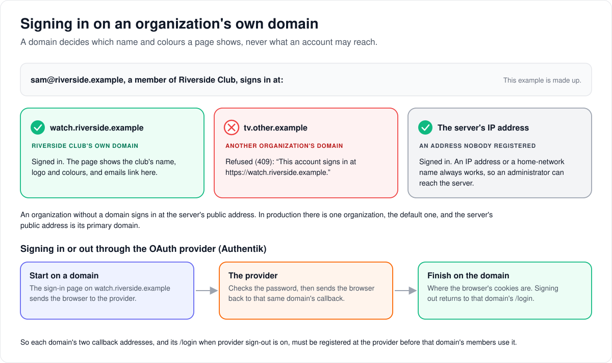

# How apps connect

> **Provenance and status.** Bloem page, written on 2026-10-31, brought up to date on
> 2026-11-01 and checked against `main` at `b6039036d`. Silo's API and its Jellyfin
> and Audiobookshelf servers run in Bloem as Silo ships them. Bloem adds its own API,
> `/api/bloem/v1`, for its own apps, scopes every entrance to an organization, and
> adds organization domains, profile sign-ins and remote control. This page explains
> it in plain language; the technical rules are in the
> [For developers](#for-developers) section and the pages it links.

## Which apps connect, and where

A Bloem server has three entrances:

- **The main address** serves the web app, Bloem's Android and Apple apps, and
  Silo's own apps. It speaks Silo's API (`/api/v1` and `/api/v2`) plus Bloem's
  own extras under `/api/bloem/v1`. In Bloem's Docker setup it is port 8090.
- **The Jellyfin entrance** (port 8096) serves Jellyfin apps such as Infuse,
  Findroid and Swiftfin. They get no Live TV and no files from storage sources.
- **The Audiobookshelf entrance** (port 13378) serves Audiobookshelf apps for
  listening to audiobooks.

Silo's apps work with Bloem as they do with Silo. They see everything Silo has
and none of Bloem's extras, because Bloem never changes what Silo's API means.
Bloem's own apps use the extras: Live TV, profile sign-ins, richer title pages
and server-side search. The web app uses only Silo's `/api/v2` and Bloem's
`/api/bloem/v1`; Bloem's phone apps still use some of Silo's `/api/v1`, which Silo
plans to retire.

Whichever entrance an app uses, a session sees only its own organization's
libraries, with its plan's and profile's limits. Apps find the server by its
address. On a home network Bloem can also announce itself so its own apps find it
by themselves; an administrator has to turn that on.

## How people sign in

Every way in ends in one profile of one account:

- **Bloem's apps, Silo's apps and the web app** sign in to the account with
  email and password, then ask who is watching, then ask for that profile's PIN
  if it has one.
- **A profile sign-in** (dormant). The household's main profile could give a
  profile a sign-in of its own, and apps that support it signed straight into
  that one profile. Its sign-in route lived only on Silo's `/api/v1`, which Silo
  retired on 2026-11-11, so it is parked: the setting and the credentials panel
  are hidden until a native sign-in route exists. The browser always signs in to
  the account.
- **Jellyfin and Audiobookshelf apps** have one username box and one password
  box, so the profile goes in the username as `account#profile` (for example
  `sam#Kids`), and a PIN goes after the password as `password#PIN`.

**Settings → Connect Apps** shows each viewer exactly what to type. An
administrator decides whether Jellyfin and Audiobookshelf apps may connect at
all; both are allowed by default.

**When a sign-in stops working.** If an organization ends its members' sign-ins,
for example when an administrator revokes all of an account's sessions, an app that
was already signed in is told its sign-in has ended the next time it asks for a
profile, and asks the viewer to sign in again.

## Signing in on an organization's own domain

Each organization can be served on its own **domains**, its own web addresses, with
its own name, logo and colours. Its emails link to its **primary domain**.

- **On its own domain**, a member signs in as usual, and the pages show the
  organization's name and colours.
- **On another organization's domain**, the sign-in is refused, and the message says
  where to sign in instead.
- **An organization without a domain** signs in at the server's public address.
- **An address nobody registered**, such as the server's IP address, always lets
  people sign in, so an administrator can still reach the server.
- **Through the OAuth provider (Authentik)**, a sign-in or sign-out stays on the domain
  it started on. So each domain's callback addresses, and its `/login` page for
  sign-out, must be registered at the provider.

A domain decides only how pages look and where links point, never what an account
can reach: that always comes from the account's organization, and a refusal on the
wrong domain only sends the person to their own. In
production there is one organization, the default one, and the server's public
address is registered as its primary domain.

Bloem's phone and TV apps keep using the server's public address for their device
sign-in page.

## Remote control

Remote control is dormant since 2026-11-11: its routes lived only on Silo's
`/api/v1`, which Silo retired, so nothing can send a command and the server
advertises it as off. The code is parked until native routes are built; the
rest of this section describes how it worked.

Bloem lets an administrator, or a household's main profile, control a playing
app: pause, resume, seek, stop, change volume or audio and subtitle tracks, or
show a message. An app has to say which commands it accepts first, and is never
sent one it didn't list. A household's main profile reaches only its own
account's sessions; an administrator reaches the sessions in their scope and can
also end a session, with a reason.

## Who can change what

| Who | What they manage |
| --- | --- |
| Platform administrator | Whether Jellyfin and Audiobookshelf apps may connect, their addresses, local network announcement, remote control of any session in scope. Each organization's domains and branding. |
| The storefront (Bloem Garden) | An organization's domains and branding, with a platform administrator's API key. |
| An account's main profile | Profile sign-ins, and remote control of the household's own sessions. |
| Viewer | Which apps they sign in to. |

## Words used in the code

| On this page | In the code and database |
| --- | --- |
| Bloem's extras | `/api/bloem/v1` (`internal/api/router_bloem_client.go`) |
| Composed title pages | Watch documents (`watch_document_v1`) |
| Jellyfin entrance | Silo's `internal/jellycompat`, port `JF_PORT` |
| Audiobookshelf entrance | Silo's `internal/audiobooks/abs`, port `ABS_PORT` |
| Profile sign-in | profile credentials (`/api/bloem/v1/profile-credentials/{id}`) and direct-profile sessions |
| Organization domains and branding | `internal/orgdomains`, table `bloem_organization_domains`, routes `/api/bloem/v1/admin/platform/tenants/{id}/domains` and `/branding`, capability `organization_domains_v1` |
| Refused on another organization's domain | `409 wrong_organization_domain` |
| A sign-in that has ended | `401` with reason `session_invalid` (`session_expired` on `/api/v2`) |
| Local network announcement | `_bloem._tcp` (`internal/lanadvert`), setting `lan.advertisement_enabled` |
| Remote control | `internal/remote` |

## For developers

- **API:** [apps and clients](../bloem/api/apps.md): capabilities, server
  identity, Watch documents, progress sync, people, item collections and profile
  credentials. Domains and branding are on the
  [organizations API](../bloem/api/organizations.md) page. Remote control and profile
  sign-in are still on [Silo's `/api/v1`](../bloem/api/v1-routes.md#remote-control), to
  move ([leaving Silo's `/api/v1`](bloem-leaving-silo-v1.md)).
- [Organization domains and branding](bloem-organization-domains.md): host
  resolution, the sign-in check (`409 wrong_organization_domain`, "This account signs
  in at https://<primary domain>."), the OAuth callbacks and post-logout `/login` each
  domain must register at the provider, and the limits (device sign-in at `/activate`
  and `/api/v2/system/identity` stay on the public URL). Migration
  `20261101055208_bloem_organization_domains`.
- [Security foundation](bloem-security-foundation.md): a session that predates its
  organization's revocation is ended by the viewer-access gate with `401`
  `session_invalid` (`session_expired` on `/api/v2`), so its refresh is refused and the
  client signs in again (`internal/api/bloem_org_session_revocation.go`).
- [Bloem native client surface](bloem-client-surface.md): why Bloem-only features
  live under `/api/bloem/v1`, and the golden check that keeps `/api/v1` Silo's.
- [SDK compatibility and contract generation](bloem-sdk-compatibility.md): the
  generated Kotlin and Swift types.
- [Protocol compatibility](bloem-compatibility-removal.md): Silo's Jellyfin and
  Audiobookshelf servers in Bloem.
- [Admin remote control](admin-remote-control.md) and the
  [LAN service advertisement](../specs/lan-service-advertisement.md).

The pictures are SVG files under `images/apps/`, drawn by
`scripts/bloem/pictures/apps.py` through `scripts/bloem/draw-pictures.py`. Redraw
them there, not by hand.
