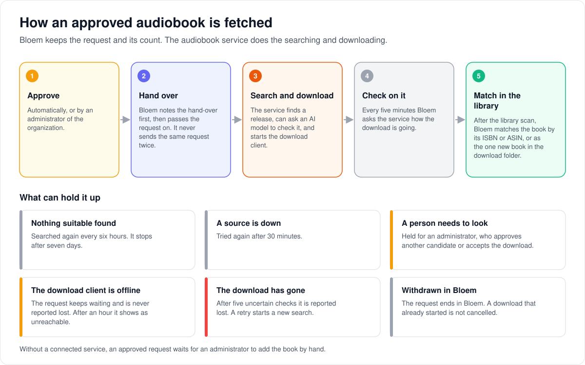
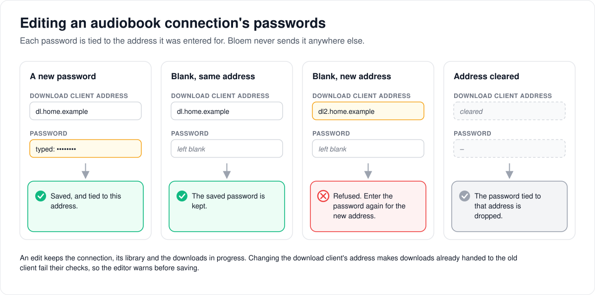

# How audiobook requests work

> **Provenance and status.** Bloem page, rewritten on 2026-11-01 and checked against
> `main` at `b6039036d`. The audiobook request lane is a Bloem addition. It runs
> beside Silo's movie and series request service (`internal/requests`, Silo's
> [media requests](media-requests.md)), which it does not change. The technical
> rules are in the [For developers](#for-developers) section.
> Its routes were checked again on 2026-11-11, after Silo retired its v1 API.

A viewer can ask for an audiobook the library doesn't have yet. This page walks
through who can ask and who sees what, how Bloem fetches an approved book when an
audiobook service is connected, how Bloem knows the book has arrived, who is
told, and how the service's passwords are kept safe. The overview of all three
request kinds is [how requests work](bloem-requests.md).

## Who can ask, and who sees what

A **profile** asks for a book by its **ISBN** or **ASIN** (the numbers that
identify an edition), or by title and author. The profile must belong to the
signed-in account, in an organization that is active. The default organization
may still be getting ready; a reseller organization that is getting ready may not
file.

- **The limit.** Requests count against the account's limit. The account's own
  settings come first, then its group's (the plan's) settings, then the server's
  defaults. Every profile on the account shares one count, and audiobooks are
  counted apart from movies, series and ebooks. Withdrawing a request still
  counts; a decline gives the count back.
- **Organization administrators** are not held to their group's limits, but a
  restriction set on their own account still applies.
- **Privacy.** Profiles on one account don't see each other's requests. An
  organization administrator sees their own organization's queue, never
  another's. Being a platform administrator does not open an organization's
  queue on its own.
- **Duplicates.** Asking twice for the same book in one organization is refused
  as a duplicate, without showing who asked first.
- **Retries.** An app sends an **idempotency key** with each new request, so a
  retry after a lost answer returns the first request instead of filing a
  second.

Only the web app and the Bloem API offer audiobook requests today. Jellyfin and
Audiobookshelf apps don't, and Bloem's own phone and TV apps have not added them
yet.

## How an approved request is fetched

A platform administrator can connect an **audiobook service**: a plugin that
searches for a release, can ask an AI model to choose and check one, and hands it
to a download client such as qBittorrent or NZBGet. The connection is linked to
one audiobook library and the **download folders** inside it. Without a
connection, an approved request waits for an administrator to add the book by
hand.

1. **Approve.** Automatically, or by an organization administrator.
2. **Hand over.** Bloem passes the request to the audiobook service. It records
   that it did so before it calls, so it never sends the same request twice.
3. **Search and download.** The service looks for a release and starts the
   download. Bloem's request check runs every five minutes and starts at most
   five searches each time.
4. **Check.** On each of those runs, Bloem asks the service how the download is
   going.
5. **Wait for the library.** When the service reports a verified download, the
   request waits for the library scan to pick the book up.
6. **Match and finish.** Bloem finds the book in the catalog (next section) and
   tells the requester.

What can hold it up:

- **Nothing suitable found.** The service searches again every six hours and
  gives up after seven days.
- **A source is down.** Bloem tries again after 30 minutes.
- **A person needs to look.** When the service is unsure about a release or a
  download, it holds the request for an administrator, who can approve a
  different candidate (a fresh attempt) or accept the download.
- **The download client can't be reached.** The request keeps waiting; it is
  never reported lost because of an outage. After an hour the administrator's
  list shows it as unreachable.
- **The download has gone.** After five uncertain checks the download is reported
  lost, and a retry starts a new search.

Withdrawing a request in Bloem does not cancel a download that has already
started.

## How Bloem knows the book has arrived

Every five minutes Bloem looks for each open request's book in the
organization's catalog. A request is done when a catalog audiobook matches every
identifier the requester gave. ISBN-10 and ISBN-13 forms of the same number
count as one. A similar title or author is never enough, and an ebook with the
same ISBN doesn't count. The book must also be in an audiobook library the
organization owns, or one the platform granted it.

After a download, Bloem can also accept the single audiobook that appeared in the
download folders for that attempt. If two books appeared there, an administrator
decides.

An administrator can also mark a request fulfilled by hand. That records the
decision; it doesn't claim the book is playable.

## Who is told

- A new request goes to the organization's administrators.
- Approval, decline and completion go to the person who asked.
- Bloem checks again, just before sending, that each recipient still belongs:
  an account that was switched off, a profile that was removed or a suspended
  organization gets nothing.
- Book titles never go into announcements for the whole server.

## Keeping the service's passwords safe

The connection holds passwords and keys for several services, each with its own
address. Bloem ties each password to the address it was entered for:

- A **new password** is saved and tied to its address.
- A **blank password** keeps the saved one, but only while its address is
  unchanged.
- A **changed address** without the password again is refused.
- A **cleared address** drops the password tied to it.

So a saved password is never sent to a server it was not entered for. Editing a
connection keeps its identity, its library and the downloads in progress. But
changing the download client's address makes the downloads already handed to the
old client fail their checks; the web editor warns before such a save.

A **Test** button checks the saved connection without changing anything.

## Example: an outage is not a loss

This example is made up.

Ana, a member of Riverside Club, asks for an audiobook by its ISBN on Monday
morning. The club's administrator approves it, and the audiobook service finds a
release and starts the download.

On Monday afternoon the club's download client is offline for two hours. Bloem's
checks get no answer, so the request keeps its place. After an hour the
administrator's list marks it unreachable, and nothing is reported lost.

The client comes back, the download finishes, and the service reports it
verified. The request waits for the library. At the next scan the book appears in
the download folder with Ana's ISBN, Bloem matches it, and Ana gets a notice.

## Who can change what

| Who | What they manage |
| --- | --- |
| Platform administrator | Connecting the audiobook service: creating, editing and testing a connection, and linking it to a library and its download folders. This is done from the organization's administrative context. |
| Organization administrator | Their organization's audiobook queue: approve, decline, mark fulfilled, retry, approve a held candidate, accept a download. Reading the connection setup. |
| A viewer's profile | Asking for books, following and withdrawing its own requests. |

## Words used in the code

| On this page | In the code and database |
| --- | --- |
| Audiobook request | a `bloem_book_requests` row with `media_type` `audiobook` (`internal/bookrequests`) |
| Audiobook service | the `bloem.requests.audiobooks` plugin, a `request_router.v1` capability |
| Connection | a `request_integrations` row, with its passwords in one encrypted `abk1.` bundle |
| Linking to a library and download folders | the library binding with its dedicated download roots |
| Hand over, attempt | a dispatch (`bloem_ebook_request_dispatches`) and an acquisition attempt (`bloem_audiobook_request_acquisitions`) |
| Checking every five minutes | the hidden `bloem_reconcile_book_requests` task |
| Waiting for the library | fulfilment `awaiting_library` |
| Mark fulfilled by hand | `fulfilment=manual` |
| Idempotency key | the `Idempotency-Key` header |

## For developers

- **API:** [requests](../bloem/api/requests.md): the viewer routes under
  `/api/bloem/v2/book-requests`, the organization queue under
  `/api/bloem/v2/admin/organization/book-requests`, and the connection routes
  under `/api/bloem/v2/admin/organization/audiobook-request-integrations`.

### Lane boundary

Bloem owns the audiobook request lane in `internal/bookrequests` and
`bloem_book_requests`. Silo's TMDB request store, routes and pages keep their
behavior. The web app wraps those pages at the existing `/requests` and
`/admin/requests` entry points and selects the audiobook lane with
`kind=audiobook`.

Approved requests may use the opt-in `bloem.requests.audiobooks` acquisition
backend. An enabled audiobook-only request integration and a valid library
binding with dedicated download roots make acquisition available. Without that
binding, catalog matching and manual fulfilment keep their behavior. Ebook
requests stay in their separate Bookwarehouse lane
([how ebook requests work](bloem-ebook-request-foundation.md)).

### Authority and policy

Filing requires an authenticated account, a verified profile, an active
organization membership, and a profile belonging to that organization and
account. Reseller (hosted) organizations may file. The default organization may
be `initializing`; that exception does not admit an initializing reseller
organization. It applies whether or not Silo switching is on.

The filing policy reads the profile's own group in its organization and the
active membership. The account's own `users.requests_allowed` overrides the group
gate. Account request-limit and approval overrides (`request_user_limits`) take
precedence over group settings (`request_group_limits`), then global request
settings (`request_settings`). A window that resolves to zero or less counts the
last seven days. Organization administrators keep the existing exemption from
group policy; an explicit account restriction still applies. Counters are
independent of Silo's movie/series lane and the ebook lane, and shared by an
account's audiobook requests across its profiles (an account has one
organization). Withdrawal consumes quota; decline refunds it.

Ordinary reads and cancellation filter by organization, account and profile.
Sibling profiles do not see each other's requests. Administration uses a current
organization administrative context and filters before pagination. A platform
context alone grants no organization queue access. Requester-supplied headers,
query parameters and JSON fields cannot select another organization.

Verified direct-profile sessions may use only the explicit viewer routes. They
cannot use the administrative request routes. Jellyfin and Audiobookshelf do
not expose this Bloem-native request API.

### Identity and concurrency

Create requires an `Idempotency-Key` of 16–128 characters without whitespace.
The key is scoped to organization, account and profile. The stored digest covers
the normalized title, author, identifiers and note. An identical replay returns
the original request with HTTP 200, including after withdrawal or completion;
changed input for the same key returns 409. New filings return 201.

ISBN-10 converts to ISBN-13 and ASIN is uppercased. A title plus author may be
filed without an identifier. Active ISBN, ASIN and fallback title/author identity
indexes prevent concurrent duplicates within one organization, without exposing
another profile's request. Advisory-lock namespace 143 serializes filings by
account so independent book quota checks and retries cannot over-admit.

Mutations lock the request row and require `expected_revision`. Approval and
decline apply to pending requests; withdrawal and manual fulfilment apply to
pending or approved requests. Terminal outcomes and stale revisions return 409.
Manual fulfilment records `fulfilment=manual` and leaves `library_content_id`
empty; it does not claim that a playable audiobook was found.

### Catalog completion and notifications

The hidden `bloem_reconcile_book_requests` task runs every five minutes and
checks up to 100 rows per pass. Each request is locked with
`FOR UPDATE SKIP LOCKED`, allowing multiple API replicas to reconcile safely.
Either a pending or approved request can complete when its audiobook already
exists in the organization's catalog.

Completion requires all supplied stable identifiers to match one
`media_items.type=audiobook` item. ISBN-10 and ISBN-13 are equivalent. A title or
author resemblance is not sufficient here (the storage plugin's lane below is the
one exception), and an ebook with the same ISBN does not qualify. The match also requires a media-file row in an enabled audiobook
folder owned by the organization, or in a platform folder with an active
entitlement for that organization. The request, provider-ID, catalog, file,
folder, owner, organization and entitlement rows are locked while completion
commits. This establishes catalog presence; it does not preflight filesystem or
storage-provider liveness. The ordinary scanner supplies audiobook ASIN provider
IDs; ISBN completion requires an ISBN provider ID in the catalog.

Submitted notices go only to current organization administrators. Approval,
decline and completion go only to the current requester. Recipients are
resolved again from enabled accounts, current profiles, memberships and
organization status before dispatch. Tenant request titles never go to the
deployment-wide server-channel announcement path: the book notifier
(`internal/notifications/bloem_book_request_notifier.go`) has no server-wide
announcement.

Book lifecycle and manual-completion notices use the existing `system.alert`
operational delivery (inbox, push, email and webhook channels) with stable
request/event/account/profile IDs. Their links open the audiobook request lane.
Library completion uses the existing `request.fulfilled` delivery and checks the
recipient's current catalog access; it cannot disclose an item the profile may
not open. Notification master preferences and existing per-account
device/webhook filtering still apply. Lifecycle notices are best effort on a
bounded detached context. Completion notices retry durably until the delivery
succeeds, is deduplicated, or the recipient is no longer eligible.

### Acquisition and review

The host registers `bloem_reconcile_book_requests` before starting the task
manager. Each pass independently reconciles ordinary library completion,
audiobook acquisition and ebook acquisition, so one lane's failure does not
starve the others. Audiobook acquisition checks at most 100 requests and starts
at most five searches within a three-minute run budget. A status check falls due
60 seconds after the last one (`audiobookPollDelay`), so in practice every pass
of the five-minute task checks it.

A dispatch freezes the integration ID, installation, capability and owner as
its identity. Renaming, credential/configuration edits, plugin version changes
and library/root rebinding do not replace an in-flight acquisition. The original
library, roots and language remain frozen for completion. Removing/replacing the
backend identity fails the acquisition; verified provider completion can still
match the retained library roots.

PostgreSQL leases serialize provider calls. A started marker commits before
Fulfill; ambiguous outcomes use a durable unknown receipt and read-only
CheckStatus, never a second submission. Definite host pre-RPC failures retain no
started marker. Cancel/refile chains share their original submission ID and
attempt, including across ISBN/ASIN identifier variants. Cancellation does not
cancel the external download. Retry keeps any in-flight lease: late receipts
and decisions cannot affect a newer attempt.

`request_router.v1` carries requester-free descriptors, an `abr1.` receipt and
an `abd1.` decision envelope. Both envelopes are strict, bounded and validated.
Secrets travel only in the ordinary encrypted request-integration API key field
as an `abk1.` composite, bound to normalized destination URL fingerprints. They
never enter the dispatch descriptor, receipt, decision log or requester view.
The plugin owns release search, AI selection/verification and downloader calls;
the host owns policy, identity, attempts and catalog completion.

The plugin answers `CheckStatus` in the host's vocabulary:

- `review` must carry a verify decision with outcome `review`, and holds the
  request for an administrator.
- `completed` must carry external status `verified` and a `verified` decision.
- `unknown` with external status `missing` (a confirmed download the client no
  longer shows) is an uncertain check: it backs off and, after five, reports the
  download lost.
- `unknown` with `absent` (a hand-off the client never showed) is searched again
  after two absent checks.
- `unknown` with external status `unknown` means the plugin could not read the
  download client. That check keeps the request's state and counters, so a
  client outage never reports a download lost; an outage longer than an hour
  shows as `unreachable` in the admin stuck view.
- A failed `CheckStatus` call (the plugin itself unavailable) is still an
  uncertain check.

Pre-release plugin builds answered `queued` for all four of these cases
(`review`, and `unknown` with `missing`, `absent` or `unknown`); the adapter
(`audiobookProviderStatus` in `internal/api/bloem_audiobook_router.go`) maps a
`queued` answer by its external status to the same states. The
cross-process acceptance in `internal/api/bloem_audiobook_lifecycle_test.go` runs
this contract against the real plugin executable when
`BLOEM_AUDIOBOOK_REQUEST_PLUGIN_BINARY` is set.

No-match searches wait six hours and stop after seven days; unavailable sources
wait thirty minutes. Uncertain checks back off and stop after five failures.
Selections or downloads needing review wait for an administrator. An approved
candidate starts a fresh attempt; accepting a download permits catalog matching
without marking the request fulfilled. Manual fulfilment remains available.
Review/failure notices go only to current organization administrators and use
stable attempt-scoped delivery identities. The admin view retains the newest
50 validated decisions; requesters receive only safe progress and reason text.

The admin stuck view (`audiobookStuckReason` in
`internal/bookrequests/audiobook_admin.go`) never fails a request for being
slow; an administrator's retry starts a new attempt. Its reasons are:
`not_reached` (approved for an hour without a dispatch, or a check overdue by an
hour), `slow` (queued or downloading for 72 hours), `stalled` (the client reports
the download stalled), `unreachable` (three failed checks, or an unreadable
client for an hour) and `not_in_library` (verified by the provider more than 24
hours ago but not yet matched).

Provider verification moves a request to `awaiting_library`. Completion still
requires a catalog item: either all supplied stable IDs match, or exactly one
nonmissing audiobook item exists below the retained dedicated download roots in
an attempt-marker folder. Two matching items require review. The path lookup
first materializes the library/path index range; it does not search the entire
catalog. A completed download does not create a scanner schedule or guarantee
filesystem liveness.

The Bookwarehouse storage plugin's connection (`bloem.storage.bookwarehouse`,
capability `audiobooks`) has no download folders. Its library is bound to the
plugin's own installation and usually carries ASINs, while requests often carry
only an ISBN. Its requests complete, after an identifier match, from the native
library's items with a live storage reference that is current for that
installation's source:

- by the `audiobook_id` of the attempt's latest verified decision, the
  Bookwarehouse audiobook whose tracks are `audio/<audiobook_id>/<file>`;
- otherwise by title and author, on every pass while the download runs or
  waits for the library, unless the plugin holds it for review. An item counts
  only if it appeared after the request was made, so a copy the library
  already held does not complete it. Its title must equal the request's after
  folding case, accents and punctuation (`&` reads as "and", apostrophes
  drop), with or without either title's subtitle after a colon or a spaced
  dash. One of its credited authors must equal one of the request's authors,
  split on commas, semicolons, `&` and "and". One such item completes the
  request; two go to review with `multiple_items`. The rule is
  `audiobookTitleAuthorMatch` in `internal/bookrequests/audiobook_title_match.go`.

The plugin places these requests with Bookwarehouse's abiplayer route. Its
`abr1.` receipt keeps kind `qbittorrent`, with the abiplayer request id in
`torrent_id` and the normalized `norm_title` and `norm_author` it asked for. The
host accepts those two fields only from the storage plugin's connection, only on
a `qbittorrent` receipt with a `torrent_id`, and only as lowercase letters and
digits separated by single spaces, at most 200 bytes each. They are informational:
completion compares the request's own title and author. The plugin's `completed`
answer is never completion by itself.

### Connection edits and credential rotation

Creating, editing, binding and testing a connection require platform
administrator authority (`platform_admin` effective authority) in an
organization administrative context; reading the setup needs only the
organization context. Bloem's audiobook setup is the only writer of an audiobook
connection after creation. `PUT .../audiobook-request-integrations/{id}` edits it
in place, so the connection keeps its ID, binding and in-flight acquisitions. The
host decodes the saved `abk1.` bundle and recomposes it:

- a new credential value replaces the saved one and is bound to its URL as
  submitted;
- a blank credential keeps the saved value only while the fingerprint of its URL
  (`qbittorrent_url`, `nzbget_url`, `abook_base_url`, `ai_base_url`) still equals
  the saved binding; a changed URL is refused until the credential is entered
  again;
- a cleared URL drops the credentials bound to it.

A saved secret is therefore never bound to a host it was not entered for. The
update runs as a conditional write on the row revision read at the start, so a
concurrent edit returns 409 instead of reverting a rotation.

The submitted `plugin_config` is a merge patch over the saved settings: a
submitted key replaces its saved value, `null` removes it, and an omitted key
keeps it. Clearing a URL, and with it the credentials bound to it, takes an
explicit `""` or `null`; leaving the key out of a partial edit keeps both.
In-flight acquisitions survive an edit, but the plugin checks each download
receipt against the fingerprint of its client URL. Changing `qbittorrent_url` or
`nzbget_url` therefore makes downloads already handed to the previous client
fail their status checks; the web editor warns before such a save.

Silo's generic request-integration editor keeps a saved `api_key_ref` whenever
`base_url` is unchanged. Audiobook connections keep `base_url` empty and their
URLs in `plugin_config`, so that rule never fires for them. The host refuses
generic updates (`PUT /api/v2/admin/request-integrations/{id}`; the v1 twin went
with Silo's v1 API) and option probes of any connection whose saved or submitted media types
include `audiobook`, or whose installation is `bloem.requests.audiobooks`
(`internal/requests/bloem_lane_integration_guard.go`). The refusal is a form
validation error naming Bloem's audiobook setup. Generic creation stays open
because it carries the caller's own credentials. This guard does not depend on
the plugin's own binding check.

Upstream Silo's generic editor has no such guard, so while Silo serves a
switchable database it, or a direct SQL edit, can still move a URL under a saved
composite. Dispatch therefore checks every saved credential against its URL
binding when it reads the connection, before it resolves the plugin. A mismatch
or an unreadable composite is a conflict and the plugin is not contacted: a
submission is treated as not sent and tried again later, and a status check
counts as a failed check.

`POST .../audiobook-request-integrations/{id}/test` runs the plugin's
`TestConnection` against the saved connection for a platform administrator. The
host first checks every saved credential against its URL binding and answers
`ok=false` without calling the plugin on a mismatch. The response is
`{ok, message}`; transport errors become fixed text, and a plugin message that
repeats a saved credential is withheld. A failed test is HTTP 200.

`book_request_connection_admin_v1` advertises the edit route and the connection
test routes of both lanes. The server sets it when the admin-context routes are
mounted and the audiobook setup, and the ebook setup where that lane is mounted,
are wired.

### Native client follow-up

The server advertises `audiobook_requests_v1` only when the viewer routes and
their authority middleware are mounted. The generated Bloem OpenAPI and client
DTOs describe the lane. Existing native movie/series request flows remain
valid, but native audiobook UI integration is pending in both client repos:

| Repository | Existing owner | Required integration |
| --- | --- | --- |
| `bloem-apple` | `MediaRequestRepository` and `AppleRequestsScreen` | Add a separate capability-gated native book repository and form/history section; preserve the existing TMDB repository. |
| `bloem-android` | Network `SocialApi`, engine `RequestSurfaces`, mobile `TouchRequests`, TV `RemoteRequests` | Add separate native book operations and capability-gated form/history surfaces; preserve movie/series discovery. |

Both integrations must retain a filing key across transport retries, bind work
to the originating account/profile/organization, send `expected_revision` for
withdrawal, distinguish approval from fulfilment, handle the audiobook request
notification link, and clear rows/forms/pagination when authority changes.
They must not expose ebook fulfilment through this audiobook capability. Native
acquisition setup and review surfaces remain follow-up work for both clients;
the server exposes those operations through the Bloem admin API.

### History

The lane arrived on 2026-10-10 (`904cd8b66`, `23083cc81`). The ebook lane and
shared book queues followed on 2026-10-11 (`fb87eb439`), acquisition dispatch on
2026-10-12 (`0e6cd9a27`), and connection editing, testing and status handling on
2026-10-14 (`49834d9f3`, `a9901dd3c`, `7ae86fbab`, `bd0162bcb`, `c5daf4119`).
`c60b7008e` (2026-10-26) moved the per-account request override from the
membership back onto `users`, gave each account one organization, and replaced
the `mirrored` membership-policy phase with the single Silo switching flag.

Technical pages:

- [How requests work](bloem-requests.md): the three request kinds side by side.
- [How ebook requests work](bloem-ebook-request-foundation.md): the
  Bookwarehouse lane that shares this queue table and task.
- [How request rules apply](bloem-request-policy.md): Bloem's organization and
  profile checks on Silo's movie and series requests.
- [Silo backend switching](silo-backend-switching.md): the flag a database shared
  with Silo carries.

The pictures are SVG files under `images/audiobook-requests/`, drawn by
`scripts/bloem/draw-pictures.py`. Redraw them there, not by hand.
