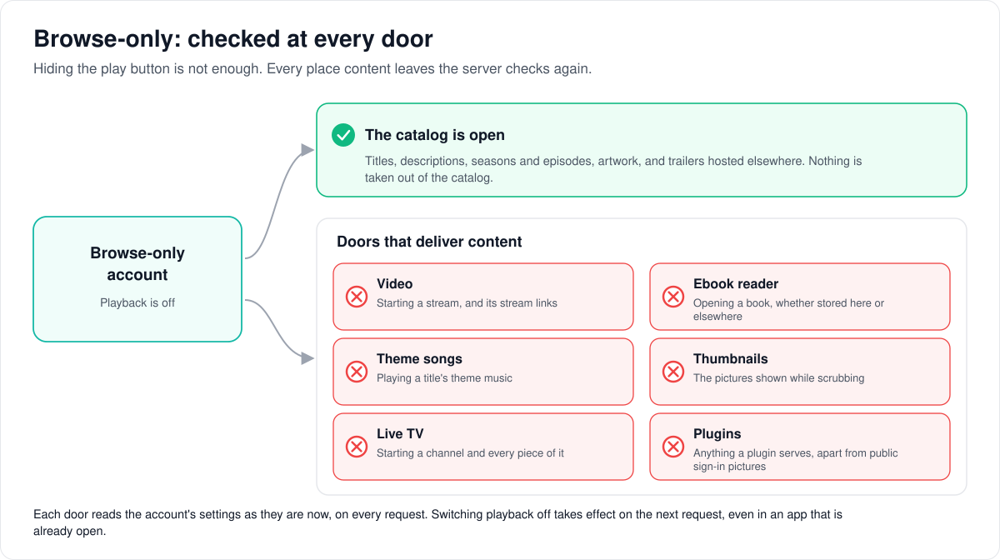
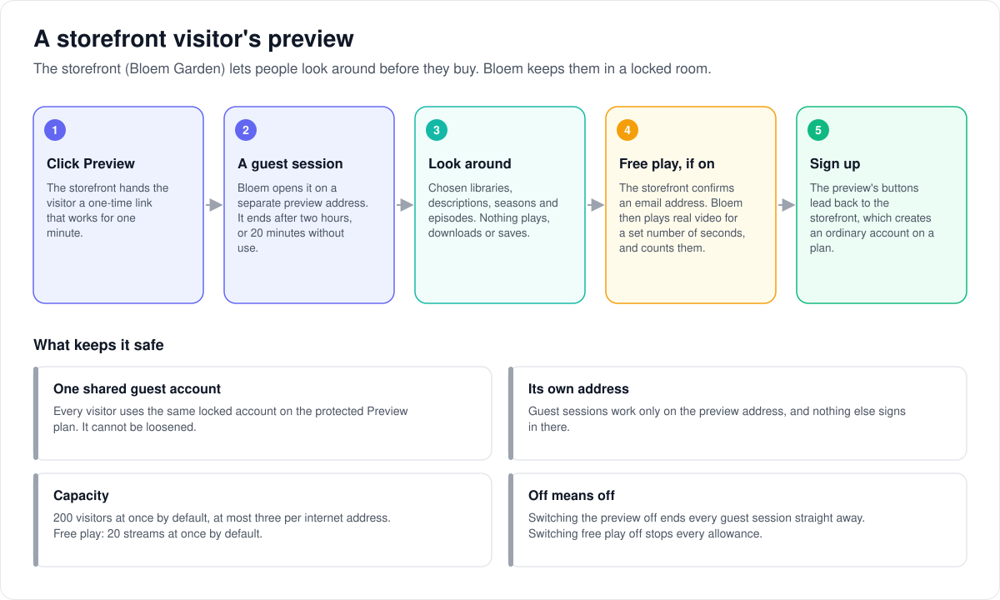
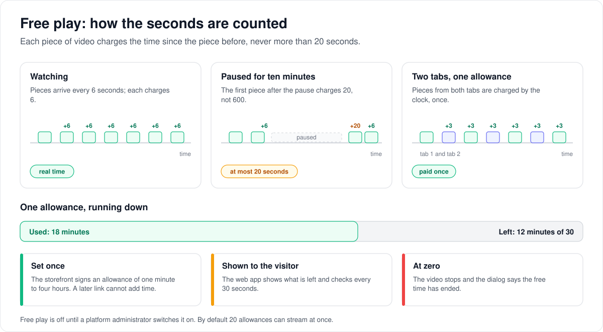

# How browse-only access and the preview work

> **Provenance and status.** Bloem page, rewritten on 2026-11-01 and checked against
> `main` at `b6039036d`; the preview status wait updated on 2026-11-02. Browse-only access and the storefront preview are Bloem
> additions. Silo's group policy has the playback, download and permission switches
> that this page builds on; Silo has no preview principals, guest sessions or
> delivery-time playback checks. The technical rules are in the
> [For developers](#for-developers) section.

A **browse-only** account can look through the catalog but never play anything.
This page walks through what browse-only allows, how Bloem makes sure nothing
plays, the two kinds of storefront preview, how **free play** lets a preview
visitor watch for a limited time, and what the web app shows a visitor. Plans
themselves are explained in [how plans work](bloem-plans.md).

## What browse-only allows

An account is browse-only when its plan, or an administrator, switches playback
off. The built-in **Browse-only** plan and the protected **Preview** plan both do.

- **It can see** titles, descriptions, seasons and episodes, artwork, and
  trailers hosted elsewhere.
- **It cannot** play a video, read an ebook, play a theme song, scrub through
  thumbnails, watch Live TV, download, or use plugins (apart from their public
  sign-in pictures).

Browse-only takes nothing out of the catalog. It only stops content from being
delivered.

## Checked at every door

Hiding the play button is not enough: an app could still ask for the video. So
Bloem checks again at every place content leaves the server, on every request,
with the account's settings as they are right now. Switching playback off
therefore takes effect on the next request, even in an app that is already open
and even for a stream link handed out a moment earlier.

## Two kinds of preview

The storefront (Bloem Garden) uses browse-only to let people look around before
they buy. Both kinds run on the protected **Preview** plan, which can never be
loosened.

- **A personal preview** is an ordinary account on the Preview plan, such as a
  storefront trial. The storefront decides when it ends.
  Once the account moves to a real plan, the preview stops on its next request.
- **A guest preview** needs no account. The storefront hands the visitor a
  one-time link, and Bloem opens a short **guest session** on a separate
  **preview address**. Every guest shares one locked account.

What keeps guests safe:

1. **The link works once, for one minute.** A copied link cannot be reused.
2. **Guests live on the preview address only.** A guest session is refused
   anywhere else, and nothing else signs in on the preview address.
3. **Sessions end on their own.** After two hours, or after 20 minutes without
   use. Switching the preview off ends every guest session at once.
4. **Capacity is capped.** By default 200 guests at once, and three per internet
   address; a fourth from the same address ends the oldest. The traffic limit (60
   requests a second across all guests) counts API calls only: the web app's own
   files and signed artwork pass uncounted, because a library grid alone asks for
   about a hundred covers at once.
5. **Little is kept about guests.** Bloem stores no visitor's internet address
   or browser details, and keeps preview events only as daily counts.
6. **Only an allowed list of actions works.** Anything not on the list is refused,
   including anything Silo adds later.

## Watching for a limited time (free play)

The storefront can let a guest watch real video for a set time, called an
**allowance**. Free play is off until a platform administrator switches it on.

1. **The storefront decides who.** It confirms the visitor's email address,
   refuses repeats, and puts the allowance in the launch link: between one minute
   and four hours, for at most seven days.
2. **Bloem records it once.** The first link sets the allowance. A later link for
   the same allowance can never add time or reset what was used.
3. **The visitor watches in the web app.** Video only, as a converted stream. No
   downloads, Live TV, books or theme songs, and nothing is saved to an account.
4. **Bloem counts the seconds.** Each piece of video it sends charges the time
   since the piece before, at most 20 seconds. So a long pause costs at most 20
   seconds, and two tabs on one allowance pay once.
5. **At zero, the video stops.** The app shows a dialog that the free time has
   ended, with the storefront's buttons.

By default 20 free-play streams can run at once. When they are all busy, a new
start is refused with a request to try again in a few minutes. Switching free
play off stops every allowance on the next request, without ending the guest
sessions.

## What the visitor sees in the web app

- A banner that names the preview and shows any free time left, with buttons that
  lead back to the storefront.
- The chosen libraries and their titles, with search. A library opens on its
  Recommended rows without the personal ones (the audiobook library's opening deck
  is personal, so it opens on its Library tab), collections show their posters, box
  sets appear in search and on their movies, posters carry their rating badges, and
  the calendar opens on All because a guest follows no shows.
- No personal pages: no Continue Watching, favourites, watchlist, requests,
  settings, notifications or profile pages. Trying to open one leads to the
  title or home page with a sign-up button.
- When a guest session ends, a choice of what to do next instead of a sign-in
  page. Leaving ends the session and returns to the storefront.

## Example: one evening of free play

This example is made up.

Mira opens the storefront, confirms her email address and gets 30 minutes of free
play. She clicks **Preview** and lands on the preview address as a guest.

- She watches the first 12 minutes of a film, and the banner shows 18 minutes
  left.
- She pauses for 10 minutes to make tea. When she presses play again, only 20
  seconds are charged for the pause.
- She opens the same film in a second tab to show a friend. Both tabs play, but
  the time is charged once.
- About 18 minutes later the video stops and the ended dialog appears. Mira
  follows its button to the storefront, which creates her account on a real plan.

## Who can change what

| Who | What they manage |
| --- | --- |
| Platform administrator | The preview's settings: on or off, the preview address, launch-link keys, capacity, wording and links, libraries, the age-rating ceiling, and free play on or off with its capacity. Ending every guest session. Done in the Platform context, or with an API key that has the `admin:preview` scope. |
| The storefront (Bloem Garden) | Launch links, who gets free play and how much, personal preview accounts and when they end. |
| A visitor | Looking around, free play when given, leaving. |

## Words used in the code

| On this page | In the code and database |
| --- | --- |
| Browse-only plan | the `browse-only` entitlement template |
| Preview plan | the protected `bloem-preview` entitlement template |
| Personal preview, preview account | a preview principal (`internal/auth/bloem_preview_principal.go`) |
| Guest session | a session with `auth_method=preview_guest` on the shared preview account |
| One-time link | a signed launch ticket (`internal/preview/ticket.go`), exchanged at `POST /api/bloem/v1/preview/sessions` |
| Preview address | the preview host in the preview settings |
| Allowance | a play grant (`bloem_preview_play_grants`); free play is `free_play_enabled` |
| Counting the seconds | `preview.ChargeDelivery` |
| Allowed list of actions | `internal/api/bloem_preview_routes.go` and `internal/apiv2/bloem_preview_gate.go` |
| Checked at every door | the Bloem content adapters (transport checks) |

## For developers

- **API:** [plans and preview](../bloem/api/plans.md): preview administration
  under `/api/bloem/v1/admin/platform/preview`, the guest exchange
  `POST /api/bloem/v1/preview/sessions`, `GET /api/bloem/v1/preview/status` and
  `POST /api/bloem/v1/preview/events`.

### Transport checks

Bloem's group policy can grant catalogue visibility while denying playback.
Playback denial must prevent content delivery as well as video session
creation. It does not remove descriptions, seasons, episodes, file descriptors
or theme-song descriptions from an otherwise accessible catalogue.

The native listener enforces these boundaries:

- The composed native ebook reader checks current playback permission before
  resolving a file. This covers v1 and v2 GET/HEAD, local ebook/comic/manga files,
  native storage, ranges, conditional requests and conversion. Reading is a
  playback permission; download permission is independent.
- The v2 operation gate refuses trickplay manifests and theme playback
  authorization before handlers can sign URLs or dispatch work.
- The composed theme service refuses playback-denied authorization, and wraps
  the grant consumer's fresh viewer resolution with a playback check. Existing
  grants keep the host's login, account, revision, profile and file checks.
  Revoked grants receive the existing invalid-grant response without file bytes.
- Live TV session starts require playback permission. Delivery requires both
  Live TV and playback permission from the freshly resolved scope; an unexpired
  stream token cannot bypass revocation. Guide/channel browsing keeps the
  separate Live TV permission.
- Both plugin mounts resolve current tenant and viewer policy after their
  independent authentication. Playback denial is explicit, rather than treating
  the viewer as anonymous, and precedes plugin dispatch or asset file opening.
  Bearer, query, plugin-launch-cookie and unscoped API-key credentials use the
  same check. Direct-profile sessions keep their existing plugin prohibition.
  Anonymous public descriptors and public sign-in icons keep their existing
  behavior.

Transport restrictions are carried by the Bloem content adapters. They do not
become catalogue predicates. Independently authenticated content endpoints
reconstruct tenant authority from their validated account/profile identity before
resolving policy; normal viewer endpoints keep the host's authentication, profile
and PIN gates.

The implementation uses Bloem-owned adapters and existing router/plugin seams.
Do not wire the underlying shared ebook or theme service directly into the Bloem
listener: doing so omits the added policy boundary.

These transport checks also protect ordinary accounts with playback disabled.
Dedicated preview principals and guest sessions add the restrictions below.
Response hygiene, artwork-class restrictions and the prospect UI are separate
parts of the preview design.

Regression coverage lives in the Bloem browse-only handler, middleware, v2 and
plugin tests. Router tests exercise reused credentials across policy revocation
and an existing native HLS ticket after playback is revoked.

### Preview principals

The protected `bloem-preview` entitlement template permits catalogue browsing
while denying playback, downloads, transcoding, requests and permissions. Only
its library selection may be revised. Database constraints pin those limits on
template revisions and materialized access groups; the template cannot be
archived or used as the parent of a derived cohort.

The seed migration (`20261014120000_bloem_preview_template`) keeps template
history and its `bloem_preview_seeded` provenance marker when rolled back.
Reapplying it preserves curated revisions and the current revision pointer. A
preexisting operator template using the reserved key is still rejected;
reapplication never adopts or overwrites it.

A non-admin account is a preview principal when its own access group
(`users.access_group_id`, read with its active membership's organization) or any
of its profiles' groups is materialized from that template (`previewAccountSQL`
in `internal/auth/bloem_preview_principal.go`). Classification is read with
current session authority on each request. That lookup (`ActivePreviewSession`,
`ActiveSessionAuthority` and the auth middleware's `sessionAuthority`) also
requires the session to belong to the account the credential names, which is
Silo's token-to-session binding (Silo #3140, merged in `68070f04b` on
2026-10-27). The plugin router and the auth middleware therefore keep that
binding. Per-account and profile overrides cannot restore the denied
permissions. The lookup keeps remote-playback purpose and its approved profile,
so preview restrictions and handoff restrictions both apply. Guest activity and
expiry are checked in that same database snapshot. Conversion therefore affects
existing credentials on their next request, including v1 websocket tickets
minted before it. API keys owned by preview principals are refused.

Two short-lived credentials are not classified: a direct-download link (`dl`) and
an Apple push display token. Neither reaches the preview gate as a preview
principal, so they rely on the policy checks behind them. A preview principal
cannot mint either. One minted before a conversion still meets the downloads
policy (downloads are off) or can only read notification text.

Authenticated v1 and native routes use the exact method/route allowlist in
`internal/api/bloem_preview_routes.go`. Delegated v2 routes use the operation
allowlist in `internal/apiv2/bloem_preview_gate.go`. Unlisted operations are
denied by default, including new upstream operations. Preview refusals carry
`X-Bloem-Denial: preview_only`; v2 keeps the `permission_denied` problem type.
Boot and catalogue reads pass their existing profile, tenant and library gates.
Personal previews keep session housekeeping and device approval. Guests are
refused those operations and websocket-ticket minting.

Both plugin authentication paths treat preview principals as anonymous, whether
the credential is a bearer token, query token, plugin cookie or API key. Existing
public discovery and sign-in artwork keep their public behavior.

### Guest preview sessions

`POST /api/bloem/v1/preview/sessions` exchanges a signed launch ticket only on the
configured preview host. Ed25519 verification checks issuer, server audience,
host, issue time, strict expiry, ticket identifier and optional item/reference.
The issue-to-expiry window is at most 60 seconds (`MaxTicketLifetime`). Up to two
public keys are accepted. Successful exchanges keep consumed identifiers in
PostgreSQL until expiry, so replay is refused across processes and restarts.
Expired receipts are swept at most once per minute.

Sessions carry `auth_method=preview_guest` and belong to the configured shared
account. Database guards serialize credential creation with account assignment:
ordinary sessions and API keys cannot race the assignment and its revocation.
The generic session repository cannot create guest sessions. Guest classification
is forced independently of the account's group; guest account responses keep
only boot identity and expose no contact details, permissions or downloads.

Absolute expiry is set at exchange (two hours by default, `session_ttl_seconds`
7200, allowed 5 minutes to 24 hours). Idle expiry defaults to 20 minutes
(`idle_ttl_seconds` 1200, allowed 1 minute to 2 hours and never above the absolute
lifetime). Access tokens are capped at 15 minutes and the remaining session
lifetime. Refresh never extends either deadline. A valid refresh token can reuse
its session during a fresh ticket exchange, within the same database transaction.
Disabling preview revokes every guest session in the settings transaction.
Security settings are read fresh; presentation data may be cached.

Host enforcement uses the request's original `Host`, never forwarded-host
metadata. Guest credentials are refused on every other host before public or
optional-auth handlers run. Guest admission (`admitPreviewGuest`) answers a guest
token on another host, while the preview is off, or for another account with 401
`preview_session_invalid`. The preview host refuses other sign-ins and plugin
surfaces, and accepts only guest credentials. A settings-read outage fails
closed.

Capacity is counted and allocated under the same PostgreSQL advisory lock as
settings changes, with a default of 200 live guests (`max_concurrent`, 1 to
10,000). An IPv4 address or IPv6 /64 has at most three live sessions
(`MaxGuestsPerClient`); the oldest is revoked for a fourth. An opaque HMAC bucket
derived from the shared server signing secret keeps that cap coherent across
processes. No address is stored in the session tables. Launch-attempt limits are
rolling-hour counters in each API process: 20 per client bucket, with bounded
memory. Guest HTTP traffic, including public endpoints, is capped at 60
requests/second (burst 120); authenticated sessions also have their own 10
requests/second cap (burst 30), before the normal server-wide budget. A guest
over its cap gets 429 `preview_busy` with `Retry-After: 1`.

The resolved address is kept only in request memory for admission. Guest
requests remove addresses and browser/client headers from observer context and
skip request/activity writers. Expired signed guest credentials receive the same
privacy treatment. Activity filtering reads only a cached account snapshot and
performs no database I/O on the writer's request path.

### Preview administration

The native Platform preview control plane accepts either a Platform admin
context or an API key carrying `admin:preview` (an unscoped admin key also keeps
access). The scope only narrows authority: every operation checks the enabled
administrator again in PostgreSQL. Organization contexts and unrelated key
scopes are refused. Settings, key rotation, account creation, template curation
and guest revocation serialize with exchange under the same advisory transaction
lock.

Setup creates the reserved shared account, its primary profile and welcome
onboarding completion, applies the protected preview template and claims issuer
ownership atomically. It never adopts an existing account occupying the reserved
login name. Password sign-in is disabled; a Bloem-owned public login guard also
returns `403 preview_account` before the ordinary login handler could hit the
database session guard. Repeated setup for the same issuer returns the account;
another issuer cannot replace or clear ownership.

Settings updates merge only explicitly supplied fields inside the lock.
Account identity and ticket keys are read-only there. Rotations replace the
one- or two-key allowlist separately, supporting overlap without stale settings
forms restoring retired keys. The canonical configured host (the server's public
address, from the `server.public_url` setting and the server configuration) and
the normal host serving the admin request cannot become the preview host
(`Configure` in `internal/preview/admin.go`). Organization domains are not part
of that check. Presentation links must be absolute HTTPS URLs without
credentials; content-rating ceilings must be recognized ratings.

Library curation appends an immutable revision to the protected template and
reapplies it to the shared account in the same transaction. An explicit empty
library list grants no libraries. The picker uses only PostgreSQL catalogue
reads, the shared account's materialized library selection and the configured
maturity ceiling. Both keyword search and provider-ID lookup return metadata
only. They do not invoke providers, prepare files or mint grants. Probe
verification checks a ticket without consuming it; capacity information stays
behind admin authority.

### Preview presentation

Authenticated preview catalogue scope intersects the current protected template's
selected enabled libraries with the host's resolved viewer scope, keeping empty
intersections explicit. The settings maturity ceiling only tightens host limits.
Playback, downloads and Live TV stay denied (outside free play, below).
Authority lookup failures fail closed.

Home and library layouts filter personalized and social recipes before row lookup,
so a preview may read both (`getHomeLayout`, `getLibraryLayout`). Box sets
(`searchCatalogBoxSets`, `getCatalogBoxSet`, `getCatalogItemBoxSet`), the poster
overlay settings (`getOverlayConfig`) and the row-type catalog (`listSectionRecipes`)
are reads with nothing personal in them, allowed since 2026-11-11.
Continue Watching, Next Up, Favorites and Watchlist are excluded explicitly because
the recipe gallery categorizes them as library staples. Profile-owned collection
rows are excluded too; hidden row IDs cannot be read through section queries.
Preview catalogue and native Watch search never call a semantic provider. With
Meilisearch configured they use it by keyword only (`internal/catalog/bloem_preview_search.go`,
since 2026-11-11): no query embedding, and the ranking of the words half of a
subscriber's search. Search ranking sessions, at most 16 per account, are kept per
login session instead, because every guest shares one account. Without Meilisearch,
previews keep PostgreSQL keyword retrieval, which they used for everything before:
it found three titles for "breaking bad" where the Meilisearch index finds every
title holding both words.

Preview detail uses request-local readers without probe repair, copy-safety racing,
chapter extraction, marker population or watchlist promotion. Metadata refresh
queueing remains. Artwork resolution refuses file frames and manga chapter covers
before signing, including cached variants. Item covers and external trailers remain.

Preview JSON responses are bounded to 8 MiB and scrub nested filenames, release
names, paths and chapter artwork. Invalid, oversized or excessively nested output
returns `503 preview_response_unavailable`. Preview responses are not cacheable;
subscriber response handling keeps its original writer and body.

The additive v2 account projection carries nullable preview display facts and
`playback_allowed`. Guest end dates come from absolute session expiry. Personal
end dates live in a separate Bloem table and are display metadata: Garden keeps
account-expiration authority. Conversion removes preview facts on the next request,
even when an old display-date row remains. Playback capability permission and CTA
denial participate in the host's normal capability revision and validator hashing.
The original Account and PlaybackCapabilities schema names stay stable. The
properties are additive and optional in the contract. With no presentation
extension installed, the host keeps its original projections and response bytes.

Authenticated preview events accept only `cta_shown`, `cta_clicked` and
`session_ended`. Persistence contains UTC day, event name and count only. Session
keys stay in bounded process memory for rate limiting: one event per ten seconds
with burst three, and an aggregate five per second with burst twenty per process.
Retries increment again; clients should treat telemetry as best effort. The
counts are written to `bloem_preview_event_counts`; no route reads them yet.

### Free play

A storefront may give a guest a free-play allowance: real video playback for a
number of seconds, metered by the server. The storefront decides who gets one
(Garden confirms an email address and refuses repeats); the server only
honours and meters signed allowances. Free play is off by default
(`free_play_enabled`). The settings also carry the storefront's offer for guests
without an allowance (`free_play_url`, `free_play_label`, `free_play_seconds`,
default 1800, allowed 60 to 14,400), which is wording only: the ticket carries the
real allowance.

- **Claims.** `play`, `grant` and `grant_exp` arrive together in the launch
  ticket (`internal/preview/ticket.go`) or not at all. `play` is between one
  minute and four hours (`MinPlayAllowance`, `MaxPlayAllowance`); `grant_exp`
  must fall after the ticket's expiry and within seven days of its issue
  (`MaxGrantLifetime`). The first exchange records the grant in
  `bloem_preview_play_grants`; later tickets for the same grant never raise its
  allowance or end and never reset what it used. The guest session row names its
  grant (`play_grant_id`). A grant ticket in a tab holding a browse-only session
  opens a new session and revokes the old one; a plain ticket in a free-play tab
  keeps the free-play session.
- **Live grant.** A grant is live while the preview and free play are on, its
  `used_seconds` is below its allowance and it has not ended
  (`preview.LiveGrant`, read in one statement with the settings, never cached).
  Switching free play off ends it on the next request without revoking
  sessions.
- **Bearer requests.** Guest admission (`markPreviewGuest`) marks a request
  whose session holds a live grant (`previewcontext.WithFreePlay`). Only a
  marked request gets `PlaybackAllowed` in the preview scope and playback
  limits without the shared account's stream caps (every guest shares that
  account). Downloads and Live TV stay off; the protected template and its
  constraints are unchanged.
- **Operations.** For a marked guest the v2 preview gate also admits
  `startPlayback`, `stopPlayback`, `updatePlaybackProgress`, the playlist,
  segment and subtitle reads. `replanPlayback`, the progressive original
  (`getPlaybackMedia`), downloads, trickplay, theme songs, books and every
  personal write stay refused. The gate rewrites the start body so only the
  `hls` delivery class is enabled and progress stays on the device, refuses
  with `429 free_play_busy` (`Retry-After: 60`) when `free_play_max_active`
  (default 20, allowed 1 to 1,000) other grants had a segment delivered in the
  last 60 seconds, and binds the returned playback session to the grant
  (`bloem_preview_play_sessions`). A plan that is not an HLS transcode stream is
  stopped and refused.
- **Stream tokens.** Plan URLs carry a stream token, which skips bearer
  authentication and the preview gate. `bloemStreamTokenAuth` therefore judges
  every stream token of the shared preview account on v1 and v2: only
  `/playback/transcode/{session}/` playlists and segments and
  `/stream/{session}/subtitles/` pass, for a session bound to a live grant,
  and the request is marked so the stream-token viewer resolver narrows scope
  with playback on. Anything else is `403 preview_only`; a spent or switched-off
  grant is `403 free_play_ended` and its playback session is stopped. Both
  refusals carry the code in `X-Bloem-Denial`.
- **Meter.** Each segment delivery charges the seconds since the grant's
  previous delivery, at most 20 (`MaxChargedGap`), none for the first
  (`preview.ChargeDelivery`, one statement). Playlists and subtitles only need a
  live grant, so a paused player's playlist reloads cost nothing. Two tabs on one
  grant pay wall-clock time once.
- **Telling the app.** The account projection carries `free_play` and
  `playback_allowed:true` for a live grant (see the API reference). The web
  client opens video only, shows what is left, re-reads the account every 30
  seconds during free play and shows the ended dialog when `free_play`
  disappears.

### Web preview presentation

The collections route selects a browse-only server collection view before the
ordinary personal collection page mounts. It neither requests personal lists
nor exposes collection creation or editing. The upstream subscriber page stays
unchanged behind the module adapter.

The web client derives preview mode from the authenticated account presentation.
Guest entry also discovers the dedicated host through the public preview status.
While that status is in flight, a signed-out visitor on a page behind sign-in waits
in the preview route boundary (`web/src/bloem/preview/RequireFullAccess.tsx`) instead
of being sent to log in; public pages such as the login screen are not held. The boot
session restore waits for the status only on a known preview host, so an ordinary
subscriber's restore never depends on it. Visiting a preview route on the normal host cannot change subscriber credential
storage. Guest refresh tokens and their display/attribution metadata live under
the tab-scoped `bloem-preview-session` key. Ordinary subscriber refresh and
profile storage stay separate. Ticket fragments are cleared before exchange, and
one launch shares one exchange across React's development remounts. Only the
verified server response supplies the initial item and affiliate referral.

Expiry clears guest credentials and keeps the operator's launch/trial metadata
across reload. Guest expiry opens the session-ended choices instead of login;
personal end dates stay display facts. Guest exit revokes the session, clears
its local credentials and returns to the configured storefront. CTA destinations
accept HTTP(S) URLs only, add `src=preview` and the selected item, and add `ref`
only from the verified guest exchange. No preview referral is invented.

A route boundary runs before protected pages mount. Playback and reader routes,
Live TV, rooms, onboarding, personal recommendations, account/settings/profile
pages, notifications, requests and collection editing redirect to an item or home
CTA. Reader return links are restricted to local item paths. Playback controllers
also intercept direct video, route-sync and audiobook starts before player state
is created. Catalogue search scope stays a tab-local choice without a settings
write. Guest and personal previews bypass onboarding/taste prompts and suppress
realtime connections, theme grants, translation, subtitle searches and persisted
library preferences. Read-only version/audio/subtitle metadata stays available.
External trailers and catalogue artwork continue through the existing components.

Bloem's Vite module resolver decorates exact presentation module boundaries with
preview adapters. An adapter can import its original module without decorating
itself again. The same resolver runs in development, production builds and tests;
subscriber branches keep the original components and hooks. Preview-specific
logic stays in `web/src/bloem/preview`, with existing shared app/auth/playback
integration points and no new seam entries. The UI is presentation and defence in
depth; it grants no authority beyond the server's preview gate.

### Follow-up

Public showcase readiness still requires Garden launch/configuration integration.
Bloem Android and Apple preview banners, CTA and personal-control suppression are
the separate native-client milestone. Their existing denied-operation behavior
continues to enforce server policy.

### History

The transport checks arrived in `61fc3cfd5` (2026-10-13). Preview principals,
the route and operation allowlists, guest sessions and preview administration
arrived on 2026-10-14 (`994d44176`, `4c9840362`, `343ad96b5`, `c443409a2`,
`017538c98`, `d1ae0621f`, `f7a1b09db`), and the web preview mode in `0d589164f`.
`7452bd121` (2026-10-15) re-integrated it all with the Silo main of that date,
and `21fae6837` (2026-10-15) preserved template history on migration reapply.
`a7436b4e5` (2026-10-25) moved the v1 sockets to Silo's tickets; `c60b7008e`
(2026-10-26) moved an account's group back onto `users`; the Silo merge
`68070f04b` (2026-10-27) binds every preview-aware session lookup to the account
the credential names; and `38e587805` added free play (migration
`20261028222252_bloem_preview_free_play`).

Technical pages:

- [How plans work](bloem-plans.md): the plans, the preview from the storefront's
  side, and the upgrade prompt.
- [Entitlement templates guide](../wiki/admin/entitlement-templates.md) and
  [managing entitlement templates](../operations/entitlement-templates.md): the
  `browse-only` and `bloem-preview` templates.
- [Live TV client access](live-tv-client-access.md): the separate Live TV
  permission.
- [Delivery boundary enforcement](delivery-boundary-enforcement.md): access
  rechecked when content leaves the server.
- [Admin guide, browse-only previews](../wiki/admin-guide.md#browse-only-previews).

The pictures are SVG files under `images/browse-only-content-policy/` (and the preview steps
under `images/plans/`), drawn by `scripts/bloem/draw-pictures.py`. Redraw them
there, not by hand.
