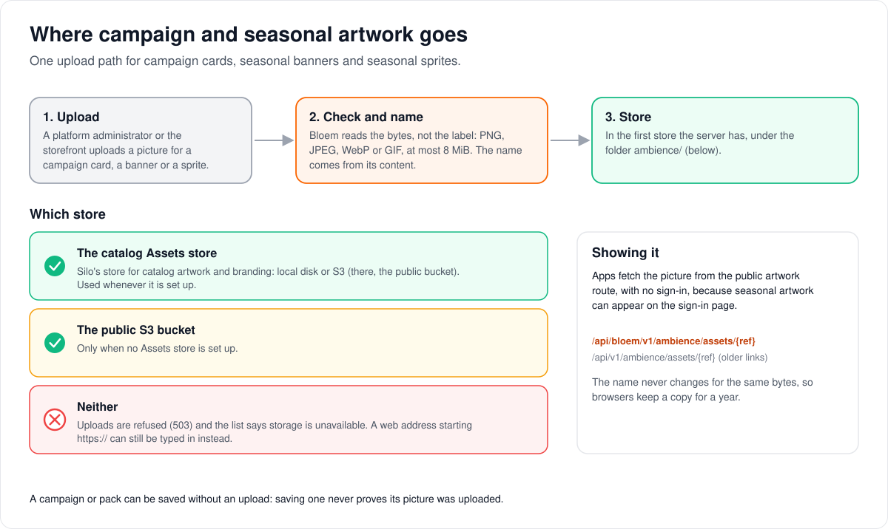

# Where campaign and seasonal artwork is stored

> **Provenance and status.** Bloem page, rewritten on 2026-11-01, checked against
> `main` at `b6039036d` and checked again on 2026-11-11, after Silo retired its v1 API.
> The artwork upload service is a Bloem addition on top of
> Silo's [blob storage](blob-storage.md). This page explains where uploaded pictures go
> and how apps fetch them, in plain language; the technical rules are in the
> [For developers](#for-developers) section.

Campaign cards and seasonal packs can carry pictures that an administrator uploads.
This page walks through what happens to an upload, which store it lands in, and how
apps show it.

## What happens to an upload

1. **Upload.** A platform administrator, in **Campaigns & seasonal packs**, or the
   storefront (Bloem Garden) uploads a picture for a **campaign card**, a seasonal
   **banner** or a seasonal **sprite** (a small picture that floats across the screen).
2. **Check and name.** Bloem looks at the bytes themselves, not at what the file
   claims to be, and accepts a PNG, JPEG, WebP or GIF of at most 8 MiB. It names the
   file after its content, so the same picture always gets the same name.
3. **Store.** It saves the file in the first store the server has (below), in a folder
   of its own, `ambience/`.

## Which store is used

- **The catalog Assets store**, whenever it is set up. This is Silo's store for catalog
  artwork and branding, on local disk or on S3 (where it is the public bucket). Uploads
  therefore work on a server with local artwork storage too.
- **The public S3 bucket**, only when no Assets store is set up.
- **Neither:** uploads are refused, and the admin console says storage is unavailable.
  A picture can still be given as a web address starting `https://`.

Saving a campaign or a pack never proves its picture was uploaded: a pack can be
saved with a web address, or with no picture at all.

## How apps show it

Apps fetch an uploaded picture from a **public** address, with no sign-in, because
seasonal artwork can appear on the sign-in page. Because a picture's name comes from
its content, it never changes, and browsers may keep a copy for a year.

## Example: a winter banner

This example is made up. On a server with local artwork storage, a platform
administrator uploads `snow-banner.png` to the "Winter snow" pack. Bloem checks that it
really is a PNG under 8 MiB, names it after its content, stores it in the Assets store's
`ambience/` folder on local disk, and sets the pack's banner to its public address.
Uploading the same file again for another pack reuses the same name.

## Who can change what

| Who | What they manage |
| --- | --- |
| Platform administrator | Uploading artwork for campaigns and seasonal packs, in the Platform context. Choosing the server's storage (Silo's storage settings). |
| The storefront (Bloem Garden) | Uploading the same artwork, with a platform administrator's API key. |
| Viewer | Nothing; their apps fetch the public pictures. |

## Words used in the code

| On this page | In the code and database |
| --- | --- |
| The upload service | the ambience asset service (`internal/ambience/assets.go`) |
| Campaign card, banner, sprite | asset kinds `campaign_card_16x9`, `season_banner`, `season_sprite`; pack slots `banner`, `sprite` |
| The file's name | the content reference (`ref`): 16 hex characters of the SHA-256, plus the extension |
| Catalog Assets store | Silo's `Assets` blob store (`deps.Blobs.Assets`) |
| Public S3 bucket | `deps.S3Public` |
| "Storage is unavailable" | `storage_available: false` in the admin ambience list |
| Public address | `GET /api/bloem/v2/ambience/assets/{ref}` |

## For developers

- **API:** [messages and promotions](../bloem/api/messages.md):
  `POST /api/bloem/v2/admin/platform/ambience/assets` (standalone upload),
  `POST /api/bloem/v2/admin/platform/ambience/{id}/assets` (upload and attach), and the
  public `GET /api/bloem/v2/ambience/assets/{ref}`. Native platform authoring reuses this
  service; see the [native API](../bloem-api-reference.md#platform-campaign-and-seasonal-authoring).
  The legacy routes on Silo's v1 API were retired on 2026-11-11; they are recorded on
  [Bloem's retired v1 routes](../bloem/api/v1-routes.md#seasonal-packs).

### History

The ambience (seasonal pack) registry and its artwork service are Bloem's
(`internal/ambience`, first commit `54ace4675`, 2026-09-01); campaign cards share it.
This page was first written in the Silo merge `64bbab66b` (2026-09-23), which brought
in Silo's blob store and its `blob-storage.md`. Later the same day `f293cce0d` moved the
wiring into `cmd/silo/bloem_main.go` and switched the service from the public S3 client
to the catalog Assets store, which the first version of this page did not reflect. On
2026-10-31 (`3eb77be33`) uploads started returning paths under
`/api/bloem/v2/ambience/assets/`, and migration
`20261031234831_bloem_native_ambience_asset_paths` rewrote the paths stored in
`ambience_packs.assets`, `promotions.image_url` and `promotions.placement`.

### Store selection

- `bloemWireServices` (`cmd/silo/bloem_main.go`) hands `ambience.NewService` the catalog
  Assets store through `blobstore.NewBucketAPI(deps.Blobs.Assets)`, and falls back to
  the public S3 client only when no Assets store is configured. It never passes a
  typed-nil store.
- Objects live under the key prefix `ambience/` in the store's bucket. That prefix is
  Bloem's; Silo's prefix table does not list it. On S3 the Assets store is the public
  bucket, so existing keys are unchanged.
- Silo's storage lock and [storage identity](blob-storage.md#storage-identity) rules
  apply, because the uploads share the Assets store. Private avatar storage is never
  used.
- With no store at all, the registry reports `storage_available: false`, multipart
  uploads return `503 unavailable`, and an HTTPS artwork URL can still be authored. A
  successful registry write does not prove that an asset was uploaded.

### Upload rules (`StoreAsset`, `AttachAsset`)

- The server sniffs the bytes (`http.DetectContentType`); the declared type is ignored.
  PNG, JPEG, WebP and GIF are accepted; SVG never is. Anything else is
  `415 unsupported_image`.
- At most 8 MiB (`MaxAssetBytes`); larger is `413 too_large`.
- The object is named `<first 16 hex characters of the SHA-256><.png|.webp|.jpg|.gif>`.
  A standalone upload answers `201` with the `url` and the stored asset (`asset_id`,
  `kind`, `ref`, `url`, `checksum`, the full SHA-256, `content_type`, `size_bytes`); an
  attach answers `201` with the `url`, the `slot` and the updated pack.
- An optional `asset_id` (at most 128 characters), the authoring system's ID, makes a
  standalone upload idempotent through `ambience_assets`: the same ID with the same
  bytes returns the existing object; different bytes replace it. `kind`, when given,
  must be one of the three kinds.
- Attaching to a pack locks the pack row while rewriting `assets`: `banner` replaces,
  `sprite` appends, and the 32-sprite cap is checked before anything is written to
  storage. An unknown slot is `400 bad_request`.

### Serving (`HandleServeAsset`)

- `GET /api/bloem/v2/ambience/assets/{ref}` is mounted by `mountBloemPlatformStorefront`
  (`internal/api/router_bloem_storefront.go`). It is the only artwork route and
  `ambience.AssetURLBase` the only accepted path prefix: the older v1 artwork route went
  with Silo's v1 API on 2026-11-11, and migration
  `20261111215029_bloem_api_v2_ambience_asset_paths` moved the paths stored in Bloem's
  tables to it. A copy of an old path kept outside those tables, such as a campaign card
  saved to an inbox earlier, no longer loads.
- A `ref` must match `^[0-9a-f]{16}\.(png|webp|jpg|gif)$`, which keeps the path free of
  traversal; anything else, or a missing object, is `404 not_found`. No store is
  `503 unavailable`.
- Responses carry `X-Content-Type-Options: nosniff`, Silo's
  `branding.AssetContentSecurityPolicy`, an ETag equal to the quoted reference,
  `Cache-Control: public, max-age=31536000, immutable`, and `304` when `If-None-Match`
  matches. The `Content-Type` comes from the reference's extension.
- The route is public because seasonal artwork can render on the login screen.

### Acceptance

The browser acceptance recorded in
[web feature coverage](bloem-web-feature-coverage.md#acceptance-evidence-and-limits)
(18 September 2026) ran against configured public S3, before the switch to the Assets
store. No later upload acceptance against local artwork storage is recorded.

### Related pages

- [Seasonal scheduling](seasonal-scheduling.md) and [playback cards](playback-overlays.md).
- [Bloem artwork storage](../bloem/overlays/wiki/admin/artwork-storage.md), the
  overlay on Silo's former operator page, and the
  [S3 storage notes](../bloem/overlays/s3-storage-setup.md).
- Silo's [blob storage](blob-storage.md).

The picture is an SVG file under `images/bloem-campaign-asset-storage/`, drawn by
`scripts/bloem/pictures/bloem_campaign_asset_storage.py` through
`scripts/bloem/draw-pictures.py`. Redraw it there, not by hand.
