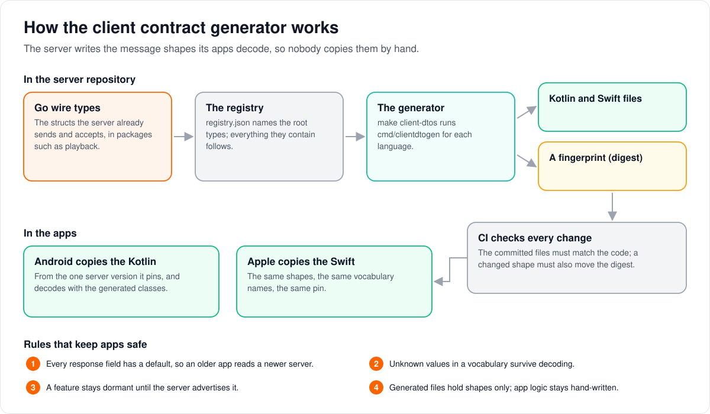

# How the client contract generator works

> **Provenance and status.** Bloem page, written on 2026-11-01 and checked against
> `main` at `798faa986`. The generator is a Bloem addition; Silo's nearest equivalent is
> its settings bindings (`cmd/settingsgen`). This page replaces the September working
> spec, `docs/specs/client-dto-generator.md`, and keeps that spec's section numbers in
> [For developers](#for-developers), because the generator's code cites them as `§N`.

Bloem's apps have to know the exact shape of every message the server sends and accepts.
This page explains how the server writes those shapes out for the apps, how a change
reaches them safely, and the rules that keep an older app working with a newer server.

## One source for every message shape



1. **The server's own types are the source.** Every message the server sends or accepts
   is a Go type in the server's code. Nobody retypes those shapes by hand for the apps.
2. **The registry picks what the apps need.** A short file,
   `contracts/client/v1/registry.json`, names the **root types**: the requests and
   responses the apps use. Everything a root contains is included automatically.
3. **The generator writes the app code.** `make client-dtos` turns the registry into
   Kotlin files for Android and Swift files for Apple, committed in the server
   repository.
4. **A fingerprint marks every shape change.** The **contract digest** is a fingerprint
   of the whole set of shapes. It changes only when a shape changes, never for a
   reformatting.
5. **CI checks every change.** A change to a registered Go type that is not regenerated
   fails the build, and a change of shape that is not recorded fails it too.
6. **Each app copies the files from one server version.** An app **pins** a server
   commit and copies the generated files made at that commit.

## Rules that keep apps safe

- **Older apps keep working.** Every field a server sends has a default in the app, so
  an app decodes a newer server that adds fields, and an older Silo server that lacks
  Bloem's fields.
- **New values do not break anything.** A list of named values, such as playback
  outcomes, accepts a value the app has never seen instead of failing.
- **Features wait until the server offers them.** A Bloem-only feature, such as
  announcements or seasonal packs, is decoded only after the server advertises it.
- **Generated files hold shapes only.** Anything that decides how an app behaves stays
  in hand-written app code.

## Example: a new field

This example is made up.

A developer adds `poster_blurhash` to a catalog item the server already sends. They run
`make client-dtos`; the Kotlin and Swift item types each gain a `posterBlurhash`
property with an empty default, and the digest moves. CI passes once the regenerated
files and the new digest are committed. An Android app pinned to the previous server
commit keeps working, because it never sees the field; once it pins the new commit, it
can show the blurred placeholder.

Renaming or removing a field is different: it can break an app that still expects the
old name, so before Silo's API locks it needs a line in the pre-lock removals table and
a coordinated app update.

## Who can change what

| Who | What they change |
| --- | --- |
| Server developers | The Go wire types, the registry, the generator and the committed output. |
| The owner | Rulings on the contract: what counts as a breaking change, and the generator's open questions (§11). |
| App developers | The pinned server commit, the copied files, and the hand-written code around them (§9.2). |

## Words used in the code

| On this page | In the code and repository |
| --- | --- |
| Generator | `cmd/clientdtogen` |
| Registry | `contracts/client/v1/registry.json`, its schema `registry.schema.json`, loaded by `cmd/clientdtogen/internal/registry` |
| Root type | a `roots` entry in the registry |
| Generated files | `contracts/client/v1/kotlin/` and `contracts/client/v1/swift/` |
| Contract digest | `CONTRACT_DIGEST` in `GeneratedContract.kt` / `.swift`, pinned in `contracts/client/v1/digest.txt` |
| Coverage list | `contracts/client/v1/coverage.json`: wire types deliberately not registered, each with a reason |
| Regenerate, check | `make client-dtos`, `make verify-client-dtos`, `make client-digest`, `make verify-client-digest`, `make verify-client-coverage` (`Makefile.bloem`) |
| Gate | the capability key an app must see before it decodes a type |

## For developers

The numbered sections below keep the numbering of the September 2026 spec
(`docs/specs/client-dto-generator.md`, written in `ab6d56ae9` with the owner's answers
in `f71d0e9c1`, both 2026-09-02; removed on 2026-11-01). Code comments in
`cmd/clientdtogen` and `contracts/client/v1` cite them as `§N`. Sections that only
recorded the original plan are summarised; every rule still in force is kept.

**History.** The generator's first commit is `d82101ee0` (2026-09-02); the Kotlin output
landed in `b9559b4b6`, the coverage allowlist in `9e8f492f1` and the digest pin in
`b0d658aac` (all 2026-09-02); the Swift emitter in `fac4c80db` (2026-09-04). The
registry holds 17 packages at `798faa986`: `internal/playback`, `internal/api/handlers`,
`internal/notifications`, `internal/events`, `internal/promotions`, `internal/ambience`,
`internal/remote`, `internal/requests`, `internal/onboarding`, `internal/watchdoc`,
`internal/subtitles`, `internal/models`, `internal/diagnostics`, `internal/livetv`,
`internal/apiv2`, `internal/nativestorage` and `internal/bookrequests`. Bloem CI runs
`make verify-client-dtos` (`.github/workflows/bloem-ci.yml`). Vendoring into the apps is
work in the app repositories.

### 2. Why the output shape differs from the earlier client

The owner's rulings R-19, R-31 and R-32 make the server the single source of the apps'
wire types, and require the current apps to share no substantive line with the earlier
Android client except wire strings. The output shape is therefore a provenance
requirement, enforced by generator tests (§8):

1. Property names come from the Go field name by the generator's own rule (§4.3), never
   from the wire string.
2. Declaration order is the Go struct order.
3. `@SerialName` on every property, on its own line, even when the wire name equals the
   property name.
4. Explicit `public` on every declaration (class, constructor property, companion,
   constant).
5. Defaults and nullability are computed from Go tags by rule (§4.4), not chosen.
6. Class names are the Go type names verbatim, qualified by a package derived from the
   Go package.
7. One file per Go package, with a generated header carrying the server revision and
   generator version (§5.2).
8. No hand-written functions in generated files: no `fun` declarations at all.

#### 2.1 Before and after

`playback.TimelineV3`:

```go
type TimelineV3 struct {
	SourceStartSeconds     float64  `json:"source_start_seconds"`
	StreamOriginSeconds    float64  `json:"stream_origin_seconds"`
	PlayerStartSeconds     float64  `json:"player_start_seconds"`
	TimelineOffsetSeconds  float64  `json:"timeline_offset_seconds"`
	SeekWindowStartSeconds *float64 `json:"seek_window_start_seconds,omitempty"`
	SeekWindowEndSeconds   *float64 `json:"seek_window_end_seconds,omitempty"`
	CanSeekAnywhere        bool     `json:"can_seek_anywhere"`
	SeekRestoration        string   `json:"seek_restoration"`
}
```

The earlier hand-written client called it `PlaybackTimelineV3`, put each `@SerialName`
inline, and chose defaults (`canSeekAnywhere = true`,
`seekRestoration = "player_position"`). The generator emits:

```kotlin
/** Wire type `playback.TimelineV3`. Direction: response. Dialect: upstream-compat. */
@Serializable
public data class TimelineV3(
    @SerialName("source_start_seconds")
    public val sourceStartSeconds: Double = 0.0,
    @SerialName("stream_origin_seconds")
    public val streamOriginSeconds: Double = 0.0,
    @SerialName("player_start_seconds")
    public val playerStartSeconds: Double = 0.0,
    @SerialName("timeline_offset_seconds")
    public val timelineOffsetSeconds: Double = 0.0,
    @SerialName("seek_window_start_seconds")
    public val seekWindowStartSeconds: Double? = null,
    @SerialName("seek_window_end_seconds")
    public val seekWindowEndSeconds: Double? = null,
    @SerialName("can_seek_anywhere")
    public val canSeekAnywhere: Boolean = false,
    @SerialName("seek_restoration")
    public val seekRestoration: String = "",
)
```

Only the wire names are shared. The defaults are Go zero values: a default that encodes
app policy belongs in a hand-written helper, not in a message type. The Swift emitter's
rendering of the same struct is pinned in `cmd/clientdtogen/internal/emit/swift/swift_test.go`
(`specTimelineV3`), and the Kotlin one in `kotlin_test.go`.

### 3. Inputs: selecting the Go wire types

An explicit registry was chosen over marker comments (scattered, and would require
editing Silo's files) and over walking the router (anonymous structs and `map[string]any`
payloads have no nameable type, and realtime frames are not routes). The registry lists
roots only; the generator loads the packages with `golang.org/x/tools/go/packages` and
walks the type graph transitively, so a type reachable from two roots is generated once.
`go/types` also reaches unexported handler types such as `capabilityResponse`.

#### 3.2 Registry format

```json
{
  "schema": 1,
  "packages": [
    {"path": "internal/playback", "dialect": "upstream-compat",
     "roots": [{"type": "DecisionResponseV3", "direction": "response"},
               {"type": "EventEnvelope", "direction": "response", "gate": "realtime"}]},
    {"path": "internal/api/handlers", "dialect": "upstream-compat",
     "roots": [{"type": "capabilityResponse", "direction": "response",
                "bloem_fields": ["announcements", "supported_types", "dismiss", "ambience", "promotions", "remote_control"]}]},
    {"path": "internal/promotions", "dialect": "bloem", "gate": "notifications.promotions",
     "roots": [{"type": "Card", "direction": "response"}]}
  ],
  "serializers": {
    "internal/api/handlers.itemListResponse.frame_rate": "org.bloemserver.bloem.model.wire.FrameRateWire"
  }
}
```

- `path`: Go package, repository-relative. One output file per entry (§5.1).
- `dialect`: `upstream-compat` (the shape exists on Silo too) or `bloem`. A package
  default, overridable per root. `bloem_fields` marks Bloem-only fields inside an
  upstream-compat type. Dialect never changes the generated type; it goes into
  documentation comments and the dialect table (§5.3). Field marking lives in the
  registry, not in struct tags, because the owning Go files are Silo's.
- `direction`: `request`, `response` or `both`. It drives the defaults rule (§4.4) and is
  inherited transitively: a type reached from a response root is response-reachable.
- `gate`: the capability an app must see advertised before decoding the type (§7.3).
- `serializers`: the only escape hatch (§9.2). A field with a custom
  `MarshalJSON`/`UnmarshalJSON` or a polymorphic shape gets `@Serializable(with = …)`
  pointing at an app-side class the registry names. The generator never writes a
  serializer body.

The generator **refuses**, naming the type, rather than guessing: generic types, fields
with the `,string` option, custom marshalers without a `serializers` entry, untagged
exported fields, embedded pointers or embedded types with their own `json` tag, and any
registered root missing from its package (`internal/graph/build.go`; tests
`TestRefusals`, `TestRefusalsAreCollected`, `TestRegistryLevelRefusals`).

#### 3.3 Realtime frames

The playback control socket's envelopes (`EventEnvelope`, `CommandEnvelope`,
`HelloEnvelope`, `AckEnvelope`, `ResultEnvelope` in `internal/playback/realtime.go`)
carry a `payload` (`json.RawMessage`) selected by `name`. They register like any other
root; the payload structs (chapter-thumbnail, markers, subtitle-translation, plan
invalidation and remote-command payloads) register as response roots, so the app's
hand-written dispatcher decodes `payload` by `name`. The `CommandName` and
`RealtimeEventName` sets become generated vocabularies (§4.2), so an app's `hello`
advertises exactly the server's vocabulary.

### 4. Go to client mapping

Kotlin is the reference rendering; §4.5 lists where Swift must differ.

#### 4.1 Types

| Go | Kotlin | Notes |
| --- | --- | --- |
| `string` | `String` | |
| named `string` type with a `const` block | value class with a companion of constants | §4.2; unknown values decode |
| `bool` | `Boolean` | |
| `int`, `int32`, `uint16`, `uint32` | `Int` | the contract uses `int` for counts and small IDs |
| `int64`, `uint64` | `Long` | row IDs, positions |
| `float32`, `float64` | `Double` | |
| `time.Time` / `*time.Time` | `String` / `String?` | the server also hand-formats some dates, so a typed instant would be wrong; parsing is app code |
| `uuid.UUID` / `*uuid.UUID` | `String` / `String?` | |
| `json.RawMessage`, `any` | `JsonElement?` | always nullable: Go writes `null` for a nil value |
| `map[string]any` | `Map<String, JsonElement>` | |
| `[]T` | `List<T>` | Go writes `null` for a nil slice; the default is `emptyList()`, and the app's JSON configuration coerces `null` (§5.2) |
| `*[]T` | `List<T>?` | presence matters: an absent `ambience` key means dormant, `[]` means nothing active |
| `[]byte` | `String` | base64 |
| `map[string]T` | `Map<String, T>` | |
| `*T` | `T?` | |
| field of struct type `T` | `T` | |
| embedded struct | its fields inlined at the embed point, in its order | as encoding/json promotes them |
| type alias | resolved to its target, generated once in the target's file | |
| `json:"-"`, unexported field | omitted | |
| exported field without a `json` tag | refused | the contract must name its wire names |
| `,omitempty` / `,omitzero` | "may be absent" | §4.4 |
| `,string` | refused | |

#### 4.2 String vocabularies

Go's named string types accept unknown values, and a Kotlin `enum class` would not: a
server adding a value would break every older app at decode time. The generator emits a
value class with one constant per Go constant, in Go source order, and a `KNOWN` list of
the vocabulary the server was built with. The constant identifier is the Go constant name
with the type-name prefix and shared prefix or suffix removed, in SCREAMING_CASE
(`StreamProtocolHLSV3` → `HLS`), the rule `settingsgen` applies to keys. A constant that
would collide with `KNOWN` is refused (`TestRefusesConstantNamedKnown`; constant names
are pinned by `TestConstantNames`).

#### 4.3 Property names

The input is the Go field name, never the wire string:

1. Split the identifier into words at lower-to-upper boundaries and digit boundaries; a
   run of capitals followed by a capital and a lowercase letter ends the initialism
   before the last capital (`HDRDetails` → `HDR`, `Details`; `BLCompatibilityIDs` →
   `BL`, `Compatibility`, `IDs`; `HDR10MaxWidth` → `HDR`, `10`, `Max`, `Width`;
   `MIMEType` → `MIME`, `Type`).
2. Lowercase every word, capitalise the first letter of every word but the first, join.
3. A Kotlin hard keyword (`in`, `is`, `as`, `fun`, `object`, …) gets a `Value` suffix;
   soft and modifier keywords (`type`, `value`) are allowed.

`HDRDetails` → `hdrDetails`, `BLCompatibilityIDs` → `blCompatibilityIds`,
`DVProfile` → `dvProfile` (wire `dolby_vision_profile`), `ID` → `id`, `URL` → `url`.
The rule is pinned by `TestCamelCase` (`internal/emit/naming_test.go`).

#### 4.4 Nullability and defaults

| Go field | Response-reachable type | Request-only type |
| --- | --- | --- |
| pointer `*T` | `T? = null` | `T? = null` |
| `omitempty`/`omitzero` scalar | zero-value default | zero-value default |
| `omitempty` slice or map | `emptyList()` / `emptyMap()` | same |
| scalar without `omitempty` | zero-value default | required |
| slice or map without `omitempty` | `emptyList()` / `emptyMap()` | required |
| struct `T` without `omitempty` | `T()` (every response-reachable class has an all-defaults constructor) | required |
| `json.RawMessage`, `any` | `JsonElement? = null` | `JsonElement? = null` |

Response types default everything so an app decodes any server it meets: Silo omits every
Bloem key, and a newer server adds keys. A forgotten `bloem_fields` entry therefore cannot
break decoding. Request types keep required fields so a missing value is a compile error.
`@SerialName` values are the `json` tag names, byte for byte.

#### 4.5 Where Swift differs (C7)

| Row | Kotlin | Swift | Why |
| --- | --- | --- | --- |
| package | `org.bloemserver.bloem.contract.<pkg>` | `public enum <Pkg> { … }` in `<pkg>/<Pkg>.swift` | Swift has no per-directory namespace; a caseless enum is one |
| wire names | `@SerialName` | `public enum CodingKeys` cases | also the construct the Apple identity gate exempts |
| defaults | constructor defaults + `coerceInputValues` | a generated `init(from:)` with `decodeIfPresent(…) ?? default` | synthesized `Decodable` ignores defaults and throws on a missing key |
| encoding | `explicitNulls = false`, `encodeDefaults = true` | a generated `encode(to:)`, `encodeIfPresent` for optionals | same bytes; references are `self.`-qualified |
| `int`, `uint32` | `Int` (32-bit) | `Int` (64-bit) | wider on Apple |
| vocabularies | value class | `public struct X: RawRepresentable, Codable` | unknown values survive; constants keep SCREAMING_CASE so both apps name them alike |
| `json.RawMessage`, `any` | `JsonElement` | the app-owned `BloemJSONValue` (`Codable`, `Hashable`, `Sendable`) | no standard JSON value type |
| self-referential field | `Child? = null` | a computed property over a private `Indirect<Child?>` box | a struct cannot contain itself; a cycle with no pointer is refused |
| registry `serializers` | the Kotlin target | the `swift` target, else the Kotlin target's last component | adding a `swift` target would move the digest |
| type named `Protocol`, `Self` or `Any` | as is | backticked; refused across namespaces | `Namespace.Protocol` is metatype syntax |

### 5. Outputs

#### 5.1 Layout

One file per Go package: `contracts/client/v1/kotlin/<pkg>/<Pkg>.kt` in Kotlin package
`org.bloemserver.bloem.contract.<pkg>` (the last Go path element), and the Swift tree
mirroring it (`swift/<pkg>/<Pkg>.swift`), plus `GeneratedContract.kt` and
`GeneratedContract.swift`. In the Android app the files live in a separate
`kotlin-generated` source directory, excluded from lint.

#### 5.2 File header and determinism

Each file starts with "Code generated by cmd/clientdtogen from bloem-server
`<package>`. DO NOT EDIT.", then `// Server revision: <full SHA> (generator v1, registry
contracts/client/v1/registry.json)` and "Regenerate in the server repo with: make
client-dtos". Kotlin files also state the JSON configuration decoding needs:
`ignoreUnknownKeys`, `coerceInputValues`, `explicitNulls = false`, `encodeDefaults`.

The revision comes from `-server-revision` and is the only non-deterministic line.
Packages follow registry order; types within a file are sorted by Go type name; fields
keep Go declaration order; constants keep Go source order; imports are sorted. Two runs
on the same tree give identical bytes (`TestDeterminism`).

#### 5.3 `GeneratedContract`

`GeneratedContract` holds `SERVER_REVISION`, `GENERATOR_VERSION`, `CONTRACT_DIGEST`, and
two tables: `DIALECT` (class name to dialect) and `GATE` (class name to capability gate,
gated types only). They are tables, not functions; conformance tests and the capability
layer read them. Swift's digest equals Kotlin's (`TestContractDigestMatchesKotlin`).

### 6. Running it

#### 6.1 Server side

```sh
make client-dtos          # regenerate contracts/client/v1/kotlin and swift (committed)
make verify-client-dtos   # regenerate into a temp dir and diff against the committed copy
make client-digest        # re-pin contracts/client/v1/digest.txt after a shape change
make verify-client-digest
make verify-client-coverage
```

`make client-dtos` runs `go run ./cmd/clientdtogen -lang kotlin|swift -out <dir>
-server-revision $(BUILD_REVISION)`. It writes into the sibling Android checkout only on
request: `SYNC_CLIENTS=1` or `make client-copies-dtos` (`BLOEM_ANDROID_DTO_DIR`).
`verify-client-dtos` regenerates each language with the revision stamped in its own
committed `GeneratedContract`, never `HEAD`, so a commit can never make the committed
copy stale by itself.

#### 6.2 App side

An app pins a server commit, copies the generated files from it, and checks that every
file's `// Server revision:` line equals the pin. Its conformance tests decode the
server's golden fixtures (`internal/playback/testdata/protocol_v3/*.json`) through the
generated types.

#### 6.3 Where the drift check runs

Server CI regenerates and diffs; it is the authoritative check, failing in the
repository where the change is made. App CI cannot regenerate (it would need Go and the
server source at the pin); it checks the pin and decodes the fixtures. Diffing server CI
against an app checkout was rejected because it ties the server build to an app's branch.

### 7. Versioning

#### 7.1 Additive changes

A new field, constant or root: regenerate and commit both copies. Every response
property has a default, so apps compile and decode unchanged.

#### 7.2 Breaking changes and the digest

A rename, removal or type change of a field removes or retypes a public property and
moves `CONTRACT_DIGEST`. Before Silo's API locks these are allowed, coordinated with both
apps and recorded in the pre-lock removals table ("Breaking removals taken before lock") of
`docs/architecture/v1-scope.md`.
`contracts/client/v1/digest.txt` pins two digests: the contract digest of the normalised
type graph (`internal/graph/digest.go`) and a digest of that removals table at the time.
`TestDigestPinMatchesTree` (`internal/digestfile/realtree_test.go`) fails when the
contract moves without a new removals-table line, and names the missing step; then
re-pin with `make client-digest`. After the lock, the same test is to allow only
additions. The digest ignores the order of `bloem_fields` and is canonical
(`TestDigestIsDeterministicAndCanonical`, `TestDigestIgnoresBloemFieldOrder`,
`TestDigestSensitivity`).

#### 7.3 Capability-gated types

Announcements, promotions, seasonal packs and remote control are Bloem features found
through capability payloads, never by version checks. Gated types are generated
unconditionally and carry their gate in documentation comments and `GATE`. An app does
not call the route or decode the payload until the named capability key is present.
Absence follows Go: `Promotions *capabilityPromotions` with `omitempty` becomes
`promotions: CapabilityPromotions? = null` (null means dormant), and `Ambience
*[]ambience.Wire` becomes `List<Wire>? = null` (null means dormant, empty means nothing
active).

### 8. Tests

- **Golden files.** A synthetic fixture package
  (`cmd/clientdtogen/internal/graph/testdata/fixture`, registry from
  `internal/graph/graphtest`) declares one struct per §4.1/§4.4 row. Goldens under
  `cmd/clientdtogen/testdata/kotlin/` and `testdata/swift/` are compared byte for byte
  (`TestGolden`; `-update` rewrites them).
- **Provenance** over the goldens (`TestProvenance`): every declaration explicitly
  `public` (bar Swift's private indirection box), a `@SerialName` line or `CodingKeys`
  case per property, no `fun` in Kotlin and only the mechanical `encode(to:)` in Swift,
  every type name a Go type name.
- **Naming** (`TestCamelCase`, `TestConstantNames`) and **refusals** (§3.2).
- **Round trip** (`cmd/clientdtogen/roundtrip_test.go`, `TestPlaybackRootRoundTrip`):
  for every playback root, each server golden fixture and each marshaled realtime root
  is decoded into the Go type, re-encoded, and every key must be an `@SerialName` in the
  committed Kotlin and a `CodingKeys` case in the committed Swift. Deleting one fails the
  test and names the field, type and file. The Swift half runs through
  `testdata/swiftsupport/main.swift`.
- **Swift compiles** (`TestGeneratedSwiftCompilesAndDecodes`, `TestCommittedSwiftCompiles`):
  `swiftc -swift-version 6` type-checks the fixture goldens and the whole committed Swift
  tree against the support types in `testdata/swiftsupport/`, and a runtime driver checks
  §4.4: an empty object takes every default, a `null` list becomes empty, unknown keys and
  values survive, a self-referential type round-trips, and a request-only type refuses a
  body missing a required key.
- **Coverage drift** (`TestAllowlistMatchesTree`, `internal/coverage`): every exported,
  tagged struct in a registered package is either reached or listed in
  `contracts/client/v1/coverage.json` with a reason.
- **Determinism** (`TestDeterminism`, `TestDumpIsDeterministic`).

### 9. What stays hand-written

#### 9.1 Migration order in the apps

Apps replace hand-written types by verification strength: the playback protocol first
(golden fixtures and conformance tests already fence it), then the Bloem-only engagement
types, then the handler-backed catalog surface, one domain per commit, deleting the
replaced file in the same commit. The earlier client's model files are listed in the
coverage allowlist with their posture (`TestSpecFilesArePinned`).

#### 9.2 What the apps write themselves

- **Custom serializers**, such as the two-shape frame rate (`FrameRateWire`), named by the
  registry's `serializers` map. The generator never writes their bodies. The test-side
  stand-ins for Swift are in `cmd/clientdtogen/testdata/swiftsupport/`
  (`RegistrySerializers.swift`, `Support.swift`, with `BloemJSONValue` and `Indirect`).
- **Presentation and policy helpers**, as extension functions or separate types over the
  generated ones.
- **Defaults that are app policy**, such as where seeking resumes: generated types carry
  Go zero values.
- Everything with a function body.

### 10. Swift emitter acceptance (C7)

The Swift emitter (`-lang swift`, `cmd/clientdtogen/internal/emit/swift`) is accepted
when: Kotlin output and its digest are unchanged by a Swift change; Swift goldens are
committed and deterministic; the provenance assertions hold; the generated Swift
compiles; the runtime driver passes; the round-trip gate covers both languages;
`verify-client-dtos` stamps each language from its own contract file; refusals name the
offender (unusable serializer, constant named `KNOWN`, namespace collision,
`Protocol`/`Self`/`Any` across namespaces, pointerless cycle); and the divergences are
written down (§4.5). Two follow-ups are deliberately not gating: explicit `swift` targets
in `serializers` (they would move the digest), and a copy hook into the Apple checkout
(it waits for the app to settle where generated files live).

### 11. Owner decisions (2026-09-02)

- Q1, property names: camelCase from the Go field name (§4.3).
- Q8, Swift: in scope; the emitter interface serves both languages (`-lang
  kotlin|swift`, `internal/emit`), and Swift came as C7.
- All other questions took their defaults: vocabularies as value classes with `KNOWN`;
  `time.Time` as `String`; one file for `internal/api/handlers`; untagged exported fields
  refused; output committed under `contracts/client/v1/`; a separate `cmd/clientdtogen`
  rather than a `settingsgen` mode; Bloem-only fields marked in the registry, never in
  Silo's struct tags.

### Related pages

- [How Bloem's SDKs and generated contracts fit together](bloem-sdk-compatibility.md).
- [How Bloem's native API is organized](bloem-client-surface.md).
- [Bloem client coverage reasons](../../contracts/client/v1/coverage.json) are kept with
  the contract.

The picture is an SVG file under `images/client-contract-generator/`, drawn by
`scripts/bloem/pictures/client_contract_generator.py` through
`scripts/bloem/draw-pictures.py`. Redraw it there, not by hand.
