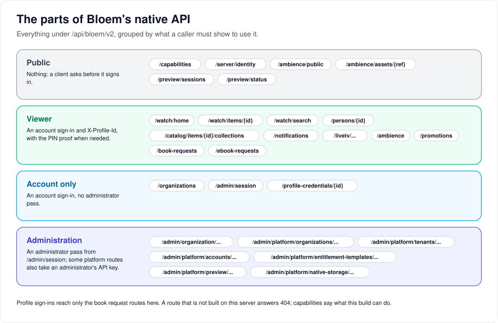

# How Bloem's native API is organized

> **Provenance and status.** Bloem page, rewritten on 2026-11-01, checked against `main`
> at `b6039036d` and checked again on 2026-11-11, after Silo retired its v1 API.
> `/api/bloem/v2`, Bloem's native API, is a Bloem addition beside Silo's own `/api/v2`. This page explains its layout in plain language; the technical
> rules are in the [For developers](#for-developers) section.

Bloem's apps talk to a Bloem server through two APIs: Silo's, for everything Silo has, and
Bloem's own, for what Bloem adds. This page walks through why Bloem has its own API, how it is
laid out, and how an app finds out what a server can do.

## Why Bloem has its own API

A Bloem server must keep working for apps built for Silo, which will never learn a field,
value or route that only Bloem has. So Bloem never changes Silo's routes. It puts everything
of its own under **`/api/bloem/v2`**: Live TV, organizations, plans, campaigns, seasonal packs,
book requests, storage sources, and richer home and title documents for its apps. Silo's
alpha v1 API is retired and answers `410 Gone`, so nothing goes there either (see
[leaving Silo's v1 API](bloem-leaving-silo-v1.md)).

## How it is laid out



The routes fall into four groups, by what a caller must show:

1. **Public.** Nothing. An app asks these before it signs in: what the server can do, which
   server it is, and the seasonal look of the signed-out pages.
2. **Viewer.** An account sign-in and a chosen **profile**, sent in the `X-Profile-Id` header,
   with the PIN proof when the profile has one. Everything shown is that profile's view: only
   titles it may see, and its own progress.
3. **Account only.** An account sign-in without a profile: the list of the account's
   organizations, swapping the sign-in for an administrator pass, and managing a profile's
   own sign-in.
4. **Administration.** A short-lived **administrator pass**, for a platform or one
   organization. The storefront's platform routes also take a platform administrator's API
   key. See [how Bloem's security foundation works](bloem-security-foundation.md).

A **profile sign-in** (straight into one profile, dormant since Silo retired its v1 API, where
its sign-in route lived) reaches only the book request routes on Bloem's API. Everything else there needs an account sign-in.

## How an app finds out what a server can do

An app asks two public questions before it signs in:

- **"What can this server do?"** `GET /api/bloem/v2/capabilities` lists **feature tokens**,
  short names such as `watch_document_v1`. An app uses a feature only when its token is
  listed, and never guesses from a version number. This answer never fails.
- **"Which server is this, and is it set up yet?"** `GET /api/bloem/v2/server/identity` gives
  the server's ID and name and whether setup is done. This one can say "try again later",
  because it reads the database.

They are separate on purpose: if the first could fail, an app would be back to guessing.

## Progress uploads

An app that was offline uploads its saved positions in one batch to Silo's
`POST /api/v2/sync/progress`. Bloem had its own upload route until 2026-11-11; it answered
in a finer way than Silo's v1 route, and it went when Silo retired that route.

## Example: a TV app starting up

This example is made up.

1. Anna's TV app asks `GET /api/bloem/v2/server/identity` and finds the server it paired with
   last week, set up and ready.
2. It asks `GET /api/bloem/v2/capabilities` and sees `watch_document_v1`, so it can use
   Bloem's home document.
3. Anna signs in with her email and password, and picks her profile.
4. The app asks `GET /api/bloem/v2/watch/home` with her profile in `X-Profile-Id`. It gets one
   document: the recently added titles her profile may see, her progress on them, and one
   featured film.
5. When an app uploads positions saved while offline, it sends them to Silo's
   `POST /api/v2/sync/progress`.

## Who can change what

| Who | What they manage |
| --- | --- |
| Bloem developers | New Bloem routes go under `/api/bloem/v2` with an OpenAPI declaration and, for a new feature, a feature token. A test pins that only Silo's `410` tombstone sits under Silo's retired v1 API. |
| App developers | Reading feature tokens instead of versions, ignoring fields they do not know, and adopting the generated Kotlin and Swift types on purpose ([SDKs and generated contracts](bloem-sdk-compatibility.md)). |

## Words used in the code

| On this page | In the code and repository |
| --- | --- |
| Bloem's API | `/api/bloem/v2`, built by `mountBloem` (`internal/api/router_bloem.go`) and `bloemClientSurface` (`internal/api/router_bloem_client.go`) |
| Viewer group | `RequireAuth`, `optionalLegacyTenant`, rate limiting, `RequireViewerAccess`, `requireBloemLiveTVProfile` |
| Profile sign-in limits | the direct-profile allowlist, `internal/api/direct_profile_routes.go` |
| What a server can do | `GET /api/bloem/v2/capabilities` (`internal/api/handlers/bloem_system.go`) |
| Which server it is | `GET /api/bloem/v2/server/identity` (`internal/api/handlers/server_identity.go`) |
| Home and title documents | Watch documents, `watch_document_v1` (`internal/watchdoc`) |
| Progress upload | Silo's `POST /api/v2/sync/progress` |
| The v1 route test | `internal/api/v1_route_surface_test.go` |

## For developers

- **API:** [apps and clients](../bloem/api/apps.md) (capabilities, identity, Watch,
  persons, collections, profile credentials) and the full
  [API by topic](../bloem/api/README.md). The [wire reference](../bloem-api-reference.md) adds
  behavior that does not fit a schema.

### History

The native client surface was first served on `/api/v2` (`25024c844`, 2026-08-14) and moved
to `/api/bloem/v2` (`811fb4d29`, 2026-09-02) because upstream Silo was taking `/api/v2` for its
own, unrelated API. Later changes that matter: direct-profile sessions may file ebook requests
(`70401bd26`, 2026-10-14); Bloem's music routes (`f9e1447f3`) and lifecycle receipts with
their `lifecycle_idempotency_*` tokens (`b017bfe84`) were removed on 2026-10-26; the campaign
viewer routes (`promotions_viewer_v1`) and the public `GET /api/bloem/v2/ambience/public`
were added on 2026-11-01. On 2026-11-11 Silo retired its v1 API (`26cf9b3e4`) and Bloem's
native progress upload went with it (`862d0fec2`). Silo's own v1 and v2 APIs are described in
[API contract](api-contract.md) and [v1 scope](v1-scope.md).

### Namespace rule

`/api/bloem/v2` is the native Bloem API, distinct from upstream Silo's `/api/v2`. Silo's
alpha v1 API is retired. New Bloem-only features belong under `/api/bloem/v2`, because
a deployment must stay usable by upstream Silo clients that will never learn a Bloem-only
field, value or route.

That rule is enforced: `internal/api/v1_route_surface_test.go` walks the mounted route tree
and compares the routes under Silo's retired v1 prefix against golden lists
(`internal/api/testdata/v1_routes_*.txt`); since 2026-11-11 they hold only Silo's tombstone
and its health and ready probes. A route added there fails with the route named. Regenerate
the goldens only when Silo changes the tombstone:

```bash
BLOEM_UPDATE_V1_ROUTE_GOLDEN=1 go test ./internal/api/ -run TestV1RouteSurface
```

### Routes

| Route | Auth | Notes |
| --- | --- | --- |
| `GET /api/bloem/v2/capabilities` | public | Build capabilities. Never fails. |
| `GET /api/bloem/v2/server/identity` | public | `server_id`, `server_name`, `api_versions`, `bloem_api`, `setup_complete`. `no-store`. |
| `GET /api/bloem/v2/ambience/public` | public | The active deployment-wide seasonal packs, for signed-out pages; always an array. |
| `GET /api/bloem/v2/watch/home` | account + profile | `watch_document_v1` home snapshot. |
| `GET /api/bloem/v2/watch/items/{content_id}` | account + profile | `watch_document_v1` item snapshot. |
| `GET /api/bloem/v2/watch/search` | account + profile | Profile-scoped Watch search. |
| `GET /api/bloem/v2/persons/{person_id}` | account + profile | Profile-scoped person detail and visible filmography. |
| `GET /api/bloem/v2/catalog/items/{content_id}/collections` | account + profile | The visible server collections that contain the item. |
| `GET /api/bloem/v2/notifications`, `/notifications/sync`, `/notifications/{id}` | account + profile | The profile's inbox, with the alert fields Silo's `/api/v2` projection drops. |

The viewer route group uses `RequireAuth`, `optionalLegacyTenant`/`ResolveLegacy`, rate
limiting, viewer-access resolution and `RequireProfile` (through `requireBloemLiveTVProfile`,
which admits a headerless request only on Live TV's signed delivery paths). They do not
require an explicit tenant-selected account token. Administrative routes use their separate
validated administrative-context authority.

The native namespace also owns operational `/livetv` routes, account-only
`/profile-credentials/{id}` management, scoped organization invitation/audit adapters,
platform campaign/seasonal authoring, the storefront's platform routes (reseller
organizations, accounts, announcements, campaigns, seasonal packs, and organization domains
and branding under `/admin/platform/tenants/{id}/domains` and `.../branding`), the campaign
viewer routes `/promotions` (advertised as `promotions_viewer_v1`), and authenticated
`/ambience` delivery when `seasonal_viewer_v1` is advertised. Seasonal delivery requires a
verified profile in the current active tenant; public branding and `/ambience/public` remain
public-only. Their authorization requirements differ from viewer delivery; see the
[wire reference](../bloem-api-reference.md).

Live TV capability discovery adds optional `xtream_supported` for installed live-provider
support, not permission, encryption readiness or playback success. Server-owned Kotlin/Swift
bindings include this field with absent/false handling. The embedded web uses
`POST /api/bloem/v2/livetv/tuners/xtream` with an authenticated administrator's selected
primary profile and required PIN proof. No Silo v1/v2 alias or sibling-client provider
administration is supplied. See [Xtream boundaries](xtream-live-tv.md) and the
[deployed revision and acceptance limits](../operations/2026-10-07-native-storage-deployment.md).

The viewer routes use ordinary account sessions and require `X-Profile-Id`. Direct-profile
sessions are limited by the router's allowlist (`internal/api/direct_profile_routes.go`),
which since Silo retired its v1 API admits only the audiobook and ebook request viewer
routes under `/api/bloem/v2`; everything else is rejected before native viewer
middleware runs. The browser's Silo v2 calls are also outside that allowlist: credential
management does not imply direct-profile browser login.

`feature_tokens` describe additive capabilities, including `watch_document_v1` and
`device_pairing_v1`, and clients must not use a server version for
feature detection. Most tokens are build-level. Retry behavior for mutations is in the
[wire reference](../bloem-api-reference.md#retrying-mutations). A token does not prove that an
unrelated dependency-conditional route is mounted in a particular deployment; clients still
handle the route's response.

### Server identity is its own endpoint

Identity is a sibling of the capability document rather than a section inside it. The
capability document must never fail: a probe that can itself be unavailable leaves a client
interpreting exactly the ambiguous state the probe exists to replace. Its one
runtime-dependent token, `native_audiobook_presentations_v1`, is omitted while the
native-audio readiness check is false; the other conditional tokens follow what was wired at
startup. The response stays `200`. Identity resolves the `server.instance_id` setting through the database and
legitimately answers `503`, and its `setup_complete` flips exactly once, so it is served
`no-store`. Folding the two together would either make the capability probe fallible or leave
the identity fields silently absent.

Silo's retained v1 health probe answers `server_name` and `server_id` from the Jellyfin compatibility
configuration, as upstream does. Health fields are not a scope key; the native identity
endpoint remains authoritative for that purpose. See
[protocol compatibility](bloem-compatibility-removal.md).

### Progress sync

Bloem's native `POST /sync/progress` and its `progress_sync_v1` token were removed on
2026-11-11 (`862d0fec2`). The route took Silo's v1 request body and reported `updated`,
`ignored` or `error` where Silo's v1 route reported `ok`. Clients upload offline progress to
Silo's `POST /api/v2/sync/progress`, which reports `success` or `failure` per item.

### Response and dependency behavior

The native surface may add fields and routes without preserving an upstream Silo wire shape.
Clients must ignore response fields they do not understand. The public identity route is
always mounted. Other handlers are conditionally assembled; a handler absent from the router
yields `404`. Watch is mounted when its reader dependencies exist. Its catalog reader is also
always passed to the Watch handler as the searcher, so a deployment without the optional
search provider returns a valid `200` search document with no items rather than `503` when
Watch itself is mounted.

### Wiring

`mountBloem` builds the native surface from `Dependencies` inside
`internal/api/router_bloem.go` and `internal/api/router_bloem_client.go`, rather than
receiving handlers assembled by Silo's router. That independence is the point: a native route
can be added, changed or removed without editing `internal/api/router.go` at all.

The embedded web keeps working Silo v2 screens and adds native adapters at the owning feature
boundary. See [web coverage](bloem-web-feature-coverage.md) for route ownership,
validation and remaining acceptance. Current server-owned Kotlin/Swift bindings are generated artifacts; their presence
is not evidence that sibling client implementations have shipped these workflows. The
[SDK compatibility guide](bloem-sdk-compatibility.md) describes the source revision, digest
checks and explicit consumer adoption procedure.

Technical pages:

- [How Bloem's security foundation works](bloem-security-foundation.md): sign-ins,
  administrator passes and tenant checks.
- [Leaving Silo's v1 API](bloem-leaving-silo-v1.md).
- [Live TV client access](live-tv-client-access.md).
- [How apps connect](bloem-apps.md).
- [Server identity](server-identity.md).

The pictures are SVG files under `images/client-surface/`, drawn by
`scripts/bloem/draw-pictures.py`. Redraw them there, not by hand.
