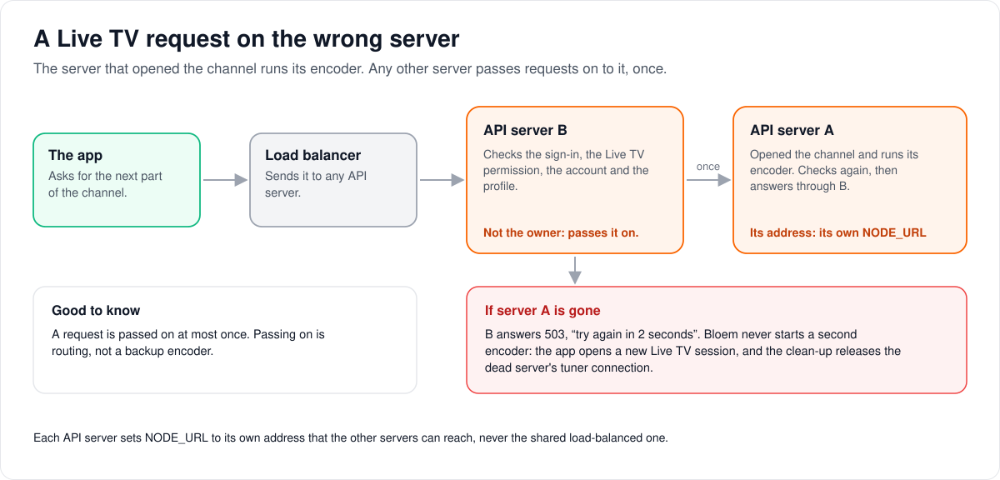
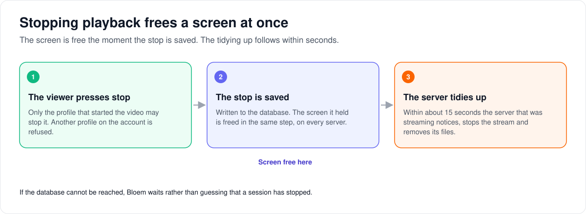

# How playback works across several API servers

> **Provenance and status.** Bloem page, rewritten on 2026-11-01 and checked against
> `main` at `b6039036d`. These are Bloem additions built on Silo's durable v3
> playback attempts (`playback_v3_attempts`), node heartbeats and `NODE_URL`; see
> Silo's [restart-resilient playback](restart-resilient-playback.md) and
> [node failure detection](node-failure-detection.md). Live TV itself is not
> Silo's: it is Bloem's adaptation of Prairie Server
> ([FORK.md](../../FORK.md#prairie-server-live-tv)). The technical rules are in the
> [For developers](#for-developers) section.

A larger Bloem runs several API servers behind one address, and any request can
land on any of them. Silo already keeps playback attempts in the database, so a
server can restart without losing them. This page covers what Bloem adds on top:
how a Live TV request finds the server that is encoding the channel, how Xtream
connections are shared, and how stopping playback frees a screen everywhere at
once.

## Live TV: a request is passed on once

A Live TV channel is encoded by one server, the one that opened it. Bloem does not
need the load balancer to send a viewer back to the same server every time.

1. **The app tunes in.** Server A opens the channel, starts the encoder and records
   itself as the session's owner.
2. **A later request lands elsewhere.** The app asks for the next part of the
   channel, and the load balancer sends it to server B.
3. **B checks it and passes it on once.** B checks the sign-in, the Live TV
   permission, the account and the profile, exactly as A would. Then it forwards
   the request to A's own address.
4. **A checks it again and answers.** The video goes back through B to the app.

If A has stopped or is not answering, B says "try again in two seconds". Bloem
never starts a second encoder for the same session: the app opens a new Live TV
session instead, and the dead server's tuner connection is released by the usual
clean-up. Passing requests on is routing, not a backup encoder.

Each API server needs its own address that the others can reach, set in
`NODE_URL`. It must not be the shared load-balanced address.

## Xtream connections are shared between servers

An Xtream provider allows only so many streams at once. Every server that opens a
stream for watching, HLS or recording first takes a **lease** on one of them, in
the database, and renews it every 15 seconds. A lease nobody renews for a minute
lapses. So all servers together stay within the number the administrator set.
These leases count only Bloem's own streams, not other apps using the same
account.

## Stopping playback frees a screen at once

1. **The viewer presses stop.** Only the profile that started the video can stop
   it; another profile on the same account is refused.
2. **The stop is recorded.** Bloem writes it to the database, and in the same step
   frees the screen it held, so the plan's screen count is right at once, on every
   server.
3. **The streaming server tidies up.** Every 15 seconds or so, each server looks
   for stopped sessions it is still serving, stops them and removes their files.

If the database is unreachable, Bloem waits rather than guessing that a session
has stopped.

## Words used in the code

| On this page | In the code and database |
| --- | --- |
| Session owner | the API node ID and process instance recorded on the Live TV session (`20260917214743_bloem_livetv_cluster_routes.sql`) |
| Server's own address | `NODE_URL` |
| Pass on once | `serveLiveTVPeer` (`internal/api/handlers/bloem_livetv_peer.go`), with the `X-Bloem-LiveTV-Peer-Hop` header |
| Lease | an Xtream connection lease (`internal/livetv/bloem_xtream_store.go`) |
| Stop | the durable attempt stop and receipt; `playback_v3_attempts.stopped_at` |
| Free the screen | the fleet capacity reservation (`20260917214744_bloem_stopped_playback_capacity.sql`) |
| Stop handler | `internal/api/handlers/bloem_playback_stop.go` |

## For developers

- **API:** the Live TV routes are on the [Live TV API page](../bloem/api/live-tv.md).
  Playback stop uses Silo's playback routes. None of this adds an endpoint or
  changes a successful response.

Bloem uses Silo's durable playback attempts and node heartbeats. It does not
introduce a second playback-stop protocol or require sticky API sessions.

### Live TV delivery

A native Live TV session records the API node and process instance that opened
its HLS bridge. An authenticated playlist or segment request received elsewhere
is forwarded once to that process. Both replicas apply the ordinary credential,
Live TV permission, account and profile checks. No peer-only bearer credential
is minted and no browser redirect exposes credentials to another origin.

The destination comes exclusively from a fresh API/integrated heartbeat with
both the recorded node ID and process instance. A reused node name cannot claim
a predecessor's encoder. Configure `NODE_URL` on **each API replica** to its own
HTTP(S) origin reachable by the other replicas, not to a load-balanced service.
The existing hostname/listen-address fallback remains available for single-node
installs. Peer origins cannot contain credentials, paths, queries or fragments.

Forwarding preserves paths, query credentials, range requests and media response
headers. It disables environment proxies and redirects, enforces timeouts (3 s to
dial, 3 s for TLS, 10 s for response headers, 30 s for the request) and rejects a
second hop (the `X-Bloem-LiveTV-Peer-Hop` header). An unavailable or stale owner
returns `503` with `Retry-After: 2`; a released or unauthorized session returns
`404`. The API never silently starts another encoder for the same HLS session. If
the owner dies, the client must open a new Live TV session; existing stale-session
cleanup releases the dead tuner allocation. Forwarding is routing, not encoder
failover.

Bloem's former Live TV stream mapping and opener-token path on the Jellyfin
compatibility surface are removed. Silo's Jellyfin server itself is served again
since `2393c41ee`, as Silo's unchanged code, which has no Live TV routes. Native
session ownership remains the authority for retained Live TV routes; historical
protocol tables do not provide an alternate content path. See
[protocol compatibility](bloem-compatibility-removal.md).

Apply the cluster-route migration before deploying the new binary. Sessions
opened by an older binary have no process owner and retain local-only routing;
retune them after a rolling upgrade. The changes do not make an in-flight HLS
encoder survive its owner process.

### Xtream physical connections

[Xtream sources](xtream-live-tv.md) add a separate database-backed lease for each
physical provider stream opened by raw delivery, HLS or DVR. UUID fencing, 60-second
expiry (`xtreamLeaseTTL`) and 15-second renewal share the provider budget across
replicas. Failed renewal stops the input; an expired owner cannot renew or release
its replacement. Every physical reopen must claim capacity again.

Credentials are resolved server-side from encrypted storage only when opening the
provider. Encoder processes receive an owned MPEG-TS pipe, never an authenticated
URL. These leases bound Bloem's admissions, not the provider's TCP accounting or
connections opened by other applications. They do not make encoders fail over.
Upgrade every API/worker binary before configuring protected providers.

The [September 19 deployment](../operations/2026-09-19-xtream-deployment.md) applied
the Xtream schema and passed operational smoke checks. Cross-pool fixture coverage
is not real multi-replica owner-loss or decoded-media acceptance; those remain open.

### Playback stop and capacity

Both native stop entry points use the existing durable attempt stop/receipt
mechanism. The v1 bridge falls back to legacy in-memory behavior only when no
durable attempt exists. A storage error must not be treated as a missing attempt.
Ownership is checked before any stop or history mutation. Since `68070f04b`
(2026-10-27) the durable stop in `internal/api/handlers/bloem_playback_stop.go`
applies Silo's `ownsPlaybackSession` rule: both the account and the acting
profile must match the attempt, so a sibling profile on the same account gets
`403` and cannot stop another profile's playback. Silo's v1 progress and stop
handlers apply the same rule (Silo #3133, `e852571bb`).

The transition to a non-null `playback_v3_attempts.stopped_at` releases Bloem's
fleet capacity reservation transactionally under the same account advisory lock
used for admission. Admission checks the durable stop after obtaining that lock,
so an owner racing to renew or reacquire cannot resurrect a stopped reservation.
The existing durable receipt remains the authority for history deduplication.

The API reconciliation loop batch-checks local producers against stopped
attempts. On its next pass it removes them, interrupts local transports and
runs local-only remote-stop hooks. Those hooks close transcodes and remove local
recipes/grants, but do not create another stop receipt or history row. This
producer cleanup is eventual (normally the 15-second reconciliation interval);
capacity release is immediate when the stop transaction commits. A database
outage delays reconciliation rather than guessing that a session has stopped.
Silo's existing stream-deny and progress-stop checks remain in force.

No native Apple/Android protocol change is required: clients retain their
existing native stream URLs, stop calls and status handling. Removed protocol
parity tests do not establish native acceptance. These changes neither add a new
endpoint nor alter the successful response schema.

### History

The Live TV peer forwarding, the durable stop path and the fleet capacity release
were added in `167e03f20` (2026-09-18) with migrations
`20260917214743_bloem_livetv_cluster_routes.sql` and
`20260917214744_bloem_stopped_playback_capacity.sql`. The Xtream leases followed
in `23ee4c1ac` (2026-09-19; see [Xtream Live TV](xtream-live-tv.md)). `2393c41ee`
(2026-10-18) restored Silo's Jellyfin server, which has no Live TV routes. The Silo
merge `68070f04b` (2026-10-27) made the durable stop follow Silo's per-profile
ownership rule (Silo #3133).

### Related pages

- [How Live TV works](bloem-live-tv.md), [Live TV client access](live-tv-client-access.md)
  and [Xtream live TV providers](xtream-live-tv.md).
- Silo's [restart-resilient playback](restart-resilient-playback.md) and
  [node failure detection](node-failure-detection.md).
- [Native video playback](bloem-native-video-playback.md): worker HLS for stored movies.

The pictures are SVG files under `images/cluster-media/`, drawn by
`scripts/bloem/draw-pictures.py`. Redraw them there, not by hand.
