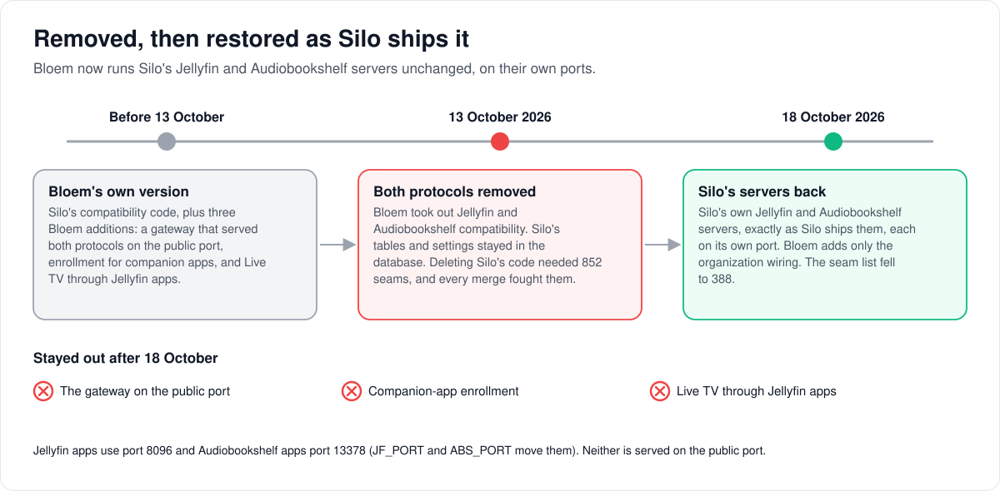
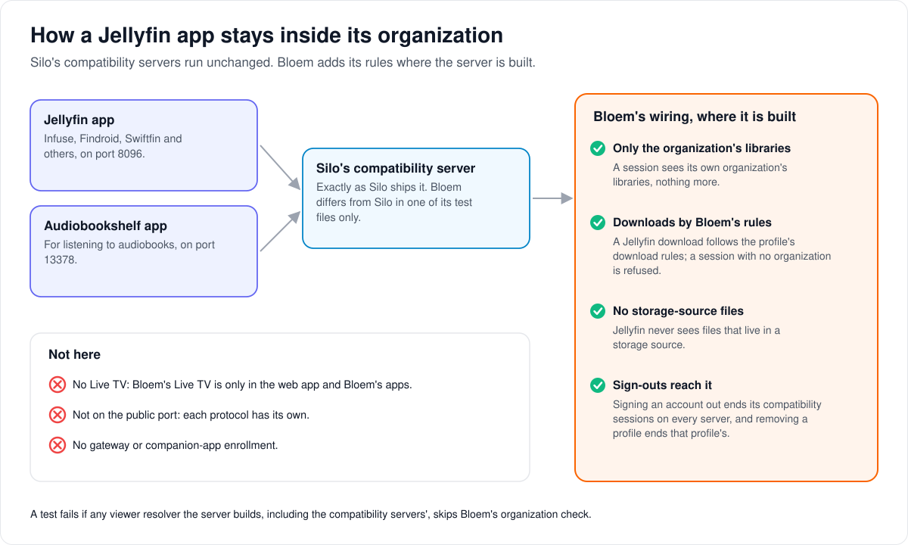

# How Bloem runs Silo's Jellyfin and Audiobookshelf servers

> **Provenance and status.** Bloem page, rewritten on 2026-11-01, updated on 2026-11-05
> and checked against `main` at `3ab048c07`. The compatibility servers are Silo's; only the organization
> wiring and the persistence notes are Bloem's. The file name still says "removal"
> because the page was first written when Bloem removed the protocols; today they are
> served. The technical rules are in the [For developers](#for-developers) section.

Jellyfin apps and Audiobookshelf apps can use a Bloem server as if it were their own
kind of server. This page walks through how Bloem took that ability out and brought
Silo's version back, how a session from one of those apps stays inside its
organization, and what is deliberately left out.

## Removed, then restored

1. **Before 13 October 2026** Bloem ran Silo's compatibility code with three
   additions of its own: a **gateway** that served both protocols on the server's
   public address, enrollment for companion apps, and Live TV through Jellyfin apps.
2. **On 13 October** Bloem removed Jellyfin and Audiobookshelf compatibility. Silo's
   data stayed in the database, but deleting Silo's code meant 852 changed Silo files,
   and every daily merge fought them.
3. **On 18 October** Bloem brought back Silo's own servers, exactly as Silo ships them.
   Bloem's three additions stayed out.

Today each protocol has its own **port**, a numbered door on the server: Jellyfin apps
use 8096 and Audiobookshelf apps 13378. Neither is on the server's public address.

## How a session stays inside its organization

Jellyfin and Audiobookshelf apps know nothing about organizations. They sign in to an
account, and Bloem works out the account's **organization**, the customer it belongs
to. Where the Bloem server builds Silo's compatibility servers, it adds four rules:

- **Only the organization's libraries.** A session sees what its own organization may
  use, with its plan's and profile's limits.
- **Downloads by Bloem's rules.** A Jellyfin download follows the **profile's**
  download rules. A session whose organization can't be worked out is refused.
- **No files from storage sources.** Libraries read from S3 or Bookwarehouse have no
  file on disk for a Jellyfin app to open, so those files are hidden from it.
- **Sign-outs reach it.** Signing an account out ends its compatibility sessions on
  every server. When an organization removes a profile, that profile's Jellyfin
  sessions end too.

## Words used in the code

| On this page | In the code |
| --- | --- |
| Jellyfin compatibility | `internal/jellycompat`, listening on `jellyfin_compat.listen` (default `:8096`) |
| Audiobookshelf compatibility | `internal/audiobooks/abs` and `internal/audiobooks/abssocket`, on `:13378` while `audiobookshelf_compat.enabled` is on |
| Moving the ports | Silo's bootstrap variables `JF_PORT` and `ABS_PORT` |
| Bloem's wiring | `cmd/silo/bloem_compat.go`, and `newTenantAwareViewerResolver` in `cmd/silo/bloem_main.go` |
| Only the organization's libraries | the scope resolvers wrapped in `newTenantAwareViewerResolver` |
| Downloads by Bloem's rules | `newBloemCompatDownloadServer` |
| No files from storage sources | `bloemGuardNativeStorageFiles` |
| A removed profile's sessions end | `bloemProfileSessionRevoker`, deleting `jellycompat_sessions` rows |

## For developers

- **API:** Silo's own descriptions of the protocols are the
  [Jellyfin compatibility API](../jellycompat-api.md) and
  [`internal/audiobooks/README.md`](../../internal/audiobooks/README.md). Bloem's native
  API is not served on these ports.

History: first written for Bloem's removal of Jellyfin and Audiobookshelf
compatibility (`b8ddec9bf`, 2026-10-13; migration renumbered in `933bcc5dd`) and
rewritten when Bloem restored Silo's servers (`2393c41ee`, 2026-10-18). `879da820c`
(2026-10-26) returned the public port and the compatibility listener start-up to
Silo's `main.go` code.

### What runs

Bloem runs upstream Silo's Jellyfin-compatible server (`internal/jellycompat`) and
Audiobookshelf-compatible server (`internal/audiobooks/abs`,
`internal/audiobooks/abssocket`) as Silo ships them. Each binds its own configured
port: `jellyfin_compat.listen` (default `:8096`) and, when
`audiobookshelf_compat.enabled` is on (the default), `:13378`. Silo's bootstrap
variables `JF_PORT` and `ABS_PORT` move them (`ABS_PORT` is Silo #3117, merged in
`68070f04b`). Neither is served on the public port.

Bloem removed both on 2026-10-13 and restored them on 2026-10-18, so that Silo's code
merges without hundreds of deletion seams. Bloem's own additions from before the
removal stay removed: the companion-application enrollment, the same-origin
compatibility gateway on the public port, and Live TV through the Jellyfin surface. Do
not restore them ([BLOEM_AGENTS.md](../../BLOEM_AGENTS.md#jellyfin-and-audiobookshelf-compatibility)).

### Tenant integration

Silo's packages stay upstream bytes. Bloem adapts them only where `cmd/silo/main.go` wires them,
with the adapters in `cmd/silo/bloem_compat.go` and the tenant-aware resolver in
`cmd/silo/bloem_main.go`:

- Both servers' scope resolvers are wrapped in `newTenantAwareViewerResolver`, so a
  Jellyfin or Audiobookshelf session reaches only its organization's libraries.
- Jellyfin downloads go through the native download service for the session's
  profile, with the validated tenant on the context (`newBloemCompatDownloadServer`,
  installed through `deps.OnDownloadService`). The native per-profile download policy
  decides; a session without a resolvable tenant is refused.
- Files in native storage locations are hidden from the Jellyfin handlers that need an
  OS filename (`bloemGuardNativeStorageFiles`, wrapping the compatibility
  `FileResolver`).
- Account-wide sign-outs use Silo's path: the revoking transaction deletes the stored
  compatibility sessions, and every replica evicts its cached copies when the
  revocation is announced. A Jellyfin session also ends when its login session is
  revoked. Silo's `OnUserSessionsRevoked` keeps Silo's type and runs for Silo's
  callers; Bloem's own callers that must report a failed invalidation, such as the
  organization lifecycle, use `BloemOnUserSessionsRevoked`, which returns an error
  (`bloemUserSessionsRevoker` in `cmd/silo/bloem_main.go`).
- A Jellyfin sign-in opens an account-level login session, which Bloem's
  profile-scoped revocation (an organization removing its profiles) does not reach.
  `bloemProfileSessionRevoker` deletes those profiles' `jellycompat_sessions` rows and
  announces the revocation so replicas drop cached copies.

`GET /api/v1/health` answers `server_name` and `server_id` from the Jellyfin
compatibility configuration, as upstream does.

Organization domains don't apply on these ports: the Jellyfin address is server-wide
([organization domains and branding](bloem-organization-domains.md)).

### Persistence

Migration `20261013161500_remove_bloem_compatibility.sql` dropped only Bloem's own
tables: application enrollment, credentials, audit and the Live TV compatibility
streams. Silo's Jellyfin and Audiobookshelf tables, the author-count view and their
settings were kept, so the restore needs no PostgreSQL migration. That migration's Down
still refuses rollback.

Bloem's earlier SQLite cleanups (shipped as user-store versions 32 and 34) dropped
`jellycompat_displayprefs` and its settings. Bloem's SQLite repair step recreates the
table; the deleted preferences do not return. See
[SQLite user-store versions](bloem-upstream-adapters.md#sqlite-user-store-versions).

### Upstream merges

Take Silo's compatibility code as it is; there are no deletion seams to preserve.
Until the merge of Silo through `2d5f22e7d` (2026-11-05), one Jellyfin test file was
a seam: `internal/jellycompat/dv_strip_test.go`, whose no-route cases turned off
Bloem's tone-mapping defaults. Silo #3470 turns tone mapping off in those fixtures
itself, so the file is Silo's bytes again and left `contracts/seams.txt`. When
upstream changes how `main.go` builds either server, keep the tenant wiring above.
`TestProductionViewerResolversUseBloemTenancy`
(`cmd/silo/bloem_viewer_tenancy_wiring_test.go`) fails when a production
`policy.NewViewerResolver` construction, including the compatibility servers', skips
Bloem tenancy.

Until 2026-10-26 Bloem also kept `cmd/silo` listener guard tests that allowed only
named listener functions (`newAudiobookshelfListener`, `serveAux`) to serve the
compatibility ports. `879da820c` removed `serveAux` and those tests when the public
port returned to Silo's root handler; the listeners are now Silo's own start-up code in
`cmd/silo/main.go` and `cmd/silo/abs_listener.go`.

### Related pages

- [How apps connect](bloem-apps.md): the three entrances and how people sign in, in
  plain language.
- [Bloem's adapters over Silo](bloem-upstream-adapters.md): the other places Bloem
  wraps Silo.
- [How Live TV works](bloem-live-tv.md): why Live TV is only in the web app and Bloem's
  apps.
- [Silo backend switching](silo-backend-switching.md): both servers share the
  compatibility tables.

The pictures are SVG files under `images/protocol-compatibility/`, drawn by
`scripts/bloem/draw-pictures.py`. Redraw them there, not by hand.
