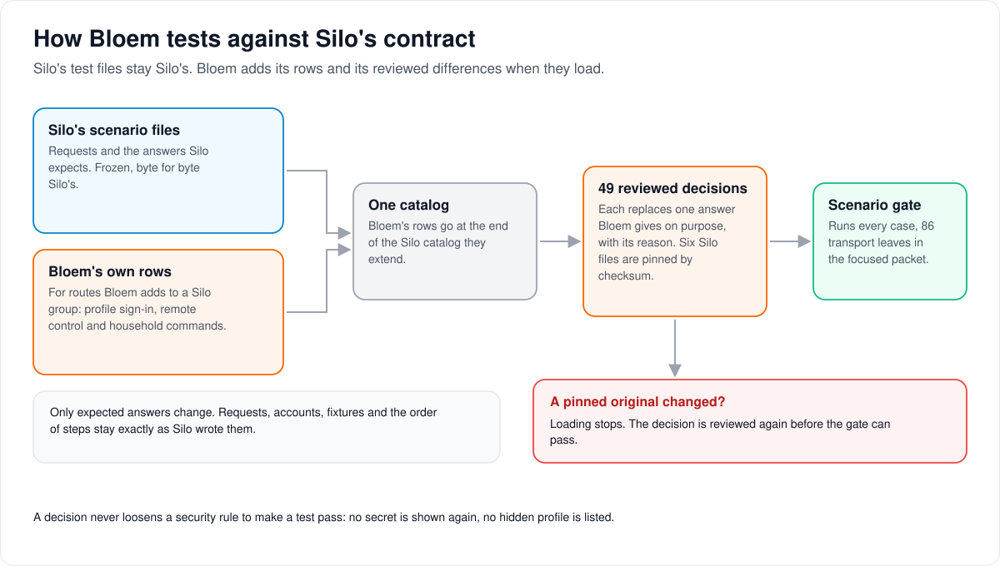

# How Bloem's contract adjudications worked (retired)

> **Retired on 2026-11-11.** Silo retired its v1 API and deleted its scenario catalogs, their
> executor and the v1/v2 pairing model (Silo #3200). Bloem's adjudications, extra catalogs and
> executor hooks went with them, as did the gate's `scenarios` phase and Bloem CI's scenario
> executor job. This page records how they worked, because the same idea (a reviewed, pinned
> decision instead of a loosened test) applies to any contract test Bloem inherits.

Silo described how its API must behave in **scenario files**: a request, who sends it, and the
answer Silo expects. Bloem ran those same files against its own server. This page explains how
Bloem added its own rows, how it recorded the few places it answered differently on purpose, and
what stopped that from hiding a real mistake.

## How the layers fit

1. **Silo's scenario files stay Silo's.** Bloem never edited them, so Silo's updates merged
   cleanly.
2. **Bloem's own rows** covered routes Bloem added to a Silo route group, such as profile
   sign-in, remote control and household commands. They lived in Bloem's own files and were
   added to the end of the Silo catalog they extended when it loaded.
3. **Adjudications** were 49 reviewed decisions. Each replaced one expected answer where Bloem
   answered differently on purpose, and said why.
4. **Pins.** Bloem recorded a checksum of each of the six Silo files it adjudicated, and kept
   a copy of each original case. If Silo changed one, loading stopped until someone reviewed the
   decision again.
5. **The scenario gate** ran every case, including the unchanged ones.

## What an adjudication could and could not do

An adjudication changed only the **expected answer**. The request, the account sending it, the
test data and the order of steps stayed exactly as Silo wrote them. A decision was never a way to
make a failing test pass by loosening a rule: none showed a secret again, let a hidden profile
be listed, or treated a crash as acceptable. No test was excluded from the ordinary gate.

Most decisions fell into a few kinds:

- **Silo moved on.** Silo's newer `/api/v2` added fields after its test was frozen, so Bloem's
  answer had them too. Silo wins.
- **Bloem adds something.** For example, an account's own details also say whether it is a
  storefront preview guest and whether it may play video.
- **A later decision.** For example, a recorded change shows an API key's secret only when the
  key is created, never again in a list.
- **Bloem is stricter.** For example, a missing storage service is reported as unavailable,
  not as a crash.
- **Bloem's name.** A device sign-in page says `Bloem`, not Silo's name.

## Example: a list of API keys

This example uses a real decision.

Silo's frozen test for listing API keys expected each key's secret value in the list. A later
change, recorded among the pre-lock removals in [v1 scope](v1-scope.md), shows a key's secret
only once, when it is created; a list gives a short prefix instead. So the adjudication for
`keys_list.meaning` and `keys_list.shape` expected no `key` field at all, and still checked the
key's prefix, owner, scope and order. A negative test failed if a secret ever appeared.

## Who could change what

| Who | What they managed |
| --- | --- |
| Bloem developers | Proposing a new adjudication, with its reason, and re-pinning after reviewing a changed Silo original. |
| A reviewer | Accepting the decision. |
| Silo | Its own scenario files, which Bloem took byte for byte. |

## For developers

The code is gone, so this section records only what a developer may still meet in older notes.

- **Where things lived.** Silo's scenario files were under `contracts/api/v2/scenarios/`; Bloem's
  own rows under `internal/scenariocatalog/bloem_catalogs/<listener>/<group>.json`, spliced onto
  the catalog they extended by `scenariocatalog.Load`; the adjudications and their checksum pins
  in `internal/scenariocatalog/bloem_adjudications.json`. All of these were deleted with Silo's
  catalogs. `contracts/api/v2/breaking-approvals.json` is Silo's file and unchanged by Bloem.
- **What the decisions were.** Forty-nine transport decisions in all, in the kinds listed
  above: for example `422 validation_failed` for an invalid invitation email on v2, `stale: true`
  on unsampled resources, the seven named API-key scopes in discovery, `503 unavailable` instead
  of a recovered panic for a missing object store, `Cache-Control: no-store, no-transform` on
  state and progress reads, and `server_name` set to `Bloem`.
- **Why a pin failed closed.** A changed request, principal, row or original assertion stopped
  the catalog from loading, so a reviewer had to look at the decision again instead of the gate
  silently passing.
- **What replaced it.** Silo's `/api/v2` contract checks and Bloem's own contract tests
  ([API contract](api-contract.md), [v1 scope](v1-scope.md)). Bloem keeps no second copy of
  Silo's expectations.

Technical pages:

- [API contract](api-contract.md) and [v1 scope](v1-scope.md).
- [How Bloem follows Silo](bloem-following-silo.md): why Silo's files stay Silo's.

The picture is an SVG file under `images/contract-adjudications/`, drawn by
`scripts/bloem/draw-pictures.py`. Redraw it there, not by hand.
