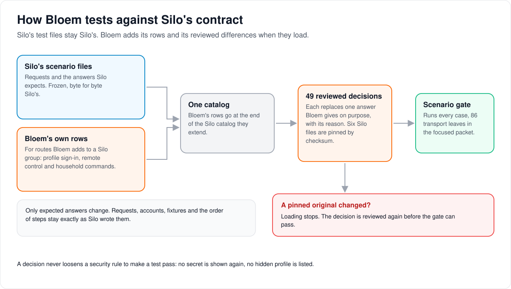

# How Bloem's contract adjudications work

> **Retired on 2026-11-11.** Silo retired its v1 API and deleted its scenario catalogs,
> their executor and the v1/v2 pairing model (Silo #3200, merged into Bloem in
> `26cf9b3e4`). The adjudications, Bloem's extra catalogs and executor hooks went with
> them, as did the gate's `scenarios` phase and Bloem CI's scenario executor job. This
> page is a historical record of how they worked.

> **Provenance and status.** Bloem page, rewritten on 2026-11-01 and checked against `main`
> at `b6039036d`; the account capability row updated on 2026-11-02 and the profile listing row on 2026-11-09. Adjudications are a Bloem test layer over Silo's frozen API scenario
> catalogs: where Bloem deliberately answers differently from what a Silo test expects, a
> reviewed, pinned decision replaces that expectation. Silo's files are unchanged. The
> technical rules are in the [For developers](#for-developers) section; the dated results
> there are history.
> Its routes were checked again on 2026-11-11, after Silo retired its v1 API.

Silo describes how its API must behave in **scenario files**: a request, who sends it, and the
answer Silo expects. Bloem runs those same files against its own server. This page explains
how Bloem adds its own rows, how it records the few places it answers differently on purpose,
and what stops that from hiding a real mistake.

## How the layers fit



1. **Silo's scenario files stay Silo's.** Bloem never edits them, so Silo's updates merge
   cleanly.
2. **Bloem's own rows** cover routes Bloem adds to a Silo route group, such as profile
   sign-in, remote control and household commands. They live in Bloem's own files and are
   added to the end of the Silo catalog they extend when it loads.
3. **Adjudications** are 49 reviewed decisions. Each replaces one expected answer where Bloem
   answers differently on purpose, and says why.
4. **Pins.** Bloem records a checksum of each of the six Silo files it adjudicates, and keeps
   a copy of each original case. If Silo changes one, loading stops until someone reviews the
   decision again.
5. **The scenario gate** runs every case, including the unchanged ones.

## What an adjudication may and may not do

An adjudication changes only the **expected answer**. The request, the account sending it, the
test data and the order of steps stay exactly as Silo wrote them. A decision is never a way to
make a failing test pass by loosening a rule: none shows a secret again, lets a hidden profile
be listed, or treats a crash as acceptable.

Most decisions fall into a few kinds:

- **Silo moved on.** Silo's newer `/api/v2` added fields after its test was frozen, so Bloem's
  answer has them too. Silo wins.
- **Bloem adds something.** For example, an account's own details also say whether it is a
  storefront preview guest and whether it may play video.
- **A later decision.** For example, a recorded change shows an API key's secret only when the
  key is created, never again in a list.
- **Bloem is stricter.** For example, a missing storage service is reported as unavailable,
  not as a crash.
- **Bloem's name.** A device sign-in page says `Bloem`, not Silo's name.

## Example: a list of API keys

This example uses a real decision.

Silo's frozen test for listing API keys expects each key's secret value in the list. A later
change, recorded among the pre-lock removals in [v1 scope](v1-scope.md), shows a key's secret
only once, when it is created; a list gives a short prefix instead. So the adjudication for
`keys_list.meaning` and `keys_list.shape` expects no `key` field at all, and still checks the
key's prefix, owner, scope and order. A negative test fails if a secret ever appears.

## Who can change what

| Who | What they manage |
| --- | --- |
| Bloem developers | Proposing a new adjudication, with its reason, and re-pinning after reviewing a changed Silo original. |
| A reviewer | Accepting the decision. No test is excluded from the ordinary gate. |
| Silo | Its own scenario files, which Bloem takes byte for byte. |

## Words used in the code

| On this page | In the code and repository |
| --- | --- |
| Silo's scenario files | `contracts/api/v2/scenarios/` |
| Bloem's own rows | `internal/scenariocatalog/bloem_catalogs/<listener>/<group>.json`, spliced by `scenariocatalog.Load` |
| Adjudications | `internal/scenariocatalog/bloem_adjudications.json`, loaded by `bloem_adjudications.go` |
| Pins | `catalog_sha256` in that file |
| Scenario gate | the ordinary Bloem scenario executor (`internal/scenariocatalog/executor`) |
| Route decisions | `internal/api/bloem_v1_adjudication_test.go` |
| Breaking-change approvals | `contracts/api/v2/breaking-approvals.json` (Silo's bytes) |

## For developers

- **API:** the frozen catalogs and their v1/v2 pairing model were described in Silo's
  `docs/architecture/scenario-acceptance.md`, deleted with them. Silo's
  [Problem Details](api-contract.md#problem-details) and the
  [pre-lock removals](v1-scope.md#breaking-removals-taken-before-lock) are the contracts
  several decisions cite.

### History

First written with the September 19 CI follow-through (`23ee4c1ac`, 2026-09-19). Later:
Silo's newer v2 fields adjudicated (`e5fd82c87`, 2026-10-08); the October 14 transition below
(merged in `4e7ff22d7`, 2026-10-15); Bloem's own scenario rows moved out of Silo's files
(`ae1117d8a`, 2026-10-26); four profile adjudications removed with lifecycle receipts
(`b017bfe84`, 2026-10-26). On 2026-11-01 Silo's scenario files and
`contracts/api/v2/breaking-approvals.json` are byte for byte Silo's (Silo merged through
`63ef34b23`).

### October 14 upstream contract transition

The Silo sync through `ea3c10a7f` adopts two upstream pre-lock decisions:
[Silo #1801](https://github.com/Silo-Server/silo-server/pull/1801) makes the stored account
profile limit nullable to express group inheritance, and
[Silo #2413](https://github.com/Silo-Server/silo-server/pull/2413) removes administrator CSS,
font and color overrides. The four exact breaking-change fingerprints against the prior Bloem
baseline were recorded in `contracts/api/v2/breaking-approvals.json`, with those upstream PR
numbers as their approval provenance. No wildcard or post-lock exemption was introduced. The
four left that file in `7452bd121` (2026-10-15), once `main` contained the changes. Since the
Silo merge `303511a25` (2026-10-26) the file is Silo's bytes again: Bloem's copy had
accumulated 81 other approvals for changes `main` already included, and they were dropped.

The web consumers and server-maintained Kotlin/Swift contracts follow the upstream shapes.
Bloem's organization and seasonal branding remain separate. Before rollout, both native client
releases need their generated-contract adoption checked, especially nullable `max_profiles`.
This local server merge does not update or certify sibling client releases.

The auth scenario catalog adds Silo's `jellyfin_quick_connect` capability field. Bloem
answered `false` while it had removed Jellyfin compatibility; since the restore (`2393c41ee`,
2026-10-18, see [protocol compatibility](bloem-compatibility-removal.md)) the device-login
capability is Silo's code and answers `true`. The baseline digest was refreshed after
reviewing those three added field-presence assertions. The existing adjudicated scenarios and
their transport decisions are unchanged.

### Bloem's own scenario rows

Rows for routes Bloem registers in a Silo route group (profile login, device remote control,
profile reads and household commands) live in
`internal/scenariocatalog/bloem_catalogs/<listener>/<group>.json` (today
`api/api-v1-auth.json`, `api/api-v1-devices.json` and `api/api-v1-profiles.json`), each naming
the Silo catalog it `extends`. `scenariocatalog.Load` splices them onto the end of that
catalog's rows, so Silo's files under `contracts/api/v2/scenarios/` stay Silo's bytes while
the gate, the executor and the adjudication digests see the same merged catalog as before.

### Decision and scope

The 2026-09-19 CI follow-through reconciles historical Silo fixtures with behavior already
shipped by this tracking fork. It does **not** change production handlers, authorization,
response serialization or routing to satisfy a test. It does not restore credential
disclosure, typed-nil panics or hidden-profile enumeration.

The original scenario JSON, route snapshots and upstream acceptance selectors remain
unchanged. The ordinary Bloem scenario gate applies an explicit, source-pinned downstream
expectation layer. This is a deliberate contract decision, not a claim that the original Silo
expectations passed unchanged.

The implementation is
[`bloem_adjudications.go`](../../internal/scenariocatalog/bloem_adjudications.go), with all 49
transport decisions and their reasons in
[`bloem_adjudications.json`](../../internal/scenariocatalog/bloem_adjudications.json). The
loader checks SHA-256 pins for all six affected baseline catalogs (`api/api-v1-admin-invitations.json`,
`api/api-v1-admin-system.json`, `api/api-v1-api-keys.json`, `api/api-v1-auth.json`,
`api/api-v1-onboarding.json` and `api/api-v1-profiles.json`) and compares each supplied
scenario and row with its original. A changed request, principal, row or original assertion
fails closed and requires renewed review. It returns copies; the frozen loader and its
historical selectors are not rewritten.

### Scenario decisions

| Cases / transport | Current Bloem contract | Reason |
|---|---|---|
| `adm_inv_create.invalid_email` / v2 | `422 validation_failed`, with exactly one safe `body.email` field diagnostic | Required by [Problem Details](api-contract.md#problem-details); v1 remains `400 invalid_email`. |
| `resources.ok`, `resources.unsampled` / v2 | Unsampled resources explicitly include `stale: true` | Availability remains false and GPU entries remain empty. Do not discard freshness information. |
| `keys_list.meaning`, `keys_list.shape` / v1 | `key` is absent, including null/empty values; `key_prefix` is present and `revision` is a positive integer | The [recorded pre-lock removal](v1-scope.md#breaking-removals-taken-before-lock) makes secrets creation-only. Ownership, scope and ordering assertions stay. |
| Five `scopes.*` discovery cases / v2 | Exactly seven named scopes in the reviewed order | Native discovery includes session summaries, library discovery, bulk entitlements, storefront template provisioning (`admin:entitlements:accounts`) and preview administration (`admin:preview`). V1 keeps its two-scope projection. Discovery never grants authority. |
| `me.api_key` / v1 | An authenticated unscoped key reads its own exact, nonsecret account projection | Authentication is resolved once by middleware rather than reparsing a key as a JWT. This does not permit session minting, logout or scope escalation. |
| `me.api_key`, `me.ok`, `me.disabled_account` / v2 | Silo's account keys plus `preview` and `playback_allowed` | Bloem's account projection reports the guest preview binding (null otherwise) and playback permission. Everything else Silo pins is unchanged. |
| `setup_status.db_down` / v1, `signup_status.db_down` and `capability.ok` / v1 and v2 | `503 unavailable`, "Preview host configuration is unavailable." | With the database unreachable the preview host guard cannot read its settings, so it refuses every auth route before routing; a GET there can start a sign-in. Anonymous routes elsewhere, including liveness and readiness, keep Silo's answers. |
| Four `account_capability.*` cases / v2 | Revision is the opaque authority-bound digest, not constant `"1"`; the body also carries `sign_out_other_sessions: true`, which Silo added on October 31, 2026 (#2925) | Primary, secondary and profileless capability predicates stay unchanged. |
| Three `state.*` and four `progress.*` cases / v2 | Exact `Cache-Control: no-store, no-transform`, including follow-up reads | Preserve both privacy directives rather than weakening the response. |
| `avatar_upload.typed_nil_panic`, `avatar_upload.meaning` / both | Missing object storage returns `503` with a safe envelope | An unavailable dependency is not a recovered handler panic. |
| Four `sessions.*` cases / v2 | The listing also carries `current_session`; each session also carries `current` and `last_seen_at` | Silo's v2 session listing added them after the oracle was frozen. Silo wins. |
| `profiles_list.ok` / v2 | The listing also carries `max_advisory_age_supported`, `require_advisory_age_supported` and, for an account with a profile limit, `max_profiles` | Silo's v2 profile listing added them after the oracle was frozen (`max_profiles` in Silo #3656, merged in `5a93e8b41`; the fixture account resolves to the default limit, `DefaultMaxProfiles`). Silo wins. |
| Ten `device_lookup.*` cases / v2 | `server_name` is `Bloem` | Bloem's default display name (`branding.DefaultServerName`); the oracle expects Silo's brand. |

Until 2026-10-26 the table also adjudicated `profiles_create.limit`,
`profiles_create.unknown_library_ids` (v1) and `profiles_delete.secondary_forbidden` (both
transports). They described Bloem's lifecycle-receipt profile handlers; when `b017bfe84`
removed lifecycle receipts, those handlers returned to Silo's bytes and the four decisions
were dropped (53 to 49).

Only expected responses and the reviewed onboarding follow-up headers change. Requests,
identities, fixtures, mutation sequencing, transport pairing and follow-up execution do not.
A focused real-router packet executes all 86 transport leaves, including the unchanged
partners (`TestBloemAdjudicatedScenarios` pins the count). Negative tests reject disclosed
keys (`TestBloemAdjudicationRejectsAPIKeyDisclosure`) and changes to the pinned originals
(`TestBloemAdjudicationsPreserveFrozenCatalogs`, `TestBloemAdjudicationsRefuseChangedOriginal`).

The older named Silo acceptance targets still certify their original upstream contracts.
They are not relabeled as Bloem compatibility evidence; in particular, a target requiring
reusable secrets on list reads is not a valid Bloem release oracle. Use the normal Bloem
scenario gate or the focused packet below for these adjudicated cases. No test is excluded
from the ordinary gate.

### Route decisions

[`bloem_v1_adjudication_test.go`](../../internal/api/bloem_v1_adjudication_test.go) pins the
unchanged route snapshots and lists every affected method and path:

- Three OAuth routes are existing upstream Silo routes, verified in the tracked upstream
  router, under its v1 prefix: `POST /auth/oauth/complete`, `POST /auth/oauth/{install_id}/init`,
  and `GET /auth/oauth/{install_id}/callback`. They are not new fork-only v1 features.
  The full surface check now requires these additions explicitly.
- The 28 historical v1 `/livetv/...` entries describe Bloem's Prairie-derived feature, not
  an upstream Silo capability. Their maintained home is `/api/bloem/v2/livetv/...`, as already
  implemented by the native Live TV work. This review records the namespace correction; it
  does not introduce aliases, redirects or another v1 removal at runtime. Older callers of the
  fork-only prefix must migrate; they are not claimed compatible.

There is no prefix-wide ignore rule. Every listed old route must be absent and its exact
native method and path must be mounted, including `HEAD` and all administrative writes. A
missing native replacement, restored legacy alias, missing OAuth addition, changed snapshot,
or unrelated v1 addition or removal fails (`TestBloemV1AdjudicationClosedSet`). The existing
mounted authority and delivery tests remain separate checks of profile, PIN, administrator
and stream-proof enforcement.

### Focused verification

Commands assume the repository root is the cwd. Use separate disposable, migrated application
and scenario databases; scenario reseeding is destructive.

```sh
go test -count=1 ./internal/scenariocatalog -run '^TestBloemAdjudications'
go test -count=1 ./internal/scenariocatalog/executor \
  -run '^TestBloem(AdjudicatedScenarios|AdjudicationRejectsAPIKeyDisclosure)$'
go test -count=1 ./internal/api \
  -run '^(TestV1RouteSurface.*|TestV1SiloRouteContractIsNeverNarrowed|TestBloemV1AdjudicationClosedSet)$'
```

On 2026-09-19 the focused real-router packet passed **52 transport leaves / 99 hierarchical
events** without skips, and the route packet passed **9 hierarchical events**. These are
targeted results, not a full-suite or real-provider certification. Remote CI for `418a18b7d`
then passed the API route tests but timed out in the ordinary scenario executor after 20
minutes. No assertion-failure markers were reported; unfinished scenarios remain unverified.

The [deployment record](../operations/2026-09-19-xtream-deployment.md) records the completed
rollout and narrowly approved timeout exception; it does not mark CI green.

Technical pages:

- [API contract](api-contract.md) and [v1 scope](v1-scope.md).
- [How Bloem follows Silo](bloem-following-silo.md): why Silo's files stay Silo's.

The picture is an SVG file under `images/contract-adjudications/`, drawn by
`scripts/bloem/draw-pictures.py`. Redraw it there, not by hand.
