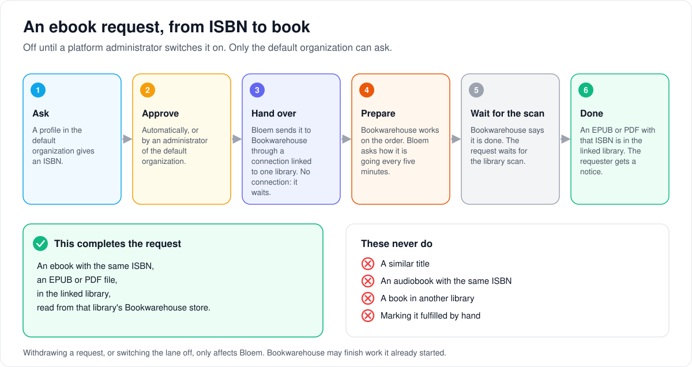
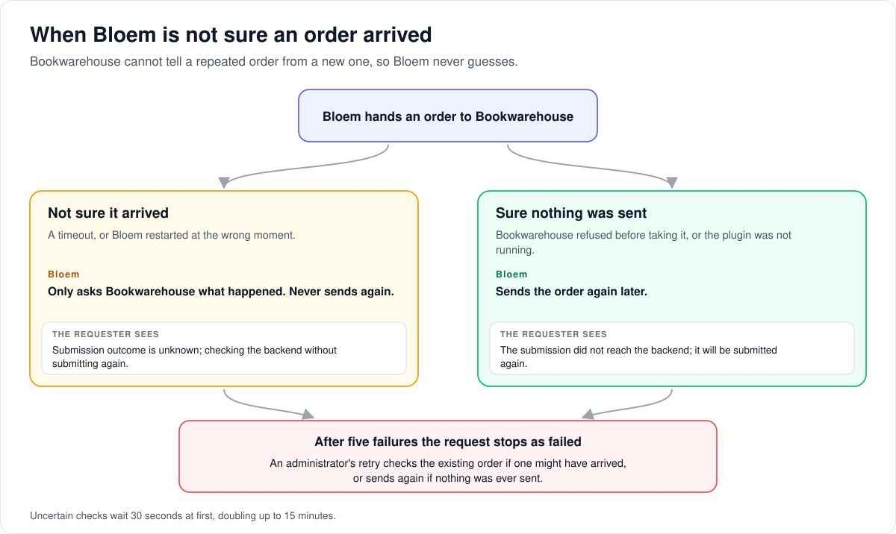

# How ebook requests work

> **Provenance and status.** Bloem page, rewritten on 2026-11-01 and checked against
> `main` at `b6039036d`. The ebook request lane is a Bloem addition: Silo's request
> service covers movies and series through TMDB, and Bloem's book lanes sit beside
> it. No deployment record under `docs/operations/` mentions an ebook request
> acquisition in production. The technical rules are in the
> [For developers](#for-developers) section.

A viewer in the default organization can ask for an ebook by its ISBN, and Bloem
can have Bookwarehouse supply it. This page walks through who can ask, how a
request becomes a book in the library, what Bloem does when it is not sure a
request reached Bookwarehouse, and who manages the lane. The overview of all
three request kinds is [how requests work](bloem-requests.md).

## Who can ask

- **The lane is off until a platform administrator switches it on.** While it is
  off, nobody can file or approve, but people can still see their history and
  withdraw, and administrators can still decline.
- **Only the default organization.** Bloem's own direct customers can ask. A
  reseller organization's people cannot, not even its administrators.
- **Only by ISBN.** The **ISBN** is the number that identifies an edition. A
  ten-digit ISBN is turned into the thirteen-digit form. A title, an author or an
  ASIN alone is not accepted.
- **The plan must allow requests.** Ebooks follow the same request settings as
  other requests, but are counted on their own, apart from audiobooks, movies and
  series. Withdrawing still counts; a decline gives the count back.
- **One request per tap.** An app sends an **idempotency key** with each new
  request, so a retry after a lost answer returns the first request.

The web app offers ebook requests. Bloem's phone and TV apps don't yet, and
Jellyfin and Audiobookshelf apps never see this lane.

## From request to book

1. **Ask.** A profile in the default organization gives an ISBN.
2. **Approve.** Automatically, when the request settings say so, or by an
   administrator of the default organization.
3. **Hand over.** Bloem sends it to **Bookwarehouse** through a **connection**: a
   saved Bookwarehouse address and key, linked to one Bookwarehouse ebook
   library. With no usable connection, the approved request simply waits.
4. **Prepare.** Bookwarehouse works on the order. Bloem asks how it is going
   every five minutes.
5. **Wait for the library.** When Bookwarehouse says it is done, the request waits
   for the library scan.
6. **Done.** The request is fulfilled when an EPUB or PDF with that ISBN appears
   in the linked library. The requester gets a notice.

A similar title, an audiobook with the same ISBN, or a book in another library
never completes the request. There is no "mark fulfilled by hand" for ebooks.

## When Bloem is not sure

Bookwarehouse cannot tell a repeated order from a new one. So if Bloem doesn't
know whether its order arrived (a timeout, or Bloem restarted at the wrong
moment), it never sends the order again. It only asks Bookwarehouse what
happened. The requester sees:

> Submission outcome is unknown; checking the backend without submitting again.

When Bloem knows for certain that nothing was sent, for example because
Bookwarehouse refused the order before taking it or the plugin was not running,
it sends again later:

> The submission did not reach the backend; it will be submitted again.

After five failures the request stops as **failed**. An administrator's retry
then sends again if nothing was ever sent, or checks the existing order if
something might have been.

Withdrawing a request, or switching the lane off, only affects Bloem.
Bookwarehouse may finish work it already started.

## Who can change what

| Who | What they manage |
| --- | --- |
| Platform administrator | Switching the lane on and off, Bookwarehouse connections, linking a connection to a library, and testing a connection. They work as the default organization or in the Platform context. |
| Administrator of the default organization | The ebook queue: approve, decline, retry. |
| A profile in the default organization | Asking, following and withdrawing its own requests. |

## Words used in the code

| On this page | In the code and database |
| --- | --- |
| Ebook request | a `bloem_book_requests` row with `media_type` `book` (`internal/bookrequests`) |
| Switching the lane on | the server setting `bloem.requests.ebooks_enabled`, exactly `true` |
| Bookwarehouse | the `bloem.requests.bookwarehouse` plugin, through `request_router.v1` |
| Connection | a `request_integrations` row that advertises `book` |
| Linked library | a native Bookwarehouse ebook library (storage plugin `bloem.storage.bookwarehouse`), bound in `bloem_ebook_request_integrations` |
| Hand over | a dispatch in `bloem_ebook_request_dispatches` |
| Checking every five minutes | the hidden `bloem_reconcile_book_requests` task |
| Waiting for the library | fulfilment `awaiting_library` |

## For developers

- **API:** [requests](../bloem/api/requests.md): the viewer routes under
  `/api/bloem/v1/ebook-requests`, the queue under
  `/api/bloem/v1/admin/organization/ebook-requests`, the policy switch
  `PUT /api/bloem/v1/admin/organization/ebook-request-policy`, and the
  connection routes under
  `/api/bloem/v1/admin/organization/ebook-request-integrations`.

### Lane boundary

Ebook requests use `internal/bookrequests` and the Bloem-owned
`bloem_book_requests` table with media type `book`. The existing Requests page
and organization admin queue select this lane with `kind=ebook`. Audiobooks
keep their own routes, quota counters, retry semantics and manual completion
([how audiobook requests work](bloem-audiobook-requests.md)); Silo's TMDB
request table stays separate.

### Admission and authority

Filing and approval require the exact unencrypted value `true` for
`bloem.requests.ebooks_enabled`; the default is `false`. Global request policy
must also permit the operation. The caller needs an enabled account and active
membership in the durable default organization (`organizations.is_default`).
Ordinary viewers need a verified current profile belonging to that account and
organization. Hosted (reseller) organizations cannot file, including their
administrators.

Authorized history, denial and local cancellation remain available after
opt-out. Mutations require the current request revision. Withdrawal keeps quota
usage; denial refunds it. Quotas inherit existing request/group policy but count
ebooks independently from audiobooks and movie/series requests.

ISBN is mandatory. Valid ISBN-10 converts to canonical ISBN-13; ASIN and
title-only identities are unavailable. Filing uses a durable `Idempotency-Key`
scoped to organization, account and profile. Identical normalized retries
return the retained request; changed payloads or cross-kind key reuse conflict.
Existing audiobook digests remain valid.

### Fulfillment boundary

Acquisition uses a separate ordinary plugin, `bloem.requests.bookwarehouse`,
through the existing SDK `request_router.v1` interface. Native storage plugins
cannot declare this capability. Connections reuse the encrypted
`request_integrations` store and must explicitly advertise `book`; an empty
media-type list does not qualify. Integration IDs are opaque strings.

Platform administrators configure the lane from an administrative context for
the default organization or a verified platform context. Platform setup resolves
only the default organization and checks its active account and membership; an
initializing default is allowed only while Silo switching is enabled (the
`public.bloem_silo_switching` flag; see
[Silo backend switching](silo-backend-switching.md)). This exception applies only
to ebook setup (`ResolvePlatformViewer` in
`internal/api/bloem_ebook_request_setup.go`), not to organization session
selection or request queues. Policy, connection creation and library binding are
separate mutations. Connections default to EPUB and HTTPS; trusted local HTTP
requires explicit opt-in. PDF requires an explicit connection configuration
opt-in. Responses never contain connection credentials.

`POST .../ebook-request-integrations/{id}/test` runs the plugin's
`TestConnection` against a saved connection the lane can use, for a platform
administrator. It returns `{ok, message}` with HTTP 200 whether or not the test
passed. Transport errors become fixed text, and a plugin message that repeats
the saved API key is withheld. A test is a provider read; it does not touch
dispatch state.

Each connection must be linked to an enabled native Bookwarehouse ebook library
accessible to the default organization. Approved requests remain awaiting
fulfillment when no eligible bound connection exists. Dispatch freezes a
secret-free descriptor containing the connection, installation, configuration,
binding and storage-source revision. Changes invalidate its use rather than
silently redirecting existing provider work to another library or account.

### Recovery and concurrency

The hidden book reconciliation task (`bloem_reconcile_book_requests`) runs every
five minutes with bounded batches. PostgreSQL leases permit multiple server
replicas. Provider RPCs run outside database transactions, after persisting a
dispatch-start marker. Policy epochs fence responses across transient
disable/enable changes; narrow observers accept ordinary upstream settings
writes while advancing only Bloem-owned state.

Bookwarehouse lacks atomic idempotency. After an uncertain submission or process
loss, recovery and status calls only read provider state. They never blindly
repeat the acquisition POST. Retained receipts bind the canonical ISBN, format
and original submission identity. Canceling and refiling the same ISBN keeps
that submission identity and recovers previous work before any new submission.
Unresolved state remains visible for admin review and retry. A host failure
before RPC entry, or the plugin's `FailedPrecondition`/`InvalidArgument` rejection
before submission, proves that nothing was sent and clears only a new,
receipt-free started claim. Generic transport errors remain uncertain and
recover only through reads. The library loader carries the storage location's
selection revision into its authority check.

The requester-visible reason follows that distinction. An uncertain outcome
reads "Submission outcome is unknown; checking the backend without submitting
again." A proven non-submission reads "The submission did not reach the
backend; it will be submitted again." That covers a plugin refusal and a host
failure before the call, such as an unavailable plugin or a failed
revalidation. Uncertain checks back off from 30 seconds, doubling up to 15
minutes. After five failures the request is `failed`: a non-submission says that
an administrator retry submits again ("Submission failed repeatedly before
reaching the backend; retry submits it again."), and an uncertain one says that
retry checks the existing submission ("Backend checks stopped after repeated
failures; retry checks the existing submission."). A provider-reported failure
is `failed` at once ("The backend could not fulfill this request; retry checks
the existing submission.").

Cancellation affects Bloem only. Bookwarehouse may continue work already
started. Disabling acquisition blocks new provider work; it does not promise
provider cancellation. Provider errors exposed to clients exclude credentials
and raw backend responses.

### Completion and notifications

Provider completion means awaiting a library scan. Fulfillment requires an
ISBN-matching `media_items.type=ebook` item with an `ebook` ISBN provider ID
in the retained linked library, a `probe_source=storage` EPUB/PDF file
reference, canonical catalog location and the retained storage-source identity.
A filesystem replacement, missing file, foreign library, audiobook or title
match cannot complete the request. Manual ebook fulfillment is unavailable.
Catalog completion does not claim provider liveness or a successful reader open.

Submitted notices go to current organization administrators; approval, decline
and completion go to the current requester. Kind-aware lifecycle notices link
to the ebook lane. Library-completion delivery checks current catalog access
and retries durably. No tenant book titles go to deployment-wide broadcasts.

### Client scope

`ebook_requests_v1` advertises the mounted API, while its per-profile capability
reports opt-in and current policy. This increment supports embedded web/admin
flows. Ebook request adoption in Bloem Apple and Android is deferred. Ebook
requests are
open to any user of Bloem, so the five viewer routes (capability, history,
filing, read and withdrawal) are in the direct-profile session allowlist, as the
audiobook viewer routes are. A bound profile files and withdraws as itself under
the same default-organization and profile checks; approval, retry and setup stay
administrative. `ebook_requests_direct_profile_v1` is advertised alongside
`ebook_requests_v1`, so a client can tell this admission from an older server's
403. Jellyfin and Audiobookshelf do not expose this Bloem request API. Automatic
audiobook acquisition uses its own lane.

### History

Ebook admission arrived in `285e83c8b` (2026-10-10), fulfillment and the shared
book queue in `fb87eb439` (2026-10-11), and the direct-profile and
connection-test changes on 2026-10-14 (`70401bd26`, `49834d9f3`, `2cc1fc6c0`,
`690a939ff`, `86438443b`, `c3523bb5f`). `c60b7008e` (2026-10-26) moved account
policy back onto Silo's `users` table and replaced the membership-policy phases
with a single Silo switching flag, which changed the setup exception above.

Technical pages:

- [How requests work](bloem-requests.md): the three request kinds side by side.
- [How audiobook requests work](bloem-audiobook-requests.md): the other book lane,
  which shares the queue table and the five-minute task.
- [Native storage](bloem-native-storage.md): Bookwarehouse storage sources and
  the libraries they feed.
- [Silo backend switching](silo-backend-switching.md).

The pictures are SVG files under `images/ebook-request-foundation/`, drawn by
`scripts/bloem/draw-pictures.py`. Redraw them there, not by hand.
