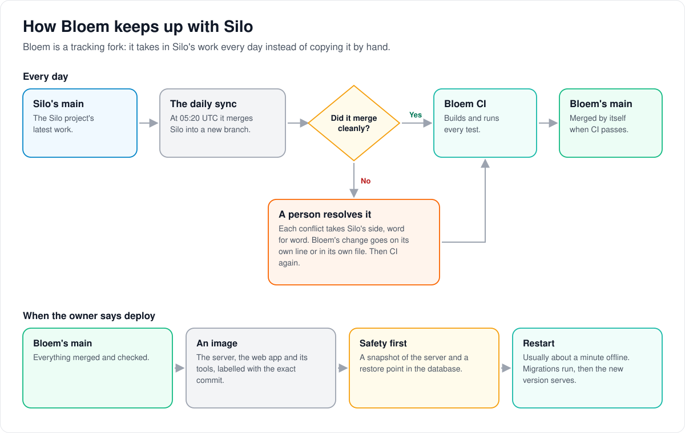

# How Bloem keeps up with Silo

> **Provenance and status.** Bloem page, written on 2026-10-31, updated on 2026-11-01
> and checked against `main` at `b6039036d`. On 2026-11-02 the routine below changed:
> the daily sync was switched off and Silo is merged outside GitHub Actions. Bloem is a tracking fork of Silo Server.
> This page explains in plain language how Bloem takes in Silo's work and keeps its
> own apart. The policy itself is in [how Bloem forks Silo](../../FORK.md), and the
> automation in [Bloem CI](../bloem/ci.md).

Bloem is Silo plus Bloem's additions. Silo's developers change Silo every day,
and Bloem takes those changes in rather than copying them by hand. This only
stays cheap if Bloem's additions sit **beside** Silo's code, never inside it.

## Each Silo merge

1. **A maintainer merges** Silo's latest work into a new branch of Bloem, outside
   GitHub Actions. Each conflict takes Silo's side, word for word, and Bloem's
   change goes on its own line or in its own file.
2. **Does Bloem still work?** Every check runs before anything is pushed: the Go and
   web tests, the contract checks and the database checks. Where Silo's change would
   break Bloem, Bloem's behavior goes back on Bloem's own lines, with a test, and the
   checks run again.
3. **Pushed to `main`,** the merge goes through Bloem CI like any other push.

Until 2 November 2026 a daily GitHub job made the merge at 05:20 UTC and landed a
clean one by itself. It could not resolve a conflict or adapt Bloem's code, so it
is switched off ([Bloem CI](../bloem/ci.md#how-silos-work-comes-in)).

When the owner says deploy, `main` becomes an image labelled with its exact
commit. Before the restart there is a snapshot of the server and a restore point
in the database. The restart usually takes about a minute: database migrations
run, then the new version serves. Each deploy gets a dated receipt under
`docs/operations/`.

On 2 November 2026 Bloem's `main` had all of Silo's work through `07f0ae21c`, merged
that night, and production ran `e3a096b20`.

## When Silo and Bloem change the same lines

**Silo always wins.** On 31 October 2026 a merge had folded Bloem's check into
one of Silo's lines in the household code. The behavior was right, but every
time Silo touched that line it would conflict again. The fix put Silo's line back
exactly as Silo wrote it, with Bloem's check on its own lines just above.

Bloem keeps its own work in three places:

- **Its own files,** named `bloem_*`, and whole packages that Silo doesn't have,
  such as Live TV.
- **Overlays:** where a Silo document needs a Bloem note, a separate Bloem page
  carries it, and Silo's document stays as Silo wrote it.
- **The seam list,** `contracts/seams.txt`: the Silo files Bloem still edits,
  each with its reason. On 1 November 2026 it held 304. The number may only go
  down, and adding one is a reviewed decision: the 304th, on 1 November, keeps a
  sign-in or sign-out through the sign-in provider on the organization's domain it
  started on.

## Words used in the code

| On this page | In the repository |
| --- | --- |
| Tracking fork | `main` shares Silo's history and merges Silo's `main` ([FORK.md](../../FORK.md)) |
| A Silo merge | a merge commit on `main` titled "Merge Silo upstream through <sha>" |
| The daily sync (switched off) | `.github/workflows/upstream-sync.yml`, merged by `upstream-sync-merge.yml`; both run only when the repository variable `BLOEM_UPSTREAM_SYNC` is `true` |
| Bloem CI | `.github/workflows/bloem-ci.yml` |
| The image | the Bloem Image workflow, or a local build of the same commit |
| Receipt | a dated deployment record under `docs/operations/` |
| Seam | a Silo-owned file that Bloem edits, listed in `contracts/seams.txt` |
| Overlay | a Bloem page under `docs/bloem/overlays/` beside a Silo document |

## For developers

- [How Bloem forks Silo](../../FORK.md): the merge policy, seams and overlays, and
  what Bloem adds and removed.
- [Bloem's adapters over Silo](bloem-upstream-adapters.md): how Bloem changes Silo's
  behavior without editing Silo's files.
- [Bloem CI](../bloem/ci.md): every job, the switched-off daily sync and its merge
  gate, and the image.
- [BLOEM_AGENTS.md](../../BLOEM_AGENTS.md): the rules for changing Bloem,
  including Silo switching and upstream contributions.
- [Integration changelog](../bloem/CHANGELOG.md): every Silo merge and Bloem
  change, with commits and seam counts.
- [Documentation workflow](../bloem/documentation-workflow.md): where each kind
  of change is documented, and how the generated pages are rebuilt.

The pictures are SVG files under `images/following-silo/`, drawn by
`scripts/bloem/draw-pictures.py`. Redraw them there, not by hand.
