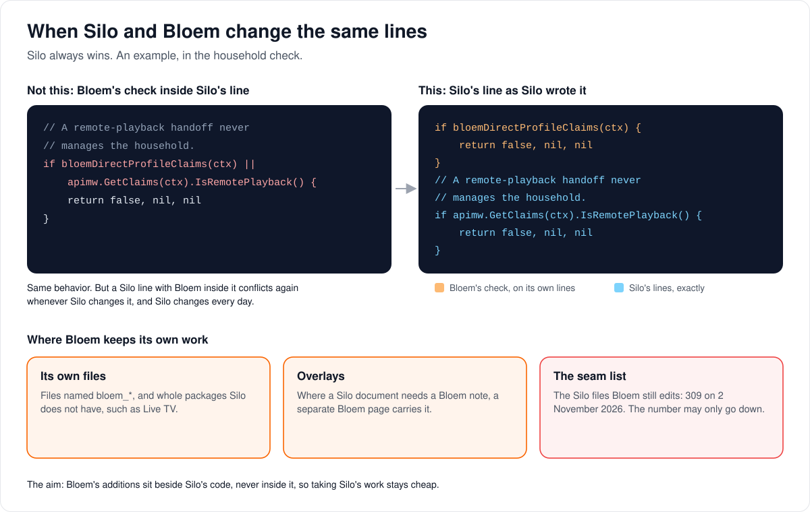

# How Bloem keeps up with Silo

Bloem is a tracking fork of Silo Server. This page explains in plain language how Bloem takes in Silo's work and
keeps its own apart. The policy itself is in [how Bloem forks Silo](../../FORK.md), the automation in
[Bloem CI](../bloem/ci.md), and the technical rules in the [For developers](#for-developers) section.

Bloem is Silo plus Bloem's additions. Silo's developers change Silo several times a
day, and Bloem takes those changes in rather than copying them by hand. This only
stays cheap if Bloem's additions sit **beside** Silo's code, never inside it. This
page walks through how each batch of Silo's work comes in and reaches production, when
the merge stops, what happens when Silo and Bloem change the same lines, and where Bloem
keeps its own work.

## Each Silo batch

![A merge bot takes each batch: Silo's main has new commits; twice a day, at 04:00 and 16:00 Amsterdam time, a free check starts one batch at a time in its own thread; the merge takes Silo's side of every conflict; if Bloem still works, the merge is pushed to main and the thread ends, the bot waits for Bloem CI on that commit and sends one message, and the daily deploy ships the newest commit CI passed. If not, Bloem adapts on its own lines, or the bot stops for a maintainer and blocks the next batch](images/following-silo/daily-flow.svg)

A **merge bot** on Bloem's build machine takes each Silo **batch**: everything on
Silo's `main` when the bot starts work on it.

1. **Twice a day, at 04:00 and 16:00 Amsterdam time,** a free check starts a batch
   when Silo has commits Bloem lacks and has been quiet for 10 minutes. It costs
   nothing, and it runs every 10 minutes to watch the running batch, but only those
   two times start one. Merging more often would not reach users sooner, because
   production moves once a day. One batch runs at a time: a batch still running when
   a slot comes means no new batch that slot, and commits that land later wait for
   the next one.
2. **One thread per batch.** The bot works each batch in its own thread, in its
   own copy of the repository. A maintainer can watch it live and answer it.
3. **The merge.** Every conflict takes Silo's side, word for word. Where Silo's
   change would break Bloem, Bloem's behavior goes back on Bloem's own lines or in
   Bloem's own files, with a test that fails without it.
4. **The review.** A script lists what the batch touches that Bloem has to look at:
   the seams, Bloem's files beside or calling the Silo code that changed, overlays,
   Bloem pages and migrations. The bot reads each one, regenerates the contracts and
   brings the pages the merge affects up to date.
5. **Does Bloem still work?** The **fast local checks** run on the build machine
   before anything is pushed: the build, the contract and verify checks and
   changed-line lint.
6. **Pushed to `main`,** the merge goes through Bloem CI like any other push, and
   Bloem CI runs the full suite. The thread ends here: it hands the pushed commit to
   the bot, and the bot itself waits for CI on that exact commit, with one rerun of a
   failed job. Then it sends one message: merged, or stuck when CI stays
   red.
7. **Deployed once a day.** At 10:00 Amsterdam time the daily deploy ships the newest
   commit on `main` that Bloem CI passed, with every batch merged since the last one;
   the deploy refuses any other commit. A maintainer can override the CI check by hand.

Until 2 November 2026 a daily GitHub job made clean merges by itself, and maintainers
merged the rest by hand. The job could not resolve a conflict or adapt Bloem's code,
so it is switched off ([Bloem CI](../bloem/ci.md#how-silos-work-comes-in)).

On 16 November 2026 Bloem's `main` had all of Silo's work through `17d5376ce`, merged
in `c1c7de503`, and production ran `43a551a45`: Silo through `abd85d0ca`, deployed on
16 November 2026 ahead of the daily deploy.

## Deploying a batch

1. **Safety first.** Before the restart there is a snapshot of the server and a
   **restore point** in the database: a marked moment the database can be taken back
   to.
2. **Restart.** It usually takes about a minute: database migrations run, then the
   new version serves. People watching at that moment are interrupted.
3. **Checks.** The server must be ready, healthy and on the new version, with no
   errors in its logs and every transcode node on the new image.

If a check fails, the bot puts the previous image back by itself, whether or not
migrations ran. Only when the server stops answering during the restart, or the
rollback itself fails, does the bot try nothing more and stop for a maintainer. The bot
never restores the database: that would undo what people did since the restore
point, so a maintainer decides.

## When the bot stops

The bot stops in its thread, writes what failed, what it tried and what it suggests,
and sends the "stuck" message, when:

- a test or check fails and it cannot fix the cause;
- Bloem cannot be kept working without editing Silo's lines;
- Bloem CI stays red after its fixes;
- the deploy fails or rolls back.

A stopped batch blocks the next one until a maintainer answers in its thread or
releases it. Production stays as it was, or as the rollback left it. Migrations and
people watching are not reasons to stop.

## When Silo and Bloem change the same lines

**Silo always wins.** In the household code, for example, Bloem's check sits on its own
lines just above Silo's line, and Silo's line stays exactly as Silo wrote it. Folding
the check into Silo's line would conflict again every time Silo touched it.

Bloem keeps its own work in three places:

- **Its own files,** named `bloem_*`, and whole packages that Silo doesn't have,
  such as Live TV.
- **Overlays:** where a Silo document needs a Bloem note, a separate Bloem page
  carries it, and Silo's document stays as Silo wrote it.
- **The seam list,** `contracts/seams.txt`: the Silo files Bloem still edits,
  each with its reason. The count may only go down, and adding a seam is a reviewed
  decision (`make verify-seams` checks the list).

## Example: a day's batches

This example is made up.

1. Silo lands three commits overnight, the last at 02:40.
2. At 04:00 the check finds them, and Silo has been quiet for more than 10 minutes.
   It starts a batch with all three.
3. The merge conflicts in one file. The bot takes Silo's lines, puts Bloem's check
   back on its own lines with a test, and runs the fast checks. It pushes at 04:25,
   hands the commit to the bot, and its thread ends.
4. Bloem CI fails one job. The bot runs it once more, and it passes. At 05:20 the
   bot sends one message: merged.
5. During the day Silo lands two more commits, at 09:15 and 13:30. The checks see
   them but start nothing until 16:00.
6. At 10:00 the daily deploy ships the 04:25 merge.
7. At 16:00 the check starts the next batch, with both of the day's commits. It is
   merged by evening and ships with the next morning's deploy.

## Who can change what

| Who | What they decide |
| --- | --- |
| A maintainer | Answering a stopped batch, pausing the bot or releasing a batch, every deploy the bot does not make, and any database restore. |
| The merge bot | Merging each Silo batch with Silo winning, fixing Bloem on Bloem's own lines, pushing to `main`, waiting for Bloem CI, and deploying once a day the newest commit Bloem CI passed. |
| A repository administrator | Switching the daily GitHub sync on, with the repository variable `BLOEM_UPSTREAM_SYNC`. |
| Silo | Its own files, which Bloem takes in as Silo wrote them. |

## Words used in the code

| On this page | In the repository |
| --- | --- |
| Tracking fork | `main` shares Silo's history and merges Silo's `main` ([FORK.md](../../FORK.md)) |
| The merge bot | runs outside this repository and GitHub Actions; its configuration, scripts and prompts are kept outside this repository |
| A batch, a Silo merge | one Silo commit and everything before it; its merge commit on `main` is titled "Merge Silo upstream through <sha>", from a `merge/upstream-<sha9>` branch |
| The review | `scripts/bloem/silo-merge-review.py` |
| The fast local checks | the `build`, `verify` and `lint` phases of `scripts/bloem/local-gate.py` |
| The daily sync (switched off) | `.github/workflows/upstream-sync.yml`, merged by `upstream-sync-merge.yml`; both run only when the repository variable `BLOEM_UPSTREAM_SYNC` is `true` |
| Bloem CI | `.github/workflows/bloem-ci.yml` |
| The image | built from exactly the commit Bloem CI passed |
| Seam | a Silo-owned file that Bloem edits, listed in `contracts/seams.txt` |
| Overlay | a Bloem page under `docs/bloem/overlays/` beside a Silo document |

## For developers

- [How Bloem forks Silo](../../FORK.md#taking-upstream-changes): the merge policy,
  the steps each batch follows, seams and overlays, and what Bloem adds.
- [Bloem CI](../bloem/ci.md#upstream-sync-merges): the merge bot's schedule, CI
  wait and deploy rules, the local gate, the switched-off daily sync and its merge gate, and
  the image.
- [Bloem's adapters over Silo](bloem-upstream-adapters.md): how Bloem changes Silo's
  behavior without editing Silo's files.
- [BLOEM_AGENTS.md](../../BLOEM_AGENTS.md): the rules for changing Bloem,
  including Silo switching and upstream contributions.
- [Integration changelog](../bloem/CHANGELOG.md): every Silo merge and Bloem
  change, with commits and seam counts.
- [Documentation workflow](../bloem/documentation-workflow.md): where each kind
  of change is documented, and how the generated pages are rebuilt.

Rules each batch keeps, beyond the steps above:

- The batch is exactly the Silo commit the check found, never a later
  `upstream/main`. If someone merged it by hand meanwhile, the batch ends with
  nothing to do.
- Each batch updates, in the same push as its merge, the overlays and Bloem pages its
  merge affects, and records which Silo commit Bloem now includes in the status
  paragraph above and in the front page's status rows. After the deploy, the bot records the
  commit production runs in the same places.
- A new seam is a last resort: only when Bloem's behavior has to go back on Bloem's
  own lines and no Bloem-owned file or field can carry it. The merge message
  names it.
- If `main` moves while a batch works, the bot merges the new `main` in and runs the
  gate again before pushing. A deploy guard refuses to restart unless production
  runs the expected previous release, so the bot never races a hand deploy.

The pictures are SVG files under `images/following-silo/`, drawn by
`scripts/bloem/pictures/following_silo.py` through `scripts/bloem/draw-pictures.py`.
Redraw them there, not by hand.
