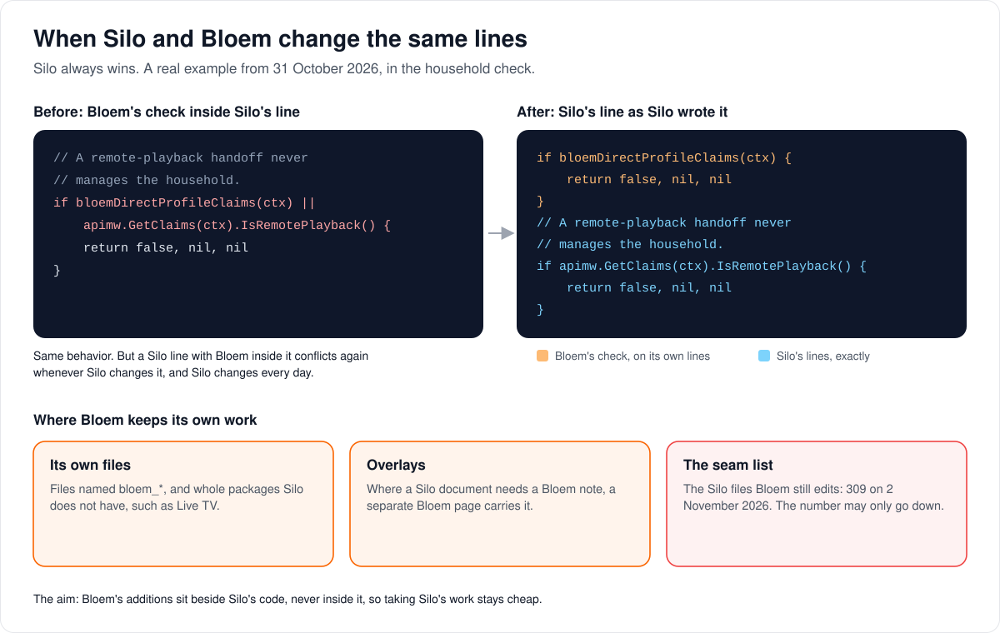

# How Bloem keeps up with Silo

> **Provenance and status.** Bloem page, written on 2026-10-31, updated on 2026-11-13
> and checked against `main` at `efafecd2e`. Bloem is a tracking fork of Silo Server.
> This page explains in plain language how Bloem takes in Silo's work and keeps its
> own apart. The policy itself is in [how Bloem forks Silo](../../FORK.md), the
> automation in [Bloem CI](../bloem/ci.md), and the technical rules in the
> [For developers](#for-developers) section.

Bloem is Silo plus Bloem's additions. Silo's developers change Silo several times a
day, and Bloem takes those changes in rather than copying them by hand. This only
stays cheap if Bloem's additions sit **beside** Silo's code, never inside it. This
page walks through how each batch of Silo's work comes in and is deployed, when the
merge stops, what happens when Silo and Bloem change the same lines, and where Bloem
keeps its own work.

## Each Silo batch

A **merge bot** on Bloem's build machine takes each Silo **batch**: everything on
Silo's `main` when the bot starts work on it.

1. **A free check every 10 minutes** looks for Silo commits Bloem lacks. It costs
   nothing, and it starts a batch only when Silo has new commits and has been quiet
   for 10 minutes, because Silo's commits arrive in bursts. One batch runs at a time;
   commits that land later wait for the next one.
2. **One thread per batch.** The bot works each batch in its own T3 thread, in its
   own copy of the repository. The owner can watch it live and answer it.
3. **The merge.** Every conflict takes Silo's side, word for word. Where Silo's
   change would break Bloem, Bloem's behavior goes back on Bloem's own lines or in
   Bloem's own files, with a test that fails without it.
4. **The review.** A script lists what the batch touches that Bloem has to look at:
   the seams, Bloem's files beside or calling the Silo code that changed, overlays,
   Bloem pages and migrations. The bot reads each one, regenerates the contracts and
   brings the pages the merge affects up to date.
5. **Does Bloem still work?** The **fast local checks** run on the build machine
   before anything is pushed: the build, the contract and verify checks and
   changed-line lint.
6. **Pushed to `main`,** the merge goes through Bloem CI like any other push, and
   Bloem CI runs the full suite. The bot waits for CI on that exact commit.
7. **Deployed.** The bot deploys only a commit Bloem CI passed: the deploy refuses any
   other. It writes the dated receipt and sends the owner one message: deployed,
   stuck or rolled back. The operator can override the CI check by hand, as happened
   once, when the owner wanted the first batch live at once.

Until 2 November 2026 a daily GitHub job made clean merges by itself, and maintainers
merged the rest by hand. The job could not resolve a conflict or adapt Bloem's code,
so it is switched off ([Bloem CI](../bloem/ci.md#how-silos-work-comes-in)).

On 13 November 2026 Bloem's `main` had all of Silo's work through `85d1c1665`, merged
in `efafecd2e`, and production ran `03f37685d`: Silo through `0387303d9`, deployed by
hand on 13 November 2026.

## Deploying a batch

1. **Safety first.** Before the restart there is a snapshot of the server and a
   **restore point** in the database: a marked moment the database can be taken back
   to.
2. **Restart.** It usually takes about a minute: database migrations run, then the
   new version serves. People watching at that moment are interrupted.
3. **Checks.** The server must be ready, healthy and on the new version, with no
   errors in its logs and both transcode nodes on the new image.

If a check fails, the bot puts the previous image back by itself, whether or not
migrations ran. Only when the server stops answering during the restart, or the
rollback itself fails, does the bot try nothing more and stop for the owner. The bot
never restores the database: that would undo what people did since the restore
point, so it is the owner's decision.

## When the bot stops

The bot stops in its thread, writes what failed, what it tried and what it suggests,
and sends the "stuck" message, when:

- a test or check fails and it cannot fix the cause;
- Bloem cannot be kept working without editing Silo's lines;
- Bloem CI stays red after its fixes;
- the deploy fails or rolls back.

A stopped batch blocks the next one until the owner answers in its thread or
releases it. Production stays as it was, or as the rollback left it. Migrations and
people watching are not reasons to stop.

## When Silo and Bloem change the same lines

**Silo always wins.** On 31 October 2026 a merge had folded Bloem's check into
one of Silo's lines in the household code. The behavior was right, but every
time Silo touched that line it would conflict again. The fix put Silo's line back
exactly as Silo wrote it, with Bloem's check on its own lines just above.

Bloem keeps its own work in three places:

- **Its own files,** named `bloem_*`, and whole packages that Silo doesn't have,
  such as Live TV.
- **Overlays:** where a Silo document needs a Bloem note, a separate Bloem page
  carries it, and Silo's document stays as Silo wrote it.
- **The seam list,** `contracts/seams.txt`: the Silo files Bloem still edits,
  each with its reason. On 2 November 2026 it held 309, after the merge of Silo
  through `56e6f871c` gave one file back to Silo. The number may only go down, and
  adding one is a reviewed decision: the last one added, on 2 November, adds lines
  to one of Silo's database tests so that it collects its own row first, after it
  failed in Bloem CI.

## Example: a morning's batches

This example is made up.

1. Silo lands three commits, at 08:05, 08:12 and 08:21.
2. The checks from 08:10 to 08:30 find new commits, but Silo has not been quiet for
   10 minutes yet. At 08:40 it has, and the check starts a batch with all three.
3. At 09:15 Silo lands a fourth commit. It waits for the next batch.
4. The merge conflicts in one file. The bot takes Silo's lines, puts Bloem's check
   back on its own lines with a test, and runs the fast checks. It pushes at 10:40.
5. Bloem CI fails one job. The bot runs it once more, and it passes.
6. At 11:25 the batch is deployed. The bot writes the receipt and sends the owner
   one message: deployed.
7. Right after the message the batch is done; Bloem CI still checks the receipt on
   its own. At 11:30 the check starts the next batch, with the 09:15 commit.

## Who can change what

| Who | What they decide |
| --- | --- |
| The owner | Answering a stopped batch, pausing the bot or releasing a batch, every deploy the bot does not make, and any database restore. |
| The merge bot | Merging each Silo batch with Silo winning, fixing Bloem on Bloem's own lines, pushing to `main`, and deploying a batch Bloem CI passed. |
| A repository administrator | Switching the old daily GitHub sync back on, with the repository variable `BLOEM_UPSTREAM_SYNC`. |
| Silo | Its own files, which Bloem takes in as Silo wrote them. |

## Words used in the code

| On this page | In the repository |
| --- | --- |
| Tracking fork | `main` shares Silo's history and merges Silo's `main` ([FORK.md](../../FORK.md)) |
| The merge bot | runs outside this repository and GitHub Actions; its configuration, scripts and prompts live in Bloem's private infrastructure repository |
| A batch, a Silo merge | one Silo commit and everything before it; its merge commit on `main` is titled "Merge Silo upstream through <sha>", from a `merge/upstream-<sha9>` branch |
| The review | `scripts/bloem/silo-merge-review.py` |
| The fast local checks | the `build`, `verify` and `lint` phases of `scripts/bloem/local-gate.py` |
| The daily sync (switched off) | `.github/workflows/upstream-sync.yml`, merged by `upstream-sync-merge.yml`; both run only when the repository variable `BLOEM_UPSTREAM_SYNC` is `true` |
| Bloem CI | `.github/workflows/bloem-ci.yml` |
| The image | built from exactly the commit Bloem CI passed |
| Receipt | a dated deployment record, `docs/operations/<date>-silo-sync-<sha9>-deployment.md` |
| Seam | a Silo-owned file that Bloem edits, listed in `contracts/seams.txt` |
| Overlay | a Bloem page under `docs/bloem/overlays/` beside a Silo document |

## For developers

- [How Bloem forks Silo](../../FORK.md#taking-upstream-changes): the merge policy,
  the steps each batch follows, seams and overlays, and what Bloem adds and removed.
- [Bloem CI](../bloem/ci.md#upstream-sync-merges): the merge bot's CI wait and
  deploy rules, the local gate, the switched-off daily sync and its merge gate, and
  the image.
- [Bloem's adapters over Silo](bloem-upstream-adapters.md): how Bloem changes Silo's
  behavior without editing Silo's files.
- [BLOEM_AGENTS.md](../../BLOEM_AGENTS.md): the rules for changing Bloem,
  including Silo switching and upstream contributions.
- [Integration changelog](../bloem/CHANGELOG.md): every Silo merge and Bloem
  change, with commits and seam counts.
- [Documentation workflow](../bloem/documentation-workflow.md): where each kind
  of change is documented, and how the generated pages are rebuilt.

Rules each batch keeps, beyond the steps above:

- The batch is exactly the Silo commit the check found, never a later
  `upstream/main`. If someone merged it by hand meanwhile, the batch ends with
  nothing to do.
- Each batch updates, in the same push as its merge, the overlays and Bloem pages its
  merge affects, and records which Silo commit Bloem now includes in the status
  paragraph above and in the front page's status rows. After the deploy, the receipt
  push records production there and in the index's "current:" receipt.
- A new seam is a last resort: only when Bloem's behavior has to go back on Bloem's
  own lines and no Bloem-owned file or field can carry it. The receipt and the
  message name it.
- If `main` moves while a batch works, the bot merges the new `main` in and runs the
  gate again before pushing. A deploy guard refuses to restart unless production
  runs the expected previous release, so the bot never races a hand deploy.

The pictures are SVG files under `images/following-silo/`, drawn by
`scripts/bloem/pictures/following_silo.py` through `scripts/bloem/draw-pictures.py`.
Redraw them there, not by hand.
