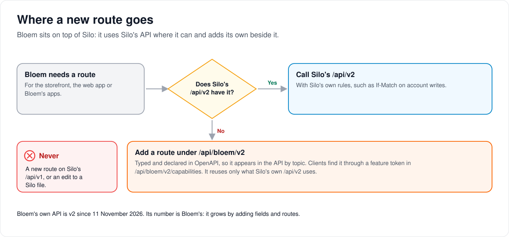
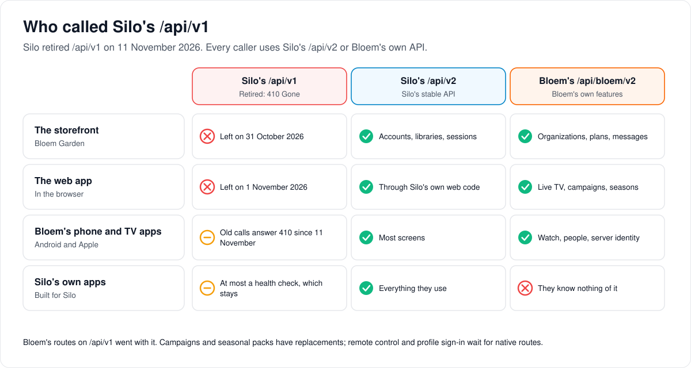

# Leaving Silo's `/api/v1`

> **Silo retired `/api/v1` on 2026-11-11** (Silo #3200, merged into Bloem in
> `26cf9b3e4`). Every route there now answers `410 Gone` with
> `client_upgrade_required`, Bloem's own routes there included; only the health and
> readiness probes stay. The routes listed under "Still on `/api/v1`" below are gone:
> campaigns and seasonal packs keep their `/api/bloem/v1` replacements, while remote
> control and direct-profile sign-in have none yet. Bloem's native routes now serve
> Silo's `/api/v2` shapes for organization groups, invitations and account devices.

> **Provenance and status.** Bloem page, rewritten on 2026-11-01 and checked against `main`
> at `b6039036d`. It records the owner's decision of 2026-10-31 that Bloem should not depend
> on Silo's `/api/v1` and should be ready for Silo to remove it, and how far Bloem has got.
> This is about Bloem's own callers; Silo's API itself is unchanged. The technical rules are
> in the [For developers](#for-developers) section.

Silo is retiring its oldest API, and anything Bloem still hangs on it goes when it does. This
page explains why that matters, the rule Bloem follows, who has already moved, and what is
left.

## Why

Silo has two native APIs. **`/api/v1`** is the old one: frozen, kept for a while so older
apps keep working, then retired. **`/api/v2`** is Silo's stable API going forward. When Silo
retires `/api/v1`, its routes answer "gone, please upgrade"; only its health checks stay.

Bloem takes Silo's code as it is (Silo wins every merge). So when `/api/v1` goes, every Bloem
route mounted on it goes too, along with any Silo `/api/v1` code Bloem still reuses. Bloem
must be off it first.

## The rule

1. **Bloem adds nothing to Silo's `/api/v1`.**
2. **For anything Silo has, Bloem's callers use Silo's `/api/v2`.**
3. **For Bloem's own features, or where `/api/v2` lacks something Bloem needs,** Bloem adds a
   route to its own API, **`/api/bloem/v1`**, instead of reaching back to `/api/v1`. The
   first was creating and updating an account on a plan.
4. **Bloem's own API keeps its own version number.** Silo retiring its `/api/v1` does not
   touch `/api/bloem/v1`, and Bloem does not move to a `v2` to match Silo. Bloem's API grows
   by adding fields and routes, and apps find new ones through a list of **feature tokens**.

## Who has moved

- **The storefront (Bloem Garden)** left `/api/v1` on 2026-10-31. Organizations, accounts on
  plans, announcements, campaigns and seasonal packs now use Bloem's API; plain accounts,
  libraries and playback sessions use Silo's `/api/v2`.
- **The web app** left on 2026-11-01. Campaign cards, announcements and the seasonal look of
  the signed-out pages now come from Bloem's API; the rest goes through Silo's own `/api/v2`
  web code.
- **Bloem's phone and TV apps** still call some `/api/v1` routes: campaign cards, the
  signed-out seasonal packs, remote control and profile sign-in. Each has a replacement, or
  gets one when the apps move.
- **Silo's own apps** have already left: on 2026-10-31 `silo-android` called none of
  `/api/v1`, and `silo-apple` only its health check.

## Example: one campaign card, before and after

This example is made up.

The platform runs a "Winter Film Week" campaign. Before 2026-11-01 the web app showed its card
on Home by asking Silo's `/api/v1` home layout for a "promoted" row, and hid it with a Silo
`/api/v1` "dismiss" call. Now the web app asks Bloem's `/api/bloem/v1/promotions` for Home's
cards, which come with the row they belong in, and hides one with a Bloem call that writes the
same per-profile dismissal. A viewer sees exactly the same card. Bloem's phone apps still use
the old way until they move.

## Who can change what

| Who | What they manage |
| --- | --- |
| The owner | The decision to leave `/api/v1`, and when a route that nobody calls is removed. |
| Bloem developers | New routes go under `/api/bloem/v1`, never on `/api/v1`; a test fails if a `/api/v1` route is added. |
| App developers (storefront, web, phone) | Moving each call to Silo's `/api/v2` or Bloem's API, and keeping each app's list of frozen `/api/v1` calls from growing. |

## Words used in the code

| On this page | In the code and repository |
| --- | --- |
| Silo's old API | `/api/v1`, retired by Silo issue #886 with `410 Gone` and `client_upgrade_required` |
| Silo's stable API | `/api/v2` |
| Bloem's own API | `/api/bloem/v1`, typed routes with OpenAPI declarations |
| Feature tokens | `feature_tokens` in `GET /api/bloem/v1/capabilities` |
| Every mounted route | `contracts/api/v2/route-inventory.json` and the [API catalogue](../bloem/api-catalogue.md) |
| The `/api/v1` route test | `internal/api/v1_route_surface_test.go` and its golden lists |
| An app's frozen `/api/v1` calls | `LegacyFrozenEndpoints` in each phone app |

## For developers

- **API:** the [API by topic](../bloem/api/README.md) lists every typed `/api/bloem/v1`
  operation. The [Bloem routes on Silo's `/api/v1`](../bloem/api/v1-routes.md) page lists the
  routes still on `/api/v1`, each with its replacement.

### Why, in detail

Silo's `/api/v1` is a frozen alpha contract. Silo keeps it through at least two published
pre-1.0 bridge releases, and then a separate maintainer decision (Silo issue #886) retires
it: the main listener answers its business routes with `410 Gone` and the
`client_upgrade_required` problem code (see Silo's [API contract](api-contract.md)). Silo
wins every merge, so when Silo removes `/api/v1`, every Bloem route mounted beside it goes
too, along with any Silo v1 handler code Bloem still reuses.

### The rule, in detail

- **Bloem adds nothing to Silo's `/api/v1`.** A Bloem feature gets a typed route under
  `/api/bloem/v1`, with an OpenAPI declaration, so it appears in the
  [API by topic](../bloem/api/README.md).
- **Bloem's callers use Silo's `/api/v2`** for everything Silo has, and `/api/bloem/v1` for
  Bloem's own features.
- **Where Silo's `/api/v2` lacks something Bloem needs,** Bloem adds a native route rather
  than calling `/api/v1`. The first was creating and updating an account on a plan.
- **Bloem's own API stays `/api/bloem/v1`.** Its version number is Bloem's, not Silo's: Silo
  retiring its `/api/v1` does not touch it, and it does not move to a `v2` to match Silo. It
  grows by adding fields and routes, which clients detect through `feature_tokens` in
  `/api/bloem/v1/capabilities`. A `v2` would only make sense if Bloem had to break its own
  contract.

### Done: the storefront (2026-10-31)

Every storefront call to a Bloem server moved off `/api/v1`.

| Storefront calls | Was | Now |
| --- | --- | --- |
| Reseller organizations and their members | `/api/v1/admin/tenants/...` | `/api/bloem/v1/admin/platform/tenants/...` |
| An account's profiles, devices and sign-in sessions | `/api/v1/admin/users/{id}/...` | `/api/bloem/v1/admin/platform/accounts/{account_id}/...` |
| Creating an account, or re-applying it on a retry, with a plan | `POST`, `PUT /api/v1/admin/users` | `POST`, `PUT /api/bloem/v1/admin/platform/accounts`, built on Silo's `/api/v2` account service |
| Account list, read, enable, password, policy, delete | `/api/v1/admin/users` | Silo's `/api/v2/admin/users`, with `If-Match` on writes |
| Libraries, playback sessions | `/api/v1/libraries`, `/api/v1/admin/sessions` | Silo's `/api/v2/libraries`, `/api/v2/admin/sessions?user_id=` |
| Announcements | `/api/v1/admin/notifications/announcements` | `/api/bloem/v1/admin/platform/announcements` |
| Campaigns and seasonal packs | `/api/v1/admin/promotions`, `/api/v1/admin/ambience` | `/api/bloem/v1/admin/platform/promotions`, `.../ambience` |
| Uploaded artwork paths | `/api/v1/ambience/assets/` | `/api/bloem/v1/ambience/assets/` |
| "Does the server support playback cards?" | `/api/v1/notifications/capability` | `playback_overlays_v1` in `/api/bloem/v1/capabilities` |

The native platform routes take the storefront's credential, an enabled administrator's
unscoped API key, as well as a Platform administrative context, and recheck the account on
every request. The same routes now also serve an organization's domains and branding
(`/api/bloem/v1/admin/platform/tenants/{id}/domains` and `.../branding`, advertised by
`organization_domains_v1`). The storefront's Silo adapter also serves plain Silo servers,
which now get the same `/api/v2` calls; a plan requested against a plain Silo server is
refused before anything is created.

Silo's `/api/v2` writes need `If-Match` with the account's current ETag, so each storefront
write to an account is a read and then a write, and a write whose ETag went stale is read and
retried once. That doubles the requests a write makes, which a server's API-key rate limit
counts, so the storefront waits out a `429` (its `Retry-After`, at most 10 seconds) and sends
the request again, at most twice.

### Done: the web app (2026-11-01)

The web app's last calls to `/api/v1` moved, and its Bloem client lost the helper
(`bloemV1Api`) that reached `/api/v1`. Its callers use `nativeApi` and
`nativeApiWithProfileRequestContext` (`web/src/api/bloemClient.ts`) for Bloem's API and Silo's
own web functions (`web/src/api/v2/`) for Silo's.

| Web app calls | Was | Now |
| --- | --- | --- |
| Campaign cards on a title, before playback and on Home | `GET /api/v1/promotions`; for Home, `/api/v1/home/layout?promoted=1` and the `promoted` row's items | `GET /api/bloem/v1/promotions`, which also serves Home, with `home_position` for the row it goes in |
| Hiding a campaign card | `PUT /api/v1/home/dismissals/promo:{surface}/{id}` | `PUT /api/bloem/v1/promotions/{id}/dismissals/{surface}`, writing the same per-profile dismissal |
| Saving an in-playback campaign to the inbox | `POST /api/v1/promotions/{id}/save` | `POST /api/bloem/v1/promotions/{id}/save` |
| Settings, Announcements | `/api/v1/admin/notifications/announcements` | `/api/bloem/v1/admin/platform/announcements`, in the platform context |
| Access groups and invitations outside an organization | `/api/v1/admin/access-groups`, `/api/v1/admin/invitations` | Silo's `/api/v2`, through Silo's own web code; outside an organization the invitations page shows Silo's invitations screen |
| Seasonal packs on signed-out pages | `GET /api/v1/theme/branding` (its `ambience` block) | `GET /api/bloem/v1/ambience/public`, public, the active deployment-wide packs (`web/src/components/seasonal/SeasonalLayer.tsx`); the phone apps still read the `ambience` block |

Silo's `/api/v2` home could not carry the campaign row: its dismissals accept only
`continue_watching` and `next_up`, and its home cards have no field for a campaign. Adding
those would mean changing Silo's code, so the campaign routes are Bloem's own. The new viewer
routes take the same checks as the native seasonal packs route (sign-in, organization, rate
limit, viewer and PIN check, a selected profile) and are advertised as
`promotions_viewer_v1`.

### Still on `/api/v1`

Until 2026-11-11 the old routes stayed mounted, unchanged, for these callers. Each needed a native or `/api/v2`
home before Silo retires `/api/v1`.

| Route | Who calls it | Home to move to |
| --- | --- | --- |
| `/api/v1/admin/tenants/...`, `/api/v1/admin/users/{id}/profiles`, `devices`, `auth-sessions` | Nobody after the storefront's release; kept for one release, then removed | (already native) |
| `/api/v1/admin/notifications/announcements`, `/api/v1/admin/promotions`, `/api/v1/admin/ambience` | Nobody: the storefront and the web app use the native routes; kept for one release, then removed | (already native) |
| `GET /api/v1/promotions`, `POST /api/v1/promotions/{id}/save`, and Home's `promoted` row and `promo:` dismissals on `/api/v1/home` | Android, Apple | `/api/bloem/v1/promotions...` (exists) |
| The `ambience` block of `GET /api/v1/theme/branding` | Android, Apple (signed-out seasonal packs) | `GET /api/bloem/v1/ambience/public` (exists) |
| `GET /api/v1/ambience/assets/{ref}` | copies of old paths outside Bloem's tables, such as campaign cards already saved to an inbox | `/api/bloem/v1/ambience/assets/{ref}` (exists). Migration `20261031234831_bloem_native_ambience_asset_paths` rewrote the paths stored in seasonal packs and campaigns. |
| `/api/v1/admin/remote/...`, `/api/v1/profiles/household/sessions/{id}/commands`, `PUT /api/v1/devices/{id}/remote-control` | Android, Apple (the web app uses Silo's `/api/v2` session commands) | native remote-control routes, added when the apps move |
| `POST /api/v1/auth/profile-login`, `GET /api/v1/profiles/{id}` | Bloem's Apple app (profile sign-in) | native profile sign-in, added when the app moves |
| Bloem's fields on `/api/v1/notifications/capability` | the phone apps' remote-control discovery | `/api/bloem/v1/capabilities`, added with the remote-control routes |

The last three have no native home yet on purpose: only the phone apps use them, and their
routes are built when the apps move, so a route nobody calls is not left to drift.

The phone apps' own use of Silo's routes is listed in each app's `LegacyFrozenEndpoints`,
which a test keeps from growing. Silo's own apps have already left `/api/v1`: on 2026-10-31
`silo-android` called none of it and `silo-apple` only its health probe.

### Sitting on top of Silo, not inside it

The native routes reuse Silo's code only through what Silo's own `/api/v2` uses, and change
no Silo file:

- Account create and update (`internal/api/handlers/bloem_platform_accounts.go`) call Silo's
  account service, `CreateAdminAccount`, `UpdateAdminAccount`, `GetAdminAccount` and
  `DeleteAdminAccount`, the same service behind `/api/v2/admin/users`. Bloem adds one step:
  putting the account on a plan revision, and deleting it again if that fails. Silo's
  `/api/v1` account handlers are not used.
- Tenants, members, account resources, announcements, campaigns (authoring and the viewer's
  cards), seasonal packs, and organization domains and branding use Bloem-owned handlers,
  mounted by `mountBloemPlatformStorefront` (`internal/api/router_bloem_storefront.go`).
- The web app reaches Silo's `/api/v2` through Silo's own web functions (`web/src/api/v2/`),
  and Bloem's API through `nativeApi`.
- `cmd/bloem-silo-switch-check` drives both servers through Silo's `/api/v2`, so the switch
  stays checkable after Silo's image stops serving `/api/v1`. Its scripts still wait on
  `/api/v1/ready`, Silo's operational probe, which the retirement of `/api/v1`'s business
  routes does not cover.

### Checking

- `contracts/api/v2/route-inventory.json` and the [API catalogue](../bloem/api-catalogue.md)
  list every mounted route; a new Bloem route under `/api/v1` is a mistake.
- `internal/api/v1_route_surface_test.go` compares the `/api/v1` routes with golden lists, so
  adding one fails a test.
- In a client, search for `/api/v1/` outside its own API.

Technical pages:

- [Bloem's routes on Silo's `/api/v1`](../bloem/api/v1-routes.md): the remaining routes,
  each marked with its replacement.
- [How Bloem's native API is organized](bloem-client-surface.md).
- [How apps connect](bloem-apps.md).
- [Messages and promotions](bloem-messages-and-promotions.md): campaigns, seasonal packs and
  announcements.

The pictures are SVG files under `images/leaving-silo-v1/`, drawn by
`scripts/bloem/draw-pictures.py`. Redraw them there, not by hand.
