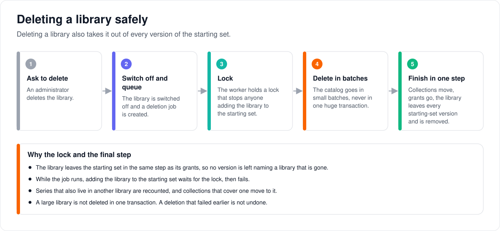

# How retiring an organization and deleting a library stay safe

> **Provenance and status.** Bloem page, rewritten on 2026-11-01 and checked against
> `main` at `b6039036d`. Organizations, their retirement and the starting set are
> Bloem additions; library deletion and its job runner are Silo's, and Bloem's guard
> wraps them. This page explains both in plain language; the technical rules are in
> the [For developers](#for-developers) section.

Two things in Bloem remove a lot at once: retiring an organization and deleting a
library. This page walks through how each one decides what to keep, what happens
when part of it fails, and the limits that remain.

## Retiring an organization

When the storefront ends a reseller organization, Bloem **retires** it:

1. Bloem locks the organization, so no member can be added while it works.
2. It removes each member exactly as it would remove one member on their own:
   - an account with **nothing else to hold it** is deleted;
   - an account that **owns another organization**, owns the platform, or has the
     **admin role** is kept, and only its membership and its devices in this
     organization go;
   - if a member owned the organization, ownership moves before that account goes.
3. It retires the organization: suspended, with its link to the storefront cleared.
   The organization is never deleted outright; its record stays as the owner of
   anything it had.
4. **All or nothing.** If removing any member fails, every change is undone and the
   organization is left as it was.
5. **Afterwards**, Bloem cleans up whatever the kept accounts still had in that
   organization. This finishes even if the request that started it is cancelled.

## Deleting a library

The [starting set](resource-tenancy-foundation.md#the-starting-set) names libraries
that new organizations receive, and every version of it is kept as history. A library
that any version names, old or current, cannot be deleted:

1. An administrator asks to delete a library.
2. Bloem checks whether any version of the starting set names it. If one does, Bloem
   refuses straight away, before the library is switched off or a deletion job exists.
3. Otherwise the library is switched off and a deletion job is queued.
4. The worker takes a lock that stops anyone adding the library to the starting set,
   and checks again. If the library is named now, it stops before deleting anything.
5. The worker deletes the catalog in small batches. In a final step it moves shared
   collections to the other libraries they cover, removes the organizations' grants
   and the library itself, and recounts series that live on in other libraries.
   Records of past grant changes are kept.

Without these checks, Bloem would delete the titles and watch history and only then
find that the library could not go, leaving an empty library behind.

What it does not do:

- A large library is not deleted in one transaction. If a deletion fails part way,
  the batches already deleted stay deleted, as in Silo.
- It does not restore anything a failed deletion removed earlier.
- A library that a version of the starting set names stays until Bloem has a reviewed
  way to retire such libraries.

## Who can change what

| Who | What they manage |
| --- | --- |
| The storefront (Bloem Garden) | Ending a reseller organization, which retires it. It uses a platform administrator's API key. |
| Platform administrator | Retiring a reseller organization through the same route, and deleting libraries. |
| Organization administrator | Nothing here: retirement and library deletion are platform work. |

## Words used in the code

| On this page | In the code and database |
| --- | --- |
| Retiring an organization | `tenancy.MemberService.RetireOrganizationInTransaction` (`internal/tenancy/tenant_retirement.go`) |
| Removing one member | `MemberService.DeleteInTransaction` (`internal/tenancy/members.go`) |
| Retired | `organizations.status = 'suspended'`, `external_service_id` cleared |
| Starting set, its versions | the creation-default entitlement bundle and its revisions (`entitlement_bundle_members`) |
| Library | a `media_folders` row (a root) |
| The lock | the advisory fence `bloem_lock_media_folder_bundle_reference(bigint)` |
| The guard | `internal/catalog/bloem_folder_repo.go`; the job runner wrapper in `internal/adminjob/bloem_runner.go` |
| Refused | `catalog.ErrFolderDeletionRestricted`, answered `409 conflict` "Library is retained by an entitlement bundle" |

## For developers

- **API:** retiring is `DELETE /api/bloem/v1/admin/platform/tenants/{id}` on the
  [organizations and administration](../bloem/api/organizations.md#delete-apibloemv1adminplatformtenantsid)
  page; the legacy `DELETE /api/v1/admin/tenants/{id}` uses the same handler. Library
  deletion is Silo's `DELETE /api/v2/libraries/{id}`, with Bloem's refusal described
  in the [libraries API overlay](../bloem/overlays/libraries-api.md).

### Tenant retirement

The tenant-delete routes (`DELETE /api/bloem/v1/admin/platform/tenants/{id}`, and
`DELETE /api/v1/admin/tenants/{id}`, Bloem's tenant admin API) use
`tenancy.MemberService.RetireOrganizationInTransaction`. The transaction locks the
organization before enumerating members, then applies the same deletion rules as an
individual tenant-member removal (`MemberService.DeleteInTransaction`):

- Remove only the retiring organization's membership, and its profiles' devices and
  device settings in that organization, for an account that is kept.
- Preserve accounts that own another organization (`organizations.owner_account_id`),
  own the platform (`platform_security.owner_account_id`), or have the administrator
  role. An account has at most one membership
  (`organization_memberships_one_per_account`), so "another membership" no longer
  occurs.
- Delete an otherwise unowned account through the account provisioner.
- Update ownership before deleting an owner account: the first other active, enabled
  member becomes owner, or none.
- Retire the organization after its memberships have been removed.

Member deletion, ownership changes, command tombstones
(`tenant_member_command_receipts.deleted_at`) and organization retirement commit
together. Any member-deletion failure rolls them all back. The organization row
remains as the historical resource owner; retirement
(`Store.DeleteTenantOrganizationInTransaction`) clears its external service identity,
operator, seats, conversions and owner, appends `-retired-<id prefix>` to its slug,
and suspends it.

After commit, `CompleteOrganizationRetirementAfterCommit` runs the ordinary
member-resource adapter, which purges only the retiring organization's resources for
surviving accounts. It runs with a bounded context that survives client cancellation
(`internal/sessioninvalidation`). Cleanup errors are reported after the durable
mutation has committed.

Regression coverage includes shared identities with a second organization's profile
(`TestTenantOrganizationDeletePreservesOtherOrganizations`) and retirement rollback
after a later member fails
(`TestTenantRetirementFailureRollsBackAllMembersAndOrganization`), in
`internal/api/handlers`. The exclusive-account numeric-ID reuse fixture lived in
`admin_tenant_organization_lifecycle_test.go`, which `b017bfe84` deleted with the
lifecycle receipts; no retirement test has replaced it.

### Library deletion

Every bundle revision that references a library retains that root, including
inactive and historical revisions. Deleting catalog rows before discovering that
reference would destroy media and watch-state records while leaving the library
itself behind. Bloem rejects such deletion before the API disables the library or
creates a job (`CheckDeletionAllowed`, answered `409 conflict`), and the worker checks
again before its first batch. Neither check removes or rewrites bundle history.

The worker acquires the canonical `bloem_lock_media_folder_bundle_reference(bigint)`
advisory fence, then locks the library row with `FOR NO KEY UPDATE` until the root is
deleted. A database trigger takes the same fence before inserting or updating a bundle
member's new library reference, so a bundle cannot retain a library between preflight
and final deletion. Removing a member only reduces retention and needs no fence. The
helper hashes a namespaced bigint ID; it never narrows folder IDs to 32 bits.

Ordinary scanner FK checks remain compatible with the root lock. Blocking those
checks while a scanner holds an item can create a wait cycle: deletion's separate
batch connection needs that item, while the scanner needs the root that the deletion
guard holds. The guard uses one dedicated connection, and all catalog batches use a
private one-connection pool. A fenced bundle writer occupying the last connection in
the caller's pool therefore cannot prevent deletion from completing and releasing the
fence. Both connections inherit the caller's connection configuration and
`BeforeConnect`/`AfterConnect` hooks; the batch pool also inherits its pool hooks. The
batch connection is opened before any destructive work; initialization failure,
cancellation and normal completion close the owned resources.

Before invoking the deletion executor, its admin-job runner prepares a private
one-connection metadata pool with the original pool configuration and hooks
(`internal/adminjob/bloem_runner.go`). The repository retains the execution's claim
generation. Heartbeats, progress, cleanup-job admission and final job writes use this
pool, so a fenced writer cannot delay heartbeats long enough for another runner to
recover a live claim. Finalization precedes heartbeat cancellation and join, then the
metadata pool closes. Metadata initialization failure does not start catalog
deletion.

The admin-job progress callback remains synchronous. Its progress write and realtime
publication share a one-second deadline. A timed-out callback waits at least thirty
seconds and for available metadata-pool capacity before another attempt, so a
saturated pool does not add a wait to every catalog batch. Intermediate progress is
best-effort during metadata contention; the claim-fenced final job result is recorded
after the deletion guard releases the bundle writer. No background progress callback
can write after execution returns.

A running admin-job deletion owns at most three database connections in addition to
the existing pools. Preflight opens only the guard connection. The current admin-job
runner executes one catalog job at a time per runner; replicas may run separate
deletion jobs, so connection budgeting includes three connections per active deletion
worker. After the catalog batches finish, one guarded transaction moves admin
collections that cover other libraries off the root, removes live organization grants
and the root, and recomputes the episode membership denorms of series that survive in
other libraries. Silo retries the collection move in a fresh transaction when
collections change or a deadlock aborts it; under the guard each attempt runs in a
savepoint instead, so a retry never releases the root lock. Entitlement audit events
survive.

Catalog batches retain upstream's resumable, short-transaction behavior. This guard
prevents the known permanent bundle-reference failure; it does not make an entire
large-library deletion atomic or restore data from an earlier failed deletion. A root
retained by bundle history needs a separately reviewed root retirement model before
physical deletion can be supported.

Tests are in `internal/catalog/bloem_folder_deletion_test.go` (for example
`TestBloemFolderDeletionPreservesBundleReferencedCatalog`,
`TestBloemFolderDeletionFencesConcurrentBundleReferences`,
`TestBloemFolderDeletionDoesNotBlockScannerForeignKeys`,
`TestBloemFolderDeletionProgressesWithFencedWriterInSingleConnectionPool` and
`TestBloemFolderDeletionFenceSupportsBigintRoots`) and
`internal/adminjob/bloem_library_deletion_runner_test.go`.

### History

The page was first written with two fixes of 2026-10-10: tenant retirement that
preserves shared accounts (`cadc2f312`) and library deletion that preserves
bundle-retained libraries (`5436ed812`, migration
`20261010210634_bloem_media_folder_bundle_deletion_fence.sql`). `b017bfe84`
(2026-10-26) removed Bloem's lifecycle receipts (an `Idempotency-Key` replay layer),
and with them this page's sections on keyed retirement and encrypted invitation
receipts. `c60b7008e` (2026-10-26) limited each account to one membership. The
storefront moved to the native tenant routes on 2026-10-31
([leaving Silo's `/api/v1`](bloem-leaving-silo-v1.md)).

Technical pages:

- [How organizations work](bloem-organizations.md): the organization's states,
  including retired.
- [How library ownership and grants work](resource-tenancy-foundation.md): the
  starting set and its versions.
- [Multitenant administration](multitenant-administration.md).

The pictures are SVG files under `images/lifecycle-safety/`, drawn by
`scripts/bloem/draw-pictures.py`. Redraw them there, not by hand.
