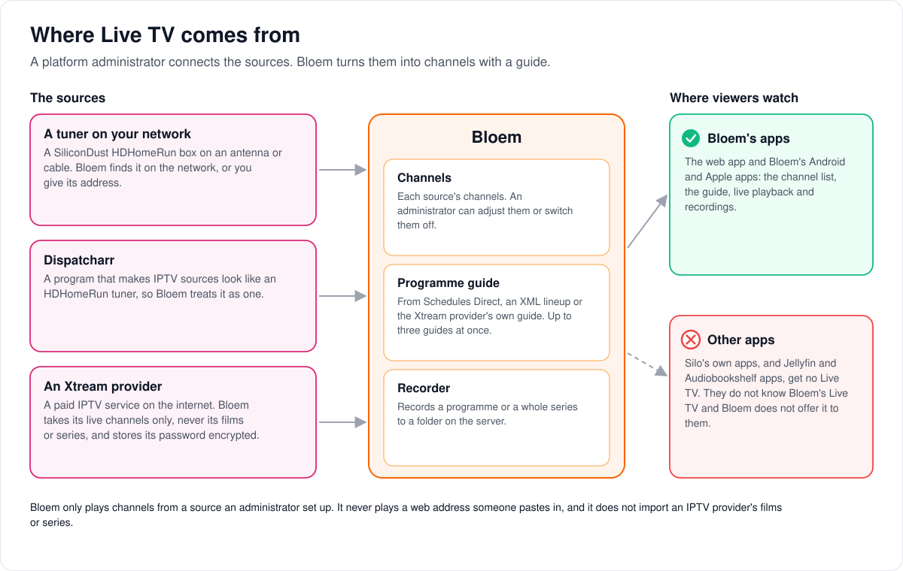
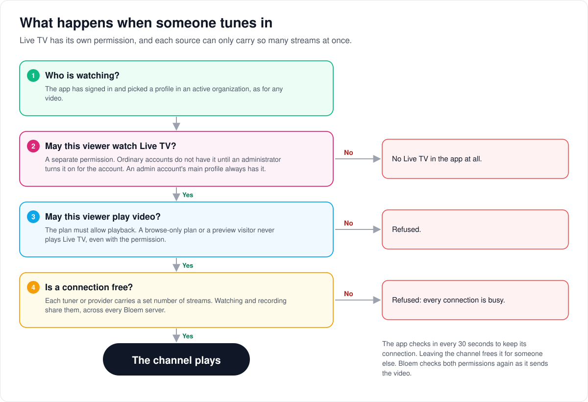
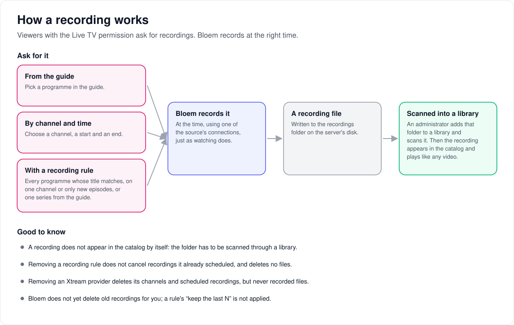

# How Live TV works

> **Provenance and status.** Bloem page, written on 2026-10-31, updated on 2026-11-01
> and checked against `main` at `b6039036d`. Silo has no Live TV and lists it as a
> non-goal; Bloem
> maintains it (see [BLOEM_AGENTS.md](../../BLOEM_AGENTS.md)). The tuner, guide and
> recording code is an attributed adaptation of Prairie Server, and Xtream
> providers are Bloem's own addition. This page explains Live TV in plain
> language. The technical pages linked at the end hold the invariants.

Live TV lets viewers watch channels as they are broadcast, follow a programme
guide and record programmes. This page covers where the channels come from, what
happens when someone tunes in, and how a recording becomes something you can
play later.

## Where the channels come from

A platform administrator connects one or more **sources**:

- **A tuner on your network.** A SiliconDust HDHomeRun box connected to an
  antenna or cable. Bloem can find it on the local network, or you give it the
  tuner's address.
- **Dispatcharr.** A program that makes IPTV sources look like an HDHomeRun
  tuner, so Bloem treats it as one.
- **An Xtream provider.** A paid IPTV service on the internet. Bloem takes only
  its live channels, never its films or series, and keeps its password encrypted
  with the server's secret key.

Bloem turns each source into a list of **channels** and adds a **programme
guide**. The guide comes from Schedules Direct, an XML lineup, or the Xtream
provider's own guide. Up to three guides can be switched on at once.

Live TV is only in the web app and Bloem's own apps. Silo's apps, Jellyfin apps
and Audiobookshelf apps do not get it: they don't know Bloem's Live TV, and
Bloem does not offer it to them. Bloem only plays channels from a source an
administrator set up. It never plays a web address someone pastes in.

## What happens when someone tunes in

1. **Who is watching?** The app has signed in and picked a profile in an active
   organization, as for any video.
2. **May this viewer watch Live TV?** This is a separate permission. Ordinary
   accounts don't have it until an administrator turns it on for the account; a
   group or plan can still forbid it. An admin account's main profile always has
   it. Without it, the app shows no Live TV at all.
3. **May this viewer play video?** The plan must allow playback. A browse-only
   plan or a storefront preview visitor never plays Live TV, even with the
   permission.
4. **Is a connection free?** Each tuner or provider carries a set number of
   streams at once. For an Xtream provider that number is one unless the
   administrator chose more, up to 64, and never more than the provider allows.
   Watching and recording share these connections, across every Bloem server.

While the channel plays, the app checks in every 30 seconds to keep its
connection. Leaving the channel frees the connection for someone else. Bloem
checks both permissions again as it sends the video.

## How a recording works

Viewers with the Live TV permission ask for a recording in one of three ways:
from the guide, by channel and time, or with a **recording rule**. A rule
records every programme whose title matches, optionally on one channel or only
new episodes, or one series from the guide.

At the time, Bloem records the programme using one of the source's connections
and writes a file to the recordings folder on the server's disk. **The recording
does not appear in the catalog by itself.** An administrator adds the recordings
folder to a library and scans it; then the recording plays like any other video.

Good to know:

- Removing a recording rule doesn't cancel recordings it already scheduled, and
  deletes no files.
- Removing an Xtream provider deletes its channels, guide and scheduled
  recordings, but never recorded files.
- Bloem doesn't delete old recordings for you yet. A rule's "keep the last N"
  setting is stored but not applied.

## Who can change what

| Who | What they manage |
| --- | --- |
| Platform administrator | Sources, channels, guides and transcoding settings, under **Manage → Live TV** in the Platform context, with the main profile selected and any PIN entered. Who has the Live TV permission. |
| Viewer with the Live TV permission | Watching, and their own recordings and recording rules. |
| An admin account's main profile | Other viewers' Live TV sessions and recordings. |

## Words used in the code

| On this page | In the code and database |
| --- | --- |
| Live TV | `internal/livetv`, served under `/api/bloem/v2/livetv` |
| Live TV permission | `watch_live_tv` (`internal/permissioncatalog`) |
| Source, tuner | a tuner row; an Xtream provider is a tuner of type `xtream` |
| Connections | the tuner's connection budget; Xtream uses durable connection leases |
| Programme guide | guide sources (EPG); an Xtream guide is a source of type `xtream` |
| Recording, recording rule | DVR entries and DVR rules |

## For developers

- **API:** [Live TV](../bloem/api/live-tv.md): every route under
  `/api/bloem/v2/livetv`, with its credentials, fields and error codes.

Technical pages, each with pictures of its own:

- [How apps reach Live TV](live-tv-client-access.md): the two permissions, capability
  discovery, how apps tune in and let go, and the routes' error codes.
- [How Xtream Live TV providers work](xtream-live-tv.md): encrypted provider accounts,
  the four fixed requests, shared connection leases and guide limits.
- [How Live TV finds tuners](../livetv-tuner-discovery.md): finding HDHomeRun and
  Dispatcharr tuners, and discovery from Docker.
- [Media ownership across API replicas](bloem-cluster-media.md): which server owns
  a Live TV session.
- [Admin guide, Live TV](../wiki/admin-guide.md#210-live-tv): setting it up.

The pictures are SVG files under `images/live-tv/`, drawn by
`scripts/bloem/draw-pictures.py`. Redraw them there, not by hand.
