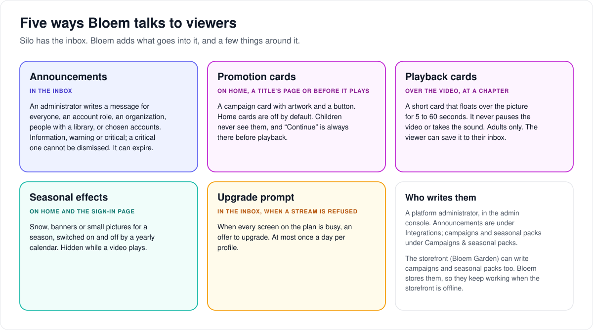
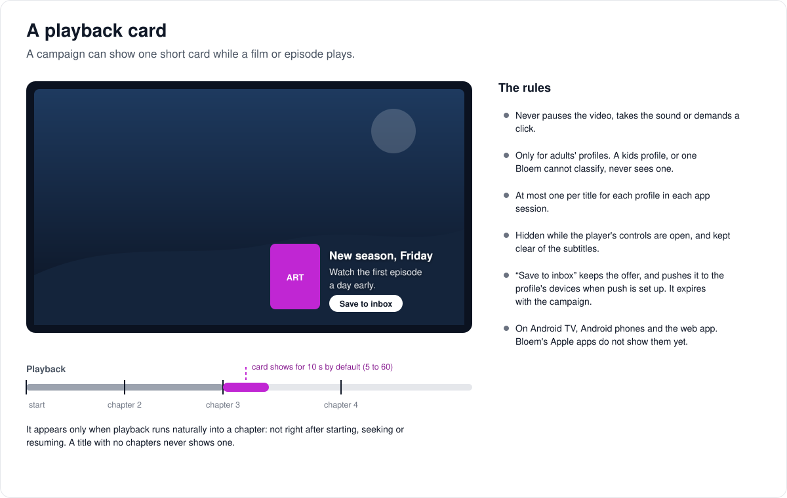
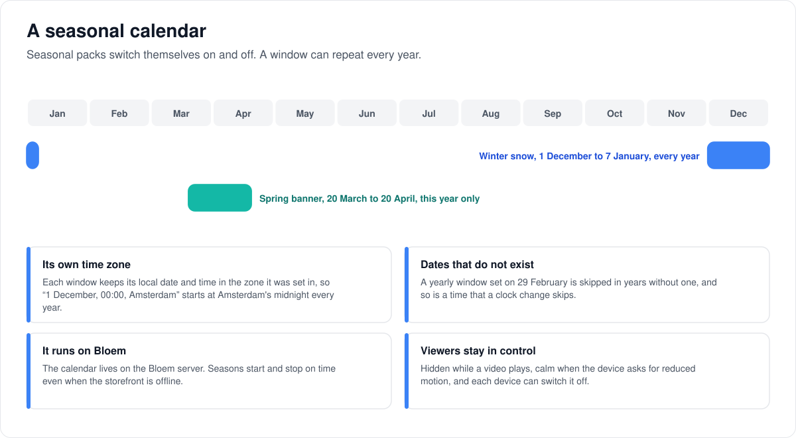

# How messages and promotions work

> **Provenance and status.** Bloem page, written on 2026-10-31 and checked against
> `main` at `c83c424b7`. Silo has the notification inbox. Bloem adds announcements,
> campaigns, playback cards, seasonal packs and the upgrade prompt. This page
> explains them in plain language; the technical pages and the API are linked at
> the end.

## Five ways Bloem talks to viewers

- **Announcements** go to the inbox. An administrator writes a message for
  everyone, one account role, one organization, everyone who can see a library,
  or chosen accounts and profiles. It is information, a warning or critical; a
  critical message can't be dismissed. It can expire, and it can be withdrawn.
- **Promotion cards** are campaign cards on Home, on a title's page or just
  before it plays. Home cards are off by default, children never see them, and
  "Continue" is always available before playback.
- **Playback cards** float over the video for a few seconds when it reaches a
  chapter (below).
- **Seasonal effects** are snow, banners or small pictures on Home and the
  sign-in page, switched on and off by a calendar (below).
- **The upgrade prompt** is an inbox offer when every screen on the plan is busy
  ([how plans work](bloem-plans.md#when-every-screen-is-busy)).

A platform administrator writes them in the admin console: announcements under
**Integrations → Announcements**, campaigns and seasonal packs under **Campaigns &
seasonal packs**. The storefront (Bloem Garden) can write campaigns and seasonal
packs too. Bloem stores them all, so they keep working when the storefront is
offline. Organization administrators can't publish them.

## A playback card

A campaign can show one short card while a film or episode plays: artwork and
text floating over the picture, with no panel around it. It appears only when
playback runs naturally into a chapter, not right after starting, seeking or
resuming, and lasts 5 to 60 seconds (10 by default), fades included.

- It never pauses the video, takes the sound or demands a click.
- Only adults' profiles see one. A kids profile, or one Bloem can't classify,
  never does.
- At most one per title for each profile in each app session.
- It hides while the player's controls are open and keeps clear of subtitles.
- **Save to inbox** keeps the offer, and pushes it to the profile's devices when
  push is set up. It expires with the campaign.
- Android TV, Android phones and the web app show them. Bloem's Apple apps
  don't yet.

## A seasonal calendar

A seasonal pack switches itself on and off. A window can repeat every year, even
across New Year, such as 1 December to 7 January.

- Each window keeps its local date and time in the time zone it was set in.
- A yearly window set on 29 February is skipped in years without one, and so is
  a time that a clock change skips.
- The calendar lives on the Bloem server, so seasons start and stop on time even
  when the storefront is offline.
- Effects hide while a video plays, calm down when the device asks for reduced
  motion, and each device can switch them off.
- The sign-in page shows only packs for everyone. After sign-in, viewers also
  see their own organization's packs.

## Who can change what

| Who | What they manage |
| --- | --- |
| Platform administrator | Announcements, campaigns, seasonal packs and the upgrade prompt, for everyone or for one organization. |
| The storefront | Campaigns and seasonal packs, through the same registries. |
| Viewer | Reading and dismissing messages (not critical ones), saving a playback card, switching seasonal effects off on a device. |

## Words used in the code

| On this page | In the code and database |
| --- | --- |
| Announcement | `system.announcement` or `system.alert` deliveries in Silo's inbox (`internal/notifications`) |
| Campaign, promotion card | a promotion (`internal/promotions`), on surfaces `home`, `detail`, `pre_playback` or `in_playback` |
| Playback card | a promotion on `in_playback`, with `playback_style` `card` or `pip` |
| Seasonal pack | an ambience pack (`internal/ambience`) |

## For developers

- **API:** [messages and promotions](../bloem/api/messages.md) for the native
  inbox, announcements, seasonal packs and their artwork, campaigns, the upgrade
  prompt and the `playback_overlays_v1` capability. The viewer's campaign cards,
  hiding one and saving one to the inbox are under `/api/bloem/v1/promotions`
  (`promotions_viewer_v1`); the phone apps still use the
  [old `/api/v1` routes](../bloem/api/v1-routes.md#campaigns)
  ([leaving Silo's `/api/v1`](bloem-leaving-silo-v1.md)).
- [Server admin announcements](admin-announcements.md),
  [playback overlays](playback-overlays.md) and
  [seasonal scheduling](seasonal-scheduling.md).
- [Presentation evaluators](bloem-presentation-evaluators.md) and
  [campaign and seasonal asset storage](bloem-campaign-asset-storage.md).

The pictures are SVG files under `images/messages/`, drawn by
`scripts/bloem/draw-pictures.py`. Redraw them there, not by hand.
