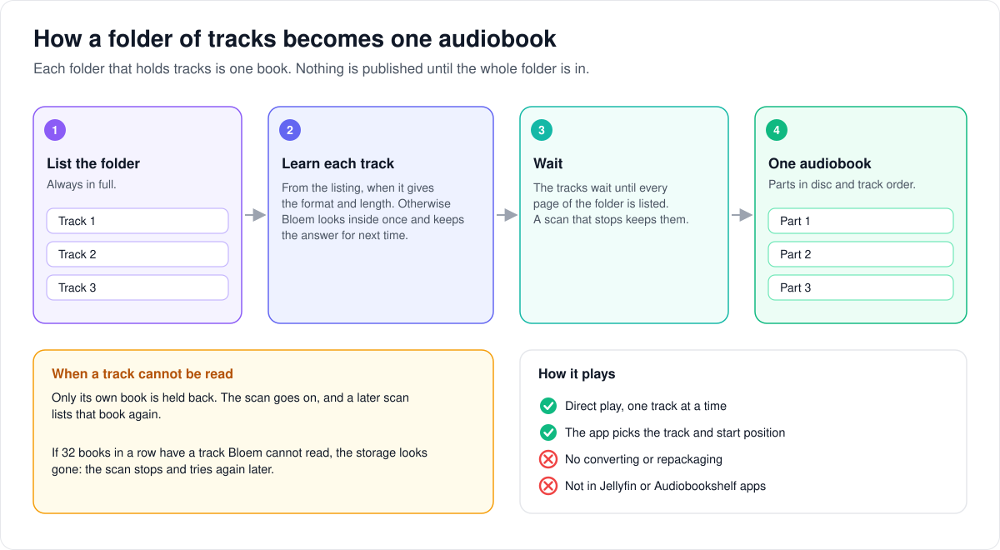

# How stored audiobooks play

> **Provenance and status.** Bloem page, rewritten on 2026-11-01 and checked against
> `main` at `b6039036d`. Native audiobooks are a Bloem addition, part of
> [native storage](bloem-native-storage.md): audiobooks kept in a storage source,
> such as an S3 bucket or Bookwarehouse, scanned through a storage plugin and
> played without a path on the server. They build on Silo's catalog, multi-part
> audiobook presentations and [playback protocol v3](playback-protocol-v3.md)
> sessions. No production acceptance of storage-source audiobooks is recorded. The
> technical rules are in the [For developers](#for-developers) section.

This page covers how a folder of audio tracks in a storage source becomes one
audiobook, what happens when a track cannot be read or goes missing, and how the
book plays.

## How a folder becomes an audiobook

Bloem treats each folder that holds tracks as one book.

1. **List the whole folder.** A book is made from all of its tracks, so Bloem
   always lists a folder of tracks in full.
2. **Learn each track.** When the listing already gives a track's format and
   length, as Bookwarehouse's does, Bloem uses that and never opens the file.
   Otherwise it looks inside the track once; see
   [how Bloem looks inside a stored file](bloem-native-probe.md). It keeps the
   answer, so an unchanged track is not opened again on the next scan.
3. **Wait for the whole folder.** The tracks wait until every page of the folder
   has been listed. Nothing is published half-way.
4. **Publish the book.** The tracks become the book's parts, in disc and track
   order when every track has one, otherwise in natural name order. A book has
   at most 512 tracks.

A book is refused as a whole when its tracks disagree about which book they
belong to, when a track is shorter than a second, or when its chapters are
broken. A single file can hold up to 10,000 chapters.

## When a track cannot be read

- **Only its book is refused.** A track that is gone, has changed, took too long,
  or that ffprobe rejected, holds back its own book. The scan goes on with the
  others, and a later scan lists that book again.
- **The scan stops when the storage looks gone.** If 32 books in a row have a track
  Bloem cannot read, or access to the source is withdrawn, the scan stops instead
  of refusing every book. It then tries again by itself, up to five times.

## When a book changes

- When the source says a track was removed, the book is updated when the scan
  finishes.
- When a track is only left out of a listing, Bloem keeps the whole old book after
  the first scan, and accepts the shorter book only after a second.
- If one track of a published book goes missing, the whole book is hidden until a
  later scan can publish it complete again.

## How it plays

- **Direct play only.** Bloem sends each track's bytes as they are. It never
  converts or repackages a stored audiobook; a player that cannot play the file
  is refused.
- **One track at a time.** The app picks the track and the position to start from.
  Bloem plays exactly that file, even when the title also has recordings on the
  server's disk.
- **Checked as it plays.** Every read checks the sign-in, the source and the
  library again. If one fails after sound has started, the connection closes.

Not supported yet: Jellyfin and Audiobookshelf apps, downloads and converting for
offline use, and covers built into S3 files.

## Words used in the code

| On this page | In the code and database |
| --- | --- |
| Folder of tracks | a directory listing with tracks; its group key is `bloem-storage:audiobook:` plus a scoped SHA-256 |
| Learned from the listing | `AudioFileMetadata` on the entry (`StorageAudioTrackFromEntry`) |
| Kept answer | `bloem_storage_audio_probes` |
| Tracks waiting | `bloem_storage_audio_staged_tracks` |
| A track's own failure | `StorageAudioProbeFailure`: `unavailable` or `invalid` |
| Scan stops | `audioOutageLimit` |
| Parts | Silo's multi-part audiobook presentation |
| Direct play | `original_http` |
| Capability | `native_audiobook_presentations_v1`; `native_audio_libraries` and `native_audio_playback` |

## For developers

- **API:** stored audiobooks use Silo's playback routes and protocol v3; there is no
  separate route. Readiness is the `native_audiobook_presentations_v1` feature token
  on `GET /api/bloem/v2/capabilities` and the native-storage capability document on
  the [storage sources API page](../bloem/api/storage.md).

### Composition

Native audiobook tracks use the existing catalog, playback-v3 sessions, stream
tokens and revision-pinned storage reader. The host composes scanning and delivery
before releasing the shared startup latch (`NativeAudioGate`). A scanner flag alone
cannot admit an audiobook scan or advertise `native_audiobook_presentations_v1`
(`internal/api/handlers/bloem_system.go` adds the token only when native audio is
ready). Audiobook probes use the movie probe budgets with 1 MiB chunks
(`cmd/silo/bloem_native_movie_scanner.go`).

### Publication and retained authority

Providers must declare `audiobooks` and directory-only listings. A directory
with tracks is always listed in full, since a book is assembled from all of its
tracks; its change token is dropped. A directory of directories keeps its token,
and an audiobook scan treats the source's change feed as covering its books: when
such a directory is listed from a token, the child directories it does not report
are carried (`carried` listing mode, `carryUnchangedTx`), kept with their retained
entries and memberships without a listing, and only the reported ones are listed.
A full listing, including the one an expired token forces, carries nothing.

An audiobook scan lists and probes up to `nativeAudioScanWorkers` (eight)
directories at once (`audioPipeline`): each directory is claimed until its page is
applied, and pages are still applied one at a time. Each worker looks for its next
pending directory after the furthest one the pipeline has claimed, and from the
start only when nothing pending follows. Audio probes read 1 MiB chunks, each
behind the scan reader's per-read authority check.

A track whose listing carries its audio metadata (codec and a duration of at
least a second in `AudioFileMetadata`) is published from that metadata, as an
ebook is from `EbookMetadata`, and is never opened during a scan
(`StorageAudioTrackFromEntry`). Its container is named from the file's demuxer,
as a probe would name it. The page is admitted for reads only when one of its
tracks must be opened. Bookwarehouse lists this metadata for every track.

Any other track is probed through `ScanReader` the first time its revision
is seen; provider paths and URLs never become tool inputs. The staged probe is
kept in `bloem_storage_audio_probes` per location and entry with that revision,
and a later scan reuses it instead of opening a track whose revision is
unchanged. Completion drops kept probes for entries the location no longer lists
at that revision. Unsupported audio extensions stage a rejection without a read.
A staged probe is bounded below its column's 1 MiB check; a track whose chapters
outgrow that bound keeps its timeline without them instead of being rejected.

A failed open or probe that is the track's own (`StorageAudioProbeFailure`)
rejects only its book, and the scan goes on. Two kinds count as the track's own:

- The provider no longer has the pinned bytes (`NotFound`, or a revision that
  changed), or the probe ran out of time. The track is `unavailable`, and its
  kept probe makes the next incremental listing list the book again instead of
  carrying it.
- The tool rejected the bytes or exceeded its input or output budget. The track
  is `invalid` for that revision.

A failure no rule names is also the track's own, and leaves it `unavailable`,
when the scan's authority still holds afterwards. A failed authority check stops
the scan, as does `audioOutageLimit` (32) when that many books in a row have an
unavailable track. A provider whose storage is gone then leaves the rest of the
catalog pending, instead of rejecting every book. A probe failure that stops a
scan logs the causes beneath the error.

A storage scan that fails resumes its journal where it stopped
(`StorageScanner.SetRetry`; production allows five failures in a row, pausing
30 seconds longer after each). An attempt that ran for five minutes resets the
count.

`bloem_storage_audio_staged_tracks` retains bounded candidates across pages and
lease takeover. Nothing publishes before directory completion, including when
the completing page has no new entries. A rejected candidate stays rejected for
its run so replay cannot erase an overflow marker. A new run removes stale
staging only for its location. Run, directory and location deletion cascade.

A book has at most 512 tracks. Complete unique positive disc/track positions
order its parts; otherwise logical paths use natural order with entry IDs as a
tie-breaker. Conflicting book IDs, malformed chapters, unsupported tracks and
tracks shorter than one second reject the whole candidate. A track may list up
to 10,000 chapters (`mediasource.MaxAudioChapters`); the protocol still promises
plugins 1,024. File durations are truncated integers; embedded and synthesized
chapter endpoints retain exact track-local seconds. Single tracks retain Silo's
empty presentation kind and zero part fields.

The reserved group key is `bloem-storage:audiobook:` followed by a scoped SHA-256
of location and directory identity. Native canonical and observed roots stay
empty. Metadata publication respects locked fields, present local files and
present files in another library. Joining native files add membership and
presentation rows without overwriting the existing owner's metadata. ISBN and
ASIN identity locks converge concurrent publications; audiobook provider IDs
remain distinct from ebook IDs.

Completion reconciles retained directory edges before publishing deferred
replacements. Explicit removals retire tracks at completion. The first eligible
implicit omission retains the complete old presentation; the second permits a
reduced replacement. Finalizer publications attach roots through the reconciled
graph, never through paths. If one retained presentation track becomes missing,
the finalizer hides its entire group. A subsequent valid publication restores it.
Counters merge only after the publication or completion transaction commits.

### Delivery

Whole-presentation authority is checked in one database snapshot: every present
track must have current configuration, an enabled root membership and enabled
source/installation, with contiguous and complete part indices. Start then
preflights the requested track through the pinned reader.

Native audio starts persist `allow_alternate_versions=false`. That fixes the
requested file through start and replans, including when the item also contains
local single-file and multipart recordings. Request-scoped pinning rejects other
start candidates too. Native audio never enters the shared version-candidate
list; local resume and fallback retain their existing behavior.

Only `original_http` direct play is admitted. Remux and transcode plans fail
before creating a binding with nonretryable `route_capability_unavailable`.
`InputSource` independently refuses native audio. Mid-stream failure requires a
fresh attempt for the same track; a recovery replan cannot change its source.
Clients select the track and send `start_position` explicitly.

The stream serves ranges, HEAD and conditional requests over the pinned reader.
Its authoritative MIME is `audio/mp4`, `audio/mpeg`, `audio/flac`, `audio/ogg` or
`audio/wav`. Plan MIME can remain `application/octet-stream` because opaque
catalog paths have no extension. Existing revision, credential, root and session
checks remain active on reads, and failure after response bytes aborts the
connection. Cover authority follows the same full-composition gate; cached bytes
and conditional replies still require fresh publication and viewer authority.

### Compatibility and limits

Native content remains behind current host publication and playback authority.
Silo's Jellyfin and Audiobookshelf servers run again since `2393c41ee`
(2026-10-18; see [protocol compatibility](bloem-compatibility-removal.md)). Bloem
hides native-storage files (catalog paths starting `bloem-storage:`) from the
Jellyfin handlers that need an operating-system file name
(`bloemGuardNativeStorageFiles` in `cmd/silo/bloem_compat.go`). No native-file
adapter is wired for the Audiobookshelf server, and native audiobook delivery
through either protocol is neither implemented nor tested. Download/conversion
support requires its own admitted path and is not implied by direct audiobook
playback.

Catalog aggregate durations can sum recordings, and duplicate-recording checks
use truncated duration. S3 does not publish embedded covers. Disc directories
are separate book directories. The unchanged Silo enrichment cover fallback
cannot read an opaque native key through ffmpeg. An ebook publisher's ISBN
insert is type-agnostic and can omit a later ebook ID already held by an
audiobook; that is a separate follow-up.

### Migrations

- `20261012022129_bloem_native_audio_staging.sql`: staged tracks.
- `20261028151500_bloem_native_audio_probe_cache.sql`: `bloem_storage_audio_probes`.
- `20261028152000_bloem_storage_carried_directories.sql`: the `carried` listing mode.
- `20261028172627_bloem_storage_audio_unavailable_tracks.sql`: the `unavailable`
  track status.

### History

Publication arrived in `d5d02a00e` and ingest and direct playback in `8b8943320`
(both 2026-10-12). Silo's Jellyfin and Audiobookshelf servers were restored on
2026-10-18 (`2393c41ee`). On 2026-10-28 kept probes (`741e94ba0`), incremental
listings of changed books (`3663a8d27`), parallel directories (`f045f1808`),
1 MiB probe reads (`2538b6e41`), publishing from listed metadata (`72b346443`),
rejecting only the unreadable track's book (`268975631`) and up to 10,000
chapters (`396dd92e9`) followed.

### Related pages

- [Native storage](bloem-native-storage.md): scanning, incremental listing and covers.
- [Native probe](bloem-native-probe.md) and
  [native scan reader](bloem-native-scan-reader.md).
- [Native video playback](bloem-native-video-playback.md): the movie equivalent.

The picture is an SVG file under `images/native-audio-playback/`, drawn by
`scripts/bloem/draw-pictures.py`. Redraw it there, not by hand.
