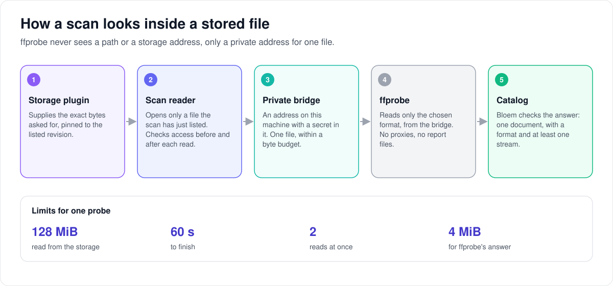

# How Bloem looks inside a stored file

> **Provenance and status.** Bloem page, rewritten on 2026-11-01, updated on 2026-11-05
> and checked against `main` at `3ab048c07`. Probing stored files is part of Bloem's
> [native storage](bloem-native-storage.md), a Bloem addition built on Silo's
> ffprobe-based scanner (`internal/scanner`, `internal/mediaprobe`). The technical
> rules are in the [For developers](#for-developers) section.

To list a movie or an audiobook track, Bloem needs to know its format, its
streams, how long it lasts and, for audiobooks, its chapters. For a file on the
server's disk, Silo runs the trusted tool **ffprobe** on it. This page explains
how Bloem runs the same tool on a file kept in a storage source, which files it
looks at, and the limits that keep it safe.

## From the storage to the catalog

1. **The scan reader opens the file** the scan has just listed, pinned to its
   revision; see [how a scan reads a stored file](bloem-native-scan-reader.md).
2. **The bridge gives ffprobe a private address** for that one file; see
   [how a trusted tool reads a stored file](bloem-native-tool-input.md).
3. **ffprobe reads what it needs**, within a byte budget and a time limit.
4. **Bloem checks the answer**: one bounded document with a format and at least
   one stream. Anything else is refused.
5. **The scan adds the title to the catalog**, or rejects it.

## Which files Bloem probes

| Kind | File endings | Read as |
| --- | --- | --- |
| Movies | `.mp4`, `.mov`, `.m4v` | MOV/MP4 |
| Movies | `.mkv`, `.webm` | Matroska/WebM |
| Audiobook tracks | `.m4a`, `.m4b` | MOV/MP4 |
| Audiobook tracks | `.mp3`, `.flac`, `.ogg`, `.opus`, `.wav` | MP3, FLAC, Ogg, WAV |

The ending only chooses how to read the file. The bytes must really be that kind
of file, and a movie must contain video. Other files are skipped without being
opened, including `.strm` shortcuts. An audiobook track whose listing already
carries its length and format is not opened at all.

## The limits

| Limit | A movie or audiobook probe |
| --- | --- |
| Bytes read from the storage | 128 MiB |
| Time | 60 seconds |
| Each read | 128 KiB for movies, 1 MiB for audiobook tracks |
| Reads at once | 2 |
| ffprobe's answer | 4 MiB |
| ffprobe's error output | 64 KiB |

A probe that runs out of any of these fails. For a movie, that stops the scan
with a message naming the file and the reason, such as "read budget exhausted";
the scan's retries then pick up where it stopped. For an audiobook track, it
rejects only that track's book, and the scan goes on.

## What keeps it safe

- **ffprobe reads only the chosen format, from the private address.** It cannot
  follow links inside the file to other files or addresses.
- **No proxies and no report files.** Settings that could send ffprobe through
  another server, or make it write a report holding the private address, are
  removed before it starts.
- **Every way out is tidied.** Bloem waits for ffprobe, its output and every read
  to finish before it closes the file. On Linux and other Unix systems it also
  stops any program ffprobe started.
- **Error messages stay plain.** They never quote ffprobe's raw output, storage
  details or the command line.

## Words used in the code

| On this page | In the code and database |
| --- | --- |
| Probe a stored video | `scanner.ProbeNative` (`internal/scanner/bloem_native_probe.go`) |
| Probe a stored audiobook track | `scanner.ProbeNativeAudio` (`internal/scanner/bloem_native_audio_probe.go`) |
| Which files | `scanner.NativeMovieDemuxer`, `scanner.NativeAudioDemuxer` |
| The limits | `scanner.NativeProbeConfig`, set in `cmd/silo/bloem_native_movie_scanner.go` |
| The answer | Silo's `ProbeData` |

## For developers

Probing has no API route; it runs inside a storage scan.

### Contract

`scanner.ProbeNative` prepares metadata from one already authorized, pinned
`mediasource.File`. A scan consumer supplies the `ScanEntryFile` context,
cancellation and reauthorization methods, a trusted ffprobe binary, a fixed
MOV or Matroska demuxer, and explicit input, time and output bounds
(`NativeProbeConfig`). No provider field selects a binary, filesystem path,
demuxer name or remote URL. The Bloem-owned file
`internal/scanner/bloem_native_probe.go` returns Silo's `ProbeData`.

The consumer uses the private `nativestorage.ToolInput` bridge for seekable HTTP
reads. Direct Matroska track parsing and HTTP reads share one attempted-byte
budget; the supplement runs before the child starts. Source and authority
failures remain sticky, including a terminal cause joined with EOF. Ordinary
EOF at the known size preserves valid partial reads. A zero child exit cannot
override a read failure, cancellation, output overflow or final authority check.
The probe reader follows the bridge's teardown rule: once cleanup cancels the
source, a read of a range the exited child abandoned still fails, but it does
not fail the probe.

### ffprobe restrictions

ffprobe is restricted to the selected container (`-f mov` with
`-format_whitelist mov`, or `-f matroska` with `matroska,webm`) and the HTTP/TCP
protocols needed for the literal-loopback bridge (`-protocol_whitelist http,tcp`).
MOV external data references and absolute paths are disabled (`-enable_drefs 0`,
`-use_absolute_path 0`). Child-only environment filtering removes proxy controls
(`HTTP_PROXY`, `HTTPS_PROXY`, `ALL_PROXY`, `NO_PROXY`) and `FFREPORT`, and the
command explicitly disables the HTTP proxy (`-http_proxy ""`). This prevents an
inherited proxy from substituting bytes and prevents ffprobe reports from
persisting the private bridge argument. The parent environment and ordinary
runtime/library environment remain intact.

### Process lifecycle

After admission, every outcome joins the child and output copiers, then joins
the bridge handlers before closing the file and releasing host admission. On
Unix, an independent context hook and final process-group cleanup (`Setpgid`)
also stop descendants of a configured wrapper after the direct child has exited.
Other platforms retain direct-child cancellation and require a trusted ffprobe
binary that does not launch other processes.

### Output

Output must be a single bounded JSON document with a format and at least one
stream. The converted result uses the pinned file size and display name as a
container hint, completes Matroska subtitle tracks as Silo's local probe does
(`applyMatroskaSubtitleTracks`), and rejects an echo of the private argument.
For a Matroska file with subtitles it matches each stream to the track entries
read before ffprobe ran, fills a missing container track ID, and takes the
entry's canonical `LanguageBCP47` (so `pt-BR` and `pt-PT` stay apart) over
ffprobe's legacy language. A failed track read fails the probe only while a
track still lacks its container ID; otherwise the tracks keep ffprobe's values.
`TestNativeProbeRealFixturesMatchLocal` checks every fixture, including
`testdata/subtitles-bcp47.mkv`, against the local probe. Error messages exposed by this consumer omit raw tool
output, provider details and command arguments; wrapped causes remain available
for typed internal classification.

### Callers and budgets

`ProbeNative` itself supplies no scanner wiring, library-kind admission,
ingestion-rejection classification, production budget defaults or playback
change. Its callers supply those: the movie scanner
(`internal/scanner/storage_movie.go`, through `ProbeStorageMovie` and
`NativeMovieDemuxer`) and the audiobook scanner
(`internal/scanner/storage_audiobook.go`, through `ProbeNativeAudio`) admit
container families and publish items. `cmd/silo/bloem_native_movie_scanner.go`
sets the movie budgets (128 MiB of input in 128 KiB chunks with two concurrent
reads, 60 seconds, 4 MiB of JSON output and 64 KiB of stderr); the audio probe
uses the same budgets with 1 MiB chunks, because every probe read is a provider
range request. A movie probe failure fails the page and the scan attempt, with
an error that names the entry and a reason chosen from typed causes only
(`storageMovieProbeError` in `internal/libraryingest/storage_movie.go`: timed
out, read budget exhausted, too many concurrent reads, probe output too large,
the file changed, the scan lost its lease, source unavailable, or the provider's
gRPC code). Immutable versions or verified snapshots remain required for native
content reads. Synthetic pinned fixtures do not certify a live backend.

### Native audio

`ProbeNativeAudio` uses an explicit reviewed audio demuxer
(`scanner.NativeAudioDemuxer`: MOV for `.m4a`/`.m4b`, MP3, FLAC, Ogg for
`.ogg`/`.opus`, WAV) and the same pinned reader, byte budget and cleanup
boundary. Its exact positive finite duration and validated chapter endpoints are
retained separately from integer catalog durations. A track may list up to
10,000 chapters (`mediasource.MaxAudioChapters`), though the protocol still
promises plugins 1,024. A book-level rejection prevents partial publication; a
failure that is the track's own rejects only its book, while authority failures
and a run of unavailable books stop the scan. See
[native audiobook presentations](bloem-native-audio-playback.md).

### History

`ProbeNative` and this page were added in `d3d2c8f72` (2026-10-10), with no
consumer, and `4e73aa7aa` (2026-10-11) added the teardown rule. Native movies
became the first consumer in `b781ac3ff` (2026-10-11), and audiobooks followed
through `ProbeNativeAudio` (`17ca70d9b` and `d5d02a00e`, 2026-10-12). Audio probes
moved to 1 MiB reads in `2538b6e41` and accepted up to 10,000 chapters in
`396dd92e9` (both 2026-10-28). The merge of Silo through `2d5f22e7d` (2026-11-05)
brought Silo's Matroska subtitle language pass (Silo #3081) to the native probe in
`b0537be3c`.

### Related pages

- [Native storage](bloem-native-storage.md): movie scanning and matching.
- [Native scan reader](bloem-native-scan-reader.md) and
  [native tool input](bloem-native-tool-input.md).
- [Native video playback](bloem-native-video-playback.md) and
  [native audiobook presentations](bloem-native-audio-playback.md).

The picture is an SVG file under `images/native-probe/`, drawn by
`scripts/bloem/draw-pictures.py`. Redraw it there, not by hand.
