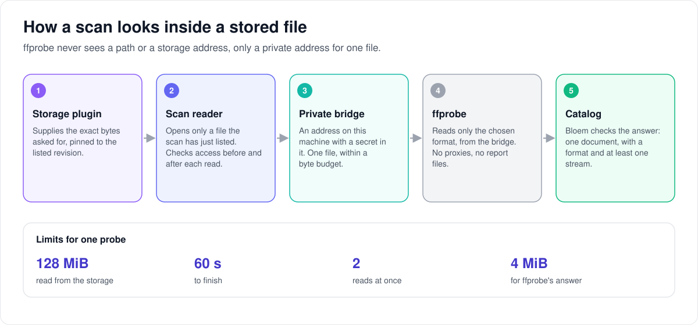

# How a scan reads a stored file

> **Provenance and status.** Bloem page, rewritten on 2026-11-01 and checked against
> `main` at `b6039036d`. The scan reader is part of Bloem's
> [native storage](bloem-native-storage.md), a Bloem addition: Silo's scanner
> reads files from paths on the server. It does not certify that a storage service
> keeps bytes unchanged. The technical rules are in the
> [For developers](#for-developers) section.

During a scan, Bloem sometimes has to look inside a stored file: to read an
ebook's details, or to learn a movie's or an audiobook track's streams and length.
The **scan reader** opens such a file. This page covers what it may open, how it
reads, and what happens when something changes mid-read.

## What the scan reader may open

- **Only a file the scan has just listed.** The scan picks it by its place in the
  page the storage plugin returned, never by a name, a path or a web address.
- **Only for the scan.** Opening a file this way lets no viewer see anything.
- **Only for the right libraries.** Ebook libraries always; movie and audiobook
  libraries only once Bloem has set up their playback at start-up.

## How it reads a file

1. **Seal the page.** When the plugin lists a page, the scan reader seals it to its
   source, folder and scan. Only that reader can open the page's files.
2. **Check the file is what was listed.** Before reading any bytes, it asks the
   plugin about the file again and compares the revision, size, time and name with
   the listing.
3. **Check around each read.** Bloem confirms that the source, the library and the
   scan are still allowed, then reads one piece pinned to the listed revision, then
   checks again. A page's reads share one check for up to a second, because a
   probe makes hundreds of small reads.
4. **Close cleanly.** Closing stops new reads, waits for the ones in flight, closes
   the file and gives back its slot, exactly once.

## When something changes mid-read

- If the source is switched off, access is withdrawn, or the scan loses its place,
  the file stops working for good. Every later read fails too.
- A read that fails returns nothing, even if part of it had arrived. Bloem never
  passes on half a piece.
- Reaching the end of the file in the normal way is not a failure.

Withdrawing access stops these reads within the second a shared check lasts.
Adding the page to the catalog is checked separately, under the page's own
locks, so the shared check never decides what is published.

## Words used in the code

| On this page | In the code and database |
| --- | --- |
| Scan reader | `nativestorage.ScanReader` (`internal/nativestorage/scan_reader.go`) |
| Seal the page | `AdmitScanPage` |
| Open a listed file | `OpenScanEntry`, which returns a `ScanEntryFile` |
| Right libraries | `librarykind.SupportsNativeStorageKinds`, with `SetNativeMovieReady` and `SetNativeAudioReady` |
| Shared check | `SetAuthorityReuse` |
| Still in its place | `storagesource.ValidatePendingPageTx` |

## For developers

The scan reader has no API route; it is internal to the scanner. The storage
source routes are on the [storage sources API page](../bloem/api/storage.md).

### Admission

`nativestorage.ScanReader` supplies a host scan with seekable reads from an
entry in its current provider page. It grants no viewer access and accepts no
filesystem path, URL or independently selected entry identity. Library admission
is `librarykind.SupportsNativeStorageKinds`: ebook libraries always, movie libraries
only when native movie playback is ready and audiobook libraries only when native
audio is ready (`SetNativeMovieReady` and `SetNativeAudioReady`, set at start-up).

`AdmitScanPage` clones and validates the page, then seals its source, location,
runtime snapshot, lease and pending directory checkpoint. Only the originating
reader can open its entries, selected by page index. `OpenScanEntry` requires a
fresh provider description with pinned reads and the retained source/root,
then checks Stat against every listed identity, revision, size, timestamp and
display field before accepting bytes.

### Authorization

Authorization compares the approved runtime generation, artifact, manifest and
configuration. A short transaction (read committed, `lock_timeout` 2 s,
`statement_timeout` 10 s) retains installation, source and library authority in
that order (`resourcetenancy.RequireStorageScanTx`), checks organization and
entitlement policy, compares the generation, install path, archive checksum and
manifest again under those locks, compares resource-owner revisions, and checks
that the source's discovery run is the lease's run. It then verifies the current
lease and that the page's directory is still pending and reachable at its sealed
cursor (`storagesource.ValidatePendingPageTx`). A scan may work on several
pending directories at once (audiobook scans use `nativeAudioScanWorkers`), so the
directory need not be the first pending one. No transaction or database
connection remains open across provider I/O. `storagesource.ValidatePendingPageTx`
and the journal's `NextDirectory` share the same lease/checkpoint verifier.

That lease check only reads the journal, so it takes no lock on the scan run or
the source (`readLease` in `internal/storagesource/lease.go`); it holds as of its
read and never waits for a page transaction that holds the run row. Every
transaction that writes the journal still verifies the lease under the source and
run locks.

### Reads

The opened file repeats authorization before and after each pinned range.
`SetAuthorityReuse` lets the reads of a page's open files share one
authorization. One check runs at a time, and a success stands for the reuse
window from when it began, so a revocation stops those reads within the window
instead of at the next read. A failure is never reused. Production uses one
second (`cmd/silo/bloem_native_movie_scanner.go`), because a probe makes hundreds
of range reads and each check takes the authority locks. Publication is
unaffected: the scan publishes each page after authorizing it under the locks in
that page's own transaction.

Source, authority and runtime failures stay sticky. A terminal error clears
the entire destination of the enclosing read and returns zero, including when
earlier ranges succeeded or the terminal cause contains EOF. Ordinary EOF at
the known file size preserves valid partial reads and does not poison the file.

### Close

Cancellation stops I/O. Close stops admission, cancels the source lifetime,
joins active reads, closes the file, and releases host admission exactly once.
When used with `ToolInput`, the trusted child and HTTP handlers must also join
before file closure. The scan coordinator must retain the publication fence
after preparation; an opened entry is neither a catalog file nor a durable
authorization grant.

### Consumers

The movie scan (`internal/libraryingest/storage_movie.go`) and the audiobook scan
(`internal/libraryingest/storage_audiobook.go`) admit their pages here and probe
the opened entries; see [native probe](bloem-native-probe.md),
[native video playback](bloem-native-video-playback.md) and
[native audiobook presentations](bloem-native-audio-playback.md). An audiobook
page is admitted for reads only when one of its tracks must be opened. The reader
does not certify a backend's immutability: immutable versions or verified
snapshots remain required for content reads.

### History

`nativestorage.ScanReader` and this page arrived together in `ded34edfa`
(2026-10-10) as a prerequisite with no consumer: as first committed it wired no
probe or scanner consumer, kept admission to ebooks and enabled no native video
playback. Native storage movies (`b781ac3ff`, 2026-10-11) and audiobooks
(`8b8943320`, 2026-10-12) made it the reader for the movie and audiobook scan
paths. Parallel audiobook directories (`f045f1808`), the shared authority check
(`41ff1bb00`) and the lock-free lease read (`24c1f3354`) followed on 2026-10-28.

### Related pages

- [Native storage](bloem-native-storage.md): scanning, the journal and leases.
- [Native tool input](bloem-native-tool-input.md): the bridge a tool reads through.
- [Native probe](bloem-native-probe.md): ffprobe over the opened file.

The picture is an SVG file under `images/native-probe/`, drawn by
`scripts/bloem/draw-pictures.py`. Redraw it there, not by hand.
