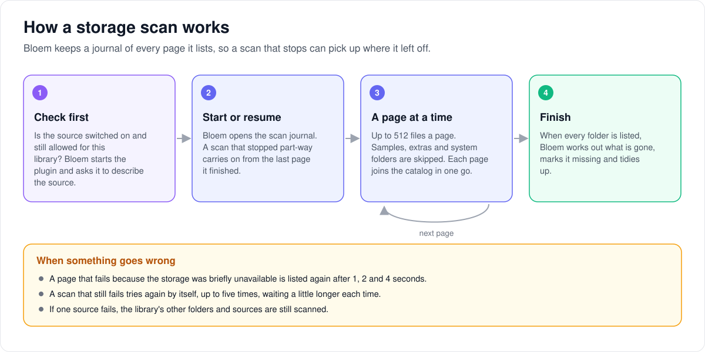
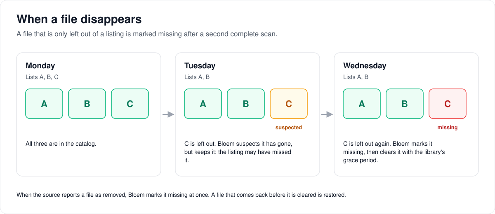
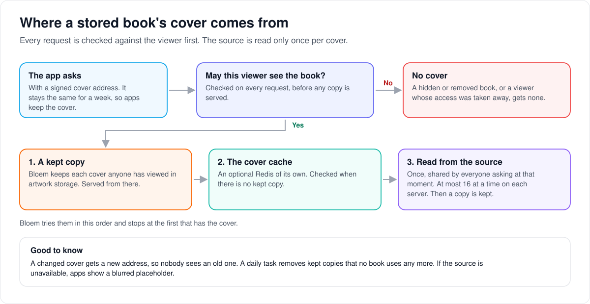

# How native storage works

> **Provenance and status.** Bloem page, rewritten on 2026-11-01, updated on 2026-11-05
> and checked against `main` at `1430c3769`. Native storage is a Bloem addition:
> Silo's libraries read files from paths on the server, and Bloem adds libraries
> that read from S3 buckets and the Bookwarehouse book service through approved
> storage plugins. It builds on Silo's plugin runtime (`internal/plugins`),
> scanner and catalog. It is experimental, and no storage service is certified
> (`backend_verified` stays false). The technical rules are in the
> [For developers](#for-developers) section.

This page walks through what happens after a storage source is added: how Bloem
scans it, how it notices a file has gone, where covers come from, and how people
read, watch and listen. Adding a source is on the
[storage sources page](bloem-storage-sources.md).

## Three ideas behind it

- **A storage plugin does the talking.** It is a small program that knows one
  kind of storage. Bloem runs it only when its release matches an approved
  checksum, and asks it for two things: lists of files, and the exact bytes it
  needs. Bloem never mounts the storage as a folder.
- **A stored file never becomes a path.** Each file from a source gets an internal
  name that starts with `bloem-storage:`. Parts of Bloem that can only open files
  on the server's disk refuse these names, so they can never be pointed at the
  wrong file.
- **The bytes are pinned.** Each file has a **revision**, a version stamp from the
  storage. Bloem reads only the revision it scanned. If the file has changed since,
  the read fails instead of mixing old and new bytes.

## How a scan works

1. **Check first.** Bloem checks that the source is switched on and still allowed
   for this library, starts the plugin, and asks it to describe the source.
2. **Start, or pick up where it stopped.** Bloem keeps a **scan journal**: a record
   of every folder and page it has listed. A scan that stopped part-way resumes
   from the journal instead of starting again.
3. **List a page at a time.** The plugin lists up to 512 files at a time. Bloem
   skips what a folder scan would skip, such as samples, extras, hidden folders
   and system folders, and adds each page's books, movies or audiobook tracks to the catalog
   in one go.
4. **Finish.** When every folder has been listed, Bloem works out what is no
   longer there and tidies up.

Good to know:

- One library can mix folders on the server with several sources. If one part
  fails, the others are still scanned, and the library's "last scanned" time
  moves on only when every part succeeded.
- A storage scan that fails tries again by itself, up to five times, waiting a
  little longer each time. A page that fails because the storage was briefly
  unavailable is listed again after a few seconds.
- Where the source can tell Bloem what changed, the next scan lists only that.
  Otherwise, or when that record is more than a week old, Bloem lists everything
  again.
- A book that has not changed is not written to the catalog again.
- Copies of one book become one catalog entry, matched by ISBN or by title and
  author. Some sources fill in a made-up ISBN, such as `0000000000000`, for
  books that have none. Bloem ignores it, so those books stay separate; one
  with no author is kept apart by its own file. A book an older release had
  wrongly joined to others is moved to its own entry the next time it is
  listed, changed or not.

## When a file disappears

A storage service can list a folder while it is changing, so a file missing from
one listing may still be there. Bloem therefore waits for proof:

- When the source says a file was **removed**, Bloem marks it missing at once.
- When a file is only **not listed**, Bloem marks it missing after a second
  complete scan also leaves it out.

Missing files are then cleared with the library's usual grace period and trash
setting. A file that comes back before then is restored.

This example is made up.

## How a movie gets its name

Bloem reads a stored movie's folder and file names the way Silo reads folders. So
`13 Eerie (2013)/xyz.mkv` becomes "13 Eerie" (2013), and a tag in a folder name,
such as `{tmdb-77084}`, picks the exact film. Bloem then matches it with the
metadata providers, as for any movie. Other editions and copies of the same film
become versions of one title. Bloem looks inside each video file once, with the
trusted tool ffprobe, to learn its streams; see
[how Bloem looks inside a stored file](bloem-native-probe.md).

## Where covers come from

1. **The app asks for a cover.** Its address is signed and stays the same for a
   week, so apps keep the cover instead of downloading it again.
2. **Bloem checks the viewer may still see this book.** If not, there is no cover,
   even from a copy.
3. **A kept copy is served** when Bloem has one.
4. **Otherwise Bloem reads it once.** It checks an optional cover cache, then reads
   the cover from the source, at most 16 at a time on each server, and keeps a copy
   for next time.

A changed cover gets a new address. A daily task removes kept copies that no book
uses any more.

## Reading, watching and listening

- **Ebooks** open in the reader, which reads the pieces it needs from the source.
- **Movies** play through Silo's usual playback; see
  [how stored movies play](bloem-native-video-playback.md).
- **Audiobooks** play directly, track by track; see
  [how stored audiobooks play](bloem-native-audio-playback.md).

Not supported yet: downloads, converting for offline use, Jellyfin apps and
series. Every read checks again that the viewer may see the title and that the
source is still switched on.

## Who can change what

| Who | What they manage |
| --- | --- |
| Platform administrator | Storage plugins, their upgrades, platform sources and every library location. |
| Organization administrator | Sources and library locations owned by their own organization, at public internet addresses only. S3 catalog upgrades stay with the platform. |
| Viewers | Nothing here. They see the titles like any others. |

## Words used in the code

| On this page | In the code and database |
| --- | --- |
| Native storage | `internal/nativestorage`, `internal/storagesource`, `internal/storageplugin` |
| Storage plugin | an installation in `plugin_installations`, marked native in `bloem_storage_installations`, serving `bloem.plugin.v1.StorageProvider` |
| Source | `bloem_storage_sources` |
| A library's folders on a source | `library_storage_locations` and `bloem_storage_selected_roots` |
| A stored file | `bloem_storage_file_refs`; its catalog `file_path` starts with `bloem-storage:` |
| Revision | the provider's opaque entry revision, pinned on every `Read` |
| Scan journal | `bloem_storage_entries`, directory checkpoints and the scan run lease (`internal/storagesource`) |
| Scan | `libraryingest.StorageScanner` |
| Removed, not listed | `removed_entry_ids`, and edge suspicion confirmed by a second listing |
| Change record | `change_token`, kept in `bloem_storage_change_tokens` |
| Cover cache | the Redis named by `BLOEM_STORAGE_COVER_CACHE_URL` |
| Daily cover clean-up | `bloem_sweep_storage_covers` (`metadata.StorageCoverSweeper`) |

## For developers

- **API:** [storage sources](../bloem/api/storage.md): every route under
  `/api/bloem/v1/admin/{platform,organization}/native-storage` and
  `/api/bloem/v1/admin/{platform,organization}/library-locations`, with its
  fields and error codes.

### Start-up admission

Native storage lets ebook, movie and audiobook libraries read files from storage
plugins, such as Bookwarehouse, alongside filesystem paths. A library can retain
multiple plugin locations, each with independently selected directory roots.

Movie admission is startup-only. The host configures the scan reader and bounded
probe before starting queues (`cmd/silo/bloem_native_movie_scanner.go`); the API
then admits movie attachment only after composing the native playback service. An
incomplete composition retains the publication hold. This describes code
readiness, not production source certification.

Audiobook scanning also requires the composed direct-play service through a shared
startup latch. See [native audiobook presentations](bloem-native-audio-playback.md)
for publication, retained authority and fixed-file delivery.

The capability document (`GET .../native-storage/capabilities`, `schema` 2) lists
`supported_source_media`: filesystem paths for movies, series, ebooks, audiobooks
and podcasts; once location editing is composed, `s3` for ebooks, plus movies when
native movie libraries are ready and audiobooks when native audio is ready, and
`bookwarehouse` for ebooks, plus audiobooks when native audio is ready.
`native_video_downloads`, `native_video_jellyfin`, `retained_namespace_reinstall`,
`enable` and `backend_verified` are always false.

### Model

- **Storage plugin.** A host-approved executable that serves the private
  `bloem.plugin.v1.StorageProvider` service (`Describe`, `List`, `Stat`,
  revision-checked `Read`). Installations are recorded in `plugin_installations`
  and marked native in `bloem_storage_installations`.
- **Storage source.** `bloem_storage_sources`: one configured source of an
  installation, with a retained UUID key, owner, encrypted configuration and a
  configuration revision. A source outlives its installation's removal.
- **Library storage location.** `library_storage_locations`: binds one source to
  one library. Libraries can combine local paths and multiple source selections;
  one source can back multiple libraries. Selected opaque roots are retained in
  `bloem_storage_selected_roots`. Enabled `movies` libraries also require the
  scanner and playback readiness boundary. A retained location's source identity
  does not change when its selected roots change.
- **File reference.** `bloem_storage_file_refs`: a published catalog file's
  location, entry ID, revision and display path, plus the cover the provider
  offers for its book. The file's `file_path` is the catalog location
  `bloem-storage:` + SHA-256 of the location UUID and the length-prefixed entry
  ID. It is an internal identity, never a filename, mounted path or URL.

### The reserved namespace

The whole `bloem-storage:` namespace is reserved, including malformed identities
(`storagesource.IsNativeLocation`). Path-only consumers refuse it before
filesystem probing, missing-file marking or tool invocation. The native ebook
reader and video service use separate authorized source resolvers. Alternate
editions and multipart start may select supported native video only when that
service is installed. Downloads and Jellyfin delivery still refuse the namespace.
Nothing opens it as a local path. The
[video execution contract](bloem-native-video-playback.md) describes native API
serving, worker HLS and the remaining surface limits.

### Creating a library

The native library-locations API can submit multiple filesystem paths and
multiple selected provider roots together in one library mutation when the
server advertises location mixing (`library_location_mixing`). Source browsing
(`GET .../native-storage/sources/{source_key}/browse`) returns `current`
separately from `breadcrumbs`: the breadcrumb list contains ancestors from the
source root through the immediate parent, and is empty at the source root. The
web picker uses its final breadcrumb for Up, displays the current directory
separately, and retains selections while navigating. Pending selections use the
multi-folder action rather than replacing them with the current folder. Directory
references remain opaque; display names and logical paths do not become provider
identities. S3 prefixes and Bookwarehouse virtual directories follow the same
browser contract.

An administrator creates an ebook or admitted movie library through the ordinary v2
`createLibrary` with `storage_source` instead of `paths`. The creation
transaction retains the installation's `FOR SHARE` lock before inserting the
location, whose immediate foreign key acquires a source lock. This agrees with
native management's installation-before-source order. The full tenancy check
that gates every scan (`resourcetenancy.RequireStorageScanTx`) then validates
the new location and reloads retained source fields after any lock wait:

- a platform library may use a platform source;
- an organization library may use its own organization's source, or a platform
  source its active organization is entitled to.

The source must be enabled, with an enabled, native-marked installation. A
refused attach rolls the whole library creation back. The library is then
scanned like any other.

Silo's `CreateLibrary` and `normalizeNewLibrary`
(`internal/api/handlers/libraries_service.go`) stay as Silo wrote them; Bloem's
part is on added lines that call `bloemLibraryAttachment`
(`internal/api/handlers/bloem_library_create.go`, since the merge of Silo through
`cb4f45d0c`). It validates `storage_source`, or takes the attachment that
`CreateLibraryWithAttachment` (the native `library-locations` create) passes in the
request context, and marks a library with no paths. `normalizeNewLibrary` sends
such a library to `bloemNormalizePathlessLibrary`, which runs Silo's checks on a
copy carrying a placeholder path, so only the paths requirement is skipped. The
attachment runs inside Silo's `CreateFolderInTx`; `FolderRepository.Create` reports
a failed commit of an attached library as `MutationOutcomeUnknown` and reloads its
storage location after the commit.

### Installing, upgrading and fencing

Sources are installed, upgraded, configured, disabled and uninstalled through the
protected `/api/bloem/v1/admin/{platform,organization}/native-storage` routes
(`internal/api/router_bloem_native_storage_management.go`): `capabilities`,
`artifacts`, `sources`, `sources/{source_key}` and its `browse`,
`configuration` and `credentials`, `installations` and
`installations/discover`, `catalog/installations`,
`catalog/installations/discover` and `catalog/installations/{installation_id}/upgrade`,
`s3/buckets` and `s3/folders`, and `installations/{installation_id}` with its
`disable` and `upgrade`. Installation selects a publisher-verified artifact; an
upload cannot approve its own checksum. Bookwarehouse releases from the fixed Bloem
catalog (`internal/plugins/bloem_storage_catalog.go`) are admitted automatically,
with no operator approval or restart. Catalog installation downloads the
server-platform binary and checks its SHA-256 before the existing transactional
source installation. The UI then stores URL and API key through the encrypted
configuration boundary. Upgrade swaps an installation's executable for a newer
approved artifact of the same plugin in one transaction and bumps its runtime
generation, so the running process is replaced; the source, its encrypted
configuration and its library stay as they are. Ordinary plugin handlers hide
native installations.

Disable and uninstall both detach every source of the installation, and a
detached source cannot be attached again: the admin UI offers only Remove.
An administrator's disable or uninstall is refused with `source_in_use` (409)
while any `library_storage_locations` row names a source of the installation,
so a library is never cut off from its files; deleting the library releases
it. Each source view carries `in_use` and `libraries`, the libraries reading
from it that the actor may see: all of them in platform scope, the actor's
organization's own in organization scope.

Configuration replacement, upgrade and removal fence the installation's runtime
while they run. A refused or failed action that commits nothing lifts its fence:
the unchanged generation restarts on the next read or scan. After a commit, or a
COMMIT whose outcome is unknown, the previous generation stays fenced and only
a committed higher generation runs.

### S3 process state

A pinned S3 catalog row uses the statically approved manifest; the release's served
`manifest.json` is only a sanity check of plugin ID, version and checksum. A release
serves one `manifest.json` for all its platforms, so it names one platform's binary:
since 2026-11-01 any binary checksum of the same release passes
(`storageCatalogRelease.hasChecksum`), so the linux/arm64 row of S3 0.4.0 is offered
too. Before that, only the platform the served manifest named was offered.

The `bloem.storage.s3` provider, installed from the catalog when its digest is pinned
in the host's static approvals or from a manually approved artifact, needs a durable
private identity and cursor database. The registry derives its `connection.state_path`
from the installation ID under `state/s3/installation-<id>/index.db` within the
host's native installation root.

The native installation root is `native-storage` inside Silo's plugin cache
directory, on the API host, the proxy host and the native video worker alike. That
directory is `SILO_PLUGIN_CACHE_DIR` when set (the operator secures it), otherwise
`silo-plugins` under the operating system's temporary directory. Since the Silo merge
`68070f04b` (Silo #3138) a Unix server refuses to start with that default when another
local user controls it (`plugins.EnsurePrivateCacheRoot`); set `SILO_PLUGIN_CACHE_DIR`
to a directory only the server's user can write. Executable replacement, runtime
generation changes, credential rotation and host restart preserve this path.
Separate installations have separate state; reinstalling a detached source creates
a new installation and does not migrate the previous installation's identity
database.

The path exists only in configuration prepared for the host runtime. It is
never persisted in `plugin_runtime_configs` or added to configuration API
views. S3 install and configuration replacement require one native `connection`
object and reject any supplied `state_path`, including empty or null values.
Runtime snapshots also refuse historical supplied paths and legacy envelopes.
An incomplete connection object may be installed; the plugin then stays
unconfigured until its required connection settings are supplied.

On Unix hosts, descriptor-relative no-follow traversal checks every ancestor.
Ancestors must belong to the host UID or root and cannot be group- or
world-writable, including sticky temporary directories. The installation root
and its state directories must belong to the host UID with mode 0700. An
existing database must be a regular file owned by that UID with mode 0600 and
one hard link. Symlinks and unsafe permissions fail closed; the registry does
not repair them. Hosts without these ownership checks refuse S3 state admission.

Install and upgrade prepare state and runtime configuration before committing.
A disabled installation may receive a package-only upgrade and a non-runnable
return snapshot; its enabled flags stay false and ordinary runtime `Snapshot`
still refuses it. This avoids reporting a committed disabled upgrade as a
failure. The S3 provider's checks do not certify a backend. Strict admission
requires genuine immutable versions or a separately verified snapshot;
explicit checked-ETag admission is described under [Protocol](#protocol). Other
library kinds remain outside native movie ingestion and playback admission.

### Initial S3 root discovery

The manual-upload `POST /installations/discover` operation in each native-storage
admin scope installs a new approved `bloem.storage.s3` source without requiring a
caller-selected root. Its separate command requires `artifact_key`, the exact
opaque `provider_source_id`, `enabled` and complete `config`. Only the platform
scope accepts optional `organization_id`. Caller root, source key and revision
fields are rejected, including null. The existing explicit-root install operation
keeps its request and supports disabled/unconfigured package installation.

The registry reserves the final installation sequence ID and prepares its
approved executable, frozen user configuration and private S3 state at that ID.
No installation or source row is published during discovery. Source management
retains host admission and rechecks current account/session, administrative scope,
owner and organization authority after preparing the execution snapshot,
immediately before starting its private one-shot manager. That short transaction
ends before process startup; no database transaction or connection spans provider
I/O. A fresh, bounded Describe must advertise the requested source and its exact
opaque root, and satisfy the retained read policy. Discovery performs no List,
Stat or Read.

After Describe, the registry seals the private state file's identity and content
hash. The private process must be reaped before publication, so a committed
consumer cannot open the same S3 identity database concurrently. Publication
verifies the original directory and executable identities and sealed state again,
including after database row waits. Missing, replaced or modified files refuse
publication; cleanup preserves replacements it does not own.

The publication transaction retains current account/session, administrative
scope, owner and organization authority and inserts the installation, marker,
archive, encrypted user configuration and new source atomically. It rechecks
authority after final file hashing and snapshot construction, immediately before
COMMIT, because retained row locks do not prevent clock-based expiry. The
committed source retains the root byte for byte. Desired `enabled: false` still
requires successful configured discovery, then leaves both resources disabled.

Cancellation or established rollback cleans only the unpublished preparation
after reaping. A bounded reaping timeout retains process, preparation and host
admission ownership until the reaper finishes; it never publishes. Unknown
COMMIT outcomes preserve the executable and state and use the existing
`operation: install` reconciliation response. They do not trigger an automatic
retry or compensating deletion.

`s3_initial_root_discovery` is true only when the router's normal storage
composition is ready and source management has the matching host/registry and
runtime manager. It is not backend certification: `backend_verified` remains
false. The retained source read policy still applies to every consumer.
This operation does not expand library-kind support, catalog admission or serving.

The Kotlin and Swift contract artifacts include the discovery command and
capability. This administrative upload operation adds no viewer workflow to
Bloem Apple or Android, and changes no Jellyfin library or playback behavior.
An admin client that adopts it must check `s3_initial_root_discovery` and
reconcile an unknown installation outcome before retrying.

### S3 all-buckets sources

From S3 plugin 0.4.0 a source may leave `bucket` empty. It then covers every
bucket its keys can list:

- The source root lists buckets (`ListBuckets`); each bucket is a top-level
  folder, and logical paths are `bucket/key`. A library may select the root (every
  bucket, including buckets created later), whole buckets, or folders in several
  buckets of the one source, so one source serves a multi-bucket library without
  `library_location_mixing`.
- `prefix` does not apply and the plugin refuses it without a bucket.
- The plugin's identity namespace includes the (empty) bucket, so IDs never collide
  with a bucket-bound source, and sources that name a bucket keep their namespace
  and IDs. Switching a source between the two modes is a namespace change.
- The host code is unchanged: it passes the connection through and summarizes it.
  A summary without `bucket` (but with a region, endpoint or name) marks an
  all-buckets source in the web UI. The add and edit forms offer an empty bucket
  only when the artifact's JSON schema lets `bucket` be empty (`minLength` absent
  or 0), so a 0.3.x artifact keeps the bucket-per-source flow.
- The Add form asks for the provider first (Backblaze B2, Wasabi, Cloudflare R2,
  Amazon S3, DigitalOcean Spaces, Hetzner, or Other) and derives the endpoint and
  signing region from the provider's region, datacenter or account ID
  (`web/src/components/admin/plugins/s3Providers.ts`). Bucket browsing and
  discovery use the derived values exactly as if they had been typed.

### Scanning

The executor holds one whole-library claim while it runs the existing
filesystem workflow, followed by the ordered plugin location selections. A
failed lane retains its error and counts while independent locations continue;
parent cancellation stops the remaining work. Aggregate catalog events publish
once, and the last-scanned timestamp advances only when every lane succeeds.
File and subtree scans remain local and never enumerate plugin selections.
Early filesystem failures join their match drainers before returning committed
scan and match counts to the aggregate. Native completion reports membership
and item removals after its transaction commits, even when no file becomes
newly missing and trash removes no file.

Startup enables the location domain's mixed-location save guard and capability
only when the executor has both filesystem dependencies and its configured
native storage scanner. This witness does not replace movie playback admission
or enable native audio.

The optional `MaintenanceFileScope` limits filesystem candidates. With no scope,
the original candidate SQL and reconciliation behavior remain unchanged. Native
composition installs a scope excluding every `bloem_storage_file_refs` row,
including files already missing. It guards marking, outside-root deletion,
trash, scoped reconciliation, and the shared ebook/audio cleanup. Retained
native versions anywhere in the catalog also prevent cascading orphan deletion.

For each selection, `libraryingest.StorageScanner`:

1. Checks tenancy (`RequireStorageScan`), loads the approved snapshot, starts
   or reuses the plugin process and obtains a fresh, bounded `Describe`.
   The advertised source ID and root must match the retained source exactly,
   under its retained read policy. After discovery, it reloads the retained source,
   rechecks tenancy and checks the executable generation and checksum again
   before beginning a scan lease.
2. `BeginLocationAuthorized` begins or resumes discovery in a transaction that checks
   and retains current installation, source, library, owner and entitlement
   authority before the journal's source and run locks. A prior preflight
   check grants no later journal write. Refused authority leaves the run,
   checkpoints and discovery pointer unchanged. The database clock decides
   lease expiry; each takeover bumps the epoch. Standalone discovery may use
   `Begin` without library authority. A renewal worker extends the lease and
   rechecks tenancy. Each committed page and the completion transaction also
   renew it, because they make the same checks under the same locks. A renewal
   waits for the library lock a page holds; an attempt that runs out of its
   10-second bound (`storageRenewalAttemptLimit`) is retried while the lease was
   renewed within its duration. Any lease or authority fence still stops the scan.
3. Lists each directory page by page. `ApplyPageAuthorized` checks current
   installation, source, library, owner and entitlement authority inside the
   page transaction, before journal source/run locks. It retains those
   resource locks through the commit of the page's journal entries
   (`bloem_storage_entries`), directory checkpoint and catalog publication.
   Replay also requires current authority. Provider I/O stays outside this
   transaction. Refused authority or failed publication rolls the page back,
   so a retry lists it again. The unfenced `ApplyPage` entry point remains
   available for standalone journal discovery. A directory the filesystem
   scanner would never walk is recorded but not queued for listing
   (`scanner.StorageDirectorySkipped`): every name Silo's walk skips
   (`scanner.SkippedDirName`: any hidden, dot-prefixed folder below the source
   root, and the NAS and OS housekeeping folders `@eaDir`, `@recycle`,
   `#recycle` and `$RECYCLE.BIN`) for every kind, plus sample, subtitle and
   title-owned extras folders for movies. A movie file under any of these
   folders is skipped too (`scanner.StorageMovieFileSkipped`). `.ignore`, `.siloignore` and
   `.nomedia` are not read: honoring them would need a pinned read of each
   ignore file and directory state across listing pages.
   A page extends the run's root reach (`bloem_storage_scan_directory_roots`)
   and publishes root memberships (`bloem_storage_file_roots`) only through
   its own entries and the directories they newly reach, so a page costs its
   own entries and those directories. A directory's first page also counts
   its retained edges, and its completing page publishes files staged by
   earlier pages; both visit that directory's children. A page that removes,
   demotes or skips a directory edge, or a listing restarted in full,
   rebuilds the whole reach and republishes its memberships, at a cost that
   grows with the location.
4. Stops lease renewal, then `CompleteLocationAuthorized` checks current resource
   authority before journal source/run locks and renews the lease for its own
   work. It rebuilds root memberships from the completed graph, holding the
   graph's reach and reachable memberships in analyzed temporary tables that
   drop at commit, and writes only memberships and absence stamps that
   change. A recursive reach is always estimated at a few hundred rows, and
   writes planned from it degrade to nested comparisons on a large location.
   It then checks and renews the lease again. Each renewal extends the lease
   to at least 30 minutes (`completionLeaseBudget`), so reconciliation and the
   finalizer each have that long even when the scan's lease is shorter; the
   extension commits only with the completion, which holds the run row and the
   source throughout. Its finalizer runs `SweepStorageLocationTx` to reconcile
   memberships and orphans and sweep expired missing files with the existing
   grace and empty-trash settings. Authority stays locked through the single
   catalog and journal commit; the lease is checked again after cleanup waits.
   Refused authority, failed cleanup or an expired lease rolls back both cleanup
   and completion. Orphaned artwork is removed after commit. Standalone discovery
   may still use `Complete` without catalog finalization.
5. A scan that stops without completing, failed or cancelled, stops renewal
   and `Release`s its own owner and epoch. The run and its journal stay, so a
   retry resumes at once instead of failing as a stale lease until the claim
   expires.

Lease checks that only read the journal take no lock (`readLease` in
`internal/storagesource/lease.go`): finding the next pending directory,
validating a page for reads and recording a directory's listing mode before it
is listed. Each holds as of its read, so scan workers never queue behind a page
transaction that holds the run row. Every transaction that writes the journal
verifies the lease under the source and run locks (`verifyLease`).

A storage scan that fails resumes its journal where it stopped
(`StorageScanner.SetRetry`, `internal/libraryingest/storage_scan_retry.go`).
Production allows five failures in a row, pausing 30 seconds longer after each;
an attempt that ran for five minutes (`storageRetryProgress`) resets the count.
Separately, a page listing that fails as transiently unavailable (gRPC
`Unavailable`, `DeadlineExceeded`, `ResourceExhausted` or `Aborted`) is listed
again up to three times, after 1, 2 and 4 seconds (`pageListRetries`), before
the scan fails. Listing a page again is safe: listing records only the
directory's listing mode.

An ebook scan lists and prepares the following page of the same directory while
the current page is applied (`Repository.FetchFollowingPage`,
`internal/libraryingest/storage_ebook_following.go`). It claims nothing and
changes no journal state; the prepared page is used only if the journal then
stands at its cursor, and is otherwise listed again.

The scan queue reports any error containing `context.Canceled` as an operator
cancellation, with no message. Provider streams, the tool bridge and the
scan's job context report their own teardown that way too, so the executor
reports a storage scan as cancelled only when the scan's own context was
cancelled. Any other failure is reported as failed and logged, with a message
that names the movie entry and a reason chosen from typed causes; provider
details and tool output stay out of it.

Publication (`scanner.PublishStorageEbooksTx`) is set-based: a page of up to
512 entries costs a fixed number of statements. Entries carrying provider
`EbookMetadata` publish without the host reading the file. Entries without it
are opened and parsed (`ParseNativeEbook`; EPUB and PDF). Files group into items
by ISBN, or title and authors, as file scans do. A placeholder ISBN (one
repeated digit, or an ISBN-13 outside 978/979, such as Bookwarehouse's
`0000000000000`) is dropped first: the book groups by title and authors, or by
its own path when it names no author, and the placeholder is not published as
its ISBN. A file still grouped by a placeholder from before this rule regroups
the next time it is listed, and an item it leaves empty is removed. Items
publish with status `matched`: the source supplies their metadata. Provider
metadata and credits are reapplied only when the item has no present local
version and no locked fields.
A native edition joining a curated local item preserves its title, credits, sort
title and artwork.

### Movies

Movie publication (`scanner.PublishStorageMoviesTx`) reads identity from the
entry's logical path, not only its file name. The path is placed below a
parse-only root (never persisted or opened) and run through Silo's own naming
rules: root inference, content-group identity and edition hints. So
`13 Eerie (2013)/xyz.mkv` is "13 Eerie" (2013), and a folder such as
`3 A.M. (2001) {imdb-tt0248661} {tmdb-77084}` supplies its title, year and
provider IDs. A source rooted at a single title folder exposes only file
names, because the provider's logical path is relative to its root.

- Files are probed and published only when Silo's walk would collect them:
  sidecars (`.srt`, `.nfo`, images) are never opened, and samples, files in
  sample/subtitle folders and local extras (convention folders owned by a
  title folder, or `-trailer`-style suffixes) are skipped without a read. A
  file an older scan published that is now skipped is marked missing.
  Extras are not published; a native listing cannot prove that a title folder
  holds media, so an extras folder counts as title-owned when its owner is
  named like a title (`Title (Year)` or provider tags).
- A new file joins the movie item of its content group in the library
  (`media_files.content_group_key`): other editions and copies of the title
  become versions of one item. Edition keys and page-local multipart totals
  are recorded. A new group gets a `pending` item, or `ambiguous` when
  folder and file titles conflict without provider tags.
- After each page commits, the scan matches its pending items through the
  metadata pipeline (`MetadataService.Process`), behind the next page's
  listing and probing and joined before the next publication and before
  completion. A folder or file TMDB tag (else IMDb) applies as
  `POST /api/v2/admin/items/{id}/match/apply` does (`ModeIdentify`). Other
  items search with their parsed title, year and Silo's alternate identities
  (`ModeInitialMatch`); no result marks them `unmatched`. A failed request
  leaves the item `pending` for the next scan, and an `unmatched` item with
  provider tags is retried. Each item is attempted at most once per scan.
- Native files are never enqueued in the path-based movie match queue,
  whose matcher derives identity from `media_files.file_path`. The existing
  startup queue seeding still selects `pending` and `unmatched` native files
  in movie libraries; it can mark them `unmatched`, which the next scan
  repairs for tagged items.

Which files are probed, and with what limits, is on the
[native probe page](bloem-native-probe.md).

### Incremental listing

A directory's final page may carry a `change_token`, stored in
`bloem_storage_change_tokens`. The next scan sends it as `changes_since`, and
the provider lists only books added or changed since, plus `removed_entry_ids`.
Removed entries change retained directory edges. Successful location completion
reconciles that location's root evidence and marks newly absent files missing.
Its sweep applies the existing removal grace and trash setting only to files
owned by that location; other locations and local versions remain retained.
A book listed again before deletion is restored. A token the provider refuses
(`FailedPrecondition`), from another configuration revision, or older than
seven days (`maxChangeTokenAge`) falls back to a full listing, which also
reconciles anything a change feed missed. Each directory retains its effective
full or incremental mode before provider I/O, including token-refusal fallback
and resumed cursors.

`complete` certifies traversal termination, not a point-in-time inventory.
Bookwarehouse fixes an upper bound when a listing starts and can defer a
present book updated before the cursor reaches it. Implicit absence therefore
takes two completed runs. A nonempty full listing suspects each retained
location/parent-directory edge it omits. A later completed full or incremental
listing of that parent confirms the omission, unless an empty full listing
makes the result suspect. Positive observations clear edge suspicion; failed
and partial runs never raise or confirm it. A changed configuration or selection
invalidates prior negative evidence. Explicit removed IDs delete their
parent edge immediately, and successful authorized completion updates missing
flags using the resulting selected-root graph.

A suspect directory remains available through its retained subtree without
being traversed again unless positively listed. Other selected roots and other
locations retain independent edges and memberships. Implicit deletion needs
one extra scan; explicit deletion has no extra delay. No current protocol field
lets the host safely distinguish a snapshot inventory from a traversal, so this
rule applies uniformly rather than relying on a plugin-ID exception.

A listed book whose entry is unchanged is not republished. Its file reference
records a digest of the entry it was published from (`entry_sha256`: revision,
provider metadata and cover), and a present file whose entry is listed again
with the same digest, configuration revision and library membership writes
only its journal entry. A forced full listing of an unchanged library rewrites
`bloem_storage_entries`, not its catalog rows. A metadata-only change counts as
updated and republishes that book.

Audiobook scans list directories of tracks in full and can carry unchanged
child directories; see
[native audiobook presentations](bloem-native-audio-playback.md#publication-and-retained-authority).

### Covers

A cover is read from its source the first time it is requested and is then
kept in artwork storage under its revisioned key. A scan records each book's
cover entry and revision, and the item's
poster path names it: `bloem-storage://storage-covers/<content_id>/original.<revision>.img`
(`artworkkey.StorageCoverPath`). The revision hashes the provider's cover entry
and revision, so a changed cover gets a new URL. Provider-matched or manually
chosen artwork is kept.

The image resolver always resolves these paths to the signed
`/api/v2/artwork/storage-covers/...` route, whichever backend stores other
artwork. A cover URL is signed in week-long windows: it stays the same for the
week and is valid for at least a week, so clients keep the cover instead of
downloading it again under a new URL. Responses carry the revision as their
ETag and are cached as immutable for the URL's lifetime, so a revalidation
never reaches the source.

The route, on every listener, authorizes the viewer for the cover's book
before any conditional response or read, so a hidden or removed book, or a
viewer whose access was revoked, stops getting the cover at once. A cover kept
in artwork storage is then served from there. A cover not yet kept is read
through `nativestorage.Host` and authorized again after the read:

1. The optional cover cache, a dedicated Redis named by
   `BLOEM_STORAGE_COVER_CACHE_URL`, is checked first. Keys hold the content ID
   and cover revision, so a changed cover is a different key and never served
   stale. Entries expire 30 days after they are written
   (`storageCoverCacheTTL`).
2. On a miss, concurrent requests for one cover share a single read through
   `nativestorage.Coordinator.OpenCover`. The source must still be enabled
   and allowed to serve the library (`RequireStorageScan`), checked again after
   the plugin starts; the signed URL is the request's authority, as for any
   artwork. Each node reads at most 16 covers at once from sources
   (`maxConcurrentCovers`); one cover read is bounded to 16 MiB
   (`MaxCoverBytes`) and 30 seconds.
3. The cover is written to the cache.
4. Once both authorization checks allow it, the cover is kept in artwork
   storage. A failed write only costs the next request another read.

Artwork storage then holds each cover anyone has viewed, about 90 KB for a
Bookwarehouse cover, and later views never reach the source, while each view
is still authorized. The daily
`bloem_sweep_storage_covers` task (`metadata.StorageCoverSweeper`) walks
`storage-covers/`, which the artwork storage sweep does not, and deletes kept
covers no book names any more: a removed book's, or a revision its source
replaced. A cover kept in the last day is left alone, and since a kept cover
is only a copy of its source's, a page of mostly unnamed covers is deleted
rather than held back.

The cover cache must be its own Redis with a memory limit and an LRU policy
(`maxmemory`, `maxmemory-policy allkeys-lru`). The server's main Redis runs
without eviction and holds sessions and grants; it must never hold covers. A
cache that is unset or unreachable only sends reads to the source: an invalid
URL disables the cache with a warning, and an unreachable one is logged at start
and skipped (250 ms dial, 500 ms read and write timeouts, no retries). A cached
cover stays servable to holders of its signed URL after its source is
disabled, as stored artwork does.

A changed or removed cover, or an unavailable source, answers 404 and clients
show the provider's thumbhash placeholder.

### Reading

The ebook reader authorizes the file through the ordinary reader resolver, then
`nativestorage.Coordinator` resolves its file reference, checks the source and
installation are still enabled and opens it through the plugin, pinned to the
reference's revision. Every runtime borrow obtains a fresh `Describe`; the
coordinator validates the retained source/root pair before `Stat` or `Open`,
then reloads the reference, authorization and executable snapshot. Cover reads
use the same admission checks. A canceled request or runtime lease cannot
start content I/O. File lifetime is tied to request and runtime
cancellation. GET/HEAD, ranges and conditional requests behave as for local
files; ETags hash the opaque revision. A provider failure at open or before
the first byte is sent is an ordinary HTTP error, such as 404 for a missing book
or 503 for an unavailable provider; after bytes were sent the response is
aborted without an error document. Downloads, conversion and offline delivery
of storage files are not supported.

### Protocol

`proto/bloem/plugin/v1/storage_provider.proto` mirrors the SDK schema; the host
uses its own generated bindings in `internal/storageproto`.
`scripts/generate-bloem-storage-proto.sh` pins protoc 3.21.12, protoc-gen-go
1.36.11 and protoc-gen-go-grpc 1.6.1; `--check` verifies the generated files.

Hosts request at most 512 entries and 1 MiB per page with a 30-second deadline.
The plugin session's 10-second default RPC bound used to cut that short; since
`d183b286f` (2026-10-25) a listing call asks for its full 30 seconds
(`storageplugin.RPCLimit`), and every other call keeps the 10-second bound.
`Read` delivers exactly the requested range (at most 8 MiB) in ordered chunks
of at most 128 KiB and must end with status OK; a partial read is discarded.
Cursors must advance and a change token appears only on a final page.

`Describe` has a ten-second deadline, a 1 MiB response bound and at most 128
sources. The protocol revision must be 1. Every advertised source has a unique
source ID and a nonempty root ID; both are opaque UTF-8 strings of at most
1024 bytes without NUL. Root IDs may repeat in different source namespaces.
An empty source list is valid for an unconfigured process, but cannot admit a
scan or read. Startup and health checks validate the entire response, including
unselected sources. An RPC error or cancellation invalidates its response.
Runtime RPCs bind both the caller's context and the executable generation's
lifetime; admitted descriptions are copied for their consumer.

Strict read admission requires an advertised revision-pinned guarantee and
genuine immutable backend versions or a separately verified snapshot. The
advertisement is not evidence that a backend preserves bytes.

The host also supports explicit `connection.revision_mode: "checked-etag"`
for the approved `bloem.storage.s3` adapter (`internal/nativestorage/checked_etag.go`).
Admission requires the exact retained S3 installation and provider source, a
single `connection` object, and a matching configured `source_id`. This exception
applies consistently to initial discovery, listing, scan probes, playback, ebooks
and covers; it never rewrites the retained root or bypasses
source/configuration/generation fences. The omitted/default mode remains strict.
`s3_checked_etag_reads` reports host support, without enabling any source or
certifying an installed adapter.

Checked mode advertises `revision_pinned_reads: false`. Genuine version IDs
remain preferred. Unversioned reads check the expected ETag and size before
GET and after the complete exact body, before successful final EOF; HEAD and
GET also send `If-Match`. A gateway can ignore that condition. These checks
detect some drift but cannot prove immutable bytes or continuity between
ranges. Failed ranges are discarded by the host's bounded reader. Switching
the mode is a configuration change governed by the existing empty-namespace
replacement rule; it is not an in-place toggle for attached libraries.

### Operations

- Bookwarehouse catalog artifacts are verified automatically and cached privately
  under the native installation root. The cache retains verified releases across
  restarts; runtime still checks installed archive integrity.
- Catalog installs of S3 sources (`POST .../catalog/installations/discover`) are
  available to platform and organization administrators. The owner comes from the
  caller (the platform, or the organization administrator's own organization;
  `organization_id` is rejected), and the usual administrator, membership, session
  and organization-policy checks are retained through publication. Catalog
  discovery is rate limited to 10 per minute per administrator, with a burst of
  three, shared by both scopes (503 `native_storage_unavailable` with
  `Retry-After: 6`), and a key that is not an admitted S3 catalog release is refused
  (`artifact_rejected`) before any download (verified catalog binaries are not
  cached; each discovery downloads its release). In organization scope, S3
  `connection.endpoint` and Bookwarehouse `connection.base_url` must pass the
  browse endpoint guard below, `allow_loopback_http`/`allow_insecure_http` are
  refused (`s3_endpoint_rejected`) and case-variant keys are invalid, on every
  route that accepts a configuration, because the plugin process connects to that
  address. The plain catalog install refuses S3 artifacts (`artifact_rejected` for
  a platform administrator, `not_found` for an organization administrator); S3
  catalog upgrades stay platform-managed (organization administrators get
  `not_found`, also for their own S3 sources, which a platform administrator or a
  manual upload of an approved artifact upgrades). The host downloads the release itself and admits it only
  when its SHA-256 digest matches a pre-approved pin; unpinned S3 releases are
  never listed or installed. Root discovery then runs as for manual installs.
- Residual risk (DNS rebinding for plugin connections): the organization-scope
  guard runs when a configuration is written. Plugin processes resolve and dial
  their endpoint themselves whenever they start (restart, test, scan, worker
  start), so a name that later resolves to an internal address is not re-checked;
  there is no single host-side start hook that knows the source owner without
  doing DNS inside a database transaction. TLS verification in the S3 plugin
  limits this to TCP connects and TLS handshakes to the allowed ports, but
  Bookwarehouse traffic is HTTPS-only only because `allow_insecure_http` is
  refused. Recommended mitigation: an OS-level egress filter for plugin processes
  (a network namespace, or nftables rules matching the plugin user/cgroup) that
  denies loopback, RFC 1918, CGNAT, link-local, unique-local and metadata
  destinations; alternatively a host-owned pinned dial target handed to the plugin
  like `state_path`.
- Credential rotation (`POST .../sources/{source_key}/credentials`) overlays only
  the access key, secret key and session token onto the stored configuration. It
  works on a source that backs a library, requires an enabled source and its
  current `expected_revision`, and never returns credentials. The rotation
  requires the stored `connection` configuration (there is no fallback to another
  config). An empty or omitted `session_token` clears a stored token. A non-S3 or
  unknown source returns `not_found`; a disabled source (no attached installation)
  returns `native_storage_unavailable`.
- Source documents carry `connection_summary`, a non-secret allowlisted projection
  (never null) for display. `GET /artifacts` adds `catalog` and `config_schema` so
  a client can render an install form. Capabilities report `s3_catalog_discovery`,
  `s3_bucket_browse` (both follow composition in both scopes) and
  `credential_rotation_in_use`.
- Bucket and folder browsing (`POST .../s3/buckets`, `POST .../s3/folders`,
  `internal/nativestorage/s3browse.go`) is stateless: the endpoint and credentials
  of the Add-source form are used for one request and never stored, logged or
  returned. The server resolves the endpoint host itself and refuses it if any
  address is loopback, private, link-local, unique-local, site-local, CGNAT,
  multicast, unspecified, reserved, documentation, metadata, one of the host's own
  interface addresses, or an IPv6 form embedding or translating IPv4 (mapped,
  translated, NAT64, 6to4, Teredo); it then pins the connection to the checked
  addresses (the dialer re-checks the connected address), follows no redirects,
  keeps TLS verification and bounds each request to 15 s and 4 MiB. A folder
  listing returns at most 200 child folders a page and never returns files.
  Organization administrators are limited to ports 443, 7480, 8443, 9000 and 9443
  (`S3BrowseOrganizationPorts`). A per-administrator token bucket (30 per minute,
  burst 10), a per-administrator cap of two concurrent requests and a server-wide
  cap of four (organization administrators together at most three, so one stays
  available to platform administrators) limit abuse; a refusal by these limits
  carries `native_storage_unavailable`. Each request writes one audit log line
  (account, scope, organization, endpoint host, bucket, outcome). Errors are the
  fixed codes `s3_endpoint_rejected`, `s3_access_denied` and `s3_backend_error`,
  which never quote the backend.
- `BLOEM_NATIVE_STORAGE_APPROVALS` names the host's static approvals file: an
  absolute, clean path without symlinks, whose parent directories belong to root
  or the server's user and are not writable by others (`nativestorage.LoadApprovals`).
  It is optional for Bookwarehouse catalog releases and holds manually supplied
  additional artifacts, outside the normal catalog flow. It is also where S3
  catalog pins live: without a pin there, no S3 catalog release is listed or
  installed.
- Migration `20261007181737_library_storage_locations` replaced the native
  onboarding schema and resets an unpublished native catalog; it refuses to run
  if any file references exist.
- Migration `20261007220212_storage_covers_on_demand` pointed existing storage
  books at their source covers; the artwork GC trigger deletes covers the host
  had copied before.
- Gates still open: verified admission of other backends, cluster-wide
  cancellation of streams open on other nodes, and recurring scan history
  retention.

### History

Persisted sources and bindings arrived on 2026-10-06 (`324ed712d`, `dbf43c8a6`,
`ccc18d1b1`), EPUB/PDF onboarding on 2026-10-07 (`b62833a14`), catalog
Bookwarehouse installs on 2026-10-09 (`5268a8ce5`), S3 discovery and private S3
state on 2026-10-10 (`730bbfe3d`, `204f820e1`), movies and checked-ETag reads on
2026-10-11 (`b781ac3ff`), audiobooks on 2026-10-12 (`8b8943320`), the
source-management UI and organization S3 sources on 2026-10-15, and full 30-second
listing deadlines on 2026-10-25 (`d183b286f`). The Silo merge `68070f04b`
(2026-10-27) added Silo's private plugin cache check. On 2026-10-28 lock-free
read-only lease checks (`24c1f3354`, `54cadaab5`), transient page-listing retries
(`3ed00c8bd`) and the ebook following-page listing (`f78891f74`) landed. The Silo
merge `ff0a75fd1` (2026-11-03) brought Silo's skip of every hidden folder, and
native scans skip the same folders (`dbe43fa54`).

### Related pages

- [How storage sources work](bloem-storage-sources.md): the plain-language
  introduction.
- [Native scan reader](bloem-native-scan-reader.md),
  [native tool input](bloem-native-tool-input.md) and
  [native probe](bloem-native-probe.md): how a scan reads inside a stored file.
- [Native video playback](bloem-native-video-playback.md) and
  [native audiobook presentations](bloem-native-audio-playback.md).
- [Delivery boundary enforcement](delivery-boundary-enforcement.md): the
  standalone proxy hides native files.

The pictures are SVG files under `images/native-storage/`, drawn by
`scripts/bloem/draw-pictures.py`. Redraw them there, not by hand.
