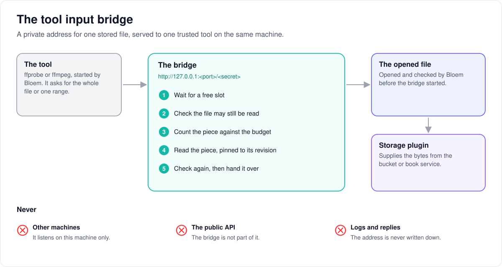

# How a trusted tool reads a stored file

> **Provenance and status.** Bloem page, rewritten on 2026-11-01 and checked against
> `main` at `b6039036d`. The tool input bridge is part of Bloem's
> [native storage](bloem-native-storage.md), a Bloem addition: Silo's tools read
> files from paths on the server. The technical rules are in the
> [For developers](#for-developers) section.

Tools such as ffprobe and ffmpeg read a file by its address. A stored file has no
address on the server's disk, and its address at the storage service must never
leak. This page explains the **tool input bridge**, which gives such a tool a
private, temporary address that serves exactly one file, and the rules it keeps.

## What the bridge is

- **One file, one tool.** Bloem first opens the file and checks the viewer or scan
  may read it. Only then does it start a bridge for that one file.
- **A private address.** The bridge listens only on the machine itself
  (`127.0.0.1`), behind a long random secret in the address. It is never part of
  the public API, and the address is never written to the catalog, logs, the
  tool's error output or any response.
- **Simple requests only.** The tool may ask for the whole file or one range of
  it. Anything else is refused before a byte is read.

## How a read works

1. **Wait for a turn.** Only a set number of reads run at once. A tool that asks
   for more waits for a free slot.
2. **Check first.** Bloem checks that the file may still be read.
3. **Read piece by piece.** Each piece is counted against a **byte budget**. A
   range starts with a small read that doubles in size, so a tool that only peeks
   at a range spends little of the budget.
4. **Check again, then hand over.** A piece reaches the tool only after the read
   and the check after it have both succeeded.

## What spoils the result

- A failure while the tool is still running spoils its result, even if the tool
  then exits happily: a source that stopped, withdrawn access, a cancelled request
  or a spent budget.
- One exception: when the tool has finished and Bloem is tidying up, a range the
  tool no longer needed may fail. That does not count, because the tool never
  received any of it.

## Tidying up

Bloem closes things in a fixed order, so the file is never closed under a tool
still reading it:

1. Stop accepting new requests.
2. Cancel the reads still running.
3. Wait for the tool and every request handler to finish.
4. Close the file.
5. Give back the file's slot.

## Words used in the code

| On this page | In the code and database |
| --- | --- |
| Tool input bridge | `nativestorage.ToolInput` (`internal/nativestorage/tool_input.go`, `tool_bridge.go`) |
| Settings for one bridge | `nativestorage.ToolInputConfig` |
| Secret in the address | the capability path, 32 random bytes |
| Byte budget | `MaxBytes`; each piece is at most `ChunkBytes` |
| Reads at once | `MaxConcurrentReads` |
| The opened file | a host-authorized `mediasource.File` |
| Run the tool | `ToolInput.Run` |

## For developers

The bridge has no API route; it is never mounted on the public API. Its
consumers are the native probe (`internal/scanner/bloem_native_probe.go`, since
`d3d2c8f72`) and native video (`internal/api/handlers/bloem_native_video.go`).

### Contract

`nativestorage.ToolInput` gives a trusted local tool seekable access to one
already opened, host-authorized `mediasource.File`. It does not resolve catalog
identity, grant source authority or admit an unversioned source. Native content
still requires immutable versions or verified snapshots.

The bridge listens on literal `127.0.0.1` and selects the file with a random
256-bit capability (URL-safe base64). Only the exact host and capability path are
accepted, with no query string. GET and HEAD support one byte range and a fixed
content length; unsupported requests, including several `Range` headers, cannot
read the source. The listener is not mounted on the public API. Its ephemeral
argument must not enter catalog rows, logs, child stderr or API responses. The
server bounds request headers (2-second read-header and idle timeouts, 4 KiB of
headers) and discards its own error log.

### Bounds and failures

The consumer supplies the file's cancellation function, a fresh authority
callback, and explicit total-byte, chunk-size, concurrent-read and elapsed-time
bounds (`ToolInputConfig`: `CancelSource`, `Reauthorize`, optional `ReleaseHost`,
`MaxBytes`, `ChunkBytes` up to 8 MiB, `MaxConcurrentReads` up to 8, and
`Timeout`). A request beyond the concurrent-read bound waits for a slot instead
of failing. Every attempted chunk reserves its bytes against the shared budget.
A range starts with a 64 KiB read that doubles up to `ChunkBytes`
(`toolRangeFirstChunk`), so a range a tool opens only to seek past does not cost a
full chunk. Each successful chunk is buffered until the pinned read and both
authority checks complete. A terminal read error rejects the chunk even when the
read returned every requested byte. Source, authority, cancellation and budget
failures remain sticky and invalidate the tool result even if the child exits
successfully after accepting partial input. The cancellation cause is kept as the
sticky failure.

Cleanup's own teardown is the one exception. A tool may exit while a range it
no longer needs is still being served; ffprobe routinely leaves an open-ended
range in flight. Cleanup cancels the source before it joins handlers, so that
read fails, and a handler failure observed after the tool has joined and
cleanup has begun is not recorded. It cannot affect the result: the failed
chunk reached the tool as no byte, and a handler records any failure before it
answers, so a failed read the tool waited on was recorded before the tool
joined. Failures while the tool still runs, or before cleanup begins, stay
sticky, even on a range the tool had already abandoned.

### Run and cleanup

`Run` accepts one trusted callback. The callback must use its context to
terminate the child and must reap that child before returning; it must not call
`Close` itself. Cleanup stops HTTP admission, cancels source and HTTP work,
joins the callback and active handlers, calls `File.Close`, then releases host
admission. A cleanup timeout cannot release admission underneath a running
consumer. An opened adapter retains its own cancellation semantics: for
example, `mediasource.OpenLocal` may close its raw descriptor when canceled
before the bridge's explicit close.

### What it leaves to consumers

The adapter itself supplies no scanner integration, probe budget defaults, library
kind admission or playback capability. Each consumer establishes its own authority,
process limits and output validation:

- The movie and audiobook scans use 128 MiB, 60 seconds and two concurrent reads,
  in 128 KiB chunks for movies and 1 MiB chunks for audio
  (`cmd/silo/bloem_native_movie_scanner.go`); see [native probe](bloem-native-probe.md).
- Native video's remux and HLS bridge uses 1 MiB chunks, four concurrent ranges,
  a 12-hour lifetime and a budget of at least 1 GiB or eight times the file size
  (`internal/api/handlers/bloem_native_video.go`); see
  [native video playback](bloem-native-video-playback.md).

### History

`nativestorage.ToolInput` and this page arrived in `8dd12345d` (2026-10-10).
`4e73aa7aa` (2026-10-11) stopped an abandoned range from failing a successful
probe (the cleanup exception above); `93d60257d` (2026-10-12) made a request
beyond the concurrent-read bound wait for a slot instead of failing; `8dbdb744f`
(2026-10-12) keeps the cancellation cause as the sticky failure; `f02081299`
(2026-10-28) starts each range with a small read.

### Related pages

- [Native storage](bloem-native-storage.md).
- [Native scan reader](bloem-native-scan-reader.md): the file a scan hands to the bridge.
- [Native probe](bloem-native-probe.md) and
  [native video playback](bloem-native-video-playback.md): the two consumers.

The picture is an SVG file under `images/native-tool-input/`, drawn by
`scripts/bloem/draw-pictures.py`. Redraw it there, not by hand.
