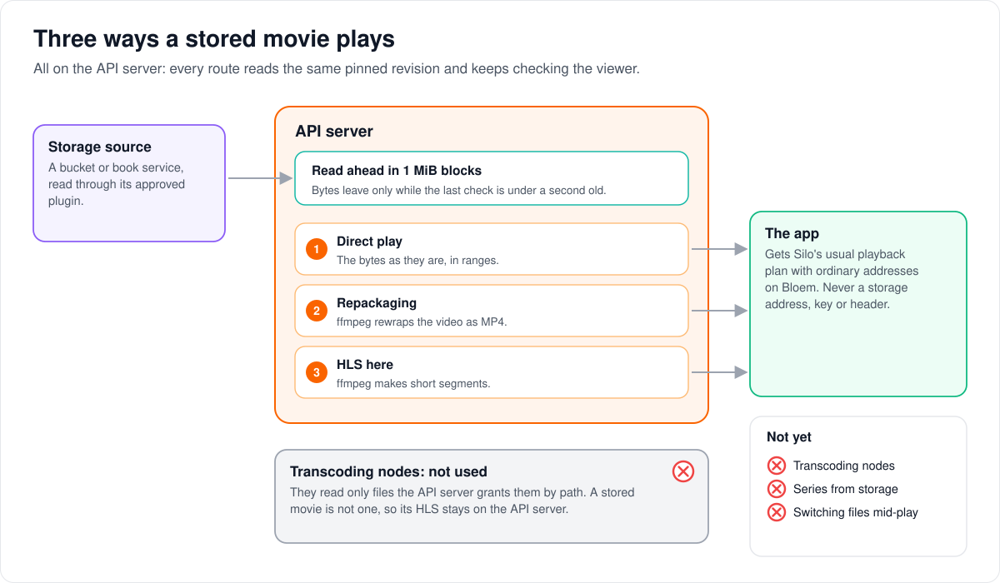

# How stored movies play

Native video is a Bloem addition: it plays movies kept in [native storage](bloem-native-storage.md) (S3 buckets,
for example) through Silo's playback planner and delivery handlers, using Silo's
[playback protocol v3](playback-protocol-v3.md). It is current for movies; runtime playback on the phone and TV
apps and cross-server operation are still open acceptance gates. The technical rules are in the
[For developers](#for-developers) section.

A movie kept in a storage source plays like any other movie: the app asks for a
playback plan and gets ordinary addresses. This page covers what the app sees,
the ways a stored movie can play, where it plays, what Bloem checks while it plays,
and what does not work yet.

## What the app sees

The app gets Silo's usual playback plan, on Silo's `/api/v2`. The
addresses in it point at Bloem. The storage service's address, its keys, its
headers and Bloem's private tool addresses never appear in a plan, the catalog, a
saved recipe, a source grant or the server's log. The web app and Bloem's apps need
nothing special for stored movies.

## Three ways a stored movie plays

1. **Direct play.** Bloem sends the file's bytes as they are, in the ranges the
   player asks for.
2. **Repackaging.** ffmpeg rewraps the video as MP4 on the fly, without
   converting it.
3. **HLS.** ffmpeg cuts or converts the video into short segments.

## Where native inputs run

A **native input** is a movie Bloem reads through its own reader instead of a
file: a movie in a storage source, or a [`.strm` item](bloem-strm.md), whose video
lives at a web address. Direct play and repackaging run on the API servers. HLS,
and converting a copy for offline use, can also run on a **transcode node**, the
machines with GPUs that convert video for the API servers.

A transcode node runs only Silo's code and keeps no database and no keys. Each
node reads its movies in one of two ways, set per node as its **source access**:

- **local**: the node reads the movie from its own copy of the library folders.
- **core**: the node asks the API servers for the movie's bytes, under a
  short-lived **source grant** the API server gave it with the job.

A native input has no file in a library folder, so it goes only to a node with
core source access. The API server gives that node a Bloem source grant, opens
the movie itself (the storage service, or the `.strm` file's web address, with the
same checks as any playback) and sends the node the bytes. The node never sees
the storage service, its keys or the web address. A node with local source
access never gets a native input: Bloem picks another node, or the API server
when the delivery settings allow it.

**What an operator needs:** for stored movies and `.strm` items to convert on the
GPUs, at least one transcode node must have source access set to `core`. Without
one, they convert on the API server, or, when the delivery settings allow only
the nodes, the start is refused. A start that burns in a subtitle stays on the
API server, because a node reading through the API servers cannot burn one in.

Ordinary library files are not affected: they go to the nodes as Silo decides.

A delivery policy that asks for a stored movie only through the standalone proxy
is refused.

## What Bloem checks

**Each time the file is opened**, which includes every start, seek, subtitle
extraction, subtitle file read and restart, Bloem checks again:

- the account or API key, the sign-in, the profile and its PIN;
- the organization membership and the library access;
- that the source still belongs where it did, the plugin is the same version, the
  source settings are unchanged, and the catalog still points at this file.

**While the movie plays**, Bloem reads ahead in 1 MiB blocks. Bytes leave the
server only while the latest check is less than a second old, so a viewer whose
access is withdrawn stops getting video within about a second.

**When playback stops**, Bloem keeps the file open until ffmpeg and everything
reading for it has finished, so the storage is never pulled away mid-read.

## Which bytes play

Bloem plays only the exact revision it scanned. By default it requires a storage
service that keeps every version of a file unchanged. For S3 buckets without
versions, an administrator can choose a **checked mode**: Bloem then compares the
file's fingerprint and size before and after each read. That catches most
changes, but cannot prove the bytes stayed the same between checks.

## Downloading a stored movie

A stored movie downloads as the original file, in Bloem's apps, the web app and
Jellyfin apps, with the same checks as playback. The download resumes where it
stopped, and stops within about a second when the viewer's access is withdrawn.
The saved file is named after the title, never after where it is stored.

Bloem's apps and the web app can also download a copy converted for offline use:
a smaller copy at one of the bitrate presets, or a copy the device can play when
it cannot play the original. Bloem prepares the copy on a transcode node with core
source access, or on the API server, reading the movie under the authority of the
download waiting for it. When the node Silo picks reads its own library folders,
the copy is made on the API server; when the setting that lets the API server
convert downloads is also off, the copy cannot be made. Cancelling or removing that download,
or withdrawing the viewer's access, stops the preparation within about a second.
Jellyfin apps download only the original, as with Silo.

## What does not work yet

- Converting on a transcode node for Jellyfin apps: Jellyfin HLS of a stored
  movie runs on the API server.
- A transcode node that restarts mid-play: the app has to start again, because
  the node's rebuild cannot get a grant for a stored movie.
- Attached fonts and bitmap subtitles in Jellyfin apps.
- Series from storage.
- Switching to another file mid-play needs a fresh start.
- Without Redis, a playback session cannot be picked up by another server.
- The paused-playback timeout in the playback settings: a stored movie left
  paused keeps its session until the app stops it or the session expires.

`.strm` files, whose video lives at a web address, play through this same pipeline,
in Jellyfin apps too; see [how `.strm` files play](bloem-strm.md).

## Words used in the code

| On this page | In the code and database |
| --- | --- |
| Native video | `internal/api/bloem_native_video.go`, `internal/api/handlers/bloem_native_video.go` |
| Playback plan | Silo's playback protocol v3 plan |
| Direct play | `original_http` |
| Repackaging | progressive MP4 remux |
| Transcoding node | Silo's `MODE=transcode` process ([transcode nodes](transcode-nodes.md)) |
| Source grant | `nodesource.Grant` (Silo's), or a Bloem grant for a native input (`NativeNodeSources`), minted by the API server |
| Source access | `stream_nodes.source_access`, `local` or `core` |
| Read ahead in blocks | `nativestorage.ReadAhead` |
| Private tool address | `nativestorage.ToolInput`, redacted as `native source` by `nativeredact` |
| Checked mode | `connection.revision_mode: "checked-etag"` |
| Capability | `native_video_playback`, `native_video_downloads` in the native-storage capability document; `native_video_remote_execution` when native inputs can go to core-access nodes |

## For developers

- **API:** stored movies use Silo's playback routes and
  [playback protocol v3](playback-protocol-v3.md); there is no separate
  native-video route. Readiness is reported by the native-storage capability
  document on the [storage sources API page](../bloem/api/storage.md).

### Contract

Native video uses Silo's ordinary playback plan (protocol v3) and HTTP delivery
contract, on Silo's `/api/v2` (the token path accepts only `/api/v2`). Its catalog identity is an opaque
`bloem-storage:` reference. Provider URLs, headers, credentials and private tool
inputs never become client stream URLs, catalog paths, durable recipes, source
grants or log lines. Silo logs every FFmpeg start and restart command through
`fspath.RedactRelayed`. The start command holds the private tool input address,
so the API servers register `nativeredact.Register` (from `nativestorage.NewHost`
and native playback composition), whose redaction replaces every tool input
address (`http://127.0.0.1:<port>/<43-character capability>`) with
`native source` and leaves Silo's core-access relay URLs to Silo's own relay,
which it wraps (`fspath.RegisteredRelayedSources`). The restart logs the command
built from the catalog reference; Bloem's own lines after the log line hand FFmpeg
the private input instead. Tests: `TestNativeInputStartLogRedactsPrivateArgument`,
`TestNativeInputRestartLogNamesCatalogFileNotPrivateArgument`,
`TestToolInputArgumentIsRedacted` and `TestRedactionWrapsTheCoreAccessRelay`.

### Source admission

Strict admission is the default: the source must supply genuine immutable
version reads or a separately verified immutable snapshot. An advertised
`revision_pinned_reads` guarantee, approved executable, ETag, size, HEAD result
or supplied hash does not prove that the backend preserves bytes. A digest
checked only after serving bytes cannot verify the bytes already exposed.

An approved `bloem.storage.s3` installation can explicitly select
`connection.revision_mode: "checked-etag"`. The host admits this exception only
for its exact retained provider source and configuration; other providers keep
strict admission. The S3 adapter prefers genuine versions where available.
For unversioned objects it checks the expected ETag and size before GET and
again after a complete exact body, before reporting successful final EOF.
It also sends `If-Match`, but some gateways ignore that condition. These checks
can detect drift and discard a failed bounded range; they cannot prove that
bytes remained unchanged between checks or across a playback session. The
checked-mode descriptor advertises `revision_pinned_reads: false`.

Each open rechecks the current account or API key, login/profile credentials,
PIN authority, organization membership, library access, source ownership,
installation generation, encrypted configuration revision and catalog file
reference. The login-session part of that recheck (`verifyNativeVideoActor`)
goes through `SessionRepository.ActiveSessionRole` (Bloem's wrapper in
`internal/auth/bloem_session.go`), which passes the delegated account to Silo's
`SessionRepository.ActiveSession`; that binds a token to its session's account
(Silo #3140). A login session that belongs to another
account does not count as active. A delegated API key must still exist with the
same account, revision and no scopes. The host retains a sealed source descriptor
for the playback session. Replanning the same file reauthorizes it without
replacing or extending that descriptor. Every execution, seek probe, subtitle
extraction and restart opens fresh authority for the same byte revision.

### Publication

Startup constructs `ScanReader` and calls `ConfigureNativeMovies` before
installing the storage ingestor or starting scan queues
(`cmd/silo/bloem_native_movie_scanner.go`). Explicit probe limits are 128 MiB of
aggregate input reads, 128 KiB chunks, two concurrent reads, 60 seconds, 4 MiB of
JSON and 64 KiB of stderr. The configured trusted ffprobe binary probes admitted
MOV/MP4 (`.mp4`, `.mov`, `.m4v`) or Matroska/WebM (`.mkv`, `.webm`) entries.
Suffixes only select the reviewed demuxer; actual bytes must contain video. Other
suffixes are skipped. A `.strm` entry is probed from the URL it holds when the scanner
has remote sources configured ([`.strm` files](bloem-strm.md#scanning)).

The scanner seals a listed page against its current lease, checkpoint, source
and resource owners. It probes before the authorized publication transaction,
then commits files, item associations and revision references together.
Probe or authority failures do not publish a partial page or reconcile the
failure as absence. New items retain filename-derived pending metadata;
existing matched metadata survives a byte-revision update. Filesystem-based
movie metadata matching is not attached to these opaque references; native
movies are matched through `MetadataService.Process` instead (see
[native storage](bloem-native-storage.md#movies)).

The API releases movie library attachment only when the scanner readiness flag
and native playback composition both exist (`attachNativeVideoReadiness` in
`internal/api/bloem_native_storage_capabilities.go`). Its native-storage
capability document reports this composition (`native_movie_libraries` and
`native_video_playback`; `native_video_remote_execution` adds the node source
grants, `NativeNodeSources.Ready`). It does not certify any live source.

### Execution and ownership

Direct GET, HEAD and ranges use the authorized revision-bound reader. Progressive
MP4 remux and local HLS use a supervised private input bridge with fixed
reviewed demuxers. Progressive HEAD validates fresh source authority and joins
its admitted file owner without reading movie bytes or starting ffmpeg. Text and
PGS subtitles and attached fonts are extracted with bounded complete output;
failed output is discarded. Text burn-in extracts execution-only ASS and font
files while retaining the catalog subtitle ordinal in the durable recipe.
Software HDR-to-SDR uses the same fresh source and shared tone-map checks.

A stored episode's or movie's subtitle sidecars (`bloem_storage_episode_sidecars`,
recorded by the series and movie scans) are its external subtitles. `NativeVideoService.catalog()`,
the resolver behind the v3 plan, recovery and the subtitle route, lists the
sidecars whose entry its location still holds at the recorded revision
(`storagesource.Repository.FileSidecars`), in name order, with language,
forced and SDH flags and format. They replace the catalog's external
subtitles for a native file and are listed under an opaque
`bloem-storage-sidecar:<location and entry digest>/<file name>` path that
names no local file and does not change with the sidecar's revision. Silo's
inventory, labels and `external_subtitle_key` URLs then apply unchanged.
The subtitle route serves one only after the session's video preflight
(binding, deny marker, profile, bound revision). It reopens the current row
and reads it through `Coordinator.OpenAuthorizedSidecar` with the bound
video's delegated authority. That repeats the video's viewer, publication and
source checks, and confirms the sidecar is still attached at the pinned entry,
revision and path, before admission and around every provider read. The bytes
must match the listed size and are at most 8 MiB. The video preflight runs
again after the read. Delivery follows Silo's local sidecar: the stored timing
correction, SRT as WebVTT unless `original=1`, ASS/SSA raw. An in-process LRU
cache of at most 32 MiB keys bytes by the bound source identity and the
sidecar's entry and revision, never by path. A changed sidecar is therefore
read again, and a cache hit still passes the binding and preflight checks.
Text sidecars cannot be burned in, as with Silo's local sidecars.

Direct play and the input bridge read through `nativestorage.ReadAhead`, never
one provider range per consumer read. It fetches 1 MiB blocks on aligned
boundaries, three ahead of a sequential reader, in at most five (direct) or
six (bridge) retained blocks (`nativeVideoDirectReadAhead`,
`nativeVideoToolReadAhead`). Every block fetch passes the source's own
per-read authority and pinned-revision checks. Cached bytes are copied out
only while the latest successful fresh authority check began less than one
second ago; a stopped or failed source stops delivery at the next read. So a
revocation that only a fresh check can observe stops delivery within one
second. Direct play hints a single closed request range so fetches stop at its
end. The bridge copies 1 MiB chunks and admits four concurrent ranges, so an
ffmpeg seek that reconnects before the previous range drains does not exhaust
its slots; its budget is at least 1 GiB or eight times the file size, over a
12-hour lifetime. `ReadAheadConfig.Validate` bounds any configuration: blocks of
64 KiB to 8 MiB, at most eight prefetched blocks, at most 64 MiB cached and an
authorization window of at most ten seconds.

FFmpeg's stderr for a native input stays in memory. Each run keeps a 64 KiB
tail (`transcodeExecutionInput.stderr`, `internal/playback/bloem_native_input.go`)
only to classify its failure with Silo's `classifyFFmpegFailure`, so a GPU
decoder rejection takes Silo's CPU-decode retry: the hardware encoder with CPU
decoding, then software. That covers a live start (`StartReadyTranscode`, on
the API server) and converting for offline use
(`prepareSourceFile`, which follows `PrepareFile`'s retries step by step). The
text can name the private input address, so it never enters an error message,
a log, the FFmpeg log sink, a receipt or a response. Errors carry only the
classification. `TestPrepareSourceFileFollowsPrepareFileRetries` fails when
Silo's `PrepareFile` gains a retry that `prepareSourceFile` lacks. Silo's
restart on CPU decoding after a QSV or VAAPI filter-graph failure reads the
session's own stderr, which stays empty for a native input, so native playback
does not take that restart.

The playback handler's file resolver is wrapped by `guardNativePlaybackFiles`
(`internal/api/handlers/bloem_native_playback_guard.go`): `GetByID` refuses a
native storage or `.strm` file, and `GetByIDs`, kept when the inner resolver has
it, leaves those files out. Silo's paused timeout
(`playback.paused_session_timeout_minutes`) reads each candidate's file through
that resolver to exempt audio-only files and skips a file it cannot read, so it
never ends a native input's session; the player's stop or the idle expiry does.
`TestPausedCandidateFilesBatchesThroughNativeGuard` pins the one batched lookup
per page.

Session bindings compare their source snapshot and delegation by instant.
Stores normalize their times to UTC without a monotonic reading, because a
Redis JSON copy never keeps the location or monotonic reading of the value it
was made from.

The source admission remains owned until ffmpeg and its input handlers have
joined. Request cancellation, playback stop and source failure cancel that owner. A cleanup goroutine cannot release the provider
while the child still consumes it. Replanning local HLS to direct or progressive
delivery tears down the previous execution and authority on commit; rollback
preserves the previous route.

### Where native inputs run

Native inputs run on Silo's transcode nodes through Silo's core source access
([transcode nodes](transcode-nodes.md#core-source-access)), with no Bloem code on
the node and no storage credentials there. Silo's grants
(`nodesource.Grant`) name an absolute path that `sources/open` and the source
bytes route stat and open as a file, which a native input never is, so Bloem
mints its own grant and answers both routes for it, in Bloem-owned code
(`internal/api/handlers/bloem_native_node_source.go`,
`internal/api/bloem_native_node_sources.go`):

- **Grant.** `NativeNodeSources.Granter` wraps Silo's `nodesource.FileGranter`.
  An ordinary file gets Silo's grant, unchanged. A native file gets a Bloem
  grant: `bloem-native-grant.v1.` and an AES-GCM-sealed payload with the node id,
  media file id, catalog reference, the binding key (playback session or download
  preparation), the bound revision, size and modification time, issue time and
  expiry. Its key is derived by HKDF from the server secret Silo's grants use,
  under its own label. It lasts `nodesource.GrantLifetime` and at most
  `nodesource.MaxGrantAge`. The node cannot read it. Mint refuses a node whose
  `source_access` is not `core` (`errNativeNodeLocalAccess`) and a file without a
  binding for the named session.
- **Which binding.** The mint names the native video binding (`NativeVideoBinding`)
  the reads go through: the playback session of a v3 start
  (`nativeNodeGrantRequest`, a Bloem line in `prepareRemoteTransportV3`), the
  download preparation's binding (`BeginPreparation`), the recipe card of a node's
  resolve, or the playback session of the stream token the request carries (a
  move off an unreachable node). Anything else gets no grant.
- **Routes.** `NodeSelfMiddleware` sits inside Silo's `/api/internal/nodes/self`
  routes after `nodecontrol.RequireNode`, and answers `sources/open` for a Bloem
  grant under Silo's per-node playback budget (`LimitNodePlayback`).
  `SourceBytesMiddleware`, in the base middleware, takes the source bytes route
  for a Bloem grant and authenticates the node with `nodecontrol.RequireNode`
  itself. Silo grants, and every other request, reach Silo's handlers untouched.
- **Open.** Each `sources/open` and each byte request verifies the grant and that
  it names the calling node, rechecks the node's source access (at open), the
  catalog row (same id and reference, not missing), the binding and the bound
  revision, and opens the file with `NativeVideoService.OpenDelegated`, which
  rechecks the viewer's or download's sealed authority as every delegated read
  does. `sources/open` answers Silo's `nodesource.OpenResponse` with a renewed
  grant, the opaque path `/bloem-native/<file id>/<digest>`, the size,
  modification time and an entity tag `"bloem-<file id>-<size>-<digest>"`; the
  digest hashes the reference and revision. The node treats the path as opaque.
- **Bytes.** The bytes route serves through `nativestorage.ReadAhead`
  (`nativeVideoToolReadAhead`), so the authority is rechecked at least once a
  second while it reads, with Silo's semantics: single and suffix ranges, `If-Match`
  on the entity tag (412 otherwise), 416 with the size and entity tag, multipart
  ranges refused, other conditions dropped, `no-store` on every answer, a rolling
  write deadline, a cut at shutdown, and 429 over 128 responses per node. Silo's
  source metrics are unexported and do not count native reads.
- **Refusals.** 403 for a grant that does not verify, another node's grant, a
  local-access node, a withdrawn authority, a stopped playback (its binding is
  revoked) or an address the `.strm` guard refuses; 410 for a row that is gone;
  412 for another revision; 503 otherwise, which the node retries. Refusals are
  logged with the node, file and status, never the error, which can name a
  storage location or an address. The `.strm` guard runs on every fetch and
  redirect of the API server's open, so the private-address setting applies to a
  node's reads as to the API server's.
- **Silo grants never open a native file.** `bloemNativeNodeControl` wraps
  nodecontrol's catalog check (`FileCatalog`) so a native path is never active for
  Silo's `sources/open`: a Silo grant of a `.strm` file, which trickplay, chapter
  images or subtitle sync could mint, would otherwise serve the text that names
  the address. Only a node's resolve finds a native row active, and its grant
  issuer (`GrantIssuer`) then mints a Bloem grant from the recipe card's playback
  session.
- **Placement.** `nativeVideoWorkerAdmissionV3` admits a native input only to a
  node with `source_access=core`, and only without subtitle burn-in, which a
  core-access node refuses (409); a refusal is an ineligible executor, so the
  route loop moves to another node or the API server as the policy allows. A move
  off an unreachable node (`moveTranscodeOffNodeV3`) gets no grant for a
  local-access node and tries the next one.
- **Downloads.** `prepareNativeHere` hands a native input to Silo's pooled
  preparer. A core-access node gets a Bloem grant for the preparation's binding;
  for a local-access node the grant is refused and Silo's preparer falls back to
  the API server under its local fallback setting.
- **Not on nodes.** Jellyfin starts keep `playback.RefuseContextRemoteStart` (the
  declared seam in `internal/jellycompat/handlers_playback.go`) and run on the API
  server: jellycompat takes the concrete `*nodesource.Grants`, so wrapping its
  granter needs a new seam. Progressive remux and direct play stay on the API
  servers. Trickplay, chapter images and subtitle sync keep Silo's granter; a
  node job for a native file fails at `sources/open` (410).

Tests: `TestNativeNodeGrantOpensAndServesBytes`,
`TestNativeNodeSourceThroughSilosOpenerAndRelay` (Silo's own `nodesource.Opener`,
loopback relay and `nodecontrol.Client`), `TestNativeNodeRefusesALocalAccessNode`,
`TestNativeNodeLeavesSiloGrantsToSilo`, `TestNativeVideoRemoteStartNeedsACoreAccessNode`
(`internal/api/handlers`), `TestStrmNodeSourceKeepsTheAddressGuard`
(`internal/api`), `TestNativePreparationGoesThroughThePooledPreparer`
(`internal/downloads`), `TestNativeVideoNodeOnlyPolicyHasNoRoute` and
`TestNativeJellyfinRemoteStartStaysOnTheAPIServer`.

### Recovery

Recovery reauthorizes before registering a reconstructed session. Redis deny
checks are fresh and fail closed for native execution; generic filesystem
cache behavior does not authorize it. A deliberate native stop must persist a
session tombstone for the full stream-token lifetime before removing the live
session, and revokes the session's source binding. A failed write returns a
failed stop and preserves the retryable session. Without Redis, bindings stay
in bounded local memory and cross-process recovery is unavailable.

### Jellyfin clients

Jellyfin clients play native-storage movies through the same delivery. Silo's
Jellyfin server keeps its own flow: sessions, stream limits, route selection,
progress reports and teardown. Only the step that turns a path into bytes
changes, through playback's context-scoped media host
(`internal/playback/bloem_context_media.go`):

- `bloemCompatNativeMedia` (`cmd/silo/bloem_compat_native.go`) puts the host on
  the Jellyfin stream routes only: video streams, HLS playlists and segments,
  subtitles and attachments. `bloemGuardNativeStorageFiles` returns a native
  file only inside such a request; every other caller still gets not found.
- `attachCompatStream` notes the compatibility session, the playback session
  and the file (`playback.NoteContextStream`).
- Direct play (`ServeDirectPlay`) is served by `NativeVideoCompat.ServeDirect`
  (`internal/api/bloem_native_video_compat.go`) through native direct delivery,
  with ranges, HEAD and a revision ETag, and no redirect. Progressive remux
  (`ServeRemuxWithOptions`), local HLS (`StartTranscode`), copy seek anchors
  (`ResolveCopySeekAnchor`) and embedded text subtitles
  (`ExtractSubtitleWithFormat`) read the host's pinned source. Silo's IDR primer
  for a seeked HEVC copy (`remuxIDRPrimer`) reads a local Matroska file's Cues; a
  native input has none, so its remux (`internal/playback/bloem_native_tools.go`)
  always serves the plain seeked copy, as Silo does for a source without usable
  Cues. HDR tone-map
  validation of a local transcode goes through the source's own `Validate`,
  as for native API playback. The subtitle cache keys entries by a file's size
  and modification time; a native input is never a file, so nothing is cached
  for it and a new revision cannot get an older revision's text.

The compatibility session is the credential. Each open and each authority
check rechecks the stored compatibility session and its login session, the
account, the profile with its PIN and credential revisions, the membership,
the viewer's playback and library scope, the source, and the playback session
it serves. The binding seals only the SHA-256 of the session token
(`CompatSessionDigest`), never the token; delegated reads look the row up by
that digest. The PIN was checked at sign-in, so it is not asked again.
Sessions an `sa_` admin key synthesizes have no login session and are refused.
A refusal answers 403, never 401, because a Jellyfin client signs out on 401.
When a Jellyfin playback session finishes or expires, the deny tombstone is
written and the binding is revoked.

Remote HLS: Silo's Jellyfin server refuses to send a native input to a transcode
node (`playback.RefuseContextRemoteStart`) and runs it on the API server, see
[where native inputs run](#where-native-inputs-run); native API playback does use
core-access nodes.

`.strm` items take the same path: `Handles` takes every native location, and the
host opens a `.strm` item's recorded URL as native API playback does. Subtitle
files beside a local `.strm` file are local files, which Silo's subtitle route
serves from disk once the guard has returned the file
([`.strm` files in Jellyfin apps](bloem-strm.md#jellyfin-apps)).

Inside a request with the host, Silo's attached-font listing and extraction read
the host's source, so the attachment route serves a native file's fonts; ffmpeg and
ffprobe never get a native path ([media tools](bloem-strm.md#playback)). Not
covered yet: listing those fonts (PlaybackInfo carries no host, so it lists none),
bitmap (PGS) subtitle extraction for native files, and Jellyfin's proxy-node direct play (a proxy refuses native sources, so
the redirect fails; an API-egress route works). Jellyfin downloads
(`/Items/{id}/Download`) are covered under [Downloads](#downloads).

### Downloads

Original downloads of native-storage and `.strm` videos go through Silo's
download service unchanged: the same policy, quotas, bandwidth limits and rows,
on every download route (`/api/v2/direct-download`, managed and ephemeral
`/api/v2/downloads/{id}/file`, and Jellyfin's `/Items/{id}/Download`).

- `downloads.GuardNativeStorageFiles` still hides every native row until
  `Service.SetNativeOriginals` installs a reader (`attachNativeVideoDownloads`,
  `internal/api/bloem_native_video_download.go`, after native playback is
  composed). It then admits what `NativeVideoDownloads.DownloadFile`
  (`internal/api/handlers/bloem_native_video_download.go`) accepts: native video
  in an admitted container, not native audio or ebooks. The admitted copy carries
  the served size; for a `.strm` item that is `bloem_remote_sources.remote_size`,
  not the text file's size.
- Serving a native target (`bloemServeNativeOriginal`,
  `internal/downloads/bloem_native_download.go`) never opens the catalog path.
  It opens the file through `strmPlayback.open`, so a storage object goes
  through `Coordinator.OpenAuthorizedPlayback` and a `.strm` item through the
  SSRF-guarded remote reader, and reads it through `nativestorage.ReadAhead` with
  the direct-play configuration. `http.ServeContent` answers ranges, HEAD and
  `If-Range` with the revision ETag direct play sends. A failure after the
  first byte aborts the response (`ErrResponseCommitted`).
- The authority (`nativeVideoDownloadAuthority`) is a delegation with no
  playback session. It is taken from the request after viewer access: an access
  token or a direct-download link (`dl`, which must name this file) is bound to
  its login session, an unscoped API key to its revision, and a Jellyfin download
  to its compatibility session (`WithNativeVideoCompatDownload`, set by
  `bloemCompatDownloadServer`; `sa_` sessions are refused). Every open and read
  rechecks it as delegated playback does (`verifyNativeVideoActor`): the
  account, the login session, the profile's PIN and credential revisions, the
  organization membership, the viewer's playback and library scope, the catalog
  file and the source. It expires with the login session, and after
  `playback.MaxTokenTTL` at the latest, so a download outlives its access token
  but not its sign-in. Refusals map to the download errors (403 or 404), never
  401.
- Prepared copies (a bitrate preset, or a copy for a device that cannot play
  the original) get Silo's quality decisions and artifact queue unchanged. Two
  approved seams let the queue read a native input. `encodeOne` prepares through
  `bloemPrepareFile` (`internal/downloads/bloem_native_prepare.go`), and
  `PrepareFile` hands an input that is not a file here to `prepareContextFile`
  (`internal/playback/bloem_prepare_file.go`). That runs Silo's prepared-file
  recipe through the supervised input bridge with the source's fixed demuxer,
  and refuses a native path that arrives without a source, so ffmpeg never opens
  a catalog reference.
- A preparation has no request behind it, so it reads under the authority of a
  download waiting for it: the oldest `preparing` row linked to the artifact
  whose viewer may still read the source (`nativeVideoPreparationAuthority`,
  token type `download_prepare`). Every open and read rechecks that row (still
  `preparing`, same account, profile and artifact) and, as for delegated
  playback, the account, the profile's PIN and credential revisions, the
  membership, the viewer's playback and library scope, the catalog file and the
  source. A job no waiting download may read for fails.
- `NativeVideoDownloads.BeginPreparation`
  (`internal/api/handlers/bloem_native_video_prepare.go`) binds each attempt like
  a playback start: the attempt's UUID (the end of its `<artifact>-<uuid>` ID)
  names a binding sealed with that authority. The returned context carries a
  context-scoped media host, so `PrepareFile` on the API server reads
  `NativeVideoService.InputSource` through the binding. The attempt always runs
  on the API server (`prepareNativeHere`); with the local fallback setting off it
  fails. Ending the attempt revokes the binding.
- The artifact queue resolves a native file to its download view, so a `.strm`
  item's tone-map revision records the served size, as the request that queued it
  did; the source's own `Validate` accepts that size for a `.strm` item, whose
  binding pins the bytes.
- A download proxy cannot read native sources: a proxy redirect is probed,
  refused, and the API server serves the file itself.

### Supported surfaces and evidence limits

The supported contract is native API video playback and original downloads for
admitted catalog files, including copies converted for offline use. Initial
movie scanning accepts MOV/MP4 and Matroska/WebM containers.
`.strm` items reuse this pipeline with a remote reader
([`.strm` files](bloem-strm.md#playback)).
Native audiobooks have their own direct-play path; see
[native audiobook presentations](bloem-native-audio-playback.md). Jellyfin
clients are covered above. The capability document keeps
`native_video_jellyfin` false until real Jellyfin clients have been checked.
`native_video_downloads` is true when native video playback is composed: original
downloads and offline conversion both work.

Sidecars belonging to a different original file after an alternate-file start
need their own host-owned binding; an effective-file binding grants no access to
that other file. File-switch replans that need the new source during preparation
remain denied until the host supplies pending plan authority; a fresh start is
the supported switch boundary. An active HLS A/V replan that retains the exact current transport
may reuse it without replacement.

Web, Apple and Android consume normal HTTP playback plan URLs. Source schemes
and provider headers are not client contracts. Their URL contracts have been
reviewed; runtime playback on those clients and cross-replica
source operation are separate acceptance gates.

Synthetic-provider acceptance runs the real coordinator, pinned readers,
planner, handlers and ffmpeg. It verifies direct ranges and decodes remux/HLS
output, exercises seek, restart, recovery, stop/revocation and joined
cancellation, and checks HDR conversion to H.264, 8-bit BT.709. Database scan
acceptance separately checks atomic movie publication. These tests do not
certify a live storage backend, a multi-server cluster or a Stremio/debrid
implementation. The SDK's storage byte interface can consume another admitted
provider, but it does not currently offer on-demand Stremio discovery or
verified snapshot lifecycle.

### Related pages

- [Native storage](bloem-native-storage.md) and
  [native audiobook presentations](bloem-native-audio-playback.md).
- [Native tool input](bloem-native-tool-input.md) and
  [native probe](bloem-native-probe.md).
- [Playback protocol v3](playback-protocol-v3.md),
  [restart-resilient playback](restart-resilient-playback.md),
  [transcode nodes](transcode-nodes.md) and
  [node failure detection](node-failure-detection.md): Silo's playback contracts,
  and [Bloem's notes on transcode nodes](../bloem/overlays/architecture/transcode-nodes.md).
- [Delivery boundary enforcement](delivery-boundary-enforcement.md): library
  access rechecked as bytes leave the server.

The picture is an SVG file under `images/native-video-playback/`, drawn by
`scripts/bloem/draw-pictures.py`. Redraw it there, not by hand.
