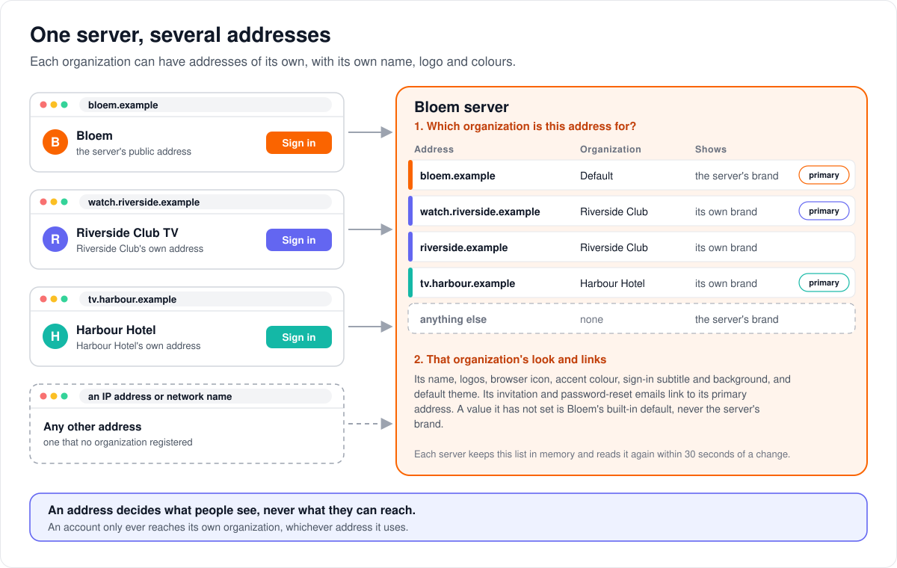
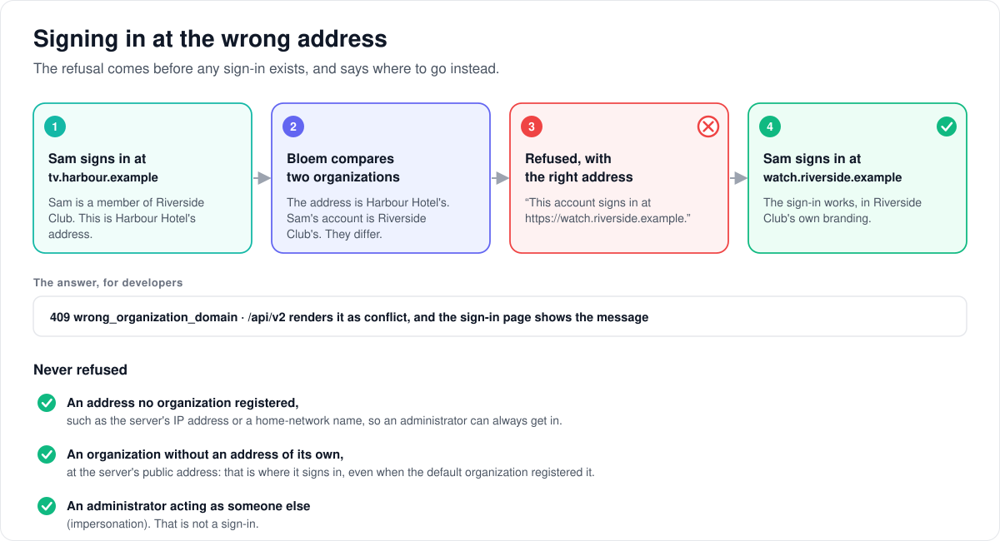

# How organization domains and branding work

> **Provenance and status.** Bloem page, rewritten on 2026-11-01 and checked against
> `main` at `b6039036d`. Organization domains and branding are a Bloem addition:
> Silo has one name, one look and one public address per server. This page explains
> them in plain language; the technical rules are in the
> [For developers](#for-developers) section.

One Bloem server can look like several services. Each organization can have web
addresses of its own, with its own name, logo and colours, and its emails link to
its own address. This page walks through how a server tells the addresses apart,
what branding covers, what happens when someone signs in at the wrong address, how
a sign-in through Authentik stays on its address, and how to add a new one.

## One server, several addresses

1. **A domain** is a web address, such as `watch.riverside.example`. A platform
   administrator **registers** a domain to one organization. A domain belongs to at
   most one organization; an organization can have several.
2. **The primary domain** is the one address an organization's links use, for
   example in its emails. An organization's first domain becomes its primary.
3. When a page or an app request arrives, Bloem looks up the address it was sent
   to. If an organization registered it, the server shows that organization's
   **branding**: its name, logos, browser icon, accent colour, sign-in subtitle and
   background, and default theme.
4. Any other address, such as the server's IP address or a home-network name, shows
   the server's own branding. So does the server's public address unless an
   organization registered it.

**A domain decides what people see, never what they can reach.** An account belongs
to exactly one organization, and it only ever reaches that organization's libraries
and people, whichever address it uses.

**The default organization** uses the server's own branding, the one an
administrator edits in the server's branding settings. Its addresses show that
branding. In production on 2026-11-01, the default organization is the only one, and
the server's public address is registered as its primary domain.

**Another organization never shows the server's brand.** A branding value it has not
set falls back to Bloem's built-in default, not to the server's name or logo.

Each server keeps the list of domains in memory. A change shows at once on the
server that made it, and on the other servers within about 30 seconds.

## Emails link to the organization's address

Invitations and password-reset emails carry the organization's own name, and their
links point at its primary domain. An organization without a domain gets links to
the server's public address. An invitation follows the organization of the
administrator who sends it; a password reset that someone asks for themselves
follows the address they asked on.

## Signing in at the wrong address

1. Someone signs in at an address that another organization registered.
2. Bloem compares the address's organization with the account's.
3. When they differ, Bloem refuses **before any sign-in exists**, with a message
   that names where the account signs in: its organization's primary domain, or the
   server's public address when its organization has none.
4. The person signs in at that address instead.

Bloem never refuses:

- a sign-in at an address no organization registered, such as an IP address or a
  home-network name, so an administrator can always reach the server;
- a sign-in by an account whose organization has no address of its own, at the
  server's public address, even when the default organization registered that
  address (otherwise the refusal would name the address that refused it);
- an administrator acting as someone else (impersonation), which is not a sign-in.

## Signing in through Authentik

Some servers let people sign in through a **sign-in provider**, Authentik. On the web,
a provider sign-in stays on the address where it started:

1. On `watch.riverside.example`, the person chooses to sign in with Authentik.
2. Bloem sends the browser to Authentik with that address's **callback**, the page
   Authentik returns to.
3. Authentik checks the person and sends the browser back to that callback.
4. Bloem finishes the sign-in on the same address, where the browser keeps its
   cookies.
5. Signing out through Authentik, when the server has that switched on, returns the
   browser to the same address's sign-in page.

Authentik only returns to addresses it knows. Each domain's two callbacks, and its
sign-in page for signing out, must be registered there first (see
[a new domain, step by step](#a-new-domain-step-by-step)). Apps on phones and TVs,
and any address no organization registered, keep using the server's public address.

## Adding a domain

1. Point the address at the server and give it a certificate.
2. Route it to Bloem through the trusted proxy in front of the server.
3. If people sign in through Authentik, register the address's callbacks and sign-in
   page there.
4. Register the domain to the organization, in the organization's page in the admin
   console or from the storefront.
5. Optionally set the organization's name, logos and colours in the same page.

## Example: a club gets its own address

This example is made up. On 2026-11-01 production had only the default organization.

Riverside Club resells Bloem to its members. A platform administrator registers
`watch.riverside.example` (the first, so it becomes primary) and
`riverside.example`, uploads the club's logo and sets its name, "Riverside Club TV",
and its blue accent colour.

- A member who opens either address sees Riverside Club TV, in blue, with the club's
  logo.
- The member's invitation email links to `watch.riverside.example`.
- A Harbour Hotel guest who tries to sign in there is told to sign in at Harbour
  Hotel's own address.
- The server's public address is registered to the default organization, as in
  production, so a member who signs in there is told to sign in at
  `watch.riverside.example`.
- What members can watch does not change: it is still the club's libraries, on the
  club's plan.

## What a domain does not change

- **Apps on phones and TVs.** The device sign-in page and the server address the apps
  are told stay on the server's public address.
- **Jellyfin apps and the email sender.** The Jellyfin address and the address emails
  are sent from are the same for every organization.
- **Invitations a platform administrator sends** into another organization link to
  the default organization's address.
- **Switching back to Silo.** A second organization ends the ability to share the
  database with Silo (see [Silo backend switching](silo-backend-switching.md)).

## Who can change what

| Who | What they manage |
| --- | --- |
| Platform administrator | Every organization's domains and branding, in the organization's page in the admin console (Domains and Branding panels). The server's own branding, which is the default organization's, in the server's branding settings. |
| The storefront (Bloem Garden) | A reseller organization's domains and branding, using a platform administrator's API key. A domain it registers is recorded as the storefront's. |
| Organization administrator | Nothing here: domains and branding are platform routes. |
| Whoever runs the hosting | The address itself, its certificate, the proxy, and the Authentik registration. |

## Words used in the code

| On this page | In the code and database |
| --- | --- |
| Domain | a `bloem_organization_domains` row, keyed by `host` |
| Primary domain | `bloem_organization_domains.is_primary`, one per organization |
| Who registered it | `source`: `platform` or `garden` (`orgdomains.SourcePlatform`, `SourceGarden`) |
| Branding | the `branding.*` settings (`branding.PresentationSettingKeys()`); an organization's own values are `bloem_organization_branding` rows |
| The in-memory list | `orgdomains.Directory`, refreshed after `DirectoryTTL` |
| The address a request arrived on | `orgdomains.RequestOrganization`, `RequestDomain`, set by `orgdomains.WrapListener` |
| The organization presentation follows | `orgdomains.OrganizationFor` |
| Wrong-address refusal | `auth.OrganizationDomainError`, answered as `409 wrong_organization_domain` |
| Callback, sign-out return address | the OAuth handler's callback URL and post-logout redirect (`internal/auth/oauth_handler.go`, `bloem_oauth_domain.go`) |
| Managing them | `/api/bloem/v1/admin/platform/tenants/{id}/domains` and `/branding`; capability `organization_domains_v1` |

## For developers

- **API:** the domain and branding routes on the
  [organizations and administration](../bloem/api/organizations.md) page:
  [list](../bloem/api/organizations.md#get-apibloemv1adminplatformtenantsiddomains),
  [add](../bloem/api/organizations.md#post-apibloemv1adminplatformtenantsiddomains),
  [make primary](../bloem/api/organizations.md#put-apibloemv1adminplatformtenantsiddomainshostprimary),
  [remove](../bloem/api/organizations.md#delete-apibloemv1adminplatformtenantsiddomainshost),
  [read branding](../bloem/api/organizations.md#get-apibloemv1adminplatformtenantsidbranding),
  [change branding](../bloem/api/organizations.md#put-apibloemv1adminplatformtenantsidbranding),
  [upload an image](../bloem/api/organizations.md#put-apibloemv1adminplatformtenantsidbrandingassetskind)
  and [remove an image](../bloem/api/organizations.md#delete-apibloemv1adminplatformtenantsidbrandingassetskind).

The code is `internal/orgdomains`. The platform routes are in
`internal/api/handlers/bloem_organization_domains.go`, the sign-in check is in
`internal/auth/bloem_sign_in_domain.go`, and the wiring is in
`internal/api/bloem_organization_domains.go`. Migration
`20261101055208_bloem_organization_domains.sql` adds both tables. The Silo-owned Go
files it changes are declared seams in `contracts/seams.txt`: `cmd/silo/main.go`,
`internal/api/router.go`, `internal/api/handlers/auth.go` and, added for the provider
sign-in as the ledger's 304th entry, `internal/auth/oauth_handler.go`.

### Rules

- **A domain decides presentation, never access.** An account belongs to one
  organization (`organization_memberships_one_per_account`). The tenant middleware
  takes that organization from the account or the session, whatever domain the
  request arrived on. A domain only chooses the branding shown and the address links
  use.
- **Registered hosts only.** A host maps to an organization only when it is in
  `bloem_organization_domains`. A stored host is lower case and has at least one dot,
  with no scheme, port or path, at most 253 characters (`orgdomains.NormalizeHost`;
  the table's check constraint holds the same pattern). A request host is compared
  lower case, with its port, IPv6 brackets and trailing dot removed.
- **Trusted proxies only.** The request's host is `X-Forwarded-Host` from a trusted
  proxy, else `Host`. A client that is not a trusted proxy cannot pick an
  organization by sending `X-Forwarded-Host`.
- **The default organization is the server.** It uses the server's own branding and
  public URL, and the branding routes refuse it (`409 default_organization`). It may
  register domains: an account of another organization is then refused there, unless
  its organization has no domain and the host is the server public URL's.
- **Another organization never shows the server's brand.** An organization's unset
  branding value is Bloem's built-in default on its domains, not the server's. The
  server's branding is the default organization's brand.

### Tables

- `bloem_organization_domains`: `host` (primary key, lower case, the host pattern
  above), `organization_id` (references `organizations`, `ON DELETE CASCADE`),
  `is_primary`, `source` (`platform` or `garden`) and `created_at`. The partial unique
  index `bloem_organization_domains_one_primary` allows one primary per organization.
- `bloem_organization_branding`: one row per organization and `branding.*` key
  (`key LIKE 'branding.%'`), primary key `(organization_id, key)`. Writing an empty
  value deletes the row.
- Domain writes for one organization take a transaction-scoped advisory lock on the
  organization, so two first domains cannot both become primary. They do not lock the
  `organizations` row, which Silo writes too.

### How a request gets its organization

`orgdomains.WrapListener` wraps the whole listener in `cmd/silo/main.go`. That covers
the API router and the page shell, which `cmd/silo/root_handler.go` serves outside
the API router.

The wrapper reads the host through `(*clientip.Resolver).RequestHostOf`
(`internal/clientip/bloem_request_host.go`), which changes nothing on the request. It
must not run `clientip.Middleware`: that rewrites `r.RemoteAddr`, and the API
router's own client-address pass would then lose the trusted proxy's forwarded host.
The organization is stored with `WithRequestOrganization`, and the matched host with
`WithRequestDomain`. On an unregistered host neither is set.

`orgdomains.Directory` holds every registered domain, each organization's primary,
the default organization's ID (`public.bloem_default_organization_id()`) and every
organization branding value in memory. After `DirectoryTTL` (30 seconds) it keeps
serving the old map while one background read replaces it, so a slow database never
holds requests up. The first read, and the read after a write on the same node
(`Directory.Invalidate`), happen in the request, so the write shows at once. Other
nodes see a write within about 30 seconds. One read is bounded at 5 seconds,
independent of the request. A failed read keeps serving the previous map.

### Branding and email links

Silo reads presentation values through a settings store that receives the request
context. `orgdomains.SettingsOverlay` wraps that store in two places:

- `branding.NewService` in `cmd/silo/main.go`. This covers `/api/v2/theme/branding`,
  the page shell and manifest (`internal/server/frontend.go`) and the branding assets.
- The invitation and password-reset services in `internal/api/router.go`
  (`bloemAccountMailSettings`), with `OverlayOptions{PublicURL: true}`.
  `server.public_url` there answers `<scheme>://<primary domain>`, in the scheme of
  the server public URL (`https` when it has none), so links follow the organization.
  An organization without a primary domain keeps the server public URL. Mail also
  reads `branding.server_name` through the overlay.

The overlay answers the keys in `branding.PresentationSettingKeys()`: server name,
login subtitle, accent colour, default theme, and the asset references (`wordmark`,
`wordmark_light`, `mark`, `mark_light`, `favicon`, `login_bg`). Every other key is
the server's. It picks the organization from `OrganizationFor`, in this order:

1. one named with `WithOrganization`;
2. the authenticated request's tenant;
3. the request's domain.

For the default organization, or none, every key is the server's.

A write goes to an organization only when its context carries `WithBrandingWrite`.
Every other write is the server's, even one made on an organization's domain. That
lets Silo's own branding settings page keep editing the server's branding. A write
to an organization invalidates the directory.

Organization values live in `bloem_organization_branding`, one row per `branding.*`
key. Uploads go through Silo's own `branding.Service.UploadAsset`, with the limits
and answers of Silo's branding upload. References are content hashes in the shared
asset store, and deleting an organization's asset only clears its row.

### Signing in on another organization's domain

Every sign-in creates a session through the auth service's session repository.
`Service.SetSignInDomainCheck` puts `Directory.SignInCheck` in front of it
(`domainCheckedSessions`, wired by `bloemInstallSignInDomainCheck`). It checks
`Create`, `CreateProfileSessionIfCurrent` and `createWithQuerier`; setting the check
again replaces it rather than stacking.

When the request's domain is registered to another organization than the account's
active membership, the sign-in is refused before a session exists, with
`auth.OrganizationDomainError`. The password and profile sign-in handlers
(`internal/api/handlers/auth.go`, `bloem_auth_ext.go`, through
`organizationDomainAPIError`) answer `409 wrong_organization_domain`,
"This account signs in at https://<primary domain>." The scheme follows the server
public URL's. That address falls back to the server public URL when the account's
organization has no primary domain. `/api/v2` renders it as `conflict`, and the
sign-in page shows the detail.

An organization without a domain signs in at the server public URL. Its accounts are
let in on that URL's host even when the host is registered to the default
organization, so the refusal never names the address that refused.

It is 409, not 403: v2 renders a 403 at sign-in as `permission_denied`, which the
sign-in page reports as a disabled account.

Not refused:

- requests on unregistered hosts, such as IP addresses and LAN names, so an
  administrator can always reach the server;
- accounts with no active membership;
- impersonation sessions.

### Signing in through an OAuth provider (Authentik)

A web sign-in through a provider stays on the organization domain it started on. The
provider sends the browser back to that domain's callback, and the browser finishes
on that domain's completion page, where its cookies are. `Directory.OAuthBaseURL`
names the base (the request's registered host, in the server public URL's scheme),
and `auth.OAuthHandler.SetRequestBaseURL` installs it (`bloemInstallOAuthDomains`).

A provider sign-out started on an organization domain returns the browser to that
domain's `/login`.

`internal/auth/oauth_handler.go` is a declared seam for this: one field and five call
sites. They are the public-origin check, the callback address, the completion page
twice, and the sign-out's return address. The helpers are in
`internal/auth/bloem_oauth_domain.go`. On any other host the flow keeps the public
URL and bounces there, as in Silo. The provider must know each domain's callback and
sign-out return address. Silo's plugin installation page and the
`/api/v2/auth/provider-logout` description name only the public URL's.

### Managing domains and branding

The platform routes sit under `/api/bloem/v1/admin/platform/tenants/{id}`:

- `domains`: list (`GET`), add (`POST`, body `host` and `primary`), set the primary
  with `PUT …/domains/{host}/primary`, and remove (`DELETE …/domains/{host}`);
- `branding`: read (`GET`) and update (`PUT`), and upload or delete an asset with
  `PUT|DELETE …/branding/assets/{kind}`.

They take a Platform administrative context or an administrator's unscoped API key.
An API key records a domain as `garden`, anything else as `platform`. The capability
is `organization_domains_v1`, advertised when the routes are mounted. The platform
administrator's organization page has Domains and Branding panels.

An organization's first domain is its primary, whatever `primary` says; `primary` on
a later one moves the primary to it. Removing the primary makes the oldest remaining
domain primary.

Answers:

| Status and code | When |
| --- | --- |
| `404 not_found` | no such organization, or the organization has no such domain |
| `422 invalid_host` | the host is not a lower-case name with at least one dot, without scheme, port or path |
| `409 domain_taken` | the host is already registered, to any organization |
| `409 default_organization` | a branding route on the default organization |
| `422 validation` | `server_name` over 80 characters, `login_subtitle` over 200, either with control characters; `accent_color` not `#RRGGBB`; `default_theme` not a theme name (`^[a-z][a-z0-9-]{0,39}$`) |
| `400 invalid_json`, `400 bad_request`, `413 too_large`, `503 unavailable` | a malformed body, an unknown asset kind or bad upload, an oversized image, no asset storage |

A branding update changes only the fields it names; an empty string clears one.

### A new domain, step by step

1. Point DNS at the ingress and issue a certificate for the host.
2. Route the host to Bloem through a trusted proxy that forwards the client's host.
3. For sign-in through Authentik on that domain, register its callbacks in the
   provider: `https://<domain>/api/v1/auth/oauth/<installation>/callback` and
   `https://<domain>/api/v2/auth/oauth/<installation>/callback`. When provider
   sign-out is on, also register `https://<domain>/login` as a post-logout redirect
   URI.
4. Register the domain, in the organization page or from the storefront.

### Limits

- **Authentik:**
  - App (native) sign-in through a provider keeps the public URL.
  - A provider sign-in refused on another organization's domain gets the OAuth
    handler's generic failure, not the address message.
- **Phone and TV apps:** the device sign-in page (`/activate`) and the server address
  the apps are told (`/api/v2/system/identity`) stay on the server's public URL. A
  device-code sign-in creates its session through the device login service, so the
  domain check does not see it.
- **Invitations from the platform:** an invitation follows the inviting
  administrator's organization. One a platform administrator sends into another
  organization links to the default domain.
- **Jellyfin and email sender:** the Jellyfin address and the email sender are
  server-wide.
- **Page shell cache:** it keeps one rendered page keyed by branding. With several
  brands it re-renders when the brand changes, which is correct but slower.
- **Silo switching:** a second organization ends it (see
  [Silo backend switching](silo-backend-switching.md)).

### Tests

- `internal/orgdomains`: `TestNormalizeHost`, `TestRequestHostKey`, the
  `TestWrapListener*` tests (registered, unknown, untrusted and trusted forwarded
  hosts), `TestOrganizationForPrefersExplicitThenTenantThenRequest`, the directory
  tests (`TestDirectoryServesExpiredMapWhileRefreshing`,
  `TestDirectoryRefreshesAfterInvalidate`, `TestDirectoryKeepsLastSnapshotOnLoadError`),
  the `TestOverlay*` tests and `TestBrandingServiceThroughOverlay`, the store tests,
  `TestSignInCheck`, `TestSignInCheckLetsAnOrganizationWithoutADomainUseTheServerAddress`
  and `TestOAuthBaseURLFollowsTheRequestDomain`.
- `internal/auth`: the `TestDomainCheckedSessions*` tests,
  `TestSetSignInDomainCheckDoesNotStack`, `TestOrganizationDomainErrorMessage`,
  `TestOAuthWebFlowStaysOnTheOrganizationDomain`,
  `TestOAuthOffTheOrganizationDomainKeepsThePublicURL` and
  `TestOAuthProviderLogoutReturnsToTheOrganizationDomain`.
- `internal/api`: `TestAccountMailSettingsFollowTheDomainDirectory`, and in
  `internal/api/handlers` `TestOrganizationDomainsLifecycle`,
  `TestDomainsSourceFollowsCredential`, `TestOrganizationBrandingRoundTrip`,
  `TestDefaultOrganizationBrandingIsServerWide` and
  `TestCapabilityAdvertisesOrganizationDomains`.
- The web sign-in page: `web/src/pages/Login.organizationDomain.test.tsx`.

Technical pages:

- [How organizations work](bloem-organizations.md): organizations, accounts and
  the default organization.
- [Multitenant administration](multitenant-administration.md): the Platform context
  the routes take.
- [Bloem native API security foundation](bloem-security-foundation.md): sign-in,
  sessions and the native namespace.
- [Silo backend switching](silo-backend-switching.md).

The pictures are SVG files under `images/organization-domains/`, drawn by
`scripts/bloem/draw-pictures.py`. Redraw them there, not by hand.
