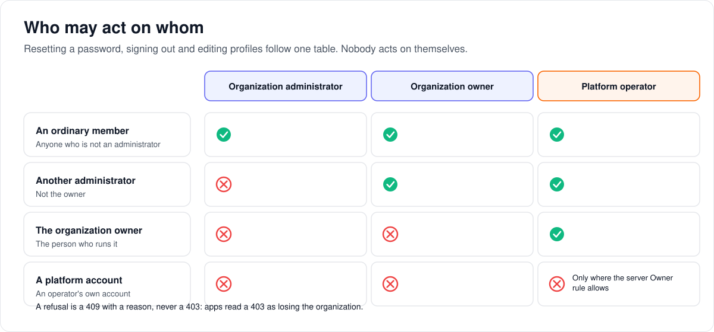

# How organization support works

> **Provenance and status.** Bloem page, written on 2026-11-13 and checked against the
> `feat/organization-support-routes` branch before its merge. Organization support is a
> Bloem addition: Silo has one set of administrators per server. This page explains what an
> organization's administrators can do to help their own people, and what the server
> operator can do to help an administrator. The technical rules are in "For developers".

An organization looks after its own people. When a member cannot sign in, forgets a PIN, or
shares a screen by mistake, the organization's administrator helps. This page covers what
they can do, who they can do it to, and how the server operator steps in when the
administrator is the one who is stuck.

## What an administrator can do

- **Help someone get back in.** Send a member a link to choose a new password, by email or
  as a link to hand over. The administrator never types or sees the password.
- **Sign a member out.** Out of every app at once, out of one session, or off one device.
  The member's list of sessions and devices shows what is signed in, without addresses.
- **Fix a household's profiles.** Add a profile, rename one, clear a forgotten PIN, or remove
  a profile. An administrator never sets a PIN, and never changes age limits.
- **See and stop streams.** Who is watching, what, on which device, and whether it plays
  directly or is converted. They can stop a stream or put a message on the screen. They do
  not see addresses, server names or routing: those belong to the server, not the
  organization.

## Who may do it to whom

- An administrator helps **ordinary members**.
- The **organization owner** can also help the organization's other administrators.
- **Nobody helps themselves** this way. A member changes their own password and signs
  themselves out in the app.
- Only the platform operator helps the **owner**.
- A **platform account** (an operator's own account) stays protected by the server's Owner
  rule, even when it belongs to an organization.

A refusal says why ("this person is the owner"). It is never a "forbidden": apps read that as
losing access to the whole organization, and a protected member is not that. A person from
another organization looks exactly like a person who does not exist.

## Example: Coach, Sam and a locked-out TV

Riverside Club's owner is Mara. Coach is an administrator, and Sam is a member.

- **Sam forgot the password.** Coach asks for a reset link for Sam, by email. Sam gets it,
  chooses a new password, and is signed in. Coach never saw a password. If Sam has no
  working mailbox, Coach asks for a link instead and hands it over. The link works for four
  hours, once, and Sam also gets an email saying a reset was issued.
- **A shared TV.** Sam's old TV is still signed in at a friend's house. Coach signs Sam out
  of that device only. Sam's phone stays signed in.
- **A lost laptop.** Coach signs Sam out everywhere. Every app asks Sam to sign in again.
- **Sam's daughter forgot her PIN.** Coach clears the PIN on her profile. She chooses a new
  one herself.
- **Coach tries to reset Mara.** Refused: only the platform operator helps the owner. Mara
  can reset Coach, though.

## When the administrator is the one who is stuck

The platform operator cannot simply walk into a customer's organization. To open it, the
**server Owner** states a reason ("The administrator is locked out; investigating with her").
That opens the organization for **at most four hours**. The reason, and every change made
while it is open, appears in the organization's **Activity** as "Platform support", with no
account name. The operator can close it earlier. Anyone else who tries gets the same "not
found" they always got.

## Who can change what

| Who | What they manage |
| --- | --- |
| Organization administrator | Their own organization's members: reset links, sign-outs, profiles, streams. Not other administrators or the owner. |
| Organization owner | The same, and the organization's other administrators. |
| Server Owner (the platform operator) | Any organization, but only by stating a reason first; the reason is shown to the customer. |
| A member | Their own password, sessions and profiles, in the app. |

## Words used in the code

| On this page | In the code and database |
| --- | --- |
| Reset link | a `password_reset_tokens` row (Silo's), completed on Silo's public reset route |
| Sign out everywhere | raising the membership `security_revision` and revoking the account's `auth_sessions` |
| A profile's revision | `user_profiles.revision`, raised by a trigger on any edit |
| Activity | `GET /api/bloem/v2/admin/organization/activity`, read from `admin_audit_events` |
| Platform support | an `admin_audit_events` row written under a `bloem_support_access` record |
| Stopping a stream | Silo's administrator terminate, called after the organization filter |

## For developers

### Routes

Under `/api/bloem/v2/admin/organization/`, behind the organization pass. The generated
[organizations page](../bloem/api/organizations.md) lists each with its fields and errors.

| Route | What |
| --- | --- |
| `POST people/{account_id}/password-reset` | Reset link; `delivery` `email` (24 h) or `link` (4 h, returned once) |
| `GET`/`DELETE people/{account_id}/sessions`, `DELETE …/sessions/{session_id}` | List, sign out everywhere, sign out one |
| `GET people/{account_id}/devices`, `DELETE …/devices/{device_id}` | List, sign out one device |
| `POST people/{account_id}/profiles`, `PATCH …/profiles/{profile_id}/details`, `DELETE …/profiles/{profile_id}/pin`, `DELETE …/profiles/{profile_id}` | Add, rename, clear PIN, remove |
| `GET streams`, `POST streams/{session_id}/stop`, `POST streams/{session_id}/message` | The organization's streams |
| `GET support-capabilities` | What this server can do; the public token is `organization_support_v1` |
| `DELETE support-access` | End the break-glass access the pass was opened under |

`POST /api/bloem/v2/admin/session` takes an optional `support` object (`reason`, or
`access_id` to renew); the context answers `access_basis` (`membership` or `support`).

### One authority rule

`adminpeople.Judge` and `adminpeople.LockAuthority` are the only place the table above lives.
Every route that acts on a person calls `LockAuthority` in the write's own transaction. It
locks, in this order, the organization (shared), the actor's membership or account (shared),
the target membership and the target account, then judges them. A promotion that commits
first is seen; one that commits later cannot change what the transaction wrote, and the
migration `bloem_retire_reset_on_promotion` deletes a reset link when its account becomes an
administrator or the owner.

Classification order, first match wins: `self`, `platform_account`, `organization_owner`,
`organization_admin`, `member`. The refusal is `409 target_protected` with `reason`. The
shared-account guard (`409 account_shared`) refuses an account-wide effect on an account in
more than one organization; today's `organization_memberships_one_per_account` constraint
makes it unreachable, and a test drops the constraint to prove the guard.

The People writes that existed before (membership suspend and reactivate, the profile
access-group move, the bulk jobs) use the same rule. A bulk job skips a protected person with
`target_protected`.

Stream stop and message have a narrower rule (`adminpeople.JudgeStream`): the actor's own
stream and a platform account's stream are refused, and any other person's stream may be
stopped.

### Revisions

| Write | `expected_revision` is | Raised by the write? |
| --- | --- | --- |
| Reset link | the person's `security_revision` | no |
| Sign out everywhere | the person's `security_revision` | yes |
| Sign out one session or device | none | no |
| Rename, clear PIN, remove | the profile's `revision` | yes, the profile's, by trigger |
| Add a profile | none | no |
| Stop, message | none (a message keeps Silo's `command_id` and `sequence`) | n/a |

Raising `security_revision` signs the member out, through the organization revocation trigger,
so only the sign-out raises it.

### Audit and rate limits

`/api/bloem/v2` is outside Silo's audit, so every route writes `admin_audit_events` itself, in
the same transaction as the change (streams: after the command was accepted). No row holds a
link, token, digest, password, PIN, hash or email address. A refusal is `<action>_refused`
with outcome `conflict`.

The budgets are counted from `admin_audit_events`, so they hold across nodes: reset links
`support_disclose` (1 per person per 2 minutes, 10 per administrator per 10 minutes, 30 per
organization per hour), sign-outs and profile edits `support_mutate` (6, 30 and 120),
streams `support_stream` (6 per session per minute, 30 and 60), and break-glass openings 20
per operator per hour. Refusals count. Over a budget is `429 rate_limited` with
`Retry-After`. Stream budgets are counted without a lock, so a burst can overshoot slightly.

### Break-glass support access

`bloem_support_access` is append-only (a trigger allows only `closed_at` to be set once). A
pass opened under it carries `support_access_id` instead of a membership. The middleware
revalidates on every request: the login session, the operator (enabled, platform
administrator, server Owner), the organization (active, owned), the access (open, unexpired,
this login session) and the organization's policy revision. The cap is four hours from
opening and a re-mint cannot extend it. Activity shows `actor_authority`
(`organization_admin` or `platform_support`) and returns `actor_account_id: null` for a
platform actor, for old events too.

Widening who may open support access means changing `supportaccess.Store.Eligible`, the
`support_access.opened` message to customers, and this page.

### Silo seam

`internal/api/handlers/playback_sessions.go` gains one zero-valued field,
`PlaybackSessionsQuery.OrganizationID`. It filters in SQL, so cursors and totals are exact.
It is declared in `contracts/seams.txt`.

### Not done

Parental fields and setting a PIN stay out of organization authority. Personal API keys
survive "sign out everywhere", as in Silo's reset policy. The streams list is polled; there
is no organization realtime channel. Removing a profile deletes its sessions, but nothing stops a
stream already playing on it; stop the stream first.
