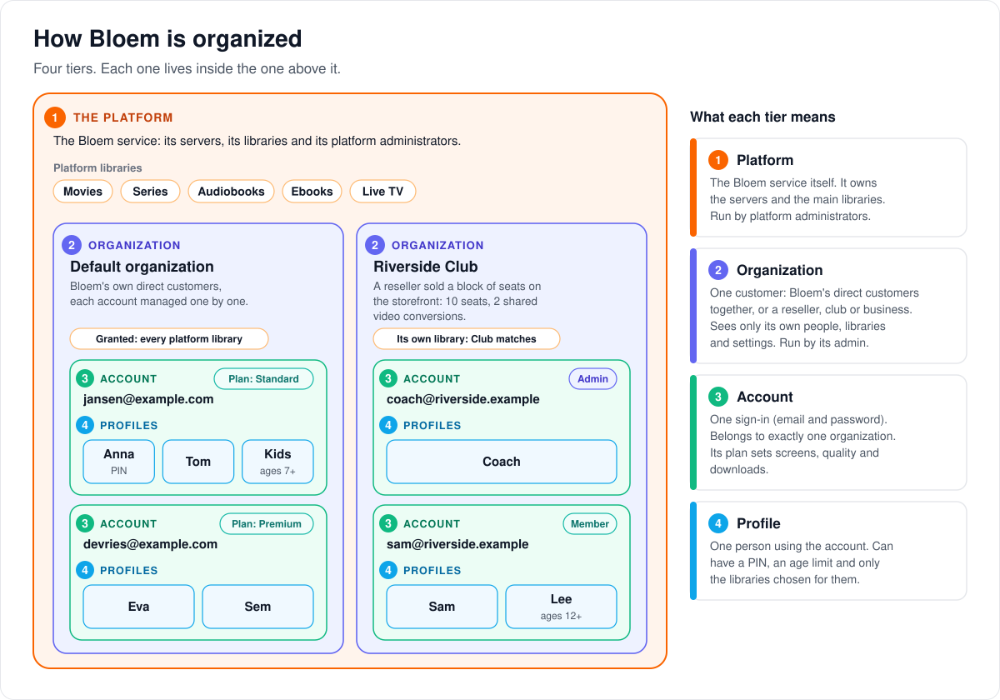
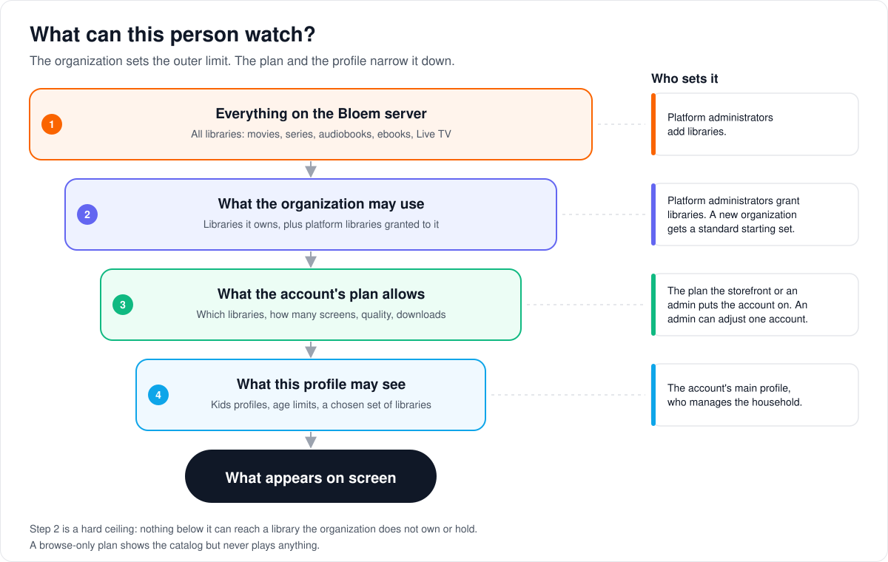
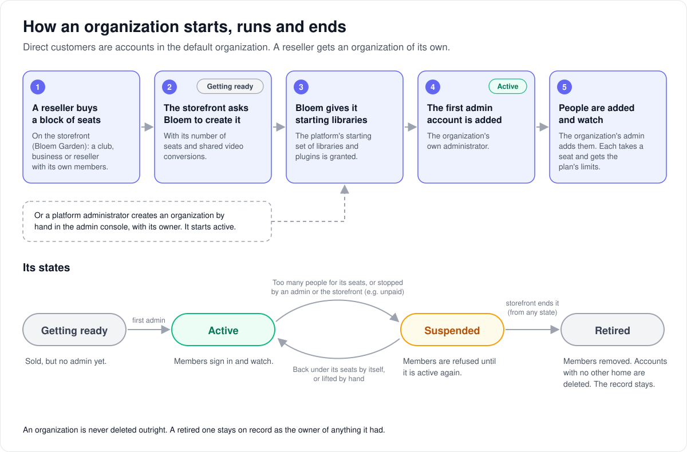
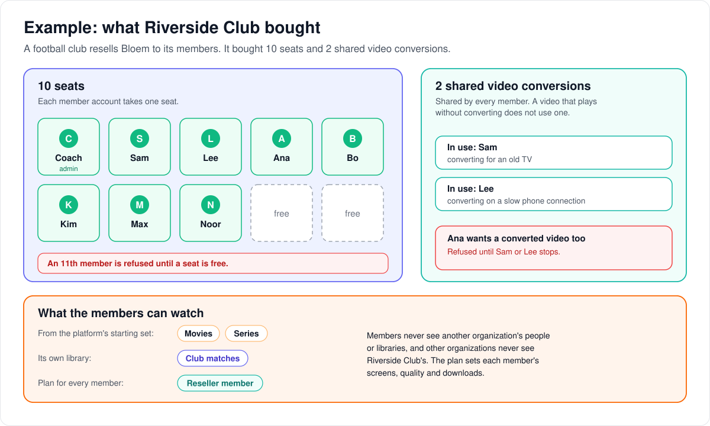
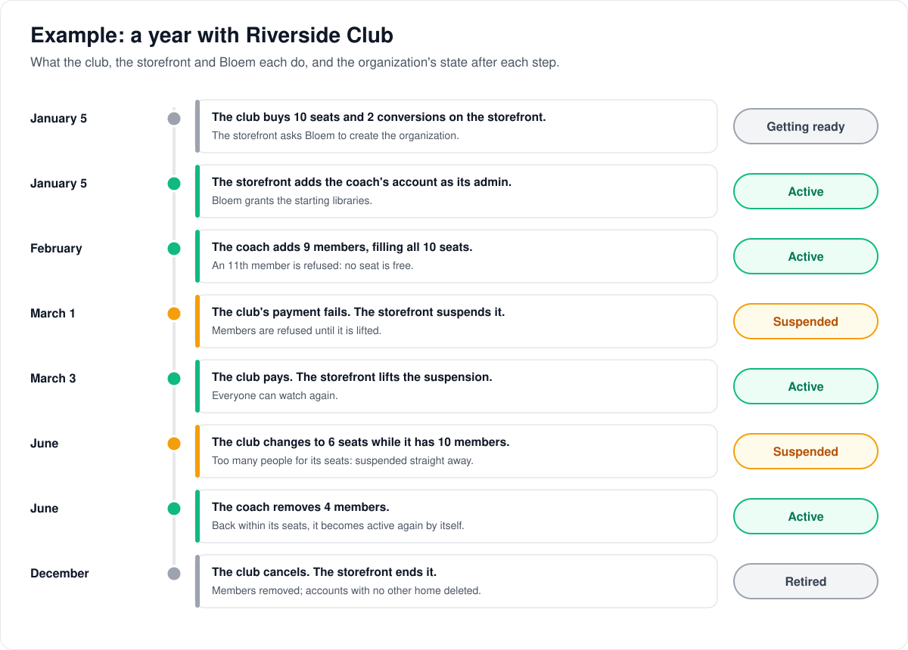
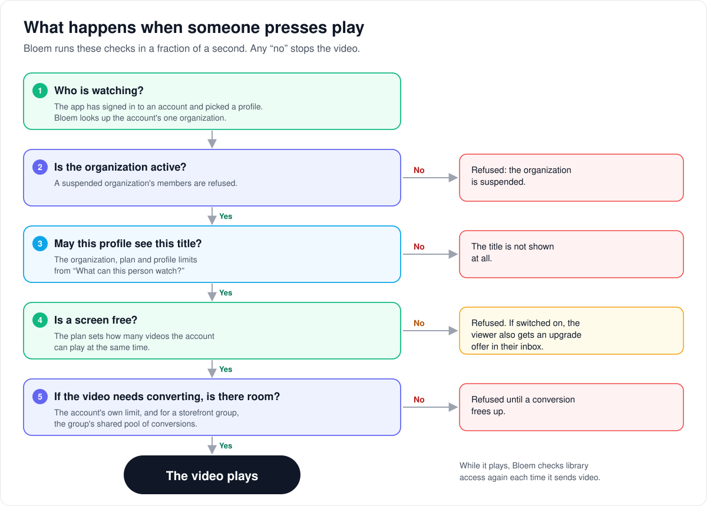

# How organizations work

> **Provenance and status.** Bloem page, written on 2026-10-31 and checked against
> `main` at `81c26179c`. Organizations are a Bloem addition: Silo has one set of
> accounts per server. This page explains the model in plain language. The
> technical pages linked at the end hold the invariants.

Bloem is built in four tiers. Each tier lives inside the one above it, and each one
can only narrow what the tier above it allows. This page walks through who is who,
what someone can watch, how an organization starts and ends, and what happens when
someone presses play.

## Who is who

1. **The platform** is the Bloem service itself: its servers, its libraries (movies,
   series, audiobooks, ebooks, Live TV) and the people who run it, the **platform
   administrators**.
2. **An organization** is one customer. It sees only its own people, libraries and
   settings, never another organization's. Its **organization administrator** runs it.
3. **An account** is one sign-in, an email address and a password. Every account
   belongs to exactly one organization. Its **plan** decides how many screens it can
   watch on at once, the picture quality and whether it can download.
4. **A profile** is one person using the account, such as each member of a household.
   A profile can have a PIN, an age limit and its own set of libraries. The account's
   main profile manages the household.

### Two kinds of organization

- **The default organization** holds Bloem's own direct customers. The storefront
  (Bloem Garden) or an administrator manages each of these accounts one by one. Every
  server has exactly one default organization, and accounts from before organizations
  existed live there too. Each new platform library is granted to it automatically.
- **A reseller organization** is sold through the storefront as a block of **seats**
  (see the [reseller example](#example-a-reseller)).
  It suits a club, a business or a reseller that looks after its own members. Each
  person takes one seat. The organization also gets a number of **shared video
  conversions** for all of its members together. It can own libraries of its own.

A platform administrator can also create an organization by hand in the admin
console. In production on 2026-10-31, the default organization is the only one,
and every account is in it.

## What can someone watch?

Each step narrows the one before it:

1. **Everything on the server.** Platform administrators add the libraries.
2. **What the organization may use.** This is the libraries the organization owns,
   plus the platform libraries granted to it. It is a hard ceiling: nothing further
   down can reach past it.
3. **What the account's plan allows.** The plan picks libraries and sets screens,
   quality and downloads. An administrator can adjust a single account, but still only
   within step 2.
4. **What this profile may see.** Kids profiles, age limits and a chosen set of
   libraries narrow it further.

A **browse-only** plan shows the catalog but never plays anything. The storefront's
preview visitors use a protected Preview plan like it. When the storefront switches
on free play, a visitor who confirms an email address can watch for a metered time.
See [browse-only content policy](bloem-browse-only-content-policy.md).

## How an organization starts, runs and ends

1. A reseller buys a block of seats on the storefront.
2. The storefront asks Bloem to create the organization, with its seats and shared
   video conversions. The organization is **getting ready**: it has no administrator yet.
3. Bloem grants it the platform's **starting set** of libraries and plugins.
4. The first administrator account is added, and the organization becomes **active**.
5. The organization's administrator adds people. Each one takes a seat and gets the
   plan's limits.

An organization can be **suspended**. That happens on its own when it has more people
than seats, for example after its seats are reduced, and lifts on its own once it is
back under. A platform administrator or
the storefront can also suspend it, for example when a bill goes unpaid. That kind
lifts only when someone lifts it. While an organization is suspended, its members are
refused.

When the storefront ends a reseller organization, Bloem **retires** it. Its members
are removed, and accounts with no other organization are deleted. Accounts that have
another organization, or that are platform administrators, are kept. The organization
itself is never deleted outright: it stays on record as the owner of anything it had.

## Example: a reseller

This example is made up. On 2026-10-31 production had no reseller organizations.

Riverside Club, a football club, resells Bloem to its members. It buys **10 seats**
and **2 shared video conversions** on the storefront. Early on, eight seats are taken.

- **Seats.** Each member account takes one seat. When all ten are taken, an 11th
  member is refused until a seat is free.
- **Shared video conversions.** All members share them. A video that plays without
  converting doesn't use one. When both are busy, a third member who needs a
  converted video is refused until one frees up.
- **What the members can watch.** Members get the platform's starting set of
  libraries plus the club's own library, all on the club's plan. Riverside Club
  never sees another organization's people or libraries, and no other organization
  sees Riverside Club's.

Over a year, the club, the storefront and Bloem each play their part:

- **A missed payment** and **too many people for the seats** both suspend the
  organization, and its members are refused while it is suspended.
- **They lift differently.** A suspension for non-payment lifts only when the
  storefront or a platform administrator lifts it. A suspension for too many people
  lifts by itself once the club is back within its seats. If someone lifts a
  payment suspension while the club still has too many people, it stays suspended
  for that reason.
- **Cancelling retires the organization.** Its members are removed, and accounts
  with no other organization are deleted.

## What happens when someone presses play

1. **Who is watching?** The app has signed in and picked a profile. Bloem looks up the
   account's organization.
2. **Is the organization active?** A suspended organization's members are refused.
3. **May this profile see this title?** This is the funnel above. A title the profile
   may not see is not shown at all.
4. **Is a screen free?** The plan sets how many videos the account can play at once.
   When none is free, playback is refused. If the storefront has switched it on, the
   viewer also gets an upgrade offer in their inbox.
5. **If the video needs converting, is there room?** The account has its own limit,
   and a reseller organization also has its shared pool. When either is full, playback
   is refused until a conversion frees up.

While the video plays, Bloem checks library access again each time it sends video,
not only when the title is listed.

## Who can change what

| Who | What they manage |
| --- | --- |
| Platform administrator | Every organization: create, suspend, reactivate, transfer ownership. Platform libraries and which organization gets them. Plans (entitlement templates). |
| Organization administrator | Their own organization only: people, profiles, groups, invitations, its own libraries, and grants already made to it. |
| The storefront (Bloem Garden) | Creating and retiring reseller organizations, their seats and conversions. Putting an account on a plan. It uses a platform administrator's API key. |
| An account's main profile | The household's profiles: who they are, PINs, age limits and libraries. |

An account with the `admin` role is a platform administrator. An organization
administrator's authority comes from their membership in that organization. The admin
console asks which of the two you are acting as, and never mixes them.

Apps built for Silo, and Jellyfin or Audiobookshelf apps, know nothing about
organizations. They sign in to an account, and Bloem works out the organization from
it.

## Words used in the code

| On this page | In the code and database |
| --- | --- |
| Platform | the one `platform` row in `resource_owners` |
| Organization | `organizations` (a "tenant" in `internal/tenancy`) |
| Default organization | the organization with `is_default` |
| Reseller organization | an organization with an `external_service_id`, created through the tenants API (`/api/v1/admin/tenants`) |
| Seats | `organizations.slots`; each seat is one `organization_memberships` row |
| Shared video conversions | `organizations.transcodes`, a pool shared by every member |
| Getting ready, active, suspended | `organizations.status`: `initializing`, `active`, `suspended`, with `suspension_reason` `quota` or `admin` |
| Retired | suspended, with the external service identity cleared and the memberships removed |
| Membership | `organization_memberships`, at most one per account |
| Library grant | an `organization_entitlements` row for a platform library or plugin |
| Starting set | the organization-creation default bundle (`entitlement_bundles`) |
| Plan | an entitlement template, applied to an access group (`access_groups.managed_template_key`) |
| Account settings | the policy columns on Silo's `users` row, which override the plan's values |
| Profile limits | `user_profiles`: PIN, child flag, age limit and library restrictions |

## Technical pages

- [Multitenant administration](multitenant-administration.md): the Platform and
  Organization admin contexts, and how Silo clients resolve an organization.
- [Resource tenancy foundation](resource-tenancy-foundation.md): resource owners,
  grants and the starting set.
- [OPA tenant authorization](opa-tenant-authorization.md): how tenant facts, the
  policy engine and SQL scope reads.
- [Lifecycle safety](bloem-lifecycle-safety.md): retiring an organization.
- [Delivery boundary enforcement](delivery-boundary-enforcement.md): access rechecked
  when video and rows leave the server.
- [Entitlement templates](../wiki/admin/entitlement-templates.md): plans.
- [Silo backend switching](silo-backend-switching.md): a database shared with Silo is
  limited to one organization.

The pictures are SVG files under `images/organizations/`, drawn by
`scripts/bloem/draw-organization-pictures.py`. Redraw them there when the model
changes, not by hand.
