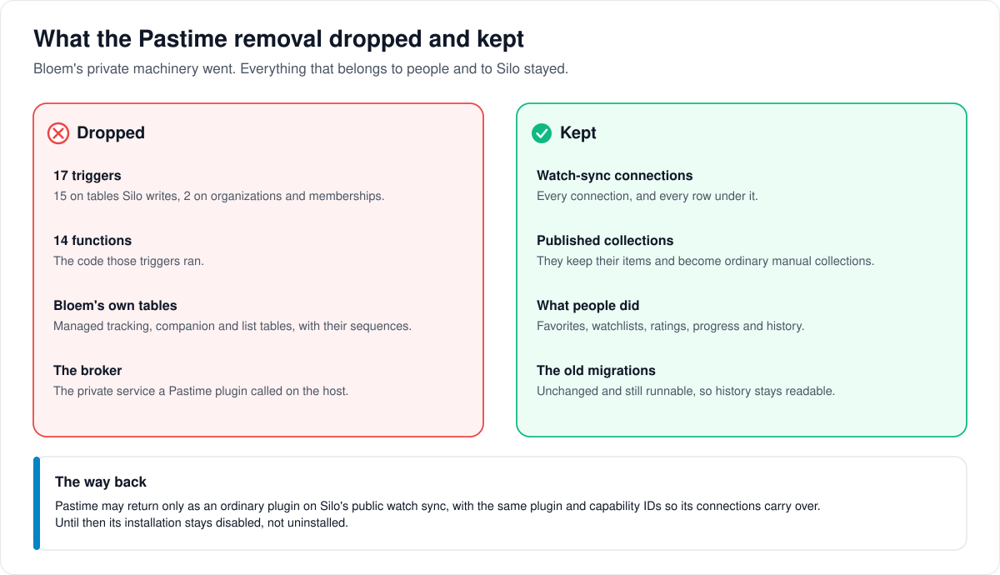

# How Pastime tracking was removed

> **Provenance and status.** Bloem page, rewritten on 2026-11-01 and checked against
> `main` at `b6039036d`. This is the current record of a completed removal of a Bloem
> addition; Silo never had it. The migration's boundaries, the upgrade constraints and
> the tests are in the [For developers](#for-developers) section.

**Pastime** is a separate service that keeps track of what people watch. For a few
days in October 2026 Bloem connected to it through machinery of its own, called
**managed tracking**. That machinery is gone. This page walks through why, what the
removal dropped and kept, how Pastime could come back, and what to watch out for when
upgrading.

## Why it went

Managed tracking reached into Silo's code and wrote straight into Silo's tables. It
needed **triggers**, small rules inside the database that run when a table changes, on
tables Silo writes, and a private service on the server that only Pastime's plugin
used. Every one of those made Bloem harder to merge with Silo, so on 13 October 2026
Bloem took it all out.

## What was dropped, and what was kept

- **Dropped:** the triggers, the functions they ran, Bloem's own tracking, companion
  and list tables, and the private **broker** service on the server.
- **Kept:** everything that belongs to people or to Silo. Each **watch-sync
  connection**, a profile's link to a tracking service, stays with everything under
  it. Collections that Pastime filled keep their items and become ordinary collections
  someone edits by hand. Favorites, watchlists, ratings, progress and watch history are
  untouched.

## How Pastime could come back

Silo has its own **watch sync** for plugins that track what people watch. Pastime may
come back only as an ordinary plugin on that, with no triggers, no private service and
no direct writes into Silo's tables. Until then:

1. Keep the Pastime plugin's installation **disabled**. With it enabled, the server
   stops at start-up.
2. Don't uninstall it. Uninstalling would leave its connections pointing at nothing.
3. When a new Pastime plugin built on Silo's watch sync is ready, install it in place,
   with the same plugin and capability IDs, so the connections carry over.

While the plugin is disabled, nothing is sent to Pastime. Plays finished in the
meantime stay in Silo's watch history, and a later version can catch up from it.

## Who can change what

| Who | What they manage |
| --- | --- |
| Platform administrator | Keeping the `bloem.pastime` installation disabled, and later replacing it in place. |
| A profile | Removing its own watch-sync connection, as with any other. |
| The person running the server | Running the removal while nothing else uses the database, and deciding a rollback from the migration record, not from whether the server starts. |

## Words used in the code

| On this page | In the code and database |
| --- | --- |
| Managed tracking | the former `bloem_managed_*`, `bloem_companion_*` and `bloem_list_*` tables, triggers and functions |
| The removal | migration `20261013231500_remove_pastime_managed_tracking.sql` |
| Watch-sync connection | a `watch_provider_connections` row, for provider `plugin:<installation>:pastime` |
| Pastime's plugin installation | `bloem.pastime` |
| The broker | the managed-tracking host broker service, bound through `BindHostBroker` |
| A collection Pastime filled | a collection whose `source_config` carried `bloem_list_binding` |

## For developers

- **API:** none of Bloem's own. The route back is Silo's watch-sync plugin capability;
  see Silo's [watch provider plugins](watch-provider-plugins.md).

History: Bloem integrated Pastime through a Bloem-only "managed tracking" broker between
2026-10-11 (`272ff0e38`) and 2026-10-13 (list collections, `c2bf1f7cd`). The code went
in `e4bcbddc5` (2026-10-13) because it reached into Silo's plugin host and wrote
directly into Silo tables. The database objects went in migration
`20261013231500_remove_pastime_managed_tracking.sql` (`1903f5eb8`, 2026-10-13), and
`a17109cd7` (2026-10-14) changed it to keep the watch-sync connections; the removal
merged in `4835a698e` (2026-10-14). The "mirrored" Silo-switching phase named below no
longer exists: since `c60b7008e` (2026-10-26) switching is a single flag (see
[Silo backend switching](silo-backend-switching.md)). The evidence test still reaches
that phase by migrating to a version before
`20261026003000_bloem_account_policy_on_users.sql`.

Bloem no longer carries a Pastime integration. The managed-tracking bridge and its
broker, the list collections, calendar, recommendation and library bridges, and the
host hooks they needed are removed. Pastime may come back only as an ordinary plugin
on public Silo capabilities such as watch sync and the plugin SDK. Bloem adds no
triggers, identity fences, private broker services or direct writes into Silo tables
for it.

### Persistence boundary

Migration `20261013231500_remove_pastime_managed_tracking.sql` drops what the Pastime
migrations created:

- the 17 `bloem_managed_*` and `bloem_companion_*` triggers (15 on Silo-written tables,
  2 on `organizations` and `organization_memberships`) and their 14 functions;
- the `bloem_managed_*`, `bloem_companion_*` and `bloem_list_*` tables and sequences.

The migration writes no `watch_provider_connections` row and none of their child rows
(sync runs, history exports, list, rating and dropped items, scrobble sessions). The
connections enrollment wrote stay as ordinary, user-removable watch-sync rows for the
plugin installation that owns provider `plugin:<installation>:pastime`, alongside any
Pastime connection a profile linked itself. While that installation is disabled no
provider serves the key, so Silo's watch sync sends nothing for these connections (a
scheduled sync records a failed run): pending history exports stay pending, and plays
finished meanwhile stay in Silo's watch history with no export row. Favorite,
watchlist, rating and dropped-show changes are not queued either, and no scrobble
session is written. Once a version with watched export serves the key again, its
scheduled sync reconciles each connection's completed history and queues the missing
plays; list and rating changes made meanwhile depend on its full list and rating sync.

Collections a list binding published keep their items; the `bloem_list_binding` marker
leaves `source_config`, and a synced native personal collection becomes manual.
Favorites, watchlists, ratings, progress and watch history are not touched.

The migration runs in one transaction, uses `IF EXISTS` and no `CASCADE`, so an
unknown dependent aborts all of it. Triggers go before the data changes, so none of
them fires during the collection updates. It writes no membership-policy column and
runs unchanged in the mirrored Silo-switching phase. Its Down refuses ("Pastime
managed-tracking removal is forward-only"): a restore needs the pre-removal database
backup and the matching old binary.

The historical Pastime migrations stay byte-identical and executable. Rollback tests
that walk the whole chain skip the removal file, as they skip the compatibility removal
(`compatibilityBaselineFS` in `internal/database/bloem_compat_removal_migration_test.go`,
`opaCompatibilityBaselineFS` in `internal/api/opa_tenant_foundation_test.go`).

### Upgrade constraints

- Disable the `bloem.pastime` installation before the release and keep it disabled
  until a version built on public Silo capabilities replaces it in place (same plugin
  ID, same capability ID, so the provider key and its connections carry over). Do not
  uninstall it: Silo's uninstall does not delete watch-provider connections, so its rows
  would be left for a provider no installation serves.
- The migration takes `ACCESS EXCLUSIVE` locks on `users` and the other formerly
  triggered Silo tables and holds each until commit. Its 5 s `lock_timeout` caps each
  lock wait, not the whole step: behind a longer-running transaction on any of those
  tables it rolls back whole and the next start retries, but the locks it already holds
  stay held through every later wait, so staggered blockers can hold up logins for
  several waits. Run it with no other database clients, for example as
  `silo --migrate-only` while the server is stopped.
- A binary from before the removal does not refuse the migrated database: the migration
  runner allows out-of-order versions and ignores applied versions it does not know, so
  it starts and then fails at runtime on the dropped tables. Decide a rollback on
  whether `goose_db_version` has 20261013231500 applied, never on whether a server
  started. Once it is applied, going back means recreating the dropped objects from a
  pre-removal backup (and deleting that version row) or restoring the whole database.

### Host boundary

- `internal/pluginhost/host.go` and `internal/auth/login_identity_space_db_test.go`
  match upstream Silo again and are no longer seams.
- Lifecycle repeatable-read transactions are not rerun after a serialization failure.
  That retry existed only for the managed-tracking fence.
- The host no longer serves the managed-tracking broker service. A `bloem.pastime` 0.1.x
  plugin requires it, so when its installation is enabled every start fails at
  `BindHostBroker` (`FailedPrecondition`) and the host stops the process. Keep that
  installation disabled until an upgrade built on public Silo capabilities replaces it
  in place.

### Evidence

`internal/tenancy/bloem_pastime_removal_switching_test.go` covers a fresh migration
chain with no Pastime objects (`TestPastimeRemovalLeavesNoManagedObjects`); a seeded
upgrade in the mirrored phase that leaves every watch-provider connection and its child
rows unchanged (enrolled, self-linked and other-provider), keeps Silo data and accepts
Silo-shaped writes (`TestPastimeRemovalKeepsSiloDataAndWritesInMirroredPhase`); atomic
failure when an unknown view depends on a dropped table
(`TestPastimeRemovalFailsAtomicallyOnUnknownDependency`); and an atomic give-up and
later retry when a long-running transaction holds a lock on a formerly triggered table
(`TestPastimeRemovalGivesUpBehindALongLockHolder`).

### Related pages

- [How Bloem forks Silo](../../FORK.md#what-bloem-removed): every addition Bloem took
  out again.
- [Protocol compatibility](bloem-compatibility-removal.md): the other removal of
  October 13, and the restore that followed.
- [Silo backend switching](silo-backend-switching.md): the switching phase the evidence
  test reaches.

The picture is an SVG file under `images/pastime-removal/`, drawn by
`scripts/bloem/draw-pictures.py`. Redraw it there, not by hand.
