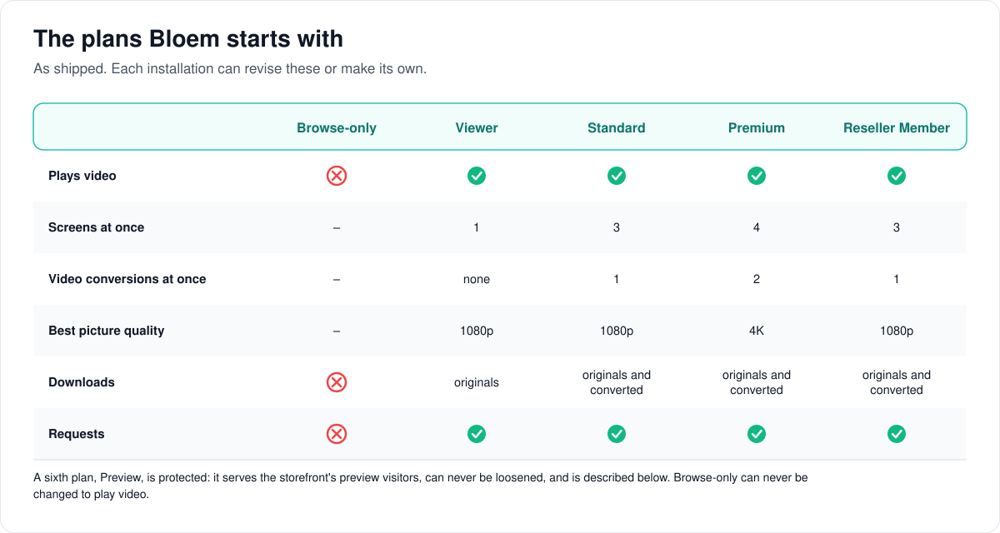
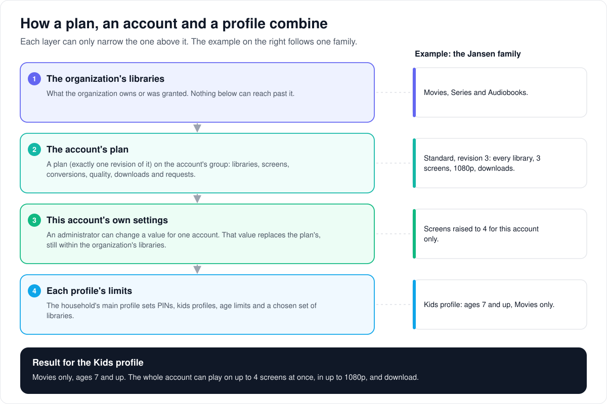
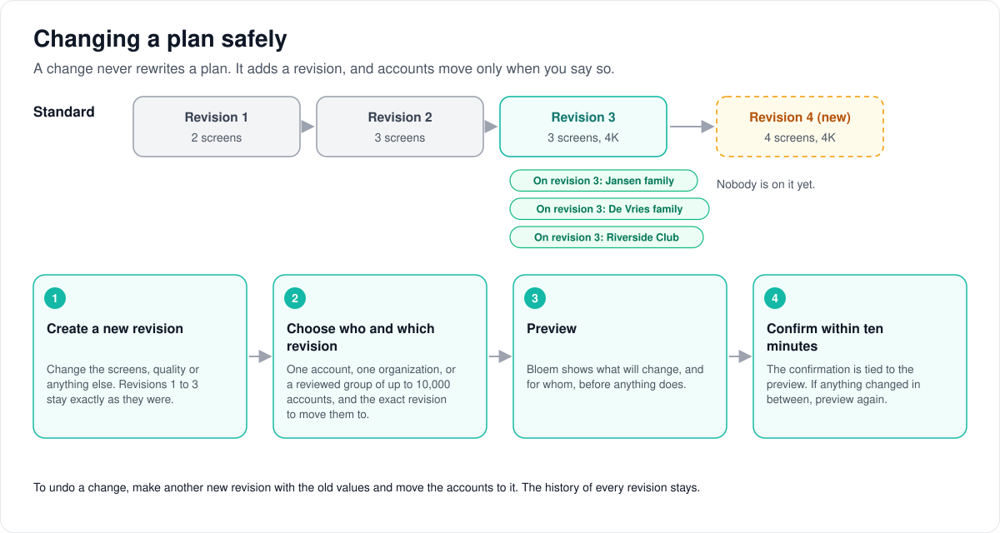
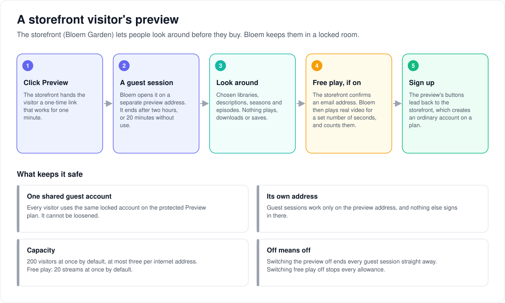
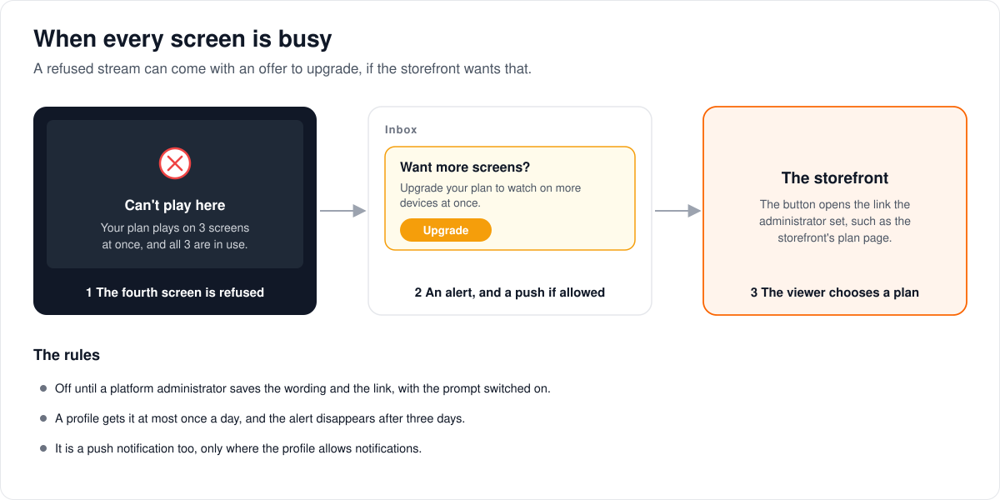

# How plans, previews and upgrades work

> **Provenance and status.** Bloem page, written on 2026-10-31, updated on
> 2026-11-01 and checked against `main` at `b6039036d`. Plans (entitlement
> templates), the storefront preview and the upgrade prompt are Bloem additions.
> Silo has the per-account settings and access groups that plans are built on.
> This page explains them in plain language; the technical pages and the API are
> in the [For developers](#for-developers) section.

A **plan** decides what an account gets: which libraries, how many screens at
once, video conversions, picture quality, downloads and requests. This page
covers the plans Bloem starts with, how a plan combines with an account and its
profiles, how to change a plan safely, how a storefront visitor previews Bloem,
and the offer a viewer sees when every screen is busy.

## The plans Bloem starts with

Bloem ships five plans that an installation can revise or copy:

- **Browse-only** shows the catalog but never plays anything. It can never be
  changed to play video.
- **Viewer** plays on one screen and never converts video, so a title plays only
  when the device can play its file as it is.
- **Standard** and **Reseller Member** play on three screens with one conversion
  at a time.
- **Premium** plays on four screens, with two conversions and 4K.

A sixth plan, **Preview**, is protected. It serves the storefront's preview
visitors (below), cannot be switched off or loosened, and no other plan can take
its name.

## How a plan, an account and a profile combine

1. **The organization's libraries** are the outer limit
   ([how organizations work](bloem-organizations.md)). A plan can only permit a
   library the organization owns or holds a grant for. "All libraries" follows
   whatever the organization has, now and later.
2. **The account's plan** is one exact revision of a plan, applied to the
   account's group.
3. **This account's own settings.** An administrator can change one value for
   one account, such as more screens. That value replaces the plan's.
4. **Each profile's limits.** The household's main profile sets PINs, kids
   profiles, age limits and a chosen set of libraries.

An organization's own web address changes only how Bloem looks: its name, logo
and colours. It never changes what a plan allows
([how organization domains work](bloem-organization-domains.md)).

## Changing a plan safely

A change never rewrites a plan. It adds a **revision**, and accounts stay on the
revision they have until someone moves them:

1. **Create a new revision.** The old ones stay exactly as they were.
2. **Choose who and which revision:** one account, one organization, or a
   reviewed group of up to 10,000 accounts (a **policy cohort**).
3. **Preview.** Bloem shows what will change, and for whom.
4. **Confirm in time.** For one account or one organization, within ten minutes
   of the preview; for a policy cohort, within 15 minutes of picking the accounts.
   The confirmation is tied to that preview; if anything changed in between,
   preview again.

To undo a change, make another revision with the old values and move the
accounts to it.

## A storefront visitor's preview

The storefront (Bloem Garden) can let people look around before they buy:

1. **Click Preview.** The storefront hands the visitor a one-time link that works
   for one minute.
2. **A guest session.** Bloem opens it on a separate preview address, which can
   never be the server's public address. It ends after two hours, or after 20
   minutes without use.
3. **Look around.** The chosen libraries, descriptions, seasons and episodes.
   Nothing plays, downloads or saves.
4. **Free play, if switched on.** The storefront confirms an email address and
   hands out an allowance; Bloem plays real video for that many seconds and
   counts them. It is off by default.
5. **Sign up.** The preview's buttons lead back to the storefront, which creates
   an ordinary account on a plan.

Every visitor uses one shared guest account on the protected Preview plan. Guest
sessions work only on the preview address, where nothing else signs in. By
default there are at most 200 visitors at once, three per internet address, and
20 free-play streams. Switching the preview off ends every guest session at once.

## When every screen is busy

When a viewer starts a video while every screen on the plan is in use, Bloem
refuses it. If a platform administrator has switched on the **upgrade prompt**,
the viewer also gets an alert in their inbox with a button to the storefront's
plan page, and a push notification where the profile allows that. A profile gets
it at most once a day, and the alert disappears after three days. The wording and
the link are the administrator's.

## Who can change what

| Who | What they manage |
| --- | --- |
| Platform administrator | Plans and their revisions, applying them to direct accounts and organizations, bulk moves, the preview's settings and libraries, the upgrade prompt. |
| Organization administrator | Moving their own organization's people between plans and cohorts, with the same preview and confirmation. |
| The storefront | Creating accounts and reseller organizations on a plan, moving an account to another plan, preview launch links and free-play allowances, using a platform administrator's API key. |

## Words used in the code

| On this page | In the code and database |
| --- | --- |
| Plan | entitlement template (`internal/entitlements`) |
| Browse-only, Viewer, Standard, Premium, Reseller Member | the template keys `browse-only`, `viewer`, `standard`, `premium`, `reseller-member` |
| Preview plan | the protected `bloem-preview` template |
| Revision | `entitlement_template_revisions` |
| Account's plan | the template on the account's access group (`access_groups.managed_template_key`) |
| Account's own settings | the policy columns on Silo's `users` row |
| Policy cohort, bulk move | entitlement cohorts and bulk policy jobs |
| Preview, guest session | preview principal and `preview_guest` sessions (`internal/preview`) |
| Preview address | the preview host in the preview settings |
| Free play | play grants (`bloem_preview_play_grants`) |
| Upgrade prompt | `GET`/`PUT /api/bloem/v1/admin/platform/upgrade-prompt` |

## For developers

- **API:** [plans and preview](../bloem/api/plans.md) (templates, per-account and
  bulk policy, preview administration and guest sessions) and
  [messages](../bloem/api/messages.md) (the upgrade prompt). The storefront puts a
  new account on a plan with `POST /api/bloem/v1/admin/platform/accounts`, and an
  organization with `POST /api/bloem/v1/admin/platform/tenants`
  ([organizations API](../bloem/api/organizations.md)). The storefront calls
  none of Silo's `/api/v1` ([leaving Silo's `/api/v1`](bloem-leaving-silo-v1.md)).
- [Entitlement templates guide](../wiki/admin/entitlement-templates.md) and
  [managing entitlement templates](../operations/entitlement-templates.md): the
  built-in plans, policy fields, key rules, confirmation and audit.
- [Bulk policy cohorts](../operations/bulk-policy-cohorts.md) and the
  [release runbook](../operations/bulk-policy-cohorts-runbook.md).
- [How browse-only access and the preview work](bloem-browse-only-content-policy.md):
  the delivery checks, preview principals, guest sessions, preview administration
  and free play.

The pictures are SVG files under `images/plans/`, drawn by
`scripts/bloem/draw-pictures.py`. Redraw them there, not by hand.
