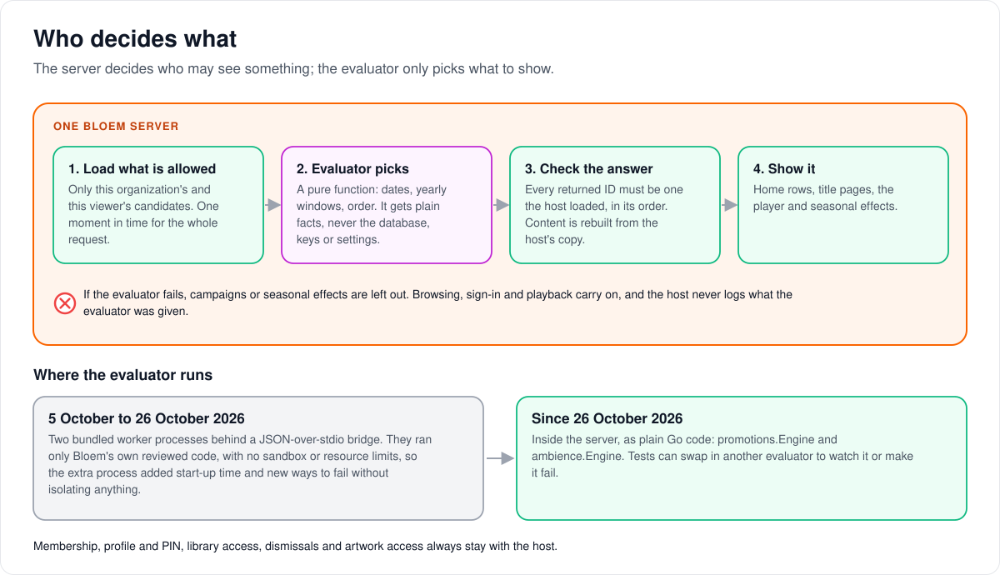

# How Bloem picks which campaigns and seasonal packs to show

> **Provenance and status.** Bloem page, rewritten on 2026-11-01 and checked against
> `main` at `b6039036d`. Campaigns and seasonal packs are Bloem additions with no Silo
> counterpart. This page explains how the server chooses what to show, in plain
> language; the technical rules are in the [For developers](#for-developers) section.

When a viewer opens Home, a title's page or the player, Bloem decides which campaign
cards and seasonal effects to show. This page walks through who decides what, what
happens when the choice fails, and why the choosing code now runs inside the server.

## Who decides what

Two parts of the server share the work:

- **The host** is the server itself. It owns the database and every rule about who may
  see what: the account's organization, the chosen profile and its PIN, library access,
  and the cards a viewer has hidden.
- **The evaluator** is a small, self-contained piece of code that only picks what to
  show from facts it is handed: dates, yearly windows, surfaces and order. It never
  sees the database, keys or settings.

For each request:

1. **The host loads only what is allowed.** It reads just the campaigns or packs this
   viewer's organization may see, and fixes one moment in time for the whole request.
2. **The evaluator picks.** From those plain facts it chooses what is on now.
3. **The host checks the answer.** Everything the evaluator returns must be something
   the host loaded, in the host's order. The host rebuilds the result from its own copy,
   so the evaluator cannot add content or pictures.
4. **The page shows it:** campaign cards on Home, on a title's page or in the player,
   and seasonal effects.

## When the choice fails

Campaigns and seasonal effects are extras. If the evaluator fails, they are left out,
and browsing, signing in and playback carry on as normal. The host never writes to its
logs what it gave the evaluator.

## Why it runs inside the server

From 5 to 26 October 2026 the evaluators ran as two separate worker processes. They
ran only Bloem's own reviewed code, with no sandbox or resource limits, so the extra
processes added start-up time and new ways to fail without protecting anything. Since
26 October 2026 they run inside the server again.

## Who can change what

| Who | What they manage |
| --- | --- |
| Platform administrator, the storefront | The campaigns and packs the evaluator chooses from ([how messages and promotions work](bloem-messages-and-promotions.md)). |
| Developers | The evaluator code. Tests can swap in another evaluator. |
| Viewer | Hiding a campaign card, which the host then leaves out. |

## Words used in the code

| On this page | In the code |
| --- | --- |
| The evaluator for campaigns | `promotions.Engine` (`internal/promotions/engine.go`), behind `promotions.Evaluator` (`Candidates`, `Deliver`) |
| The evaluator for seasonal packs | `ambience.Engine` (`internal/ambience/evaluator.go`), behind `ambience.Evaluator` (`Evaluate`) |
| The host | `promotions.Service`, `ambience.Service` and the API handlers |
| Swapping in another evaluator | `promotions.NewServiceWithEvaluator`, `ambience.NewServiceWithEvaluator` |
| The Home campaign row | Silo's sections handler, through `configureBloemSectionExtensions` (`internal/api/router_bloem_engagement.go`) and `ConfigurePromotions` (`internal/api/handlers/bloem_sections_ext.go`) |

## For developers

- **API:** the campaign and seasonal routes are on the
  [messages and promotions](../bloem/api/messages.md) page. Schedules and delivery are
  described in [seasonal scheduling](seasonal-scheduling.md) and
  [playback cards](playback-overlays.md).

### History

Promotion cards (`internal/promotions`, `3ae12d9f2`) and ambience packs
(`internal/ambience`, `54ace4675`) both arrived on 2026-09-01, specified as "S-2" and "S-3" of Bloem's September client engagement spec (removed on
2026-11-01; its rules are on [how playback cards work](playback-overlays.md) and
[how seasonal packs are scheduled](seasonal-scheduling.md)). On 2026-10-05 (`85ba110f2`)
Bloem moved their evaluation into two bundled worker processes; the
[cutover receipt](../operations/2026-10-05-presentation-plugin-cutover.md) records that
step. This page was created by `310c545f9` (2026-10-26), which brought evaluation back
in-process and replaced the earlier `bloem-presentation-plugins.md`.

### Host authority

- Promotions and seasonal ambience choose what to show with pure evaluators that run
  inside the server: `promotions.Engine` and `ambience.Engine`. The server keeps their
  database records, administrative CRUD, native API projections and access authority.
- The host loads only conservatively filtered, organization-authorized candidates and
  captures a single evaluation instant. It hands the evaluator minimal presentation
  facts, not database handles, signing keys, encrypted settings or stored author
  metadata.
- Membership, profile and PIN, library access, dismissal state and asset access remain
  host-owned.
- Returned IDs must belong to the request's authorized snapshot, in its order;
  returned content and assets are checked and rebuilt from that snapshot. An invalid
  evaluator response is `ambience.ErrInvalidEvaluation` on the ambience side.
- Promotions evaluates candidate selection (`Candidates`) and delivery (`Deliver`)
  separately, preserving lazy role and membership reads and the distinction between
  unrestricted libraries and an explicitly empty allowed-library list.
- Ambience computes active yearly occurrences using its embedded time zone data. Host
  validation constrains those occurrences without invoking a fallback seasonal
  selector.

### Runtime

- `promotions.NewService` and `ambience.NewService` use the engines.
  `NewServiceWithEvaluator` takes any `Evaluator`; tests use it to observe or fail
  evaluation.
- Presentation is optional: an evaluator error omits promotions or ambience instead of
  blocking browsing, login or playback, and the host never logs evaluator payloads.
  Caller cancellation is propagated.
- Until 26 October 2026 the same engines ran in two bundled worker processes behind a
  JSON-over-stdio bridge (`internal/bloempresentation`, since removed). The workers ran
  only this reviewed code, with no operating-system sandbox or resource limits, so the
  process boundary added start-up cost and failure modes without isolating anything
  the server does not already trust.

### Scope

The promoted Home row reaches Silo's sections handler through
`configureBloemSectionExtensions` (`internal/api/router_bloem_engagement.go`). The
shared section integration uses reusable extension hooks with feature adapters and
projections in owned files. Core tenancy, profiles and progress remain core authority.
The seam ledger (`contracts/seams.txt`, 304 entries at `b6039036d`) measures actual
upstream-file differences; moving a service alone is not evidence that a shared seam
disappeared.

### Related pages

- [Seasonal scheduling](seasonal-scheduling.md) and [playback cards](playback-overlays.md).
- [How messages and promotions work](bloem-messages-and-promotions.md).

The picture is an SVG file under `images/bloem-presentation-evaluators/`, drawn by
`scripts/bloem/pictures/bloem_presentation_evaluators.py` through
`scripts/bloem/draw-pictures.py`. Redraw it there, not by hand.
