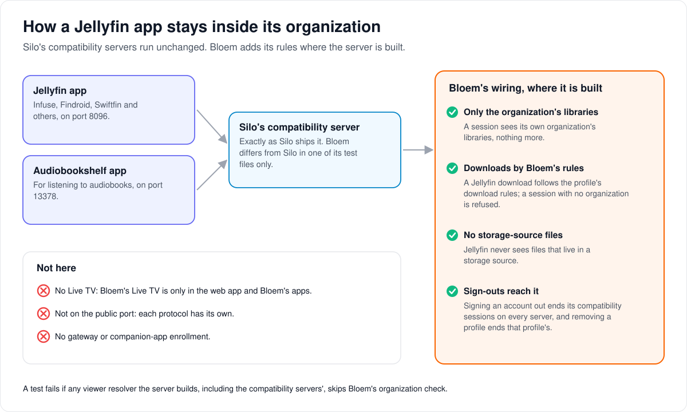

# How protocol compatibility works

Jellyfin apps and Audiobookshelf apps can use a Bloem server as if it were their own
kind of server. Bloem runs Silo's Jellyfin-compatible and Audiobookshelf-compatible
servers exactly as Silo ships them, each on its own port. The only Bloem parts are the
organization wiring and the persistence notes below. The technical rules are in the
[For developers](#for-developers) section.

## Each protocol has its own port

A **port** is a numbered door on the server. Jellyfin apps use 8096 and Audiobookshelf
apps use 13378 (Silo's bootstrap variables `JF_PORT` and `ABS_PORT` move them). Neither
protocol is served on the server's public address.

Three things are not part of Bloem: a gateway that serves both protocols on the public
address, enrollment for companion apps, and Live TV through Jellyfin apps. Bloem's Live
TV is in the web app and Bloem's own apps ([How Live TV works](bloem-live-tv.md)).

## How a session stays inside its organization

Jellyfin and Audiobookshelf apps know nothing about organizations. They sign in to an
account, and Bloem works out the account's **organization**, the customer it belongs
to. Where the Bloem server builds Silo's compatibility servers, it adds four rules:

- **Only the organization's libraries.** A session sees what its own organization may
  use, with its plan's and profile's limits.
- **Downloads by Bloem's rules.** A Jellyfin download follows the **profile's**
  download rules. An Audiobookshelf download, and the feeds and offline saves an
  Audiobookshelf app offers, follow the **account's** download rules inside its
  organization. A session whose organization can't be worked out is refused.
- **No files from storage sources.** Libraries read from S3 or Bookwarehouse have no
  file on disk for a Jellyfin app to open, so those files are hidden from it.
- **Sign-outs reach it.** Signing an account out ends its compatibility sessions on
  every server. When an organization removes a profile, that profile's Jellyfin
  sessions end too.

## Words used in the code

| On this page | In the code |
| --- | --- |
| Jellyfin compatibility | `internal/jellycompat`, listening on `jellyfin_compat.listen` (default `:8096`) |
| Audiobookshelf compatibility | `internal/audiobooks/abs` and `internal/audiobooks/abssocket`, on `:13378` while `audiobookshelf_compat.enabled` is on |
| Moving the ports | Silo's bootstrap variables `JF_PORT` and `ABS_PORT` |
| Bloem's wiring | `cmd/silo/bloem_compat.go`, and `newTenantAwareViewerResolver` in `cmd/silo/bloem_main.go` |
| Only the organization's libraries | the scope resolvers wrapped in `newTenantAwareViewerResolver` |
| Downloads by Bloem's rules | `newBloemCompatDownloadServer` (Jellyfin) and `newBloemABSDownloads` (Audiobookshelf), installed by `bloemCompatDownloadsHook` |
| No files from storage sources | `bloemGuardNativeStorageFiles` |
| A removed profile's sessions end | `bloemProfileSessionRevoker`, deleting `jellycompat_sessions` rows |

## For developers

- **API:** Silo's own descriptions of the protocols are the
  [Jellyfin compatibility API](../jellycompat-api.md) and
  [`internal/audiobooks/README.md`](../../internal/audiobooks/README.md). Bloem's native
  API is not served on these ports.

### What runs

Bloem runs upstream Silo's Jellyfin-compatible server (`internal/jellycompat`) and
Audiobookshelf-compatible server (`internal/audiobooks/abs`,
`internal/audiobooks/abssocket`) as Silo ships them, so Silo's code merges without
Bloem-side deletions. Each binds its own configured port: `jellyfin_compat.listen`
(default `:8096`) and, when `audiobookshelf_compat.enabled` is on (the default),
`:13378`. Neither is served on the public port. Companion-application enrollment, a
same-origin compatibility gateway on the public port and Live TV through the Jellyfin
surface are not part of Bloem
([BLOEM_AGENTS.md](../../BLOEM_AGENTS.md#jellyfin-and-audiobookshelf-compatibility)).

### Tenant integration

Silo's packages stay upstream bytes. Bloem adapts them only where `cmd/silo/main.go` wires them,
with the adapters in `cmd/silo/bloem_compat.go` and the tenant-aware resolver in
`cmd/silo/bloem_main.go`:

- Both servers' scope resolvers are wrapped in `newTenantAwareViewerResolver`, so a
  Jellyfin or Audiobookshelf session reaches only its organization's libraries.
- Jellyfin downloads go through the native download service for the session's
  profile, with the validated tenant on the context (`newBloemCompatDownloadServer`,
  installed through `deps.OnDownloadService`). The native per-profile download policy
  decides; a session without a resolvable tenant is refused.
- Audiobookshelf downloads go through the same service: Silo checks the download rules
  on `/api/items/{id}/file/{ino}/download`, on the sign-in and `/me` payloads'
  `permissions.download`, and when an RSS feed opens or serves.
  Those requests carry no tenant, and Bloem's tenant-scoped group policy
  (`access.EffectivePolicyForRequest`) refuses a check without one, so
  `newBloemABSDownloads` resolves the account's tenant first
  (`tenancy.SubjectResolver.ResolveSubjectTenant` with no profile). The listener names no
  profile to the download service, so the account's policy decides, as in Silo. A tenant
  that does not resolve is a refusal (`downloads.ErrDownloadNotAllowed`, `403`), not a
  server error. Both adapters are installed by `bloemCompatDownloadsHook`, on Bloem's own
  line after Silo's `deps.OnDownloadService`, which it runs first.
- Files in native storage locations are hidden from the Jellyfin handlers that need an
  OS filename (`bloemGuardNativeStorageFiles`, wrapping the compatibility
  `FileResolver`).
- Account-wide sign-outs use Silo's path: the revoking transaction deletes the stored
  compatibility sessions, and every replica evicts its cached copies when the
  revocation is announced. A Jellyfin session also ends when its login session is
  revoked. Silo's `OnUserSessionsRevoked` keeps Silo's type and runs for Silo's
  callers; Bloem's own callers that must report a failed invalidation, such as the
  organization lifecycle, use `BloemOnUserSessionsRevoked`, which returns an error
  (`bloemUserSessionsRevoker` in `cmd/silo/bloem_main.go`).
- A Jellyfin sign-in opens an account-level login session, which Bloem's
  profile-scoped revocation (an organization removing its profiles) does not reach.
  `bloemProfileSessionRevoker` deletes those profiles' `jellycompat_sessions` rows and
  announces the revocation so replicas drop cached copies.

`GET /api/v1/health` answers `server_name` and `server_id` from the Jellyfin
compatibility configuration, as upstream does.

Organization domains don't apply on these ports: the Jellyfin address is server-wide
([organization domains and branding](bloem-organization-domains.md)).

### Persistence

Silo's Jellyfin and Audiobookshelf tables, the author-count view and their settings
are part of Bloem's PostgreSQL schema as Silo defines them, and no Bloem migration
changes them. Bloem's SQLite repair step recreates the `jellycompat_displayprefs`
table. See [SQLite user-store versions](bloem-upstream-adapters.md#sqlite-user-store-versions).

### Upstream merges

Take Silo's compatibility code as it is.
When upstream changes how `main.go` builds either server, keep the tenant wiring above.
`TestProductionViewerResolversUseBloemTenancy`
(`cmd/silo/bloem_viewer_tenancy_wiring_test.go`) fails when a production
`policy.NewViewerResolver` construction, including the compatibility servers', skips
Bloem tenancy.

### Related pages

- [How apps connect](bloem-apps.md): the three entrances and how people sign in, in
  plain language.
- [Bloem's adapters over Silo](bloem-upstream-adapters.md): the other places Bloem
  wraps Silo.
- [How Live TV works](bloem-live-tv.md): why Live TV is only in the web app and Bloem's
  apps.
- [Silo backend switching](silo-backend-switching.md): both servers share the
  compatibility tables.

The pictures are SVG files under `images/protocol-compatibility/`, drawn by
`scripts/bloem/draw-pictures.py`. Redraw them there, not by hand.
