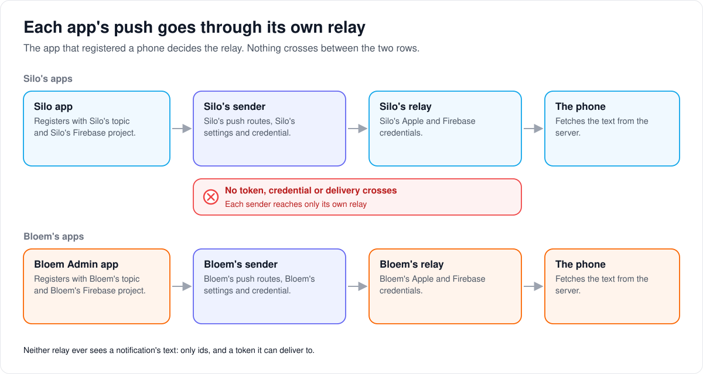

# How push notifications reach each app

A phone gets a push notification through a **push relay**: a small service that holds
the Apple and Google credentials an app needs, and passes on a wake-up the server asks
for. A relay can only reach the apps it holds credentials for. A Bloem server sends to
two kinds of app, so it uses two relays. This page walks through which app goes
through which relay, what each relay sees, and when the server signs up with each one.

## Two relays, one per kind of app

1. **Silo's apps** (Silo for Android and Silo for iPhone, iPad, Apple TV and Mac) work
   with a Bloem server as they do with a Silo server. Their phones can only be woken
   by **Silo's relay**, because Apple and Google accept a push for an app only from the
   credentials of the people who publish that app. So a Bloem server sends every
   notification for a Silo app through Silo's relay, exactly as a Silo server does.
2. **Bloem's apps** (today the Bloem Admin app) can only be woken by **Bloem's relay**,
   for the same reason. A Bloem server sends their notifications through Bloem's relay.
3. **The app that registered a phone decides the relay.** A Silo app registers through
   Silo's push routes; the Bloem Admin app registers through Bloem's. The server never
   sends a Silo app's phone to Bloem's relay, and never a Bloem app's phone, or Bloem's
   own relay credential, to Silo's relay.

Each relay has its own **relay credential**: the server's sign-in with that relay. The
server keeps the two apart, under different settings, and each half of the server can
only reach its own relay.

## Bloem's own notices never wake a Silo app

Announcements, upgrade prompts, book request notices and saved campaigns are Bloem's
own notices. They reach the inbox, web push, webhooks and Bloem's own routes, but
never a Silo app's phone. A Silo app reads a woken notice from Silo's notification
routes, which have no place for a Bloem notice's title or message. On Android the
phone would show only the type's first word and "Open Silo to view it". A Silo server
never sends such a notice, so a Bloem server does not either.

Silo's notification routes and events socket leave these notices out altogether, so a
Silo app's inbox and unread count are the ones a Silo server would give it. Bloem's
web inbox reads them from Bloem's own routes
([announcements](admin-announcements.md#what-viewers-apps-receive)).

## What the web calls each relay

The web's rebranding (`web/src/lib/product-brand.ts`) renames Silo to Bloem in Silo's
interface text, but the text about Silo's relay keeps Silo's name, because that relay
is Silo's: the notification settings card "Silo Push Relay" and its line "Mobile push
through Silo's relay", its settings search entry, the setup step's push line, and the
viewer's privacy notice ("your Bloem Server sends a content-free request to Silo's push
relay so Silo can deliver notifications"). The rule is by message key, so it holds in
every language. Bloem's own relay has its own card, "Push relay for the Bloem Admin
app", in Bloem's catalog.

## What a relay sees

Neither relay ever sees a notification's text, a title's name or a person's name. The
phone wakes up with a short id and fetches the text from the server.

For a Silo app's phone, Silo's relay receives exactly what it would from a Silo server:

- the phone's push token, and for Apple the app's topic and whether it is a test build;
- an id for the delivery, which the phone uses to fetch the text;
- the server's own id and the id of the profile the phone signed in with, so a phone
  signed in to several servers or profiles knows which one to ask;
- the id the server gave the phone when it registered.

The relay then shows "Silo — New notification available" until the app replaces it
with the real text from the server.

For the Bloem Admin app, Bloem's relay receives the phone's token, the delivery id
(which starts with the phone's id on this server), and a badge count. The [admin push
page](bloem-admin-push.md) has the details.

## When the server signs up with each relay

A server signs up with a relay the first time it has something to send through it. A
Bloem server that no Silo app ever registers with never contacts Silo's relay, unless
an administrator registers it from the push settings. The first notification for a
Silo app's phone signs the server up with Silo's relay, and the credential renews
itself from then on. Bloem's relay works the same way for the Bloem Admin app.

When a relay turns a server off, the server stops sending through it and does not sign
up again on its own. A platform administrator signs it up again: for Silo's relay with
the mobile push card in the notification settings, as on Silo; for Bloem's relay with
**Register again** under "Push relay for the Bloem Admin app", below Silo's settings on
the same page. Either button also gives a working registration a new credential.

Bloem servers used to keep their Bloem relay credential under the settings Silo's
relay uses. A server's background worker checks those settings when it starts and
every five minutes after. When they hold Bloem's credential, it moves the credential
to Bloem's own settings and leaves Silo's settings empty, so the next notification for
a Silo app signs up with Silo's relay instead of showing Silo's relay Bloem's
credential.

## Restoring a backup

Both relay credentials belong to the server, not to its data. A full restore keeps the
live server's two credentials and never takes either one from the backup. A restore
onto a server with no credential of its own clears the backup's.

## Example: one notification to each app

This example is made up.

A household watches on a Bloem server with the Silo app on an iPhone. The server's
administrator has the Bloem Admin app on an Android phone.

1. A new episode of a series the household follows arrives. The server records the
   notification and queues one delivery for the iPhone.
2. The server has never sent to a Silo app before, so it signs up with Silo's relay,
   stores that credential under Silo's settings, and sends the iPhone's token and the
   delivery id to Silo's relay.
3. The iPhone shows the episode's title, which it fetched from the server.
4. The same evening a library scan fails. The server sends the administrator's phone
   token and a delivery id to Bloem's relay, with its Bloem credential.
5. Silo's relay never sees the administrator's phone; Bloem's relay never sees the
   iPhone.

## Who can change what

| Who | What they decide |
| --- | --- |
| A platform administrator | Whether mobile push is delivered at all (the Apple and Android delivery switches), re-registering or clearing the server's credential for Silo's relay from the push settings, and re-registering the server with Bloem's relay. |
| Silo's maintainers | Which apps Silo's relay serves and what it shows on a lock screen. |
| Bloem's maintainers | Which apps Bloem's relay serves and what it shows on a lock screen. |
| A person with an app | Whether their phone registers for push, and from which app. |

## Words used in the code

| Plain words | In the code |
| --- | --- |
| Silo's relay | `DefaultPushRelayURL` (`https://push.siloserver.org`), `internal/notifications/settings.go` |
| Bloem's relay | `BloemPushRelayURL` (`https://push.bloem-studios.com`), `internal/notifications/bloem_push_relay.go` |
| Silo's sender | `pushSender` built by `NewSystem` (`System.pushSender`), sending `push_devices` rows |
| Bloem's sender | `newBloemRelaySender`, the `sender` of `AdminPushService`, sending `bloem_admin_push_devices` rows |
| Relay credential (Silo's) | settings `notifications.push_relay_*` |
| Relay credential (Bloem's) | settings `bloem.notifications.push_relay_*` |
| Moving Bloem's credential | `AdminPushService.separateRelayCredentials` |
| Registering with Bloem's relay again | `AdminPushService.RegisterBloemRelay`, `POST /api/bloem/v2/admin/platform/notifications/push/relay/register` |
| Each sender reaches only its own relay | `relayOriginGuard` on Bloem's sender; `NormalizePushRelayURL` on Silo's |

## For developers

Related pages: [admin app push](bloem-admin-push.md), Silo's
[notifications API](../notifications-api.md) and
[push API](../notifications-push-api.md).

### The boundary

- **Silo's push path is Silo's code, unchanged.** `push_devices`, its registration
  routes (`POST /api/v2/devices/push/apple`, `POST /api/v2/notifications/push/devices`
  and the v1 bridge), the fan-out, `pushSender`, `relay_credentials.go` and the relay
  admin routes all run against Silo's relay and Silo's settings. `DefaultPushRelayURL`
  is Silo's value; `NormalizePushRelayURL` accepts it and, for staging only,
  `SILO_PUSH_RELAY_DEVELOPMENT_URL`.
- **Silo's registration routes accept only Silo's app identity.** Apple: the topic
  `org.siloserver.silo` (`ApplePushTopicSilo`). Android: the FCM token carries no app
  identity, and Silo's relay sends through Silo's Firebase project, so a token from
  any other project fails there. A Bloem consumer app must not register on these
  routes with a Bloem push identity (a Bloem bundle ID or the `bloem-push` Firebase
  project): it needs a Bloem registration path that stores which relay its devices
  use. None exists today, and none of Bloem's consumer apps ships a Bloem push
  identity.
- **Bloem's notices stay off Silo's push.** `system.alert` and `system.announcement`
  rows queue no `push_delivery_attempts` (`sendsToSiloAppPush`,
  `internal/notifications/bloem_silo_app_push.go`). Their producers call
  `DispatchBloemOperational`, which is Silo's `DispatchOperational` with the push
  platforms cleared, or `DispatchOperationalBatch`, which skips them per row.
  `TestBloemOnlyDeliveriesAvoidSiloDispatch` fails when a producer hands Silo's
  `DispatchOperational` a system row.
- **Bloem's apps register on Bloem's routes only.** The Bloem Admin app uses
  `/api/bloem/v2/admin/push/*` (`bloem_admin_push_devices`, topic
  `com.bloemstudios.admin`). Every send for it, including widget wakes and Live
  Activities, goes through `AdminPushService.sender`.
- **Bloem's sender is Silo's relay client over Bloem's settings.**
  `newBloemRelaySenderFor` builds a `pushSender` whose `Settings` read and write
  through `bloemRelayStore`: every relay credential key (`relayCredentialKeys`) maps
  to `bloem.` + the Silo key, an empty URL reads as Bloem's relay, and Silo's values
  are never visible or written through it. Registration, renewal, rotation (with
  `bloemRelayRotationKey`), rejection handling and parking are Silo's functions,
  unchanged.
- **Bloem's sender cannot reach another origin.** Its transport is wrapped in
  `relayOriginGuard`, which allows only `https://push.bloem-studios.com` and
  `BLOEM_PUSH_RELAY_DEVELOPMENT_URL` when set, on every request and redirect hop.
  `NormalizePushRelayURL` alone would still accept Silo's origin.

### What goes to Silo's relay for a Silo app

`pushSender.postRelay`, unchanged from Silo, posts to `/v1/apple/send` or
`/v1/fcm/send` with `Authorization: Bearer <Silo relay capability>`,
`Idempotency-Key: <push attempt id>` and `User-Agent: Silo-Push/1.0`. The body is
`token`, `mode: private_alert`, `server_device_id`, `delivery_id` (the notification
delivery id, or the attempt id for an admin test push), `collapse_id` (the delivery
id), and `server_id` and `profile_id` (omitted when the server identity cannot be
read); Apple adds `environment` and `topic`. Silo's relay builds an APNs alert with
the fixed text "Silo / New notification available", `mutable-content`, and the keys
`silo_delivery_id`, `silo_server_id`, `silo_profile_id`; on FCM a data-only message
with `silo_delivery_id`, `silo_mode`, `silo_server_id`, `silo_profile_id`. Credential
requests go to `/v1/deployments/register` (no credential, body `{}`), `/renew` and
`/rotate`. Bloem's rotation Idempotency-Key (`bloem-rotate-` + an HMAC under the
server's signing secret) is within Silo's relay's 255-character limit.

### Registering with Bloem's relay again

`POST /api/bloem/v2/admin/platform/notifications/push/relay/register`
(`registerBloemPlatformPushRelay`, `handlers.BloemPushRelayHandler`) is the counterpart
of Silo's `registerAdminNotificationRelay` for Bloem's relay. It needs a Platform
administrative context or an enabled administrator's unscoped API key, takes no body,
and answers Silo's registration shape (`relay_url`, `deployment_id`, `key_prefix`,
`api_key_configured`, `relay_request_id`, `apns_topics`, `expires_at`) with
`Cache-Control: no-store` and never the credential. Relay failures map as on Silo's
route (`mapRelayRegistrationError`, `Retry-After` kept); a server with no push backing
answers `503 push_relay_unavailable`.

`AdminPushService.RegisterBloemRelay` holds the Bloem sender's renewal lock and runs
Silo's credential functions over `bloemRelayStore`: a usable credential at the sender's
own origin is rotated (`RotateRelayCredential`, falling back to `RegisterRelayCredential`
on 401), and anything else (parked by `deployment_disabled`, missing, a legacy key, or
issued by another Bloem origin) is replaced by `RegisterRelayCredential`. The origin is
the sender's: `BloemPushRelayURL`, or `BLOEM_PUSH_RELAY_DEVELOPMENT_URL`. The web button
is `web/src/bloem/admin/BloemPushRelaySettings.tsx`, shown in the Platform context below
Silo's notification settings (`BloemNotificationsAdminSettings.tsx`, swapped in for the
settings layout by `bloem-preview-plugin.ts`).

### Settings

| Key | Holds |
| --- | --- |
| `notifications.push_relay_url`, `_deployment_id`, `_api_key`, `_expires_at`, `_key_prefix`, `_reregistration_required` | Silo's relay credential, as on Silo. |
| `bloem.notifications.push_relay_url`, `_deployment_id`, `_api_key`, `_expires_at`, `_key_prefix`, `_reregistration_required` | Bloem's relay credential. |

`bloem.notifications.push_relay_api_key` is in `SensitiveSettingKeys`
(`internal/serversettings/bloem_encrypted_settings.go`), encrypted at rest and bound
to its key name: never rename it, or any of these keys, in SQL. Both sets are
server-specific settings, and a full restore carries each as an outbound bundle
("the push relay", "Bloem's push relay") from the live server
(`internal/backup/bloem_classification.go`).

### Moving Bloem's credential off Silo's settings

`AdminPushService.Run` calls `separateRelayCredentials` when it starts and every
`adminRelaySeparateEvery` (five minutes). Under the settings lock
(`UpdateAtomic`) it acts only when Silo's settings hold Bloem's credential
(`heldByBloemRelay`): the stored URL is one of Bloem's origins, or there is no URL
and the capability's unverified `iss` claim is Bloem's production or staging relay.
Then:

- Bloem's settings take the credential, unless they already hold one or are parked,
  in which case Silo's copy is dropped (relay registration is stateless).
- Silo's settings are reset to a server that never registered: empty, except that an
  administrator's clear (parked, no key) stays parked with Silo's default URL.

A Silo-issued credential, a legacy `rk_` key and an empty table are left alone. While
Silo's settings name Bloem's origin, Silo's sender refuses that URL before any request
(`relay_credential_unavailable`, retried on Silo's schedule), so Bloem's credential
never reaches Silo's relay. During a blue/green overlap the older build, which still
sends everything to Bloem's relay, can store a Bloem credential under Silo's names
again; Silo-app pushes the newer build handles fail until the next check moves it, and
once the older build stops the settings stay separate.

### Tests

- `internal/notifications/bloem_push_relay_test.go`: two fake relays answering for the
  production origins behind one trusting transport. Per-app routing
  (`TestPushRoutesEachAppToItsOwnRelay`), no contact with Silo's relay until a Silo-app
  device is sent to (`TestSiloRelayRegistersOnlyForASiloAppDevice`), the origin guard
  (`TestBloemRelaySenderNeverReachesSiloRelay`, `TestRelayOriginGuardRefusesOtherOrigins`),
  and the move (`TestUpgradeMovesBloemRelayCredentialOffSiloKeys`,
  `TestSeparateRelayCredentialsCases`).
- `internal/notifications/bloem_silo_app_push_test.go`: each Bloem notice still writes
  its inbox row and queues no push for a Silo app's Apple or Android device, while a
  Silo `request.approved` does (`TestBloemOnlyNoticesQueueNoSiloAppPush`).
- `internal/notifications/bloem_push_relay_register_test.go`: after `deployment_disabled`
  the admin app's pushes stay off until `RegisterBloemRelay`, which registers, stores
  Bloem's new credential and resumes them; rotation of a working credential, the 401
  fallback, a failed relay leaving the parked credential; Silo's relay and credential
  untouched throughout. `internal/api/handlers/bloem_push_relay_test.go` pins the route's
  answer and error mapping; the platform gate is in
  `TestBloemPlatformStorefrontRoutesAreMountedBehindThePlatformGate`.
- `internal/notifications/bloem_relay_credentials_test.go`: Silo's default is Silo's
  relay and Silo's path refuses Bloem's origin.
- `internal/backup/bloem_push_relay_restore_test.go`: classification, and
  `TestBloemRestoreKeepsBothRelayCredentialsDB`.
- `make silo-client-compat` registers a Silo Android and a Silo Apple device as the
  apps do, with mobile push delivery switched off on both servers so no relay is
  contacted.
