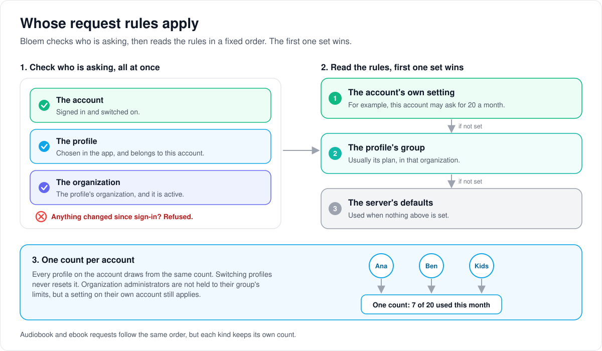

# How request rules apply to organizations and profiles

> **Provenance and status.** Bloem page, rewritten on 2026-11-01, updated on 2026-11-05
> and checked against `main` at `1430c3769`. The movie and series request service, its limits and its
> routing are Silo's (`internal/requests`; see Silo's
> [media requests](media-requests.md)). Bloem adds adapters that tie them to its
> organizations and to the profile that asks. The technical rules are in the
> [For developers](#for-developers) section.
> Its routes were checked again on 2026-11-11, after Silo retired its v1 API.

When a viewer asks for a movie or a series, Silo's request service decides
whether they may ask, how many requests they have left and whether a request
needs approval. This page walks through how Bloem makes those answers follow the
right organization and profile, what an organization administrator can see and
change, and why the rules that send requests to Radarr or Sonarr stay with the
platform. Audiobooks and ebooks have their own lanes, described in
[how requests work](bloem-requests.md).

## Whose rules apply

1. **Check who is asking.** Bloem looks at the signed-in account, the chosen
   profile and the profile's organization together, in one moment. The account
   must be switched on, the profile must belong to it, and the organization must
   be active. If anything has changed since sign-in, the request is refused.
2. **Find the profile's group.** The answer comes from the group (usually the
   plan) that the profile belongs to in that organization.
3. **Apply the order.** A setting made on the account itself wins. Then comes the
   group's setting, then the server's defaults.
4. **Count per account.** All of an account's profiles share one count. Switching
   profiles does not reset it.

Organization administrators are not held to their group's limits, but a setting
made on their own account still applies.

A request without a confirmed profile is refused. The one exception is an older
app that signs in to the default organization without choosing a profile; it
gets the account's own group there.

## What an organization administrator sees and changes

- **One account's use.** An administrator can look up how many requests one
  account in their organization has used and how many it has left. Accounts in
  other organizations, suspended organizations and switched-off accounts are
  refused.
- **Group limits.** An administrator can read and change the request limit and
  approval rule of a group in their own organization, never another
  organization's.

## Routing stays with the platform

**Routing rules** decide which connected service (such as Radarr or Sonarr)
receives an approved request. They are shared by the whole server, like the
server's request settings and connections. So only a platform administrator can
list, read, add, change, remove, reorder or preview the rules, or change how they
are used. An organization administrator cannot, even if a future sign-in tried
to give them the platform's role inside their own organization. A refused change
leaves the rules exactly as they were.

## Who can change what

| Who | What they manage |
| --- | --- |
| Platform administrator | Routing rules and routing mode, the server's request settings and connections. |
| Organization administrator | Request limits and approval rules on their own organization's groups; looking up one member account's use. |
| A viewer's profile | Asking for movies and series, within the account's limits. |

## Words used in the code

| On this page | In the code and database |
| --- | --- |
| Request service | Silo's `internal/requests` |
| Bloem's adapters | `internal/requests/bloem_*.go`, `internal/api/bloem_request_usage_wiring.go` and `enableBloemRequestPolicy` in `internal/api/router_bloem_wiring.go` |
| The profile's group | `user_profiles.access_group_id`, an `access_groups` row owned by the organization |
| A setting on the account | `users.requests_allowed` and the account's `request_user_limits` row |
| Group limit | `request_group_limits` |
| Server's defaults | `request_settings` |
| One account's use | `GET /api/v2/admin/request-users/{user_id}/usage` |
| Routing rules | request routes and the routing mode |
| Platform administrator | an account with the `admin` role and an active membership in the default organization |

## For developers

- **API:** the movie and series request routes are Silo's `/api/v2`; see Silo's
  [media requests](media-requests.md). Bloem changes who may call them, not
  their shape.

"Native listeners" below means the routers that serve Silo's API: the
`/api/v2` listener, and until Silo retired its v1 API on 2026-11-11 the v1 router.

### Composition

The movie and series request service stays shared with Silo. Bloem installs
owned tenant adapters before composing either native listener. Unsupported
production dependencies fail composition instead of silently keeping
account-wide authorization. Database-free composition and ordinary Silo services
keep their existing behavior. A DB-only discovery router has no authentication
middleware or user repository; it leaves request operations unavailable. Every
authenticated composition still requires the verified-profile policy
dependencies.

### Viewer requests

Permission and group quota resolve from the request's verified access scope
(`resolveRequestAccess` in `internal/requests/bloem_request_policy.go`). The
account, organization, membership and profile must agree with that scope. A
single database snapshot checks the enabled account, active membership,
organization state, membership security revision and organization policy
revision, and profile ownership. It then reads permission and quota from that
profile's organization-owned group. The account repository's default or oldest
membership does not select a profile's request policy.

Missing, foreign or unverified profiles fail closed. Profile-free compatibility
resolution is restricted to the actual default organization in the legacy
context, including its supported initializing state; it reads the account's own
group (`users.access_group_id`). An asserted default flag cannot turn a hosted
organization into that compatibility context.

The shared service still owns permission overrides, settings/group/user-limit
precedence, approval rules, quota consumption and request enrichment. Account
consumption stays shared across profiles; selecting a different profile does
not reset its counter. Services without the Bloem provider keep Silo's ordinary
account-group resolution.

With the provider installed (`EnableTenantRequestPolicy`), Silo's `resolvePolicy`
(`internal/requests/service.go`) returns at once into `bloemResolvePolicy`, on
lines Bloem added at its top (since the merge of Silo through `cb4f45d0c`). It
layers the settings, the group's limits and the account's own limits through
Silo's `LayeredPolicy` and counts usage as `resolvePolicy` does, so Silo's
account-group resolution (`viewerRequestAccess`) is never consulted.

### Administrative reads and group writes

`GET /api/v2/admin/request-users/{user_id}/usage` explicitly addresses an
account and supplies no target profile. Its separate adapter
(`internal/requests/bloem_admin_request_usage.go`) reports that account's own
policy, meaning the request override and access group on its `users` row, within
the actor's organization. It does not infer a profile or relax the
viewer-request resolver. One live snapshot checks the enabled actor's current
administrator membership and tenant revisions, then the enabled target's active
membership and organization-owned group. Foreign, suspended and disabled targets
are refused. Quota evaluation reuses the shared settings, overrides and
account-consumption calculation.

Administrative group-limit reads and conditional writes
(`internal/requests/bloem_group_limits.go`) bind the group to the verified
request organization and actor. A write locks the group's ownership through the
revision-checked transaction. A preflight against another organization's group
cannot authorize its quota or approval policy. These adapters keep the request
repository's other optional capabilities.

### Global routing administration

Request routes and the routing mode are server-global. The tenant service
decorator (`internal/requests/bloem_platform_routing.go`, with
`requirePlatformAuthority` in `internal/requests/bloem_tenant_scope.go`) requires
account-admin authority in the actual default organization before listing,
reading, creating,
updating, deleting, reordering or previewing routes, and before reading or
changing the routing mode. This matches the existing boundary for global request
settings and integrations. The decorator preserves the interfaces consumed by
both native listeners; TMDB title search keeps its existing behavior.

Ordinary organization-only administrators already fail the account-admin
transport gate. Current public account-session issuers do not issue an
account-admin token bound to a hosted tenant. The additional service check also
rejects that trusted bound-admin context, so accepting such a context in the
future cannot give it access to server-global routing configuration. Denied
writes leave route rows, priorities, revisions and routing mode intact.

### Tests

Regression coverage includes conflicting account/profile groups, sibling
profile policies, membership and user-limit overrides, account consumption,
internal request enrichment, foreign groups, stale authority, production
listener composition, real v2 requests, and ordinary Silo compatibility. The
tests sit beside the adapters (`internal/requests/bloem_*_test.go`).

### History

The profile and quota binding was added in `f167e85be` (2026-10-10) and the
platform guard on server-global routing in `1da67971e` (2026-10-10); routing
rules came with Silo #1632 (`9d63465bf`). `c60b7008e` (2026-10-26) moved an
account's policy (its request override and access group) back onto `users`,
where Silo keeps it, and limited an account to one organization. `b017bfe84`
(2026-10-26) removed the lifecycle-receipt dependency.

Technical pages:

- [How requests work](bloem-requests.md): movies and series, audiobooks and
  ebooks side by side.
- [How audiobook requests work](bloem-audiobook-requests.md) and
  [how ebook requests work](bloem-ebook-request-foundation.md): Bloem's own lanes,
  which apply the same order of settings to their own counters.
- [How organizations work](bloem-organizations.md): organizations, memberships
  and the default organization.
- [Multitenant administration](multitenant-administration.md): the Platform and
  Organization admin contexts.

The pictures are SVG files under `images/request-policy/`, drawn by
`scripts/bloem/draw-pictures.py`. Redraw them there, not by hand.
