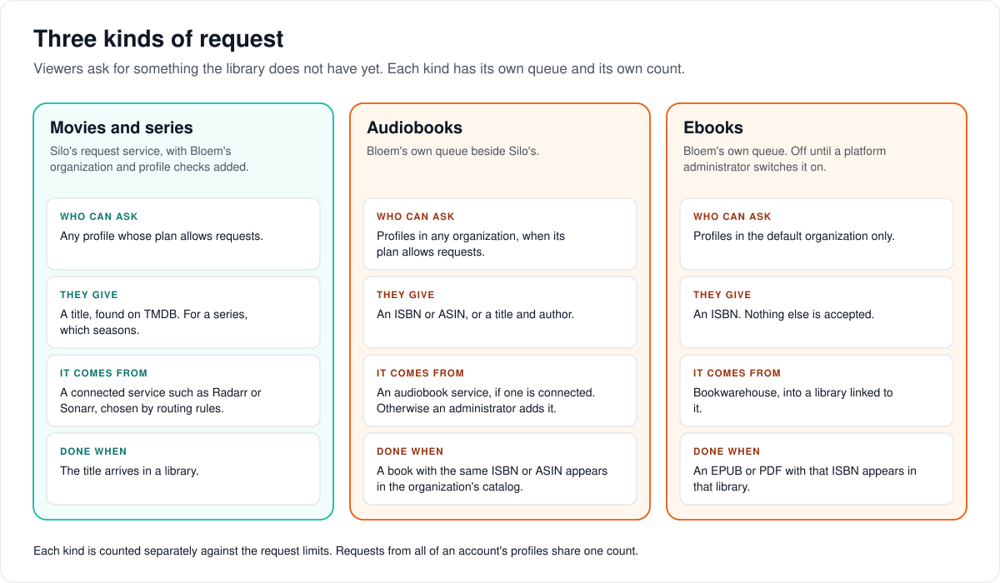
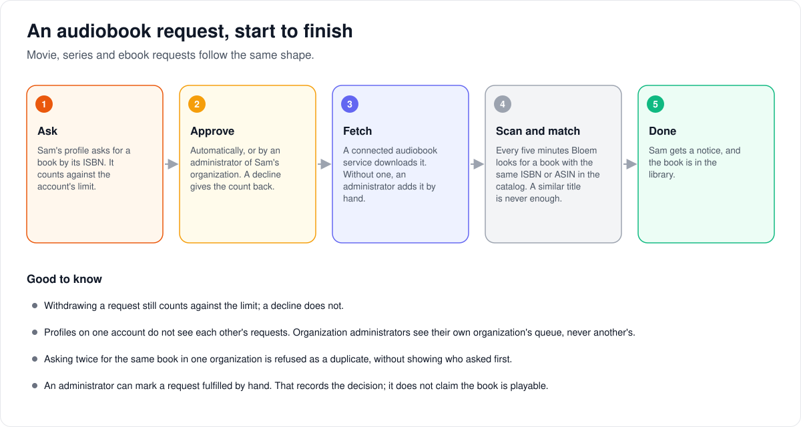

# How requests work

> **Provenance and status.** Bloem page, written on 2026-10-31 and checked against
> `main` at `c83c424b7`. Movie and series requests are Silo's request service;
> Bloem adds organization and profile checks to it, and two request lanes of its
> own, for audiobooks and ebooks. This page explains them in plain language; the
> technical pages and the API are linked at the end.

A **request** is a viewer asking for something the library doesn't have yet.
Bloem has three kinds, each with its own queue and its own count.

## Three kinds of request

- **Movies and series** use Silo's request service. A viewer finds a title on
  TMDB, chooses seasons for a series, and routing rules send it to a connected
  service such as Radarr or Sonarr. Bloem adds one thing: the request is checked
  against the viewer's organization and profile, not just the account.
- **Audiobooks** are Bloem's own lane. A viewer gives an ISBN or ASIN, or a title
  and author. If an audiobook service is connected, it fetches the book;
  otherwise an administrator adds it. The request is done when a book with the
  same ISBN or ASIN appears in the organization's catalog.
- **Ebooks** are Bloem's own lane too, and off until a platform administrator
  switches them on. Only profiles in the default organization can ask, and only
  by ISBN. Bookwarehouse supplies the book into a linked library, and the request
  is done when an EPUB or PDF with that ISBN appears there.

Each kind counts separately against the request limits, which come from the
account's own settings, its group and the server's defaults, in that order.
Requests from all of an account's profiles share one count.

## An audiobook request, start to finish

1. **Ask.** A profile asks for a book. It counts against the account's limit.
2. **Approve.** Automatically, or by an administrator of the organization. A
   decline gives the count back; withdrawing a request does not.
3. **Fetch.** A connected audiobook service downloads it. Without one, an
   administrator adds the book by hand.
4. **Scan and match.** Every five minutes Bloem looks for a book with the same
   ISBN or ASIN in the catalog. A similar title is never enough.
5. **Done.** The requester gets a notice, and the book is in the library.

Good to know:

- Profiles on one account don't see each other's requests. Organization
  administrators see their own organization's queue, never another's.
- Asking twice for the same book in one organization is refused as a duplicate,
  without showing who asked first.
- An administrator can mark a request fulfilled by hand. That records the
  decision; it doesn't claim the book is playable.
- Apps send an `Idempotency-Key` with each new audiobook or ebook request, so a
  retry after a lost answer returns the first request instead of filing a second.

## Who can change what

| Who | What they manage |
| --- | --- |
| Platform administrator | Request routing and integrations for movies and series (server-wide), the ebook lane and its Bookwarehouse connection. |
| Organization administrator | Their organization's audiobook and ebook queues: approve, decline, fulfil. The audiobook acquisition connection and its library. |
| Viewer | Asking, following and withdrawing their own requests. |

## Words used in the code

| On this page | In the code and database |
| --- | --- |
| Movie and series requests | Silo's `internal/requests` |
| Audiobook and ebook requests | `internal/bookrequests`, table `bloem_book_requests` (`kind` audiobook or ebook) |
| Audiobook service | the `bloem.requests.audiobooks` acquisition backend |
| Bookwarehouse lane | the `bloem.requests.bookwarehouse` plugin; switched on by `bloem.requests.ebooks_enabled` |
| Matching every five minutes | the `bloem_reconcile_book_requests` task |

## For developers

- **API:** [requests](../bloem/api/requests.md): filing and reading book
  requests, organization queues and acquisition connections. Movie and series
  requests are Silo's `/api/v2`; see Silo's [media requests](media-requests.md).
- [Bloem request policy](bloem-request-policy.md): profile-verified quotas and
  organization scope on Silo's request service.
- [Audiobook requests](bloem-audiobook-requests.md) and
  [ebook requests](bloem-ebook-request-foundation.md).

The pictures are SVG files under `images/requests/`, drawn by
`scripts/bloem/draw-pictures.py`. Redraw them there, not by hand.
