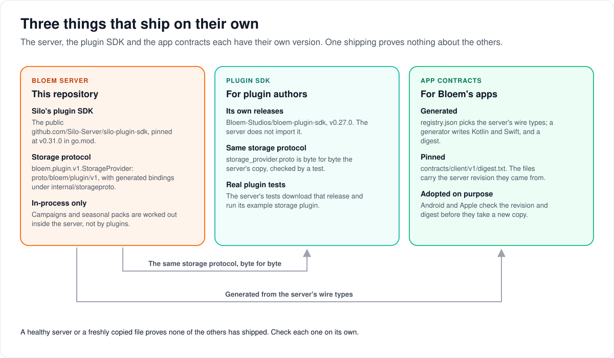

# How Bloem's SDKs and generated contracts fit together

> **Provenance and status.** Bloem page, rewritten on 2026-11-01 and checked against `main`
> at `b6039036d`. Silo owns the public plugin runtime and the `/api/v2` generators; the
> storage-provider protocol, the plugin-author SDK and the Kotlin and Swift client contracts
> are Bloem additions. The technical rules are in the [For developers](#for-developers)
> section; its dated refresh paragraphs are history.

Three things that work together ship on their own: the Bloem server, the SDK plugin authors
build with, and the generated types Bloem's apps use. This page explains what each one is, how
they stay in step, and why one shipping proves nothing about the others.

## Three things that ship on their own



- **The Bloem server** is this repository. It uses Silo's public **plugin SDK** for ordinary
  plugins, such as metadata providers, and owns one protocol of its own: the **storage
  protocol**, which lets a plugin serve a library's files from somewhere other than the
  server's disk.
- **The Bloem plugin SDK** is a separate project for people writing Bloem plugins. It has
  its own version numbers. It carries an exact copy of the storage protocol, and a test makes
  sure the copy matches the server's byte for byte.
- **The app contracts** are Kotlin and Swift types written by a program from the server's own
  wire types, with a checksum (a **digest**) of the whole set. Bloem's Android and Apple apps
  take a new copy only on purpose, after checking where it came from.

So a healthy server, a new SDK release or a freshly generated file each prove only themselves.
A storage plugin is ready only when its own release is published and approved on a server; an
app feature is shipped only when that app's release uses it.

## How they stay in step

1. **The storage protocol has one source.** The server's copy is the reference. A change to
   it is a change to the SDK too, released together, and the server's tests download that SDK
   release and run its example storage plugin as a real program.
2. **The app contracts are regenerated, never edited by hand.** A registry picks which server
   types the apps get; generators write the Kotlin and Swift files; the digest is pinned in the
   repository. Checks fail if the files or the digest no longer match the server.
3. **Apps adopt on purpose.** Each app's own tool checks the server revision and digest
   before it copies the files in, so a server change never silently changes an app.

## Example: a new field reaches the apps

This example is made up.

A developer adds an optional `artwork_style` field to a server response that the apps use.

1. They regenerate the Kotlin and Swift types and the digest, and commit them with the change.
2. The checks confirm the generated files match the server, and that the new type is listed
   (or explained) in the coverage list.
3. A week later, the Android developer runs the contract tool. It checks the revision and
   digest, copies the new files in, and the app ships the field in its next release.
4. The Apple app has not adopted it yet. Nothing breaks: the field is optional and apps ignore
   fields they do not know.

## Who can change what

| Who | What they manage |
| --- | --- |
| Silo | The public plugin SDK and runtime, and the `/api/v2` generators. |
| Bloem server developers | The storage protocol, the client registry and the pinned digest. |
| Bloem plugin SDK maintainers | SDK releases, kept byte-identical on the storage protocol. |
| Bloem app developers | When Android and Apple adopt a new contract copy. |

## Words used in the code

| On this page | In the code and repository |
| --- | --- |
| Silo's plugin SDK | `github.com/Silo-Server/silo-plugin-sdk`, pinned in `go.mod` |
| Storage protocol | `bloem.plugin.v1.StorageProvider`, `proto/bloem/plugin/v1/storage_provider.proto`, bindings in `internal/storageproto/bloem/plugin/v1` |
| Bloem plugin SDK | `Bloem-Studios/bloem-plugin-sdk` |
| SDK release the tests use | `bloemtestsdk.StorageModule` (`internal/bloemtestsdk`) |
| App contracts | `contracts/client/v1`: `registry.json`, `kotlin/`, `swift/`, `coverage.json` |
| Digest | `contracts/client/v1/digest.txt` |
| Generators and checks | `make client-digest`, `make client-dtos`, and the `verify-*` targets |

## For developers

- **API:** the generated Kotlin/Swift types describe the wire types of the
  [API by topic](../bloem/api/README.md); the [API catalogue](../bloem/api-catalogue.md) checks
  the OpenAPI documents against the mounted routes.

### History

First written in `9a427dc19` (2026-10-07) when native storage introduced a Bloem
storage-provider protocol beside Silo's public plugin SDK, and kept current with each contract
refresh. Later changes that matter: presentation evaluation returned in-process (`310c545f9`,
2026-10-26); the client contract was regenerated in the Silo merge `68070f04b` and its digest
re-pinned in `422a51fed` (2026-10-27); regenerated again in the Silo merge `4edbee99d`
(2026-10-31, Silo through `32a2f63e1`).

### Server and public plugin runtime

The current source includes Silo through `63ef34b23` and pins the public
`github.com/Silo-Server/silo-plugin-sdk` module at `v0.31.0` in `go.mod`. Host builds use
`GOWORK=off`; no private SDK module replacement is required. The
[October 7 deployment record](../operations/2026-10-07-native-storage-deployment.md) is a
historical checkpoint with an older SDK pin. Source contracts and live application revisions
must be checked separately.

Native storage uses the separate `bloem.plugin.v1.StorageProvider` protocol. The host owns
generated bindings under `internal/storageproto/bloem/plugin/v1` from
`proto/bloem/plugin/v1/storage_provider.proto`. This preserves the public `silo.plugin.v1`
descriptors and runtime compatibility. Coordinate private schema field numbers, method paths,
original `go_package` descriptor and host bindings with the provider SDK; changing a module
import is not a protocol migration.

Promotions and ambience evaluate inside the server process. From `85ba110f2` (2026-10-05) to
`310c545f9` (2026-10-26) they ran as bundled worker binaries over a local JSON bridge; that
bridge is gone (see [presentation evaluators](bloem-presentation-evaluators.md)). They were
never catalog-installable SDK capabilities, and the SDK must not gain host database, tenant,
profile or quota authority merely to package presentation code.

### Plugin-author SDK

The public `Bloem-Studios/bloem-plugin-sdk` repository has an independent module and release
history; its private storage namespace does not imply repository visibility restrictions.
Compare its public-protocol descriptors and optional service assembly against the host's
pinned public SDK, while keeping private storage registration and Bloem plugin identity
restrictions. Public-runtime currency alone does not publish a storage provider or approve an
executable artifact on a server.

The plugin-author release verified on October 15 is
[`v0.27.0`](https://github.com/Bloem-Studios/bloem-plugin-sdk/releases/tag/v0.27.0). It adds
private audiobook/audio metadata and directory-only listing declarations. The earlier
`v0.26.0` synchronized public protocols with Silo SDK `v0.24.0`, while `v0.25.0` introduced
ebook metadata and incremental listing. The host now uses Silo SDK `v0.31.0`; a release
number alone does not prove all optional public services match. Check descriptors and host
runtime assembly for the services a plugin uses.

```sh
go get github.com/Bloem-Studios/bloem-plugin-sdk@v0.27.0
```

The server does not import the plugin-author SDK, so its `go.mod` does not list it.
`proto/bloem/plugin/v1/storage_provider.proto` must stay byte-identical to the SDK release's
copy; `TestCanonicalStorageContract` in `internal/storageproto/bloem/plugin/v1` pins its digest
and field numbers.

#### Executable fixture tests

`internal/mediasource` and `internal/storageplugin` build the SDK's `examples/hello-storage`
provider and drive it as a real plugin process. The shared test helper
`internal/bloemtestsdk` resolves the SDK source from the release pinned in
`bloemtestsdk.StorageModule` (`github.com/Bloem-Studios/bloem-plugin-sdk@v0.27.0`) with
`go mod download`, so the tests need only module-proxy access and run in CI without extra
setup. The helper fails when the release's storage schema differs from the host's; advance the
pin with every schema change.

To test against an unreleased SDK change, set `BLOEM_STORAGE_SDK_WORKTREE` to an SDK checkout.
That override is development test input, not proof that a production provider can resolve an
SDK version: publish providers against an immutable, pushed SDK release.

#### Creating S3 and Bookwarehouse plugins

SDK `v0.26.0` exposes a backend-neutral, read-only storage service: implement `Describe`,
`List`, `Stat` and revision-pinned `Read`, then register it with
`runtime.WithStorageProvider`. Backend clients and credentials belong in the plugin, with
configuration delivered through `WithConfigure`. An S3 adapter can use its own S3 client; a
Bookwarehouse adapter can use the book API. Neither requires inventing a public storage
capability or using `ebook_backend.v1`, which has no SDK service implementation. See the SDK's
[storage-provider authoring guide](https://github.com/Bloem-Studios/bloem-plugin-sdk/blob/v0.26.0/docs/storage-provider.md).

The current host supports native ebook, movie and audiobook workflows when its respective
scanner, probe and delivery services are composed and ready. Libraries can combine local
paths and multiple source selections. The [storage architecture](bloem-native-storage.md),
[video boundary](bloem-native-video-playback.md) and
[audiobook boundary](bloem-native-audio-playback.md) describe admission and publication holds.
Provider artifact verification, immutable revision reads, source configuration and client
playback acceptance remain separate checks. Do not infer provider readiness from SDK metadata
or range support alone.

Bookwarehouse catalog artifacts follow host-controlled automatic verification; installation
and source configuration are exposed through protected server UI/API controls.
Backend-specific revision guarantees still belong in the provider, and credential values must
not appear in catalogue responses or generated contracts.

### Kotlin and Swift client contracts

`contracts/client/v1/registry.json` selects actual server wire types. The Go graph generator
(`cmd/clientdtogen`, described in
[how the client contract generator works](bloem-client-contract-generator.md)) produces Kotlin
and Swift DTOs and a normalized digest; settings bindings
and native/v2 OpenAPI have their own generators. Anonymous HTTP wrappers must be represented by
exact wire types before they can be registered. Preserve explicit nulls, omitted fields, JSON
spelling, opaque identifiers, int64 revisions and scope-specific requests. Do not expose domain
fields that the HTTP handler omits. A new server wire type needs an entry, or a reason, in
`contracts/client/v1/coverage.json`.

The October 7 contract refresh covers native-storage capabilities, sanitized source and
library states, binding/scan receipts, revision commands and recovery errors, beside upstream
shuffle, episode-series-poster and network-password-retention additions. These are
descriptions of the existing wire contract, not authorization changes or new runtime routes.
Native storage remains capability-gated and `backend_verified` remains false.

The October 12 refresh includes source browsing and atomic library selections, plus audiobook
acquisition setup, admin status, candidate approval and validated decisions. The audiobook
roots use the Bloem dialect and `audiobook_requests_v1` gate. That capability advertises the
mounted request lane; it does not promise that an acquisition provider is configured or ready.
Provider receipts and frozen dispatch identities remain internal and are explained in the
coverage allowlist. Browse and selection roots keep their native-storage capability gates.

The October 14 refresh adds the audiobook connection edit body
(`AudiobookRequestConnectionUpdate`, `audiobook_requests_v1` gate) and the ungated
`RequestIntegrationTestResult` shared by the ebook and audiobook connection tests.
`AudiobookIntegrationSummary` gains the optional `plugin_config` and `stored_credentials`
fields, which only the setup listing fills, and only for a platform administrator; credential
values never appear on the wire.

The October 14 integration artifacts carried source revision
`294df15ea03dd58ee3adc509aecb23452e30f176` and normalized graph digest
`sha256:9d096c83e1a0e9e38aca1eaa48696732191e05f1a8975932e60db513a2a421f4`. At `5fc698915` the
generated headers carried source revision `8ec6855d5f524b94c72f5351621bc6ece9aa6cb2`
(regenerated in that Silo merge for Silo's episode card artwork, dates and ratings) and digest
`sha256:3f29a33fa47303343c9fed8f5635b135b4f5a28072e10ae4202a247f39523ddd`, which the same
merge pinned after adding Silo's eight admin Discover types to the coverage allowlist. At `b6039036d` the
generated Kotlin/Swift headers carry source revision
`030a8cf002e1928f32f2dd4d0c155e3dfdd256be` and `contracts/client/v1/digest.txt` pins contract
digest `sha256:6a044ceb39c341966514b17592a1949b6442e4a6af2f91bdfbca5f8cb2aa8a2f`; both were
regenerated in the Silo merge `4edbee99d` (2026-10-31), which added Silo's additive
`series_status`, `series_statuses` and `exclude_series_statuses`. `digest.txt` also pins the
digest of the pre-lock removals table in [v1 scope](v1-scope.md). `digest.txt` and the
generated headers are the authority. A later documentation-only commit does not require a new
graph digest or a new source stamp.

The merged DTO graph adopts nullable account `max_profiles` and removal of the upstream
administrator styling fields. Both native client releases still need explicit bundle adoption
and runtime checks. See the [contract transition](bloem-contract-adjudications.md).

#### Reproduce and verify

Use the Go toolchain declared in the server's `go.mod` (now `1.26.10`; the October 14
integration used `1.26.9`). Go `1.27.1` changes standard-library JSON alias representation
and is not the validated generation environment. Commands assume the repository root is the
cwd:

```sh
GOWORK=off make client-digest
GOWORK=off make client-dtos
GOWORK=off make settings-bindings-native
GOWORK=off make bloem-openapi
GOWORK=off make apiv2-openapi
GOWORK=off make verify-client-digest verify-client-dtos verify-client-coverage
GOWORK=off make verify-settings-bindings verify-bloem-openapi verify-apiv2-openapi
```

The native-storage path/method check (`TestNativeStorageDocumentMatchesMountedOperations`)
walks the production registrar and requires all 40 mounted operations to be documented.
Book-request and other conditional groups also have focused mount checks. Generate the route
inventory after router changes, then consult [API coverage](../bloem/api-catalogue.md): the
inventory includes dispatchers, and typed native coverage remains incomplete. No single route
count certifies all optional groups or provider readiness.

Inspect generated changes rather than replacing a digest alone. The contract stamp identifies
the source used for generation; it is not necessarily the latest documentation commit or
running binary. `verify-client-dtos` preserves the stored stamp during regeneration and
compares every other generated byte. Commit the source declarations and generated artifacts
before asking a client to adopt them.

Consumer synchronization is explicit. Android consumes generated Kotlin in
`core/src/commonMain/kotlin-generated`; Apple consumes Swift in
`packages/BloemCore/Sources/BloemCore/Generated`. Their contract-bundle tools must verify
source revision and digest before adopting, including when the server is a Git worktree whose
`.git` is a file. A server generation must not silently dirty a sibling checkout. The
client-contracts repository stores fixture/schema evidence; it is not the source from which
server DTOs are generated.

### API surfaces and adoption limits

`/api/bloem/v1` is Bloem's native extension surface. `/api/v2` remains the supported
Silo-compatible native API; it has not been retired by this integration. `/api/v1`
business-route retirement is a separate policy decision, while its health/readiness probe
paths remain operational. Check the relevant committed OpenAPI document before implementing a
route.

Native-storage administration requires a signed platform or organization administrative-context
token. Ordinary account tokens, profile headers and v2 mutation conventions are not
substitutes. Ambiguous outcomes require reconciliation, not blind replay. Libraries use a
storage source through the ordinary v2 `createLibrary` (`storage_source`). Use the
[storage architecture](bloem-native-storage.md) and
[native API reference](../bloem-api-reference.md#native-storage-administration).

Generated types provide encoding/decoding support. They do not implement Android or Apple
administration screens, network sign-in, shuffle controls, provider installation or native
offline delivery. Current native reader support is EPUB/PDF; repair, conversion, generic
downloads, deletion and populated-namespace reinstall remain explicitly unsupported. Keep
provider/device acceptance separate from source, schema, generator and fixture checks.

Technical pages:

- [How Bloem's native API is organized](bloem-client-surface.md).
- [Native storage](bloem-native-storage.md) and [storage sources](bloem-storage-sources.md).
- [Plugin trust](plugin-trust.md).

The picture is an SVG file under `images/sdk-compatibility/`, drawn by
`scripts/bloem/draw-pictures.py`. Redraw it there, not by hand.
