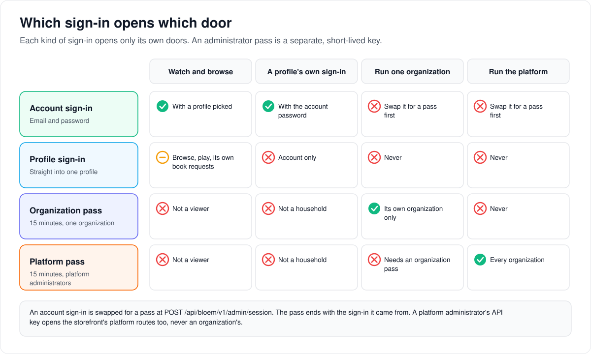
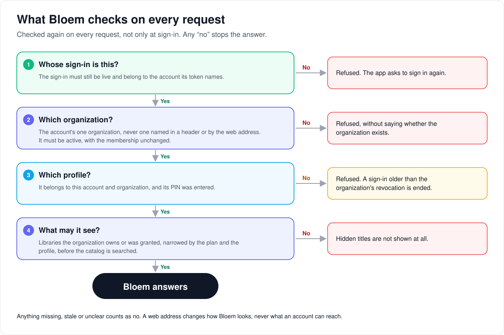
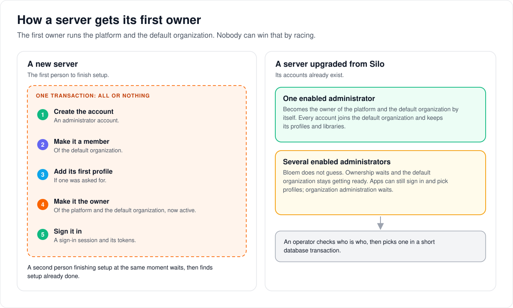

# How Bloem's security foundation works

> **Provenance and status.** Bloem page, rewritten on 2026-11-01, updated on 2026-11-02
> and checked against `main` at `209447445`, the merge of Silo through `56e6f871c`, with
> its Bloem fixes. The tenant foundation (organizations, memberships, platform
> ownership, administrator passes and the native `/api/bloem/v1` namespace) is a Bloem
> addition: Silo has one set of accounts, profiles and sign-ins per server. The technical
> rules are in the [For developers](#for-developers) section.

Bloem keeps each organization's people, libraries and settings apart, on one server. This
page walks through the kinds of sign-in and what each may do, what Bloem checks on every
request, what happens to a sign-in after an organization revokes it, how signing in works on
an organization's own web address, and how a server gets its first owner.

## Kinds of sign-in



- **An account sign-in** is what an app gets from an email address and password, the same
  sign-in Silo's apps use. It acts for the account. The app names a **profile** on each
  request, and enters the profile's PIN where it has one.
- **A profile sign-in** goes straight into one profile, with that profile's own email address
  and password. The household's main profile sets it up. It can browse, play, and keep its own
  progress, settings and book requests. It cannot manage the household or administer
  anything.
- **An administrator pass** is a separate key for running things. An administrator swaps an
  account sign-in for one, and it lasts at most 15 minutes. A **platform pass** runs the whole
  platform; an **organization pass** runs one organization. A pass is never both, and it ends
  as soon as the sign-in it came from ends. The browser keeps it in memory only.
- **An API key** is for programs such as the storefront (Bloem Garden). A key owned by a
  platform administrator opens the storefront's platform routes. It cannot sign in or out,
  and it never opens an organization's administration.

Signing in tells Bloem nothing about organizations. Bloem works out the organization from the
account itself, so apps built for Silo work unchanged. What the sign-in answer says the account
may do, such as downloading, comes from the account's own organization and access group. When
Bloem cannot work out that organization, the answer offers nothing, and the sign-in still works.

## What Bloem checks on every request



1. **Whose sign-in is this?** The sign-in must still be live, and it must belong to the
   account its token names. A token pointing at another account's sign-in is refused.
2. **Which organization?** Every account belongs to exactly one organization. Bloem takes it
   from the account, never from a header the app sends or from the web address. The
   organization must be active and the membership unchanged since the token was issued.
3. **Which profile?** The profile must belong to this account and this organization, and its
   PIN must have been entered.
4. **What may it see?** Bloem limits the catalog before it searches it: libraries the
   organization owns, plus platform libraries granted to it, narrowed by the plan and the
   profile. Nothing further down can widen that.

**Anything missing, stale or unclear is a no.** A refusal never says whether a hidden
organization, profile or title exists. A playing profile also owns its own playback: another
profile on the same account cannot stop it or move its position.

## When an organization revokes a sign-in

An organization administrator can sign a member out of every app at once. Some other changes
to a member's standing in the organization have the same effect. An app that signed in before
that moment can no longer pick any of the organization's profiles. Because an account belongs
to one organization, that sign-in is useless, so Bloem ends it and tells the app the sign-in
is no longer valid. The app then asks the person to sign in again, instead of showing a
broken home screen.

## Signing in on an organization's own address

Each organization can be served on its own web addresses (**domains**), under its own name,
logo and colours. Its emails link to its **primary domain**.

- A person signing in on another organization's address is refused before anything is
  created, and told where to sign in instead.
- An organization without a domain signs in at the server's public address.
- Signing in or out through the sign-in provider (Authentik) stays on the address it started
  on. The provider must therefore know each address's two return addresses and its sign-in
  page.
- **An address decides how Bloem looks, never what an account can reach.** Access always
  comes from the account's organization.

On 2026-11-01 production has one organization, the default one, with the server's public
address registered as its primary domain. See
[organization domains and branding](bloem-organization-domains.md).

## How a server gets its first owner



The first owner runs both the platform and the default organization.

**On a new server**, the first person to finish setup becomes the owner. Five steps happen
together, all or nothing:

1. The administrator account is created.
2. It becomes a member of the default organization.
3. Its first profile is added, if one was asked for.
4. It becomes owner of the platform and the default organization, which becomes active.
5. It is signed in.

A second person finishing setup at the same moment waits, then finds setup already done.

**On a server upgraded from Silo**, every account joins the default organization and keeps its
profiles, settings and libraries. With exactly one enabled administrator, that account becomes
the owner by itself. With several, Bloem does not guess: ownership waits, apps can still sign
in and pick profiles, and organization administration waits until an operator picks the owner.

## Example: a club on its own address

This example is made up.

Riverside Club is a reseller organization served on its own address, `watch.riverside.example`.

- **Coach signs in at the club's address.** Coach's account belongs to Riverside Club, so the
  sign-in works and the page shows the club's name and logo.
- **Jan, a direct customer, tries the same address.** Jan's account belongs to the default
  organization. The sign-in is refused, and the message names the server's public address,
  where Jan signs in as usual.
- **The club signs a member out.** Coach uses "sign out everywhere" for Sam. Sam's TV app,
  signed in last week, makes its next request and is told its sign-in is no longer valid. The
  TV asks Sam to sign in again.
- **Coach opens the club's administration.** Coach's account sign-in is swapped for an
  organization pass. After 15 minutes, or as soon as Coach signs out, the pass stops working.

## Who can change what

| Who | What they manage |
| --- | --- |
| Platform administrator | With a platform pass: every organization, its owner (with their own password), memberships, domains and branding. |
| Organization administrator | With an organization pass: their own organization only, including signing members out everywhere. |
| The storefront (Bloem Garden) | Reseller organizations, accounts, domains and branding, using a platform administrator's API key. |
| An account's main profile | The household's profiles, PINs and profile sign-ins. Profile sign-ins also need the account password. |
| The server's operator | Picking the owner of an upgraded server with several administrators, directly in the database. |

## Words used in the code

| On this page | In the code and database |
| --- | --- |
| Account sign-in | an account login session (`auth_sessions` row) and its access token |
| Profile sign-in | a direct-profile session, from `POST /api/v1/auth/profile-login`; credentials at `/api/bloem/v1/profile-credentials/{id}` |
| Administrator pass | an administrative context token (`auth.AdminContextClaims`, `internal/auth/admin_context.go`) from `POST /api/bloem/v1/admin/session` |
| Platform pass, organization pass | scope `platform` (`AdminScopePlatform`) or `organization` (`AdminScopeOrganization`) |
| API key | an `sa_` bearer key |
| Membership unchanged | the organization's `policy_revision` and the membership's `security_revision` |
| Owner | `platform_security.owner_account_id` and `organizations.owner_account_id` |
| Ownership waits | `platform_security.ownership_resolution_required` |
| Signing members out everywhere | a `security_revision` bump, recorded by migration `20260923160000_bloem_org_session_revocations` |
| Organization's own address | `bloem_organization_domains` (`internal/orgdomains`) |
| Capabilities | `GET /api/bloem/v1/capabilities` |

## For developers

- **API:** [organizations and administration](../bloem/api/organizations.md) (the
  administrator-pass exchange, organization and platform administration, domains and
  branding) and [apps and clients](../bloem/api/apps.md) (capabilities, identity and
  profile credentials). The behaviour that does not fit a schema is in the
  [wire reference](../bloem-api-reference.md#auth-model-account-viewer-and-administrative-authority).
  Silo's own authentication model is in [API contract](api-contract.md) and
  [external sign-in](external-sign-in.md).

### History

Written with the tenant foundation in `c02d2445b` (2026-08-13). Later changes that matter: v2
socket tickets bound to tenant authority (`9ab044057`, `6d52b1a0d`, 2026-10-09/11); account
policy back on Silo's `users` table with one membership per account (`c60b7008e`,
2026-10-26); lifecycle receipts removed (`b017bfe84`, 2026-10-26); Silo's session-to-account
token binding and playback ownership rules applied to Bloem's paths (Silo merge `68070f04b`,
2026-10-27); a sign-in older than its organization's revocation ended with `401
session_invalid` (`25129bcbd`, 2026-11-01); organization domains (migration
`20261101055208_bloem_organization_domains`, 2026-11-01); the login response's policy
resolved in the account's own tenant again after Silo's account payload began reporting
group-masked permissions (`5a044930c`, 2026-11-02). The [Rollback](#rollback) procedure
applies only to the August 2026 foundation release.

### The native namespace and capabilities

Bloem keeps the Silo-compatible `/api/v1` account login, profile picker, PIN unlock, token
refresh and administrative projection. The native `/api/bloem/v1` namespace is a separate
additive boundary. Its discovery and administration surface exposes:

- public `GET /api/bloem/v1/capabilities`;
- public `GET /api/bloem/v1/server/identity`;
- authenticated `GET /api/bloem/v1/organizations`;
- administrative context exchange and management routes under `/api/bloem/v1/admin`;
- the native client surface in [how Bloem's native API is organized](bloem-client-surface.md).

The capability response is the source of truth. It advertises legacy v1 compatibility,
organization membership discovery and tenant-bounded media scope, beside the media types this
build serves and the feature tokens clients match against. This is an illustrative subset,
not an exhaustive token list; consult the runtime response and the
[wire reference](../bloem-api-reference.md#get-apibloemv1capabilities):

```json
{
  "api": "bloem/v1",
  "identity_schema": 1,
  "features": {
    "legacy_silo_v1": true,
    "organization_memberships": true,
    "tenant_bounded_media_scope": true,
    "direct_profile_login": true,
    "shared_device_pairing": false,
    "delegated_admin_roles": false
  },
  "media_types": ["movie", "series", "episode", "audiobook", "ebook", "manga"],
  "feature_tokens": [
    "playback_plan_v3",
    "neutral_playback_v3_contract_v1",
    "layout_aware_passthrough",
    "playback_route_diagnostics",
    "device_quirks_v1",
    "seek_reanchor_v1",
    "output_change_v1",
    "direct_stream_resume_v1",
    "plan_source_duration_v1",
    "declared_event_channels",
    "watch_document_v1",
    "device_pairing_v1",
    "progress_sync_v1"
  ]
}
```

`features` and `feature_tokens` are not two spellings of one list. `features` is the fixed
object of identity-model booleans this document has always published; `feature_tokens` is the
open, versioned allowlist a client matches against, and every later capability lands there.
Both grow additively. `organization_domains_v1` is one of the conditional tokens: it is
advertised when the domain and branding routes are mounted with both an account and an
administrator gate.

Direct-profile login is implemented on `/api/v1/auth/profile-login` when its dependencies are
wired; the capability boolean reflects that wiring. The default-deny direct-session route
allowlist (`internal/api/direct_profile_routes.go`) still rejects Silo v2 and the native Bloem
namespace (apart from the audiobook and ebook request viewer routes), so the embedded browser
must use account login. Household credential status, set and clear are available through
`/api/bloem/v1/profile-credentials/{id}` when `profile_credential_management_v1` is
advertised. They require a non-impersonated account login, existing household/PIN permission,
and the current local account password for writes. Direct sessions and API keys cannot manage
these credentials; SSO-only reauthentication is not implemented. Credential changes require a
positive `expected_revision`, checked under the profile row lock, then rotate revisions and
revoke direct sessions. Stale writes return `409 credential_revision_conflict` without
changing the newer credentials or sessions. The browser clears form secrets after attempts and
does not keep them in query or mutation caches.

Shared-device pairing and delegated administrative roles remain unimplemented and their
booleans remain false. The initial organization authority is the broad, structured
`organization_admin` role; organization administrators cannot upload, edit or activate Rego.
Clients must not infer features from version strings. `/api/v10/*` is not an alias and returns
404.

### Security invariants

- Existing v1 JWTs remain valid and carry no organization authority.
- Legacy account requests ignore organization-selection headers and project into the account's
  own organization: its one active membership, which is the default organization for upgraded
  accounts. Direct-profile sessions instead revalidate their explicit organization, membership
  and revisions; they cannot be projected into another tenant.
- Administrative context JWTs live separately from account sessions, expire within 15 minutes
  (`auth.AdminContextTokenLifetime`), and bind exactly one Platform or Organization authority.
  Browsers retain the token in memory only; persistent storage contains at most the selected
  non-secret context key. A context requires a login session: a token without one is
  `401 tenant_session_required`, and a session that is revoked, expired, another account's or
  a remote-playback handoff is `401 authorization_state_stale`.
- Session checks are bound to the account the credential names. Since the Silo merge
  `68070f04b` (2026-10-27; Silo #3140), Silo's `ActiveSession` takes that account, and so do
  Bloem's preview-aware lookups (`ActivePreviewSession`, `ActiveSessionAuthority` in
  `internal/auth/bloem_preview_principal.go`), which the auth middleware and the plugin router
  use, the administrative context middleware (`internal/api/middleware/admin_context.go`) and
  native video's login-session check (`internal/api/bloem_native_video.go`). A token whose
  login session belongs to another account is refused.
- Playback progress and stop belong to the acting profile, not just the account. Silo's
  `ownsPlaybackSession` (#3133) guards v1 progress and stop, and Bloem's durable stop
  (`internal/api/handlers/bloem_playback_stop.go`) applies the same rule, so a sibling profile
  on the same account cannot stop another profile's playback
  (`TestBloemBridgeStopRefusesASiblingProfile`).
- Native organization-bound middleware takes selection only from validated session claims,
  then rechecks the current organization, membership, policy revision and security revision
  before attaching tenant context.
- Missing, suspended, hidden, ambiguous, foreign or stale tenant state fails closed without
  disclosing whether a hidden organization exists.
- Organization listing occurs before selection. It returns only the account's active
  memberships in active organizations and omits owners, member counts and other
  organizations.
- V1 retains the legacy account ceiling for profile-less default-organization requests. A
  selected profile resolves its canonical access group from the profile's required
  organization-qualified assignment; a group from another organization never resolves.
  Deleting a non-default group reassigns its profiles to that organization's default group in
  the deletion transaction.
- Media visibility is bounded before catalog SQL runs. An organization may see its own folders
  and platform-owned folders with an active explicit entitlement. Ownership and entitlement
  establish availability only; access groups, profile restrictions, disabled-library settings
  and custom policy may narrow that set but cannot widen it.
- Missing tenant facts, stale revisions, unavailable entitlement state, policy errors,
  malformed or undefined decisions, and evaluation timeouts fail closed. Hidden, foreign and
  non-entitled resources are not disclosed.

### Clean setup

On a database with no users, migrations create one initializing default organization and an
unassigned platform security row. Initial setup performs one protected sequence:

1. create the account;
2. provision its active default-organization membership;
3. create the optional default profile with its organization identity;
4. atomically assign platform and organization ownership and activate the organization; and
5. create the session and tokens.

Setup runs inside Silo's `UserRepository.ClaimInitialSetup` transaction, which takes the
deployment-wide `InitialSetupAdvisoryLock` and re-counts accounts after acquiring it, so a
waiting contender finds the winner's account and gets `ErrSetupAlreadyComplete`. Bloem's
`SetupInitialUserInTransaction` (`internal/auth/bloem_service.go`) applies the same fence again
inside the caller's transaction (`ClaimInitialSetupInTransaction`,
`internal/auth/bloem_setup_claim.go`), then creates the account (marked `is_owner` and
`break_glass`), the optional profile, the ownership activation and the login session in that
one transaction; failure before commit rolls all of it back. (Until `b017bfe84`, 2026-10-26, a
separate lifecycle-receipt path wrapped setup in its own transaction.) The Bloem ownership
adapter and notification-decorated user store must preserve the transactional extensions;
unsupported backing stores fail closed, never emulate a separate commit. When a default
profile is requested, both account transaction entrypoints check the provider's
transactional capability before any account or membership insert or user-store lookup. This
prevents filesystem side effects from opening an unsupported SQLite store before the
PostgreSQL transaction rejects the request. The returned store's transactional writer is
still checked independently. Requests without a default profile keep their existing
provisioning behavior. Verify:

```sql
SELECT owner_account_id, policy_revision, ownership_resolution_required
FROM platform_security;

SELECT id, slug, status, owner_account_id, policy_revision, is_default
FROM organizations;

SELECT organization_id, account_id, status, legacy_role, security_revision
FROM organization_memberships
ORDER BY organization_id, account_id;
```

Exactly one default organization must exist. Its owner and the platform owner must be the
setup account; both organization and membership must be active. Protected activation accepts
only an enabled account whose legacy account role and organization membership role are both
`admin`; ordinary, disabled, invited or suspended accounts cannot win an ownership race.

### Account provisioning and login policy

Organization-specific account creation creates the membership and assigns the account a
default access group only in the selected organization. It must not silently add a
default-organization membership; an account holds at most one membership
(`organization_memberships_one_per_account`, since `c60b7008e`). The membership provisioner
can adopt the exact active, same-role row seeded by identity creation in the same transaction;
it cannot reactivate an invited or suspended row, change its role, or increment its revisions
as a side effect. Organization provisioning uses `FOR NO KEY UPDATE`
(`internal/auth/bloem_account_provisioner.go`): concurrent seeded memberships already hold
foreign-key `KEY SHARE` locks, so upgrading both to `FOR UPDATE` would deadlock. Provisioning
does not change organization keys, and competing organization updates remain serialized. No
transaction retry substitutes for that lock compatibility.

Password-login responses resolve the authenticated account's default-organization viewer
policy before reporting `download_allowed` and the group-masked permissions (v2
`Account.permissions`), which Silo's `effectiveAccountPolicy` computes since Silo `243d7e0da`.
The login request cannot select a tenant through headers or an ambient profile context: two
Bloem lines in Silo's `AuthHandler.Login` bind the account's own tenant
(`bloemLoginPolicyContext`, `internal/api/handlers/bloem_login_policy.go`) before Silo's line
runs. Missing viewer authority marks the context with `access.RequireTenantPolicy`, so
`access.EffectivePolicyForUser` fails closed instead of falling back to the no-group policy:
the response reports no downloads and no permissions, without preventing account login for
administrative-context selection. This response is informational: later resource requests
still enforce their own authority. `TestBloemLoginReportsTheAccountGroupPolicyDB` drives the
real login against Postgres; `TestBloemLoginPolicyUsesAuthenticatedAccountTenant` covers each
way the tenant can be refused.

The v1 account-password capability and mutation routes preserve profileless account
administration. A selected profile first resolves tenant authority, then passes the shared
ownership/PIN viewer guard. Direct-profile sessions remain rejected before either lookup.

Logout revokes a login session, not an API key. The shared handler refuses API-key or
sessionless claims before invoking session revocation; valid account and admitted
direct-profile sessions keep self-logout. v1 invitation acceptance hides unknown, expired,
revoked and consumed invitations behind `404 not_found`; a pending invitation's
duplicate-account conflict remains `409 already_used`.

### Sessions an organization revoked

An organization administrator's "revoke all sessions"
(`internal/api/handlers/bloem_org_session_revocation.go`) bumps the membership's
`security_revision`, which stales every membership-bound token (administrative contexts,
tenant-bound v2 sessions, direct-profile refresh) at its next check, and revokes the
account's login sessions too. An account that is not a member of that organization is left
alone: one tenant's administrator must not sign another tenant's member out.

An account-login session that started before its organization revoked the account can no
longer select that organization's profiles. The trigger on `organization_memberships` (from
migration `20260923160000_bloem_org_session_revocations`) records the revocation time per
account and organization whenever `security_revision` rises and status and role stay the same.
That covers an administrator's "revoke all sessions", initial ownership activation and some
access edits. An account belongs to one organization, so such a session cannot load any
profile. The viewer-access gate ends the session and answers `401` with reason
`session_invalid` (`apimw.ErrSessionRevokedByOrganization`,
`internal/api/middleware/bloem_viewer_session.go`), which `/api/v2` answers as
`session_expired`. Its refresh is then refused because the session is revoked, and the client
signs in again. Callers that resolve a viewer outside the gate still see
`access.ErrProfileNotFound`, because the refusal wraps it. Only sessions are checked: an API
key has no `auth_sessions` row, and a direct-profile session is already bound to its profile
and revision. See `internal/api/bloem_org_session_revocation.go`.

### Organization domains at sign-in

A sign-in on a domain registered to another organization is refused before a session exists
(`409 wrong_organization_domain`, "This account signs in at https://<primary domain>."). The
address falls back to the server's public address when the account's organization has no
primary domain, and an organization without a domain is let in on the public address's host
even when that host is registered to the default organization, so the refusal never names the
address that refused. It is 409, not 403, because `/api/v2` renders a 403 at sign-in as
`permission_denied`, which the sign-in page reports as a disabled account. Requests on
unregistered hosts (IP addresses, LAN names) and impersonation sessions are not refused. A
sign-in or sign-out through the OAuth provider stays on the domain it started on, so each
domain's two callbacks (`/api/v1/auth/oauth/<installation>/callback` and
`/api/v2/auth/oauth/<installation>/callback`) and its `/login` (post-logout redirect) must be
registered at the provider. A domain never grants or narrows access: the tenant middleware
takes the organization from the account or session whatever host the request arrived on. The
platform routes are `/api/bloem/v1/admin/platform/tenants/{id}/domains` and
`/api/bloem/v1/admin/platform/tenants/{id}/branding`, advertised by `organization_domains_v1`
([organization domains and branding](bloem-organization-domains.md)).

### Upgrade behavior

An upgrade with exactly one enabled legacy administrator automatically assigns that account
as platform and default-organization owner. Disabled admins do not create ambiguity. Existing
users receive active memberships, profiles keep their IDs and policy fields, and existing
access groups and profiles attach to the default organization. Unassigned profiles are
backfilled to their organization's default group, after which every profile has exactly one
canonical group. Existing media folders become platform-owned and the default platform catalog
is materialized as active default-organization entitlements, so upgraded v1 users keep their
prior library visibility.

When several enabled legacy administrators exist, migrations deliberately set
`ownership_resolution_required=true`, leave both owners null, and keep the default
organization initializing (`20260812190000_tenant_identity_foundation`). V1 login and profile
switching remain available; native organization-bound requests do not.

#### Resolve multiple-admin ambiguity

Back up the database, stop write traffic, and choose one enabled legacy admin after
out-of-band identity verification. In one `psql` transaction, substitute the chosen integer
account ID for `CHOSEN_ACCOUNT_ID`:

```sql
BEGIN;

SELECT id, username, email, enabled, role
FROM users
WHERE id = CHOSEN_ACCOUNT_ID
FOR UPDATE;

SELECT singleton, owner_account_id, ownership_resolution_required
FROM platform_security
FOR UPDATE;

SELECT id, owner_account_id, status, is_default
FROM organizations
WHERE is_default
FOR UPDATE;

UPDATE platform_security
SET owner_account_id = CHOSEN_ACCOUNT_ID,
    ownership_resolution_required = false,
    policy_revision = policy_revision + 1,
    updated_at = now()
WHERE singleton
  AND owner_account_id IS NULL
  AND ownership_resolution_required;

UPDATE organizations
SET owner_account_id = CHOSEN_ACCOUNT_ID,
    status = 'active',
    policy_revision = policy_revision + 1,
    updated_at = now()
WHERE is_default
  AND owner_account_id IS NULL
  AND status = 'initializing';

UPDATE organization_memberships AS membership
SET status = 'active',
    legacy_role = 'admin',
    security_revision = security_revision + 1,
    updated_at = now()
FROM organizations
WHERE organizations.is_default
  AND membership.organization_id = organizations.id
  AND membership.account_id = CHOSEN_ACCOUNT_ID;

COMMIT;
```

Abort rather than commit unless the chosen user is enabled, has legacy role `admin`, both
protected updates affect exactly one row, and the membership update affects exactly one row.
Re-run the verification queries afterward.

### Rollback

> **Historical.** This procedure belongs to the August 2026 tenant-foundation release.
> Several later Bloem migrations are forward-only and refuse `Down` (for example
> `20261013161500_remove_bloem_compatibility.sql` and
> `20261026003000_bloem_account_policy_on_users.sql`), so a current deployment rolls back by
> restoring a backup taken before the migration, as the deployment receipts describe (for
> example [October 27](../operations/2026-10-27-main-deployment.md#rollback)).

Rollback is allowed only before operators or later phases start writing non-default
organizations, organization-specific profile group assignments, resource ownership, or
entitlements that cannot be represented by v1. Take a tested backup, stop Bloem, and roll back
the application binary and schema together. Keeping a new binary against the old schema is
unsupported.

From a matching source checkout with the deployment environment file:

```sh
make migrate-status ENV_FILE=/path/to/deployment.env
make migrate-down-to VERSION=20260812163547 ENV_FILE=/path/to/deployment.env
```

The complete rollback crosses the access-group and resource-tenancy migrations before
removing `platform_security`, `organizations`, `organization_memberships`, and the additive
organization/profile group columns. It restores the global access-group name constraint. It
does not change legacy users, profiles, account-level access-group assignments, passwords,
sessions or watch state. Verify those legacy counts and sampled rows before starting the
previous binary. Do not use this rollback after the representability boundary above has been
crossed; restore the tested backup instead.

### Release gate

Before enabling native tenant administration in an environment:

1. run migration up/down/up tests on a disposable database;
2. run the v1 compatibility suite for setup, login, profile list, PIN unlock, admin
   projection and refresh;
3. confirm legacy account login tokens do not acquire administrative-context authority, and
   direct-profile sessions keep their explicit tenant binding;
4. confirm every native organization/platform administrative route requires the matching
   short-lived context and advertises only implemented features;
5. resolve ownership ambiguity, if present; and
6. keep the pre-migration backup until the rollback window is explicitly closed.

The OPA composition, database acceptance, exact local commands and failure response guidance
are in [OPA tenant authorization](opa-tenant-authorization.md).

### Native Live TV and Xtream authority

Live TV administration is distinct from organization/platform administrative context. It
requires authenticated account authority, the acting-administrator gate, the account's
selected primary profile and any required PIN proof. General profileless account
administration does not imply profileless Live TV access. Direct-profile credentials and
signed delivery proofs cannot create providers or manage guides.

[Xtream integration](xtream-live-tv.md) keeps provider credentials encrypted with
tuner/origin binding and no plaintext fallback. Only fixed live/XMLTV endpoints are
requested; redirects and provider-supplied alternate source/artwork URLs are refused. The
server keeps opaque channel references and feeds encoders through owned pipes, not
credential-bearing URLs. UI writes capture account/profile/PIN identity and require explicit
reconciliation after uncertain outcomes, never replay. `xtream_supported` is installed
support, not a grant or proof of encryption readiness.

Mounted authority, storage and encoder regressions are separate from the
[September 19 deployment smoke checks](../operations/2026-09-19-xtream-deployment.md). Neither
certifies actual provider playback, every browser or the unfinished scenario suite. No
authorization or secret-disclosure rule was relaxed for CI.

### Native seasonal delivery and events authority

`seasonal_viewer_v1` identifies the authenticated native `/ambience` route only when all
required resolvers are mounted. It requires a verified profile in the current active tenant.
A verified legacy viewer in the initializing default organization may receive public packs
during Silo-compatible switching; this does not activate that organization or permit
organization-targeted packs. Public packs and current-organization packs are filtered with
active membership in the same database read as their contents. Public login branding and the
public `GET /api/bloem/v1/ambience/public` (the deployment-wide packs that the web app's
signed-out seasonal layer reads) never include organization-targeted packs. Direct-profile
admission remains default-deny.

The Bloem v2 events adapter captures the original authenticated principal and resolved tenant
in the ticket store's optional, server-owned `SocketIdentity.AuthorityBinding`
(`internal/api/handlers/bloem_socket_authority.go`). The contextless upgrade and periodic
checks revalidate that same session, account incarnation, organization, membership,
revisions, profile ownership, role, device and impersonator. They cannot choose a new tenant.
Shared single-use consumption, origin, protocol, expiry, PIN, access fingerprint and
revocation checks remain in force. Ordinary Silo-compatible account/OAuth JWTs omit device
identity. When such a legacy session delegates a ticket, the adapter captures the stored
session device once and compares it on every later check. Explicit tenant or device claims
never use this fallback, and client headers cannot change the captured device. Unbound older
tickets fail closed. The binding is not accepted from or exposed to clients.

Playback-control v2 tickets use the same Bloem authority adapter. Authenticated ticket
creation captures the original tenant; the public WebSocket upgrade restores and revalidates
that binding before the shared handler checks playback session, profile and installation
ownership. The shared handler's periodic checks use the same validator. Resolving a fresh
tenant from only the account and profile could retarget authority; accepting the request
without tenant context instead rejects otherwise valid control tickets. Neither is permitted.
The wire protocol, one-use ticket consumption, Origin checks, PIN verification, access
fingerprint, ownership and revocation rules remain unchanged.

Disposable rebuilt-browser acceptance received a real v2 events `hello` and kept the socket
healthy for 18 seconds, beyond its 15-second authority recheck. The same run completed
home/seasonal HTTP reads without runtime errors. Current-organization seasonal delivery and
exclusion from public branding also passed; foreign-tenant and concurrent retargeting
exclusion are covered separately by database regressions.

Technical pages:

- [Multitenant administration](multitenant-administration.md): the Platform and Organization
  admin contexts, and how Silo clients resolve an organization.
- [OPA tenant authorization](opa-tenant-authorization.md): tenant facts, the policy engine
  and SQL scope reads.
- [Resource tenancy foundation](resource-tenancy-foundation.md): resource owners, grants and
  the starting set.
- [Delivery boundary enforcement](delivery-boundary-enforcement.md): access rechecked when
  video and rows leave the server.
- [Organization domains and branding](bloem-organization-domains.md).
- [How organizations work](bloem-organizations.md) and
  [how Bloem's native API is organized](bloem-client-surface.md).
- [Household authority acceptance](household-authority-acceptance.md) and
  [API key authority acceptance](api-key-authority-acceptance.md).

The pictures are SVG files under `images/security-foundation/`, drawn by
`scripts/bloem/draw-pictures.py`. Redraw them there, not by hand.
