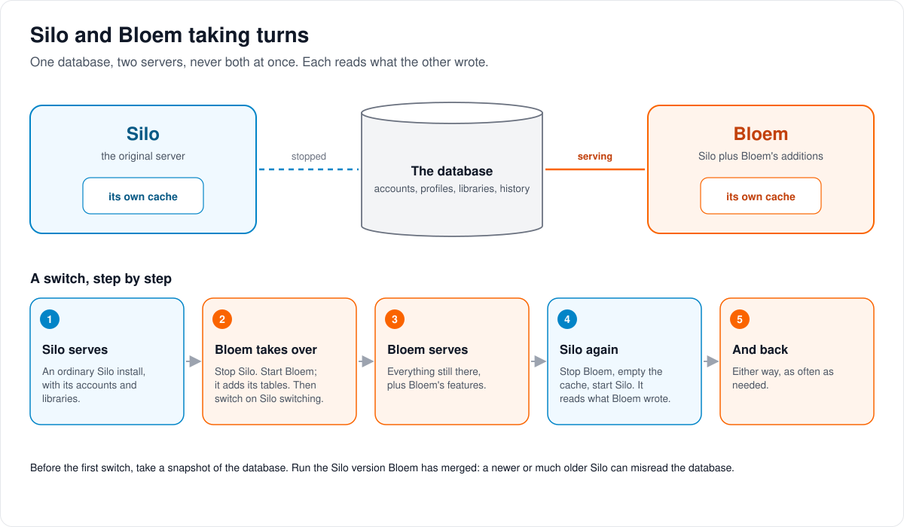
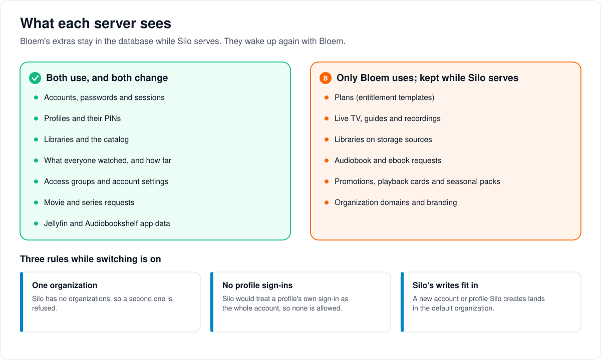
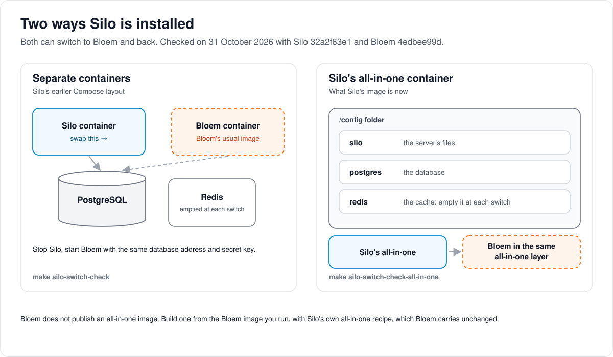

# Switching between Silo and Bloem

> **Provenance and status.** Bloem page, written on 2026-10-31 and checked against
> `main` at `c83c424b7`. Silo switching is a Bloem addition: Silo knows nothing
> about it. On 2026-10-31 both switch checks passed with Silo `32a2f63e1` and Bloem
> `4edbee99d`. This page explains it in plain language; the technical page,
> [Silo backend switching](silo-backend-switching.md), holds the commands and
> invariants.

A Silo installation can try Bloem on the same database and go back to Silo
later, without losing or corrupting anything. This is what lets someone move to
Bloem without burning a bridge.

## Taking turns

Silo and Bloem never run at the same time. Each has its own cache, emptied
before it starts, and each reads what the other wrote:

1. **Silo serves.** An ordinary Silo installation, with its accounts and
   libraries.
2. **Bloem takes over.** Stop Silo and start Bloem. Bloem adds its own tables on
   its first start. Then switch on Silo switching (`silo silo-switching enable`),
   which checks the database is safe for Silo and keeps it that way.
3. **Bloem serves,** with everything still there and Bloem's features on top.
4. **Silo again.** Stop Bloem, empty the cache, start Silo. It reads what Bloem
   wrote.
5. **And back,** either way, as often as needed.

Before the first switch, take a snapshot of the database. Run the Silo version
Bloem has merged: a newer Silo may change the database in ways Bloem hasn't
adapted to, and a much older one may not understand a later Silo change.

## What each server sees

Both servers read and change the same accounts, passwords, profiles, libraries,
watch history, access groups, account settings, movie and series requests, and
Jellyfin and Audiobookshelf app data.

Bloem's extras stay in the database while Silo serves, untouched, and work again
when Bloem serves: plans, Live TV and recordings, libraries on storage sources,
audiobook and ebook requests, campaigns and seasonal packs.

While switching is on, three rules keep the database inside what Silo can
handle:

- **One organization.** Silo has no organizations, so a second one is refused.
- **No profile sign-ins.** Silo would treat a profile's own sign-in as the whole
  account, so none is allowed.
- **Silo's writes fit in.** A new account or profile that Silo creates lands in
  the default organization, in the right group.

Switching off (`silo silo-switching disable`) lifts the rules; after that, Silo
must not serve the database again.

## Two ways Silo is installed

- **Separate containers.** Silo, PostgreSQL and Redis each run in their own
  container, as in Silo's earlier Compose layout. Stop the Silo container and
  start Bloem's ordinary image with the same database address and secret key.
- **Silo's all-in-one container.** Silo's image now carries its own PostgreSQL
  and Redis, with their data in one `/config` folder that only that container
  can open. To switch, build Bloem in the same all-in-one layer, using Silo's own
  recipe that Bloem carries unchanged, and start it on the same `/config`. Empty
  `/config/redis` at each switch. Bloem doesn't publish an all-in-one image; build
  it from the Bloem image you run.

Both layouts are tested end to end: Silo creates the accounts, Bloem takes over
and switches on Silo switching, then Bloem, Silo and Bloem again each read what
the one before wrote and write something for the next one to read.

## Who can change what

| Who | What they manage |
| --- | --- |
| The person running the server | Which server runs, the snapshot, switching on and off. |
| Platform administrator | Nothing extra. While switching is on, Bloem refuses a second organization or a profile sign-in. |

## For developers

- [Silo backend switching](silo-backend-switching.md): the commands, the database
  rules, the all-in-one procedure, and the database tests.
- `make silo-switch-check SILO_IMAGE=<Silo base image by digest> BLOEM_IMAGE=<tag>`
  and `make silo-switch-check-all-in-one SILO_IMAGE=<Silo all-in-one image by digest> BLOEM_IMAGE=<tag>`
  run the switch end to end (`scripts/bloem/silo-switch-check*.sh`, driven by
  `cmd/bloem-silo-switch-check`).
- Silo's [omnibus image](omnibus-image.md): how the all-in-one container starts
  and where it keeps its data.
- The switch is a database contract, not an API: neither server calls the other.
- The switch check drives both servers through Silo's `/api/v2`, so it keeps
  working after Silo retires `/api/v1`
  ([leaving Silo's `/api/v1`](bloem-leaving-silo-v1.md)).

The pictures are SVG files under `images/silo-switching/`, drawn by
`scripts/bloem/draw-pictures.py`. Redraw them there, not by hand.
