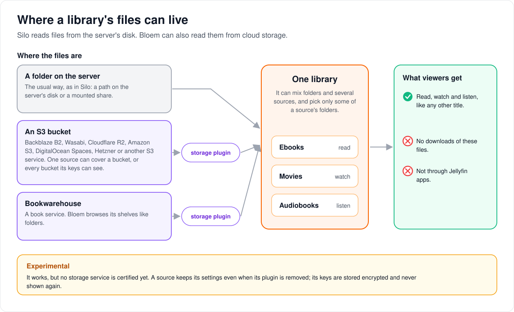
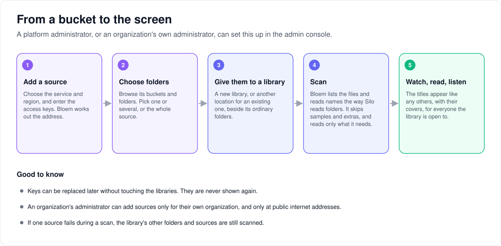

# How storage sources work

> **Provenance and status.** Bloem page, written on 2026-10-31, updated on
> 2026-11-01 and checked against `main` at `b6039036d`. Silo's libraries read files
> from paths on the server. Bloem adds **native storage**: libraries that also read
> from S3 buckets and the Bookwarehouse book service, through approved storage
> plugins. It is experimental. This page explains it in plain language; the
> technical pages and the API are linked in the [For developers](#for-developers)
> section.

This page covers where a library's files can live, how a bucket becomes titles on
the screen, and who can change what. What happens during a scan, and how stored
titles play, is on the [native storage page](bloem-native-storage.md).

## Where a library's files can live

A library can read its files from three kinds of place, mixed as needed:

- **A folder on the server**, as in Silo: a path on the server's disk or a
  mounted share.
- **An S3 bucket**, at Backblaze B2, Wasabi, Cloudflare R2, Amazon S3,
  DigitalOcean Spaces, Hetzner or another S3 service. One **source** can cover a
  single bucket, or every bucket its keys can see.
- **Bookwarehouse**, a book service whose shelves Bloem browses like folders.

S3 and Bookwarehouse are read through a **storage plugin**: a small program
Bloem trusts only when its release matches an approved checksum. Bloem never
mounts the storage as a folder. It asks the plugin for a list of files and for
the bytes it needs, when it needs them.

An S3 source can hold **ebooks**, **movies** and **audiobooks**; Bookwarehouse
holds ebooks and audiobooks. Series can't come from storage yet. Viewers read,
watch and listen as with any other title, but these files can't be downloaded,
and Jellyfin and Audiobookshelf apps don't get them.

It is **experimental**: it works, but no storage service is certified yet. A
source keeps its settings when its plugin is removed, and its keys are stored
encrypted and never shown again.

## From a bucket to the screen

1. **Add a source.** Choose the service and its region and enter the access
   keys. Bloem works out the address from the service and region.
2. **Choose folders.** Browse the buckets and folders. Pick one or several, or
   the whole source, including buckets created later.
3. **Give them to a library.** A new library, or another location for an
   existing one, beside its ordinary folders.
4. **Scan.** Bloem lists the files and reads their names the way Silo reads
   folders, so `13 Eerie (2013)/film.mkv` becomes "13 Eerie" (2013). It skips
   samples and extras and reads only what it needs.
5. **Watch, read, listen.** The titles appear with their covers for everyone the
   library is open to.

Good to know:

- Keys can be replaced later without touching the libraries.
- An organization's administrator can add sources only for their own
  organization, and only at public internet addresses on a short list of ports.
- If one source fails during a scan, the library's other folders and sources are
  still scanned. The library's "last scanned" time moves on only when every part
  succeeded. A failed scan of a source tries again by itself, up to five times,
  picking up where it stopped.
- A file the source no longer lists is marked missing after a second complete
  scan also leaves it out; one the source reports as removed is marked missing at
  once. See [when a file disappears](bloem-native-storage.md#when-a-file-disappears).

## Who can change what

| Who | What they manage |
| --- | --- |
| Platform administrator | Storage plugins, platform sources, every library location. Plugin upgrades. |
| Organization administrator | Sources and library locations owned by their own organization, at public internet addresses only. Upgrading an S3 plugin from the catalog stays with the platform. |
| Viewers | Nothing here; they see the titles like any others. |

## Words used in the code

| On this page | In the code and database |
| --- | --- |
| Storage plugin | a native storage installation (`bloem_storage_installations`) serving `bloem.plugin.v1.StorageProvider` |
| Source | `bloem_storage_sources`, with encrypted configuration and a revision |
| A library's folders on a source | `library_storage_locations` and `bloem_storage_selected_roots` |
| A file from a source | `bloem_storage_file_refs`; its catalog path starts with `bloem-storage:` and is never a real path |
| What a source can hold | `supported_source_media` in the native-storage capability document |

## For developers

- **API:** [storage sources](../bloem/api/storage.md): plugins, sources,
  credential rotation, bucket and folder browsing and library locations, in the
  platform scope and in an organization's scope.
- [How native storage works](bloem-native-storage.md): the model, scanning,
  covers, reading, the plugin protocol and operations, including the
  organization-scope address guard, bucket browsing limits and the
  `BLOEM_NATIVE_STORAGE_APPROVALS` file that pins S3 releases.
- [How stored movies play](bloem-native-video-playback.md) and
  [how stored audiobooks play](bloem-native-audio-playback.md).
- [How a scan reads a stored file](bloem-native-scan-reader.md),
  [how a trusted tool reads a stored file](bloem-native-tool-input.md) and
  [how Bloem looks inside a stored file](bloem-native-probe.md).
- [S3 storage notes](../bloem/overlays/s3-storage-setup.md): S3 for Silo's Assets
  store, which is separate from storage sources.

The pictures are SVG files under `images/storage/`, drawn by
`scripts/bloem/draw-pictures.py`. Redraw them there, not by hand.
