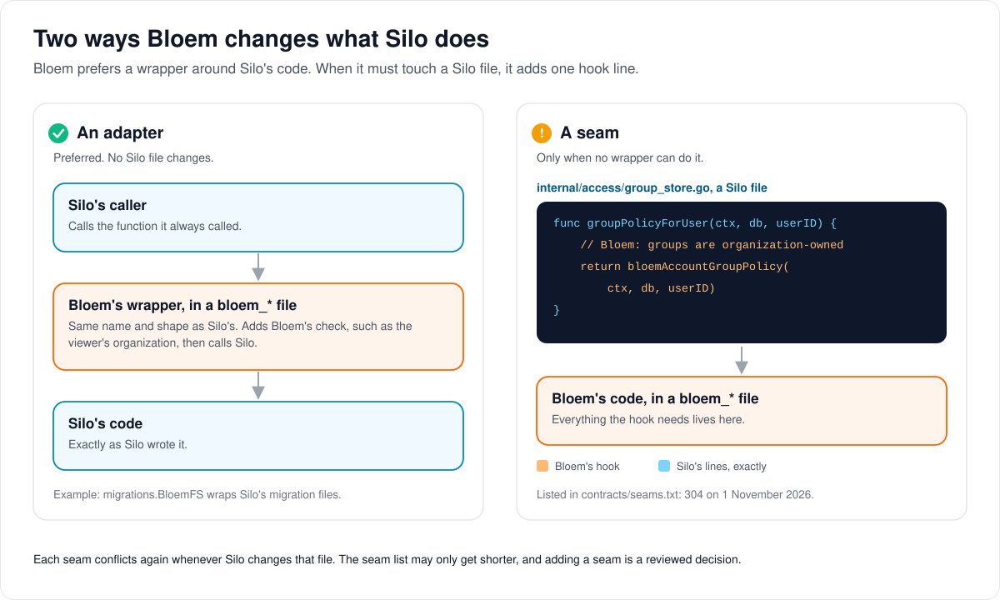
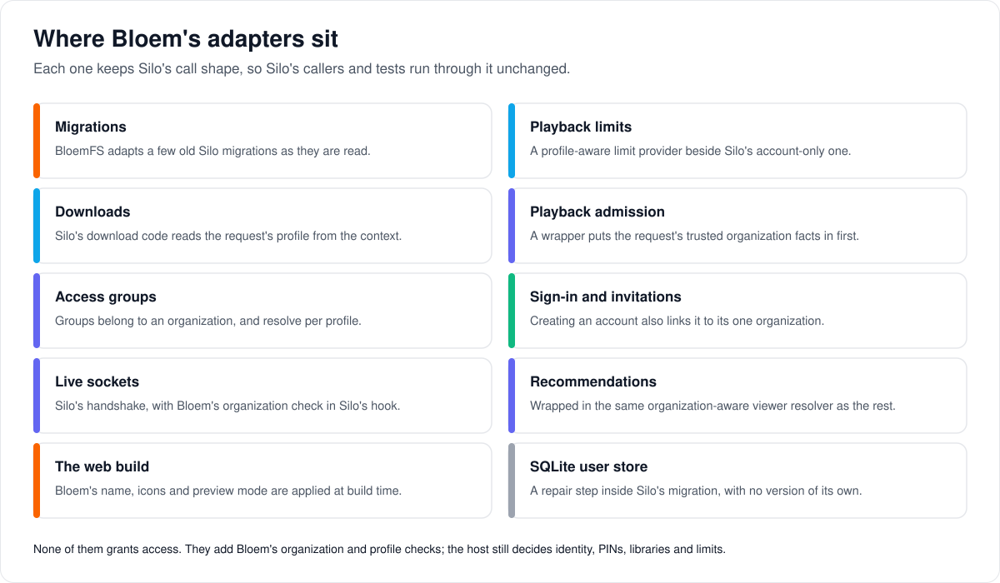

# How Bloem's adapters over Silo work

> **Provenance and status.** Bloem page, rewritten on 2026-11-01, updated on 2026-11-09
> and checked against `main` at `39b1e9d6a`. Adapters are Bloem's own: they are how Bloem changes Silo's
> behavior without editing Silo's files. Every adapter, hook and invariant is in the
> [For developers](#for-developers) section.

Bloem adds its features to Silo's code without rewriting it, so that Silo's work can
be merged in every day. This page walks through the two ways Bloem does that, where
each adapter sits, and what an adapter must never do.

## Two ways to change what Silo does



1. **An adapter** is a Bloem file that wraps a piece of Silo's code and keeps its
   shape: the same function names and the same arguments. Silo's callers call it as
   they always did. The adapter adds Bloem's check, such as which organization the
   viewer belongs to, then hands over to Silo's code. No Silo file changes. This is
   the way Bloem prefers.
2. **A seam** is a Silo file that Bloem still changes, usually by one **hook** line
   that calls Bloem's code in a file of its own. Bloem uses a seam only when no
   wrapper can do the job. Every seam is listed in `contracts/seams.txt` with its
   reason. On 1 November 2026 the list held 304. It may only get shorter.

Each seam conflicts again whenever Silo changes that file, and Silo changes every day.
An adapter costs nothing at a merge unless Silo changes the function it wraps.

## Where the adapters sit



- **Migrations.** Silo's database changes run through a wrapper that adjusts a few old
  ones as they are read, so Bloem's tables and Silo's agree. Silo's files stay as
  Silo wrote them.
- **Playback and downloads.** Silo checks limits per account. Bloem adds the
  **profile**, the person using the account, so a kids profile can have its own
  limits.
- **Organizations.** Silo has one set of accounts per server. Bloem's wrappers make
  sure every check, from pressing play to a live socket, happens inside the viewer's
  own **organization**.
- **Organization domains.** A wrapper around the whole server notes which
  organization's domain a request arrived on, so Silo's branding and email code shows
  that organization's name, logo, colours and address.
- **The web app.** Bloem's name, artwork and preview mode are applied when the web
  app is built, so Silo's web source stays as Silo wrote it.

## What an adapter must never do

An adapter never lets anyone in. It keeps Silo's checks and adds Bloem's: the
organization, the profile and its PIN, the libraries and the limits all stay with
the server. When Silo changes a function that an adapter wraps, someone compares the
two again before the merge lands.

## Words used in the code

| On this page | In the code |
| --- | --- |
| Adapter | a Bloem-owned wrapper with Silo's call shape, in a `bloem_*` file |
| Seam, hook | a Silo-owned file Bloem differs in, listed in `contracts/seams.txt` and checked by `make verify-seams` |
| Migration wrapper | `migrations.BloemFS` (`migrations/bloem.go`) |
| Profile limits | `SetProfileLimitProvider` (`internal/playback/bloem_profile_limits.go`) |
| Organization checks | `newTenantAwareViewerResolver` (`cmd/silo/bloem_main.go`), `NewBloemPlaybackAdmissionDecider`, `TenantGroupStore` |
| Organization domains | `orgdomains.WrapListener`, `orgdomains.SettingsOverlay` (`internal/orgdomains`) |
| Web build | `web/bloem-brand-plugin.ts`, `web/bloem-preview-plugin.ts` |

## For developers

- **API:** adapters keep Silo's API shapes; Bloem's own routes are in
  [the native API](../bloem/api/README.md).

Bloem retains Silo's module path, Git ancestry, environment names, and protocol
identifiers. New fork behavior belongs in owned files, with small hooks in the
upstream files listed by `contracts/seams.txt`. The ledger records each shared path;
`make verify-seams` checks that it stays accurate. See
[fork policy](../../FORK.md) and the [documentation index](../bloem/README.md).

These adapters preserve upstream call shapes; they do not grant access when a profile
or organization policy denies it. Prefer the same pattern for later upstream changes
rather than widening every shared interface and test double.

History of this page: first written in `e2e55f15e` (2026-09-30); adapter-centred
since `ae85b85b0` (2026-10-05). Several October 26 changes retired adapters that
earlier versions described: `c60b7008e` (account policy back on `users`, one
membership per account), `d064644a8` (membership created by the account repository),
`b017bfe84` (lifecycle receipts removed), `0deddcf59` and `99a62d19f` (download
profile from context, unreachable code removed). Silo's Jellyfin and Audiobookshelf
servers came back on 2026-10-18 (`2393c41ee`). The Silo merge `68070f04b`
(2026-10-27) changed the session lookups Bloem wraps.

### Migration filesystem

[`migrations.BloemFS`](../../migrations/bloem.go) wraps Silo's embedded migration
filesystem. The status and down paths in
[`cmd/silo/main.go`](../../cmd/silo/main.go) pass that wrapper; startup and
`--migrate-only` run Silo's `database.MigrateAtStartup` with Silo's `migrations.FS`.
Every migration run opens the migration folder through `migrationSubFS`
(`internal/database/migrate.go`), whose first line, added by Bloem, applies
`migrations.AdaptBloemFS` (idempotent): to Silo's startup sequence, the goose
provider, the version list a backup restore checks, and the filtered migration
filesystems used for upgrade and rollback rehearsals
(`TestMigrationSubFSAppliesBloemSchemaAdapters`). Historical
SQL remains unchanged; owned adapters handle the explicitly reviewed schema
differences. The adapted files are `20260926181741_request_group_limits`,
`20261013231605_access_group_max_profiles`,
`20261013021242_prune_deleted_library_access_references`,
`20260821170000_entitlement_templates`, `20260829085838_membership_policy_isolation`,
`20260919095615_bloem_policy_library_ids_bigint` and
`20261006162336_add_login_session_device`.

From 2026-08-29 to 2026-10-26 Bloem kept live account policy on
`organization_memberships`, through a phased authority recorded in
`membership_policy_authority` (`compatibility` and `finalized`, with `mirrored` added
on 2026-10-09 for Silo switching). Migration
`20261026003000_bloem_account_policy_on_users.sql` (`c60b7008e`) moved that policy back
onto `users` and retired the phases. The adapters below still matter because they
rewrite older Silo migrations, which an older database runs while it is still in one
of those phases. When upstream migration `20260926181741` converts legacy blocked
request limits on a finalized database, the adapter updates
`organization_memberships.requests_allowed` instead. The legacy request limit applies
to the account across its memberships; the migration preserves that scope, increments
affected policy revisions, and uses the transaction-local policy-writer marker
(`public.bloem_membership_policy_writer_marker()` when present). Before finalization,
the original account update and existing authority fences remain in effect. The
adapter does not bypass those fences or finalize an installation itself.

The replacement requires an exact match for the expected upstream statement (the
adapter fails with "upstream statement changed" otherwise). An upstream edit therefore
requires review. Do not renumber migrations, mutate the version ledger to skip a
failure, or run the unadapted SQL on a finalized Bloem database.

A database shared with Silo keeps Silo switching enabled (the single flag
`public.bloem_silo_switching` since `c60b7008e`; before it, the `mirrored` phase). An
upstream merge that adds a Silo write to a table Bloem constrains needs a switching
test beside the existing ones and a passing `make silo-switch-check` against that
upstream build. See [Silo backend switching](silo-backend-switching.md).

Fresh empty-database migrations do not exercise a finalized-schema upgrade. The
request-group regression that built that state
(`TestBloemRequestGroupMigrationAfterPolicyFinalization`) was deleted with the phases
in `c60b7008e`. The migration adapters' database tests are now
`TestBloemProfileLimitsMigration`, `TestBloemLibraryPruningMigration` and
`TestBloemLibraryPolicyWidthRejectsOverflow` in `internal/database`, and the
`TestAccountPolicy*` tests in `migrations/bloem_account_policy_on_users_test.go`,
which cover a finalized and a mirrored database moving back onto `users`:

```sh
SILO_REQUIRE_TEST_DATABASE=1 GOWORK=off go test ./internal/database \
  -run '^TestBloem(ProfileLimits|LibraryPruning)Migration$|^TestBloemLibraryPolicyWidthRejectsOverflow$' -count=1
SILO_REQUIRE_TEST_DATABASE=1 GOWORK=off go test ./migrations -run '^TestAccountPolicy' -count=1
```

Set `SILO_TEST_DATABASE_URL` to a disposable test database first. The fixtures create
and drop their own child databases; never point them at a deployed catalog.

Silo's library access lists use `integer[]`. Bloem follows that representation through
tenant memberships, groups, entitlement revisions and rollback snapshots. The former
downstream widening migration is adapted to retain the upstream width. Existing
widened databases converge through `20261014233826_bloem_silo_policy_alignment.sql`;
any out-of-range value aborts the transaction before data can be narrowed. No policy
ID is clamped or discarded to make a conversion succeed.

Silo's household limit is an inherited value: a null account override takes the group
limit, with an ungrouped default of five. An explicit account override wins for
ordinary groups. Bloem's managed entitlements additionally impose their existing
ceiling. The owned migration adapter (`migrations/bloem_profile_limits.go`) preserves
pre-existing group columns, makes membership and rollback projections nullable, and
translates Silo's new limit representation in compatibility, mirrored and finalized
modes. The final alignment migration also covers a Silo-first database where Silo has
already recorded the upstream migration versions before Bloem's older owned
migrations run.

Library deletion keeps Silo's ordered cleanup and empty-array denial semantics. Owned
hooks (`migrations/bloem_library_pruning.go`) apply the same cleanup to authoritative
memberships and rollback projections, including finalized schemas whose unused account
fields were renamed. Frozen guards admit only an exact cleanup of nonexistent library
IDs; other policy changes remain fenced. Already-adapted migration files carry a
versioned marker (`-- bloem-schema-adapter:v1:<name>`) so filtered filesystems cannot
apply an adapter twice.

### Profile-aware extensions

- [`SetProfileLimitProvider`](../../internal/playback/bloem_profile_limits.go)
  supplies profile-aware playback limits while the upstream `SetLimitProvider`
  signature stays available to ordinary Silo callers.
- Download policy keeps Silo's account-only helper signatures. Since `0deddcf59`
  (2026-10-26) Bloem's [download policy](../../internal/downloads/bloem_policy.go)
  takes the request's verified profile from the context when it belongs to the account
  being served, so Silo's v1 download handler and v2 download capability call Silo's
  `ServeDirect`, `ResolveDirectFile` and `Capability` unchanged. The former
  `downloads.CapabilityForProfile` extension was removed in `99a62d19f`. Tenant-aware
  group providers still require the validated request tenant. Ordinary Silo group
  providers retain their account policy and explicit user overrides without tenant
  context.
- The owned [`ServeDirectForProfile` and `ResolveDirectFileForProfile`](../../internal/downloads/bloem_direct.go)
  methods remain for an explicit download profile. The Jellyfin-compatible server uses
  them (`newBloemCompatDownloadServer` in `cmd/silo/bloem_compat.go`), and that
  explicit profile wins over the context.
- Silo's own `CheckAction` lines in `internal/downloads/policy.go` stay as Silo wrote
  them. Where the action input needs the request tenant's facts, Bloem sets
  `input.Tenant` on its own line just before Silo's call, with
  `bloemBindDownloadTenant` (the served-quality check of an original download, since
  the merge of Silo through `2d5f22e7d`). A missing tenant, or one for another
  account, is `ErrDownloadNotAllowed` before the decider runs
  (`TestDownloadPolicyRejectsMissingTenantFactsBeforeEvaluation`,
  `TestDownloadPolicyRejectsTenantForDifferentAccount`).
- [`NewProfilePrepareAgainService`](../../internal/downloads/bloem_reprepare.go) is
  mandatory in Bloem HTTP retry composition. It checks the requesting profile's
  download and transcode authority before calling Silo's unchanged `PrepareAgain`.
  The delegated retry rechecks transcode authority and narrows its request-local
  configuration, so a replaced row or revoked permission cannot turn an allowed
  original retry into a forbidden transcode. Original and remux retries remain
  available when only transcoding is denied; server settings and the service's cached
  configuration are not mutated.
- Account and profile policy continue to be evaluated in the acting organization (an
  account has exactly one since `c60b7008e`). Server ownership, organization
  ownership, and a household's primary profile are different authority boundaries.

### Home section extensions

Bloem's home transformers (the promoted row, delivered only on `promoted=1`) read their
options from the context, never from Silo's `SectionViewer`, which has no Bloem field.
On `/api/v1` Bloem's own line `r = withRequestSectionOptions(r)` puts the request's
query on the context before each of Silo's `HomeLayout`, `HomeSections` and
`homeSectionItems` calls in `internal/api/handlers/sections.go`. On `/api/v2` the line
`ctx = bloemHomePromotionContext(ctx, in.BloemHomePromotionInput)` does the same before
Silo's three calls in `internal/apiv2/home.go`. The transform lines in
`home_views_service.go` read the options with `sectionOptions(ctx)`
([hooks](../../internal/api/handlers/bloem_section_hooks.go)). Until the merge of Silo
through `2d5f22e7d` (2026-11-05) Bloem carried the opt-in in a `SectionViewer.Extensions`
field and wrapped Silo's arguments with it; that merge returned
`internal/api/handlers/library_views_service.go` to Silo's bytes.
`TestBloemHomeReadsCarryPromotionOptIn` (v2) and
`TestHomeEndpointsDeliverPromotedOnlyWhenOptedIn` (v1) pin the opt-in.

### Playback tenant facts

[`NewBloemPlaybackAdmissionDecider`](../../internal/policy/bloem_playback_adapter.go)
wraps the unchanged upstream playback adapter. Its owned action checker resolves
trusted tenant facts from the request context for the requested user, replaces
caller-supplied facts, and denies admission before policy evaluation when that context
is missing, mismatched or inactive. Production router wiring
(`internal/api/router.go`) must use this owned constructor. The upstream generic
constructor remains available to ordinary Silo callers; it is not the Bloem admission
boundary.

Tenant identity, membership revision, protected profiles, library ceilings and quota
reservations remain mandatory host authority. Optional presentation plugins cannot
disable those checks.

### Tenant group repository

[`TenantGroupStore`](../../internal/access/bloem_group_store.go) owns
organization-qualified group storage and profile-scoped resolution. Production HTTP
wiring, background policy readers and scenario execution must select
`NewTenantGroupStore`. Silo's `GroupStore` stays for account-level reads. Its
`GetPolicyForUser` and `GroupPolicyInTransaction` go through a hook line in
`internal/access/group_store.go`, ahead of Silo's own read, to
`bloemAccountGroupPolicy`, which reads the account's `users.access_group_id` within
the account's organization and always reports the read handled. Silo's read below
the hook stays as Silo wrote it (since the merge of Silo through `b8114188f`,
`c1aae06b2`). It is not a substitute for the profile-scoped `TenantGroupStore`. Tenant policy writes have one
canonical owned implementation; migrations and encrypted settings are unchanged.

[`TenantGroup`](../../internal/access/bloem_group_model.go) retains the common upstream
group plus organization, playback, profile-cap and managed-group fields. Use its
`Policy` method when evaluating account or profile policy. Project the embedded common
group only at the existing explicit group response boundary; account effective-policy
responses still include playback and profile limits. Legacy group array encoding and
v2 revision/conflict behavior remain unchanged.

The owned HTTP adapter resolves the validated organization for each call. All five
legacy group routes retain their existing authentication and an explicit
`RequireAccessGroupTenant` availability guard
(`internal/api/handlers/bloem_access_groups_ext.go`), returning
`503 tenant_unavailable` before storage when tenant context is absent. Inventory analysis
resolves the exact type-checked wrapper to its leaf handler while retaining full
wrapper provenance. The availability guard does not replace authentication.

Group updates preserve existing invalidation of accounts with assigned profiles;
accounts assigned only at account level retain their authorization revision. Deletion
moves and invalidates both the accounts and the profiles on the group. (Before
`c60b7008e` the account-level assignment was a membership column.) Empty updates
preserve the configuration revision; a nonempty same-value write advances it through
the existing timestamp trigger while retaining unchanged authorization revisions.
These are compatibility semantics, not new optional plugin behavior.

### Profile columns and the viewer gate

Bloem's `user_profiles` rows carry four columns Silo does not have: the profile's
own sign-in (`login_email`, `credential_revision`), its organization and its access
group. [`bloemGetProfile` and `bloemListProfiles`](../../internal/userstore/pgstore/bloem_profiles.go)
read them after Silo's own columns (`bloemProfileColumns`) and scan them through the
extra targets of Silo's `scanProfile`, so Silo's column list and scan stay as Silo
wrote them. `getProfile` and `ListProfiles` in `internal/userstore/pgstore/profiles.go`
reach them through hook lines and keep Silo's reads below. The by-id read is Silo's
`profileByIDQuery` with Bloem's columns added by `bloemWithProfileColumns`, which
panics at package load when Silo's query no longer selects `FROM user_profiles` on
its own line. Transactional reads (`ListProfilesInTransaction`) use
`bloemAttachAllowedLibraries`, Silo's allowed-library read for a caller's executor.
`internal/userstore/pgstore/profile_libraries.go` is Silo's file again.

Silo's viewer gate can read the account, its access group, the profile and its
viewer preferences as one batch (`WithSharedTables`, Silo #3453). Its queued reads
take Bloem's hooks too: `QueueGroupPolicy` goes to `bloemQueueAccountGroupPolicy`,
which queues `bloemAccountGroupPolicy`'s read for the default organization, and
`QueueProfile` goes to `bloemQueueProfile`, which queues `bloemGetProfile`'s read
(`b436fdc79`). Silo's `TestViewerResolverBatchedReadsMatchEachDB` pins that the batch
answers what one-at-a-time reads answer. Silo's batch reads the account's group
without the request tenant, where Bloem tenancy resolves the profile's own group
(`access.EffectivePolicyForRequest`), so under `WithBloemTenancy` a hook line at the
top of Silo's `Resolve` sends every request to `bloemResolve`
(`internal/policy/bloem_viewer_resolver.go`) and Silo's batch never runs. On the
shared pool `bloemResolve` sends its own batch: the account, the profile, the
profile's group in the request tenant (`access.QueueSubjectGroupPolicy`), the
viewer preferences and the tenant's libraries
(`resourcetenancy.Store.QueueAvailableMediaFolderIDs`), judged in the order the
one-at-a-time reads judge them; a failed statement the one-at-a-time path would
have read past sends it back to those reads.
`TestBloemViewerResolverBatchedReadsMatchEachDB` pins one batch and the same answers
for Silo's cases, and `TestProfileScopedPreludeStatementBudget` pins the whole
profile prelude at three round trips. Production wiring applies tenancy on
Bloem's own line straight after Silo's resolver line in `internal/api/router.go`,
through `withBloemViewerTenancy` (`internal/api/router_bloem_wiring.go`), which
panics on any resolver it cannot apply it to.
`TestProductionViewerResolversUseBloemTenancy` accepts that line and nothing else in
between, and `TestViewerResolverBloemTenancyKeepsRepositoryReads` proves Silo's batch
stays off (`7d5f8b586`, `0462cd353`, `76c2b64d7`). The policy package's tests run on their own
prepared database (`bloemtestdb.RunIsolatedSuite`), because Silo's database tests
there seed accounts and profiles directly (`9202011e1`).

### Owned startup helpers

[`cmd/silo/bloem_main.go`](../../cmd/silo/bloem_main.go) owns native service
composition and shared-worker shutdown plumbing. The shared entry point retains
listener ownership, route registration and shutdown call order. Retired protocol
gateway constructors are not part of the current composition. Worker fencing precedes
joins, and cleanup follows only successful shutdown. Concrete nil pointers are
normalized before interface conversion. Tenant, authentication and quota enforcement
remain host authority, regardless of optional presentation evaluation.

### Organization domains

[Organization domains and branding](bloem-organization-domains.md) (`internal/orgdomains`,
migration `20261101055208_bloem_organization_domains`) are wired as adapters, plus one
seam:

- `orgdomains.WrapListener` wraps the whole listener in `cmd/silo/main.go`, covering
  the API router and the page shell, and records the request's organization from its
  registered domain. It reads the host through `(*clientip.Resolver).RequestHostOf`
  and must not run `clientip.Middleware`.
- `orgdomains.NewSettingsOverlay` wraps Silo's settings store for `branding.NewService`
  in `cmd/silo/main.go` and for the invitation and password-reset services in
  `internal/api/router.go`, so branding and email links follow the organization.
- `auth.Service.SetSignInDomainCheck` (`internal/auth/bloem_sign_in_domain.go`) puts
  `Directory.SignInCheck` in front of session creation: a sign-in on another
  organization's domain is refused with `409 wrong_organization_domain`.
- `internal/auth/oauth_handler.go` is the seam: one field and five call sites, set by
  `OAuthHandler.SetRequestBaseURL` (`internal/auth/bloem_oauth_domain.go`), so a
  provider sign-in or sign-out stays on the organization domain it started on.

A domain decides presentation, never access.

### Owned build targets

[`Makefile.bloem`](../../Makefile.bloem) supplies Bloem-only targets and variables
through an additive include. Existing shared recipes retain explicit database,
scenario and contract hooks. The include precedes optional `Makefile.local`,
preserving local overrides and the upstream default target. Avoid duplicate recipe
overrides: they conceal upstream changes and make merge review harder.

### Embedded web

[`web/bloem-brand-plugin.ts`](../../web/bloem-brand-plugin.ts) owns product-copy
adaptation. [`web/product-brand-regex.ts`](../../web/product-brand-regex.ts) handles
the corresponding test regular expressions without renaming protocol identifiers. The
owned build adapter also maps the two built-in image references and brands the public
manifest and service-worker fallback notification title. Development middleware and
production asset emission provide the same behavior; source public files and the
shared brand component remain identical to upstream. Custom image URLs and supplied
notification titles are retained. Emitting the worker into the bundle also lets the
existing compressor generate matching sidecars. Owned tests exercise actual
development and build outputs. Upstream changes to these explicit literals or public
paths require adapter review. Bloem administration and Live TV pages load through lazy
routes (`web/src/bloem/lazyPages.ts`) so their code is not all part of the initial
application load.

The launch bundle is checked by Silo's own `web/scripts/check-bundle-budget.mjs`,
which reports its size without gating it; Bloem keeps no separate allowance. Seasonal
branding reads are cached by server, while authenticated profile ambience retains its
own authority and scheduling rules.

Preview adapters in [`web/bloem-preview-plugin.ts`](../../web/bloem-preview-plugin.ts)
replace Silo modules at Vite resolve time, so TypeScript checks callers against the
original module and cannot see an adapter that drops an argument or prop. Each adapter
forwards every argument and prop outside preview mode. When an upstream merge changes a
redirected module, compare its signature with the adapter; Silo's own tests for that
module run through the adapter. One replacement applies to a single importer
(`importerModules`): `App.tsx`'s requests route loads `web/src/bloem/BloemRequests.tsx`,
which adds the audiobook and ebook request tabs around Silo's page, in place of
Silo's `pages/Requests`. Every other importer, Silo's own `pages/Requests` test
included, keeps Silo's page (`web/bloem-preview-plugin.test.ts`).

The web app calls none of Silo's `/api/v1`. It reaches Silo's `/api/v2` through
Silo's own web functions (`web/src/api/v2/`), and `/api/bloem/v1` through `nativeApi`
or `nativeApiWithProfileRequestContext` (`web/src/api/bloemClient.ts`). The former
`/api/v1` helpers `bloemV1Api` and `bloemV1ApiWithProfileRequestContext` were removed
in `3eb77be33` ([leaving Silo's `/api/v1`](bloem-leaving-silo-v1.md)). Silo's lint
rule against `api<T>()` and `apiWithProfileRequestContext<T>()` stays meaningful for
routes that have a v2 contract; do not alias the native helpers to `api`.

### SQLite user-store versions

Silo owns the SQLite user-store version numbers in
[`internal/userdb/migrate.go`](../../internal/userdb/migrate.go), and a store ends at
Silo's `schemaVersion`. Bloem's idempotent repair step lives in
[`bloem_migrate.go`](../../internal/userdb/bloem_migrate.go) and runs inside Silo's
migration transaction without a version of its own. Bloem once shipped a compatibility
cleanup as version 32, before Silo claimed 32, and then as version 34. A store Bloem
left at 32 skipped Silo's version 32, so the repair adds `user_devices.custom_name`
when it is missing. Both cleanups dropped the Jellyfin display-preference table, which
the repair recreates. A store Bloem left at its former version 34 or 35 has not run
Silo's 34 or 35, so `bloemSQLiteResumeVersion` resumes it after version 33 and Silo's
idempotent steps run. With no number of its own, the repair cannot collide with a
later Silo version.

### Realtime socket tickets

The v1 events, watch-together and playback-control sockets run Silo's handshake
unchanged since `a7436b4e5` (2026-10-25): the ordinary login credential authenticates
the socket, and Silo's `POST /api/v1/events/ws-ticket` binds the profile and its PIN
proof. The v2 events and playback-control sockets keep Silo's ticket store and add
Bloem's tenant authority through Silo's `Validate` hook
([`bloem_socket_authority.go`](../../internal/api/handlers/bloem_socket_authority.go)).

### Recommendation scope

The recommendation engine builds cached rows under a scope resolver. Production wiring
wraps it in `newTenantAwareViewerResolver` like every other viewer resolver;
`TestProductionViewerResolversUseBloemTenancy`
(`cmd/silo/bloem_viewer_tenancy_wiring_test.go`) fails on an untenanted one.

### Watch-provider sync scope

A watch-provider sync matches a whole-series marker only to episodes the connection's
profile may open, through a viewer resolver Silo builds inline in `cmd/silo/main.go`
(Silo `4018816da`). Bloem's own line straight after Silo's reassigns it through
`withBloemViewerTenancy` (`cmd/silo/bloem_main.go`), which wraps it in
`newTenantAwareViewerResolver`, because a sync runs without a request tenant, and
panics on any other resolver. Without it a marker could mark, and a later export
reveal, episodes in another organization's libraries.
`TestProductionViewerResolversUseBloemTenancy` accepts that line as it accepts the
router's.

### Updating documentation and contracts

The GitHub front page and contributor guide are `.github/README.md` and
`.github/CONTRIBUTING.md`. Detailed differences live in owned architecture guides and
`docs/bloem/overlays/`. Root Silo documents can then remain identical to upstream.
When Silo removes a documentation page, fix Bloem's incoming links and identify the
replacement instead of describing a missing file as preserved.

Moving a fork note out of an upstream document may affect generated contract digests.
Regenerate and review the applicable artifact; do not treat a link fix, successful
build, or deployment probe as evidence that a contract gate passed.

### External sign-in and invitation transactions

Since `c60b7008e` (2026-10-26) Silo's account resolver and identity management service
(`account_resolution.go`, `identity_service.go`) are Silo's bytes again: account policy
is on `users`, so they read it as Silo does. The earlier `userSource` projection over
the membership join is gone.

Since `d064644a8` (2026-10-26) the account repository creates an account's one
membership itself (`linkAccountMembership` in `internal/auth/bloem_repository.go`). It
uses the organization the creating flow names, else the organization that owns the
account's access group, else the default organization. Silo's account provisioner and
its external sign-in providers (OIDC and directory) therefore need no Bloem hook. The
earlier membership-aware provisioner and `CreateAccountWithMembershipInTransaction`
(whose identifiers fed the lifecycle receipts removed in `b017bfe84`) are gone.
Invitation acceptance keeps one hook, in the seam `internal/invitations/service.go`: it
creates the account with `CreateAccountForOrganizationInTransaction` in the
invitation's stored organization (`internal/invitations/bloem_service.go`).

Upstream's current-role session check also applies to Bloem. Since the Silo merge
`68070f04b` (Silo #3140) it also binds a token to its session's account:
`SessionRepository.ActiveSession` takes the account the credential names. Bloem's
preview-aware lookups, the administrative-context middleware and the native-video
recheck pass that account too, and Silo's own `IsValid` again backs
`LoginSessionActive`. A direct-profile session retains the restricted `user` role even
when its owning account is an administrator. Initial setup sets both the owner and
break-glass flags inside the account-creation transaction, retaining an administrator
recovery path when local password sign-in is disabled. Provider identity and
refresh-chain fields coexist with Bloem's device, profile, credential revision, and
authentication-method bindings.

A sign-in that started before its organization revoked the account cannot select any
of the account's profiles. Since `25129bcbd` (2026-11-01) the viewer-access gate ends
that session and answers `401 session_invalid` (`session_expired` on `/api/v2`), so
the client signs in again instead of showing `404` "Profile not found". The hook is one
call in the seam `internal/api/middleware/viewer_access.go` to
`refuseSessionRevokedByOrganization` (`internal/api/middleware/bloem_viewer_session.go`);
`ErrSessionRevokedByOrganization` still wraps `access.ErrProfileNotFound` for callers
outside the gate.

Account invalidation retains the host's durable login-session revocation, cache
eviction and cross-replica notification boundaries. Post-commit work uses the bounded
detached context from `sessioninvalidation.Run`; profile-only deletion keeps its scoped
boundary. Silo's `OnUserSessionsRevoked` keeps Silo's type and runs for Silo's
callers; Bloem's own callers that fail closed use `BloemOnUserSessionsRevoked`
(`internal/api/bloem_dependencies.go`). Jellyfin-compatible sessions follow Silo's
account-wide revocation, and `bloemProfileSessionRevoker` in
`cmd/silo/bloem_compat.go` ends those bound to profiles an organization removes (see
[protocol compatibility](bloem-compatibility-removal.md)).

Both invitation acceptance paths preserve the organization stored on the invitation.
Link invitations can receive an email at acceptance; supersession of another
invitation remains scoped to the inviting organization (the organization filter is in
`internal/invitations/bloem_repository.go`). Since `b017bfe84` the v1 invitation and
registration handlers are Silo's bytes again. Bloem's lifecycle path, which had its
own server-settings advisory lock, is gone. The local-password check inside the
acceptance transaction is Silo's `EnsureLocalPasswordLoginAllowedInTransaction`.

The upstream user-detail page remains unchanged after its component split. Bloem's
Live TV permission is supplied by an owned permission list to the library access card,
sharing its group restrictions, conflict handling, and permission rebasing. Telemetry
extension coverage and the tenant-facts error declaration live in owned files rather
than creating additional upstream modifications.

The native DTO registry includes the imported request, watchlist, account and
trickplay response roots. The download episode wrapper serializes as a typed episode
object or explicit null; the graph generator preserves that wire shape rather than
exposing the server's internal validity flag. Generate these artifacts with the Go
toolchain declared in `go.mod`, since newer standard-library alias representations can
change how custom JSON types are inspected.

Email uses the same bundled Bloem wordmark as the sidebar when no custom wordmark is
configured. The owned mail initializer (`internal/mail/bloem_brand.go`) replaces the
fallback bytes and derived dimensions while retaining upstream's inline MIME content
ID.

### Auth service repositories

Silo's auth service (`internal/auth/service.go`) keeps Silo's concrete
`sessions *SessionRepository` and `users *UserRepository` fields, and Silo's lines use
them, their `pool` included. Bloem's lines use `bloemSessions` and `bloemUsers`
(`bloemServiceDeps` in `internal/auth/bloem_service.go`): the same repositories behind
interfaces, so Bloem's tests can fake them. `NewService` sets both on one added line
(`bloemUseRepositories`).

A Bloem rule that must also hold for sessions Silo's lines create goes into the
repository, on Bloem's lines in the seam `internal/auth/session.go`. The
organization-domain check is the example: `SetSignInDomainCheck` gives the service a
copy of its repository carrying `bloemSignInCheck`, and `createWithQuerier` runs it.
Since `56a71e430` (2026-11-06). Before it, Bloem's interfaces replaced Silo's field types,
and Silo's database tests that use the concrete repositories did not compile.

### Network sign-in metadata

The October 2026 integration imports network identity authentication ratified in
[Silo pull request 1828](https://github.com/Silo-Server/silo-server/pull/1828). Eight
admin plugin operations add `network` to their sign-in-mode response enum. Their
pre-lock breaking-change approvals referenced that upstream ratification (`approved_in`
pointed at Silo's pull request, not a Bloem one); Silo dropped them from
`contracts/api/v2/breaking-approvals.json` once consumed (`063a6884c`, 2026-10-03), so
the file no longer lists them. No wildcard approvals or baseline changes were used.

Generated Android and Apple plugin DTOs store `sign_in_mode` as a string, so the
additional value does not require a decoding change. This is source inspection, not
native runtime acceptance. Network sign-in stays opt-in and does not change password
availability or override existing provider identity authority.

Native adoption remains follow-up work for both `bloem-android` and `bloem-apple`:
discover the capability, present the enabled network sign-in choice, and verify the
provider-unavailable and off-network paths. The generated DTO additions for download
preparation and subtitle sync likewise need explicit feature adoption; generation alone
does not establish that clients expose those controls.

### Owned deployment sample and compatibility constants

Bloem operators use `.env.bloem.example`, linked by the maintained Docker guide. It
selects Silo's multi-container `docker-compose.advanced.yml`, because Silo's default
`docker-compose.yml` starts Silo's own all-in-one image. The upstream `.env.example`
remains unchanged and selects the upstream image. Moving the sample does not change a
deployed environment or encrypted settings. Since `2393c41ee` (2026-10-18) both
samples document Silo's `JF_PORT` and `ABS_PORT` for the restored compatibility
listeners. The route-prefix constants and same-origin gateway controls of Bloem's
removal-era runtime are not active configuration and should not be restored.

### Remote catalog seeds

A queued catalog import from a remote URL never fetches the URL in the job. Silo's
`CreateCatalogImportJob` (`internal/api/handlers/catalog_transfer_service.go`)
first checks the URL with its guarded `catalogseed.DownloadRemoteBundle`; the next
line, added by Bloem, calls `bloemStageRemoteCatalogSeed`
(`internal/api/handlers/bloem_catalog_seed_ext.go`), which downloads the seed again
through the public-address outbound client, stores it in the artifact store and
records its key and SHA-256 (`SourceSHA256`), so the job reads that artifact and
checks its digest. The job request never carries `RemoteURL`, so the runner's
remote branch, which Silo kept, is not reached. The synchronous import uses
Silo's guarded download as Silo ships it (since the merge of Silo through
`cb4f45d0c`).

### Preparing Silo contributions

Keep two deliverables separate: owned Bloem behavior and small reusable upstream hooks.
The current section resolver registration and host-only `ExtensionData` are candidate
building blocks. Their generic declarations currently live in an owned file
(`internal/sections/bloem_fetcher.go`), so an upstream proposal must extract neutral
definitions and relevant tests onto a clean Silo base. Assess layout/projection hooks
as a separate slice; do not include promotions, ambience, tenant schema, branding or
fork build targets merely because those features exercise the hooks.

A proposed hook needs a concrete Silo use case and proof that an absent extension
preserves existing behavior. Presentation extensions use host-authorized existing
catalog content; identity, profile/PIN, library and quota checks remain host
obligations. Validate the public contract and failure behavior for the exact upstream
slice rather than citing a passing Bloem deployment as upstream evidence. These are
candidates for discussion, not maintainer-approved interfaces.

Once an upstream hook lands, incorporate that exact upstream commit and retire Bloem's
corresponding shared-file difference. The tenant repository extraction already reuses
existing upstream interfaces; most of that extraction is maintained Bloem code rather
than new functionality to send to Silo.

### Silo player authentication

The web player keeps Silo's stream URL builder, subtitle inventory mapping, subtitle
loaders and audiobook playback hook unchanged. Media URLs carry the access token using
Silo's `token` query parameter; authentication keeps Silo's header-first,
query-fallback extraction. Bloem's session validation, direct-profile route boundary,
tenant identity and viewer policy still run after extraction. Removing URL
authentication without replacing every media loader caused subtitle and attached-font
requests to fail with 401. Follow upstream here rather than adding a second subtitle
transport.

### Native audiobook boundary

Native audiobook scanning and direct playback remain in the host. Silo's
Audiobookshelf-compatible server runs beside them on its own port, as described in
[protocol compatibility](bloem-compatibility-removal.md); it is not an extension point
for new providers. Current native publication and playback invariants are in
[bloem-native-audio-playback.md](bloem-native-audio-playback.md).

### Related pages

- [How Bloem forks Silo](../../FORK.md): the merge policy, seams and overlays.
- [How Bloem keeps up with Silo](bloem-following-silo.md): the daily sync and "Silo
  wins", with pictures.
- [Silo backend switching](silo-backend-switching.md): keeping a database Silo can
  still serve.
- [Organization domains and branding](bloem-organization-domains.md): the domain
  adapters in full.
- [Protocol compatibility](bloem-compatibility-removal.md): the Jellyfin and
  Audiobookshelf wiring.

The pictures are SVG files under `images/upstream-adapters/`, drawn by
`scripts/bloem/draw-pictures.py`. Redraw them there, not by hand.
