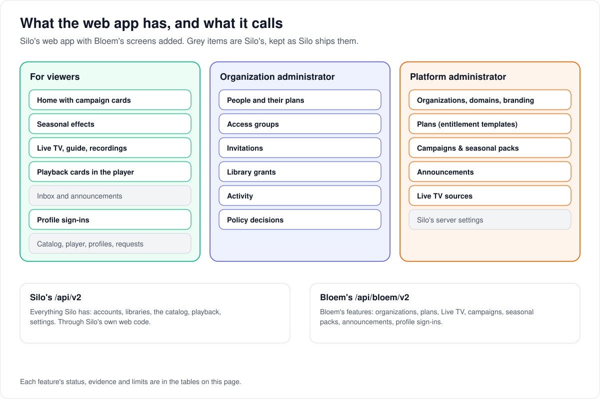

# What the web app covers

The tables, invariants and evidence are in the [For developers](#for-developers)
section.

The web app built into Bloem Server is Silo's web app with Bloem's screens added. This
page walks through what it offers each kind of user, what it talks to, what the status
words in the tables mean, and how far each feature has been tested.

## What is in the web app



- **For viewers:** Home with campaign cards, seasonal effects, Live TV with its guide
  and recordings, playback cards in the player, and Silo's catalog,
  player, profiles, requests and inbox.
- **For an organization administrator:** the organization's people and their plans,
  access groups, invitations, library grants, activity and policy decisions.
- **For a platform administrator:** organizations with their domains and branding,
  plans, campaigns and seasonal packs, announcements, Live TV sources, and Silo's
  server settings.

Bloem keeps Silo's working screens. A Bloem screen replaces one only when Silo's
cannot do the job.

## Three separate kinds of authority

The web app keeps three things apart, and never lets one stand in for another:

1. **The administrative context:** whether someone is acting as a **platform
   administrator** (the whole server) or as an **organization administrator** (one
   organization). The admin console asks which, and switching resets what was on
   screen.
2. **The account sign-in:** the email and password.
3. **The viewing profile:** the person watching, with its PIN.

A household's main profile is not a platform administrator, even on an administrator's
account.

## What the web app talks to

- **Silo's `/api/v2`** for everything Silo has: accounts, libraries, the catalog,
  playback and settings, through Silo's own web code.
- **Bloem's `/api/bloem/v2`** for Bloem's features. Signed-out pages read the seasonal
  packs for everyone from its public `ambience/public` route.

Two sign-in rules show up in the web app:

- **On another organization's domain**, signing in is refused and the sign-in page
  says where to sign in instead ([how apps connect](bloem-apps.md#signing-in-on-an-organizations-own-domain)).
- **A sign-in its organization has since revoked** ends at the next profile request,
  and the web app asks the viewer to sign in again instead of showing a broken Home.

## What the status words mean

- **Present:** the screen and the server routes behind it exist. Not every browser or
  role has been checked.
- **Partial:** it works, but the named piece is missing.
- **Boundary:** the server does not support it, so no button can supply it.
- **Shared:** Silo's own screen, kept; only Bloem's changed meaning is checked.
- **Absent:** Bloem has no version of it.

## Who can change what

| Who | What they use in the web app |
| --- | --- |
| Platform administrator | The Platform context: organizations, domains and branding, plans, campaigns and seasonal packs, announcements, Live TV administration, Silo's server settings. |
| Organization administrator | The Organization context for their own organization: people, access groups, invitations, library grants, activity, policy decisions. |
| An account's main profile | The household's profiles, PINs and profile sign-ins. |
| Viewer | Home, the catalog and player, Live TV (with the permission), the inbox, seasonal effects. |

## Words used in the code

| On this page | In the code |
| --- | --- |
| Administrative context | `AdminContextProvider` (`web/src/contexts/AdminContextProvider.tsx`), `adminV2Client` (`web/src/api/adminV2Client.ts`, prefix `/api/bloem/v2/admin`) |
| Bloem's API from the web app | `nativeApi` and `nativeApiWithProfileRequestContext` (`web/src/api/bloemClient.ts`) |
| Silo's API from the web app | Silo's own web functions (`web/src/api/v2/`) |
| Campaign cards | `BloemHome`, `CampaignPlacements`, `useCampaigns`, `PlaybackEngagement` |
| Seasonal effects | `SeasonalLayer` (`web/src/components/seasonal/SeasonalLayer.tsx`) |
| Campaigns & seasonal packs page | `EngagementPage` (`web/src/pages/admin-platform/EngagementPage.tsx`), route `/admin/platform/engagement` |
| Domains and branding panels | `OrganizationDomainsPanel` on `OrganizationDetailPage` (`web/src/pages/admin-platform/`) |
| Status words | Present, Partial, Boundary, Shared, Absent in the tables below |

## For developers

- **API:** the [API by topic](../bloem/api/README.md), with the
  [native reference](../bloem-api-reference.md) for the older long-form contract.

### Scope and interpretation

This inventory covers the web application embedded in **Bloem Server** (`web/`). The
storefront (Bloem HQ), native-client implementation, billing and a replacement
frontend are outside scope. Retain working Silo screens and APIs; native DTO
availability alone does not justify replacing them.

The tables describe the routes and components in the current source. Mounted routes and
observed behaviour outrank older docs. The "Boundaries / evidence" column records what
browser and test runs showed; it is not a certification of every feature, browser or
role. Silo's Jellyfin and Audiobookshelf compatibility servers run as Silo ships them;
Bloem has no companion enrollment or compatibility gateway (see
[Protocol compatibility](bloem-protocol-compatibility.md)). The web app has no upstream
profile theme editor; Bloem campaign and seasonal presentation is separate.

[README](../../.github/README.md) and the [operator guide](../wiki/admin-guide.md)
provide the product and operational entry points.

- **Present:** routed controls and contracts exist; not every browser or role is
  certified.
- **Partial:** implemented controls coexist with the named missing behaviour.
- **Boundary:** backend or product support is absent; a button cannot supply it.
- **Shared:** retain Silo's implementation and verify changed Bloem semantics.
- **UI / SEAM / API / CORE:** feature-owned frontend, narrow shared integration,
  Bloem-owned contract or adapter, or underlying Silo behaviour respectively.

Administrative context, account login and viewing profile are separate authorities.
A primary household profile is not platform administration. Paths below are relative
to `web/src/` unless prefixed with `internal/` or `cmd/`.

### Validation status

The browser runs behind the evidence column used Chromium against a disposable database
and a loopback server with synthetic library, channel, guide and audit fixtures. They
exercised:

- Fresh setup and account login, and profile-credential save, readback and disable.
- Grant suspension, restoration and withdrawal with confirmation and readback.
- Invitation creation, one-time handoff, link rotation and confirmed revocation.
- Scoped audit delivery, administrative-context switching and narrow audit layout.
- DVR rule create and remove with no channels, guide-to-exact-series creation, manual
  scheduling and readback (including a committed write whose response was lost), and
  narrow DVR layout.
- Campaign and seasonal review, publication and readback, opted-in home delivery and
  seasonal opt-out.
- Upload and delivery of campaign and seasonal artwork through a configured public S3
  store (a local MinIO service), with synthetic PNGs: exact bytes, MIME and dimensions
  on anonymous reads, `304` for matching ETags, `415` for a wrong MIME type, `413` for
  an oversize file and `400` for a mismatched aspect ratio.

Automated checks cover denied and unavailable states, tenant and role fences, stale
authority, nonreplay, conflicts, URL safety, pagination and redaction, and player
admission stability. None of these runs is a substitute for real tuner and media
checks, Safari, prolonged playback, fleet loss, full keyboard usability or every
pending-operation identity-switch journey. No Xtream provider was configured, so V04 and
V05 playback and authenticated Xtream browser acceptance remain open. The S3 runs prove
upload and delivery of synthetic images, not physical media or tuner behaviour, and the
SSRF guard blocks a loopback tuner fixture, so tuner checks need a permitted isolated
network.

### Administration and access

| ID | Feature / role | Reachable surface and coverage | Boundaries / evidence | Ownership |
| --- | --- | --- | --- | --- |
| A01 | Administrative context / administrators | **Present.** `AdminContextProvider` (`contexts/AdminContextProvider.tsx`), context switcher, guarded routes and `adminV2Client`. | Browser switched platform → organization; stale/recreated-context and pending-intent fencing have regression coverage.  A context refused before its first render re-mints or falls back instead of returning to context selection; a component test covers that order. Server side, since Silo #3140 the admin context middleware accepts a token only for a session of the account it names . Full expiry/suspension journey matrix remains broader acceptance work. | Existing UI/SEAM. |
| A02 | Organization lifecycle / platform admin | **Present.** `/admin/platform/organizations` and `/:id`: create, lifecycle, ownership and memberships. The organization page also has Domains and Branding panels (`OrganizationDomainsPanel`), on `/api/bloem/v2/admin/platform/tenants/{id}/domains` and `/branding`. | Retained existing screens. Numeric account selection remains a usability limitation, not a missing management API. Domain rules: [organization domains and branding](bloem-organization-domains.md). | Existing UI; Bloem domain panels. |
| A03 | People and profile assignments / organization admin | **Present.** `/admin/organization/people`: filter, page, inspect, group assignment and durable bulk work. | Retained scoped directory; does not imply unrestricted account administration. | Existing UI. |
| A04 | Access groups / organization admin | **Present.** `/admin/organization/access-groups`, shared-route dispatch and scoped hooks. Outside an organization, access groups use Silo's own `/api/v2` web code. | Default protection and reassignment remain server-owned. Not delegated-role management. | Existing UI/SEAM. |
| A05 | Invitations / organization admin | **Present.** `/admin/organization/invitations`: create, regenerate link, revoke, authoritative readback and one-time handoff. Outside an organization the invitations page shows Silo's invitations screen  on `/api/v2`. | Rebuilt browser create/regenerate/revoke passed (201/201/204), including confirmation before regeneration, context switching and logout/login without restoring the handoff. Cache exclusion is covered by unit tests; creation/renewal handoffs stay out of query and mutation caches and clear with context changes. Native lifecycle is restricted to user invitations, with captured context and organization revision. No email is sent. | UI + scoped API. |
| A06 | Library grants / organization admin | **Present.** `/admin/organization/libraries`: distinguish owned/granted, confirm suspend/restore/withdraw. | Live all three transitions/readback passed. Mutations use the grant's security revision; withdrawal is not reversible here. Does not create new platform grants. | UI, existing API. |
| A07 | Activity/audit / organization admin | **Present.** `/admin/organization/activity`: redacted lifecycle/entitlement summaries and cursor pagination. | Browser read a seeded audit event. Database tests cover tenant isolation, redaction and pagination ties. Only events already recorded by these ledgers appear; not a claim that every operation emits audit data. | UI + scoped API + route/nav SEAM. |
| A08 | Entitlement templates / platform admin | **Present.** `/admin/platform/entitlement-templates`: editor, revisions and lifecycle. | Retained existing structured workflow. | Existing UI. |
| A09 | Effective entitlements / platform admin | **Present.** Direct-account and organization entitlement panels: inspect, dry-run, apply. | Retained revision/preview binding; a successful write is not proof of effective media access. | Existing UI. |
| A10 | Bulk policy/cohorts / administrators | **Present.** Direct-account bulk page, organization People drawer and policy cohorts. | Retained role-bounded jobs, progress and cancellation; backend owns per-target outcomes. | Existing UI. |
| A11 | Authorization explanations / administrators | **Present.** Organization Policy Decisions; platform policy editing, simulation and history. | Organization audit is a separate surface. Organization authority never implies Rego authoring. | Existing UI/SEAM. |

### Viewer identity and Live TV

| ID | Feature / role | Reachable surface and coverage | Boundaries / evidence | Ownership |
| --- | --- | --- | --- | --- |
| V01 | Account/profile/PIN/device sessions / households and viewers | **Shared.** Login, profile picker, settings, activation and device/session pages. | Fresh real-server setup and account login passed after restoring two transactional adapter interfaces. Existing profile/PIN boundaries remain. A sign-in on a domain registered to another organization is refused with `409 wrong_organization_domain` (v2 `conflict`) and the sign-in page shows the detail naming the account's address (`pages/Login.organizationDomain.test.tsx`); a session that predates its organization's revocation is ended with `401 session_invalid` (`session_expired` on `/api/v2`), so the client signs in again. | Existing UI; additive setup adapters. |
| V02 | Direct-profile credentials/sign-in / household manager and viewer | **Partial / Boundary.** Profiles settings now expose credential status, set/rotate and disable with current account password and explicit confirmation. | Rebuilt two-tab acceptance passed: set/rotate 204, stale disable 409, current disable 204; the newer direct session stayed valid after conflict and was revoked after current disable. Writes require the reviewed positive credential revision under the row lock. Direct-profile **browser login is not supported**: its default-deny allowlist does not admit Silo v2. SSO-only reauthentication is absent. | UI + account-scoped API; no allowlist expansion. |
| V03 | Shared-device pairing/delegated admin roles | **Boundary.** Capability booleans remain false. | Account-device activation is not shared-device profile pairing; access groups are not delegated roles. | Backend/product decision. |
| V04 | Live TV guide/watch / permitted viewer | **Present.** `/livetv`, `/watch/live/:channelId`, capability gate, tune/renew/release and HLS player. Operational requests use `/api/bloem/v2/livetv`. | Native-HLS fallback requires browser support and server-issued `st`; account credentials are never placed in stream URLs or forwarded to foreign origins. Actual tuner, Safari and owner-loss playback remain unverified. | Bloem UI + small request-policy SEAM. |
| V05 | Tuner/guide/transcoding administration / acting server administrator | **Present.** `/admin/livetv`: discovery, lineup, sources, recordings and settings, plus encrypted Xtream live-provider setup and provider-bound XMLTV. | Xtream credentials bypass mutation caches; unconfirmed creation requires explicit reload, and removal confirms channel/DVR consequences. Protocol, PostgreSQL, component and fixture-encoder tests do not prove real-provider playback. See [Xtream limits](xtream-live-tv.md). | Existing Bloem UI + owned Xtream adapters. |
| V06 | One-off DVR/recorded playback / permitted viewer | **Partial / Boundary.** Guide and manual channel/time scheduling, status/errors, cancellation, and links when `library_item_id` exists. | Rebuilt browser acceptance passed real scheduling/cancellation and readback, including committed writes with lost responses, failed reads, blocking through explicit reload and a required fresh draft. Both created rows were cancelled; authority stayed unchanged. The recorder does not populate the catalog link: automatic import/playback remains a backend boundary. Completed unlinked rows explain manual library scanning rather than claiming playback readiness. | UI; catalog-import integration remains backend work. |
| V07 | Recurring DVR / permitted viewer | **Present with backend limits.** `/livetv?tab=series-rules`: title/channel/new-only rules, exact guide-series selection, list and confirmed removal; available with zero channels. | Live create/remove and exact-series flow passed. No rule-update API; `keep_last` is stored but not enforced, so no retention control is offered. Removing a rule does not cancel its scheduled recordings or delete files. | Bloem UI, existing native API. |

### Engagement, compatibility and operations

| ID | Feature / role | Reachable surface and coverage | Boundaries / evidence | Ownership |
| --- | --- | --- | --- | --- |
| E01 | Announcements / platform admin | **Present.** Existing announcement targeting, preview, publish and withdraw settings. The page calls `/api/bloem/v2/admin/platform/announcements` and requires the Platform context ([announcements](admin-announcements.md)). | ID-based targets retained; no organization-admin publication authority invented. | Existing UI. |
| E02 | Alerts/announcements / viewer | **Present.** Existing Notifications page and realtime consumer retained. | The Bloem adapter captures and revalidates the original principal and tenant through the shared ticket store; PostgreSQL/race regressions pass. The rebuilt browser received a real v2 socket hello and remained healthy for 18 seconds, beyond periodic authority revalidation, with no relevant HTTP/runtime errors. | Owned adapter + optional shared ticket identity field. |
| E03 | In-playback campaigns / viewer | **Present.** Existing `PlaybackEngagement` in the Silo player. It reads `GET /api/bloem/v2/promotions?surface=in_playback` and saves through `POST /api/bloem/v2/promotions/{id}/save` ([playback cards](playback-overlays.md)). | Retained cadence/control suppression and existing player lifecycle. | Existing UI/player SEAM. |
| E04 | Home/detail/pre-playback campaigns / viewer | **Present.** `BloemHome`, `CampaignPlacements`, item wrapper and pre-playback chrome integration. Cards come from `GET /api/bloem/v2/promotions` (Home with `home_position`) and hiding one writes `PUT /api/bloem/v2/promotions/{id}/dismissals/{surface}`, advertised as `promotions_viewer_v1`. | Live publication → opted-in home delivery passed. Home defaults off; children suppressed; dismissals nonreplayed; immediate Continue remains available and admitted playback stays mounted. Failure/profile-switch behavior has component coverage. | UI + narrow home/detail/player SEAMs. |
| E05 | Campaign authoring / platform admin | **Present.** `/admin/platform/engagement`: typed targets/placements, UTC dates, review, publish/edit/delete and artwork upload. | Rebuilt create/edit/delete and readback passed (201/200/204). Configured public S3 acceptance passed: PNG upload 201, exact bytes/MIME/dimensions, anonymous 200/ETag 304 and decoded Home artwork. Deployment and explicit-profile inclusion/exclusion passed. Native adapter reuses the registry; no revision-locking contract exists and the editor says so. | UI + native authority API + route/nav SEAM. |
| E06 | Seasonal presentation / viewer | **Present.** `SeasonalLayer`: snow, banner/sprite artwork, timing, opt-out, reduced motion and playback suppression. | Rebuilt current-organization delivery returned 200 and public branding excluded the targeted pack; opt-out passed. `seasonal_viewer_v1` identifies mounted authenticated native `/ambience`, which requires a verified current-tenant profile. Single-snapshot filtering excludes other memberships, including concurrent retargeting. Login and fallback stay public-only and read `GET /api/bloem/v2/ambience/public`. Requests and caches bind session/profile/PIN generation. | Bloem UI, existing shell SEAM. |
| E07 | Seasonal authoring / platform admin | **Present.** Engagement page pack editor, schedules, annual repeat when supported and asset upload. | Rebuilt create/edit/delete and readback passed (201/200/204). Configured public S3 banner/sprite uploads, public delivery/cache validation, decoded Home images and organization/public filters passed. MIME, size and declared-dimension rejection passed. Uploads use the catalog Assets store, local or S3 (see [asset storage](bloem-campaign-asset-storage.md)). Registry concurrency remains last-write-wins. | UI + native authority API + route/nav SEAM. |
| E08 | Compatibility applications | **Absent.** Companion enrollment and the protocol gateway are not part of Bloem; Silo's Jellyfin compatibility settings and status are present. | Native audiobook/ebook and device pairing remain separate. | [Protocol compatibility](bloem-protocol-compatibility.md). |
| E09 | Branding/LAN/playback deployment controls / platform admin | **Present.** Build-time identity, Silo's **Show on the local network** toggle (`server.lan_discovery`, which publishes Silo's `_silo._tcp`) and existing Playback controls. Bloem's own `_bloem._tcp` setting, `lan.advertisement_enabled`, has no web control ([LAN service advertisement](../specs/lan-service-advertisement.md)). | Header-authenticated media is not a general multi-replica switch. Deployment prerequisites remain explicit. | Existing settings/branding SEAMs. |
| E10 | Fleet and shared media / viewers/admins | **Shared; acceptance incomplete.** Retain Silo catalog, player, requests, downloads, readers, nodes and plugins. Bloem has no music catalog. | No replacement frontend. A real database/policy regression covers active/suspended/restored/withdrawn grants, campaign delivery and denied-library 404. Rebuilt reads completed all five v2 home sections with 200, including one promoted item. No home blocker was observed in that fixture. Actual media/encoder/fleet acceptance needs appropriate fixtures. | Existing Silo consumers; investigate concrete integration failures separately. |

### Implementation and authority invariants

- Admin drafts, remount keys and mutation snapshots include context generation. A
  stale intent cannot silently acquire replacement or another organization's
  credentials. Confirmations capture applicable revisions. Reload after attempted
  writes; a lost response can conceal a committed mutation. No optimistic destructive
  update.
- Profile-scoped work binds session, profile and PIN generation. Writes are not queued
  offline or automatically replayed after transport or authentication failure. Late
  tune responses still release their original viewer's tuner reservation.
- Native invitation renewal and revocation are filtered by organization and
  `role='user'`. Renewal invalidates the old claim link; neither creation nor renewal
  sends email.
- Audit reads union only the selected organization's `admin_audit_events` and
  `entitlement_audit_events`. No before/after JSON, credential documents or
  unrestricted platform activity is exposed. The fixed page size is 50.
- Direct-profile management reuses household and PIN checks and existing credential
  services. It requires a non-impersonated account login and the current local password
  for writes. Positive `expected_revision` is compared under the profile row lock; a
  conflict preserves newer credentials and sessions. Secrets stay out of query and
  mutation caches and clear after attempts.
- Home promotions are off by default, scoped to browser origin, account and profile.
  Blocked storage permits tab-local choice. Pre-playback is always skippable
  immediately; once admitted, campaigns cannot unmount the player. Artwork and link
  validation rejects credential-bearing or unsafe URLs; local artwork is limited to the
  asset route.
- Events tickets carry a server-owned binding to the original principal and tenant.
  Upgrade and periodic checks revalidate that authority without selecting a new tenant
  or weakening shared expiry, PIN, origin, fingerprint or revocation checks.
- Manual, guide and cancel DVR actions share captured-authority reconciliation. Failed
  readback keeps actions blocked until explicit reload succeeds; background refresh
  does not clear that state. The in-memory QueryClient guard does not promise
  exactly-once execution across reloads, tabs or clients.
- Native Live TV uses an account-owned profile lookup for primary-admin overrides.
  Secondary, child and unknown profiles cannot manage another viewer's recordings.
  Native returned media URLs and stream-token-only HLS delivery have mounted real
  PostgreSQL and fixture-encoder coverage; raw tuner proxy delivery retains normal auth.
- Campaign and season adapters reuse existing registries under native platform
  context, preserving the actor. They do not invent revision locks or organization
  publishing.
- The signed-out seasonal layer fetches `/api/bloem/v2/ambience/public` without
  credentials.
- Setup remains atomic. `cmd/silo/bloem_setup_transaction.go` forwards transactional
  ownership activation; `internal/notifications/bloem_profile_transaction.go` preserves
  transactional profile creation through decoration, failing closed if unavailable.
  Both account transaction entrypoints reject unsupported default-profile providers
  before inserting accounts, provisioning memberships or opening a user store. The
  returned store must still support transactional profile creation. PostgreSQL and its
  notification decorator preserve that support; SQLite creates no files on early
  rejection. Requests that do not create a profile retain their existing behaviour.

### Backend and merge evidence

Bloem-owned implementations:

- `internal/api/handlers/bloem_organization_workflows.go`,
  `internal/invitations/bloem_lifecycle.go`, `internal/tenancy/bloem_audit_read.go`.
- `internal/api/handlers/bloem_profile_credentials.go`,
  `internal/auth/bloem_profile_credential_status.go`,
  `internal/auth/bloem_profile_credential_revision.go`.
- `internal/api/router_bloem_engagement.go` (now only the Home section hook,
  `configureBloemSectionExtensions`), `internal/api/router_bloem_storefront.go` (the platform campaign, seasonal and announcement routes),
  `internal/api/bloem_promotions_viewer.go` and
  `internal/api/handlers/bloem_engagement_context.go`.
- `internal/api/handlers/bloem_events_socket_v2.go`,
  `internal/api/handlers/bloem_seasonal_viewer.go`,
  `internal/api/handlers/bloem_public_ambience.go`, `internal/ambience/bloem_viewer.go`.
- Existing native Live TV mounting: `internal/api/router_bloem_client.go` and
  `internal/api/router_livetv.go`.

Shared seams are recorded in `contracts/seams.txt`: route and navigation registration,
request policy, optional home supplemental rows, pre-playback placement, and the
existing promotion and ambience actor extraction, locked credential revision comparison
and optional server-owned socket identity binding. The two setup fixes are additive
adapters; the shared account provisioner adds the early provider check above. Shared
test seams cover migrated invitation fixtures, platform capability expectations, tenant
reseeding and catalog execution prerequisites. Additive executor helpers, including
lifecycle and local-avatar fixtures, do not modify files present in upstream; their
shared runner hooks are ledgered. Bloem keeps Silo's module path and player.

Native Apple and Android implementation is outside this page. Additive management
tokens and native routes are documented for future clients; existing clients ignore
unknown capabilities. Live TV is not served through Jellyfin. Do not
advertise browser direct-profile sign-in, shared-device pairing or enforced DVR
retention.

### Running the checks

Commands assume the repository root is the cwd:

```sh
make test-web
(cd web && pnpm exec tsc --noEmit && pnpm run build)
GOMAXPROCS=2 go test -race -p 2 ./internal/invitations ./internal/tenancy
GOMAXPROCS=2 go test -race -p 2 ./cmd/silo ./internal/notifications -run 'TestBloem.*(Setup|Notification)'
bash scripts/verify-seams.sh
git diff --check
```

Database tests need the documented disposable test database environment. Keep
credentials, generated browser states, screenshots and local fixture scripts out of git.

### Related authorities

- [Fork provenance and merge policy](../../FORK.md)
- [Native API reference](../bloem-api-reference.md)
- [Security foundation](bloem-security-foundation.md)
- [Multitenant administration](multitenant-administration.md)
- [Live TV client access](live-tv-client-access.md)
- [Cluster media ownership](bloem-cluster-media.md)
- [Playback cards](playback-overlays.md)
- [Seasonal scheduling](seasonal-scheduling.md)
- [Organization domains and branding](bloem-organization-domains.md)
- [Protocol compatibility](bloem-protocol-compatibility.md)

The picture is an SVG file under `images/bloem-web-feature-coverage/`, drawn by
`scripts/bloem/pictures/bloem_web_feature_coverage.py` through
`scripts/bloem/draw-pictures.py`. Redraw it there, not by hand.
