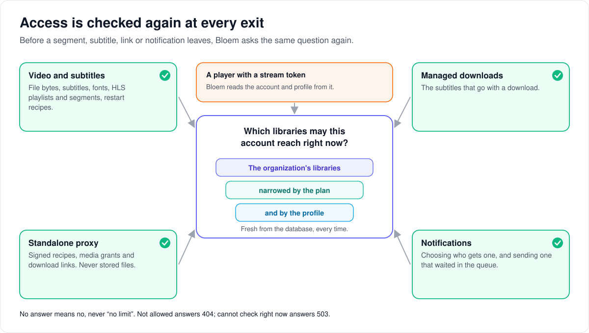

# How access is checked as content leaves the server

> **Provenance and status.** Bloem page, rewritten on 2026-11-01 and checked against
> `main` at `b6039036d`. Delivery boundary enforcement is a Bloem addition: Silo has
> no organizations, no standalone-proxy source recheck and no notification
> delivery check. The checks live in Bloem-owned files; their call sites in Silo
> files are recorded seams. The technical rules are in the
> [For developers](#for-developers) section.

Bloem decides what someone may watch when they browse and press play (see
[how organizations work](bloem-organizations.md#what-happens-when-someone-presses-play)).
But content keeps leaving the server long after that: a video segment twenty
minutes into a film, a subtitle, a download link, a notification sent later. This
page explains how Bloem checks access again at each of those exits, what the
answers mean, and what is not covered yet.

## One question, asked fresh each time

Every exit asks the same question: **which libraries may this account reach right
now?** The answer is the organization's libraries, narrowed by the plan and the
profile. It can only ever narrow; nothing widens it.

Bloem works the answer out from the database for every request. It never trusts
a copy carried inside a token or a signed link, because that copy would keep
working after access was withdrawn, until it expired. So when an organization
loses a library, or an account loses access, the next segment, subtitle or
notification is refused.

## The exits Bloem checks

1. **Video from the server.** File bytes, subtitles, subtitle fonts, HLS playlists
   and segments, and restart recipes.
2. **Managed downloads.** The subtitles that go with a download.
3. **The standalone proxy.** Its signed recipes, media grants and download links.
   It also never serves files from storage sources, because it can only read
   files on disk.
4. **Notifications.** When Bloem chooses who gets one, and again when it sends one
   that was waiting in the queue.

A player that replays a stream address cannot add a sign-in header, so the
address carries a short-lived **stream token**. Bloem works out the account and
profile from that token and asks the same question. A missing answer means
"no", never "no limit".

## What the answers mean

| What happened | The answer |
| --- | --- |
| The account may not reach this file, or it does not exist | `404`: Bloem never confirms that something exists |
| Bloem cannot check right now | `503`: try again |
| The sign-in started before the organization took the account away | `401 session_invalid`: the session is ended and the app asks to sign in again |

## A domain decides presentation, never access

An organization can be served on its own domains, with its own name and logo; see
[organization domains](bloem-organization-domains.md). The domain a request
arrives on never changes these checks: the organization always comes from the
account, so a viewer reaches the same libraries whichever address they use.

## What is not covered yet

- **The viewer's own inbox.** An old notification about a title the viewer can no
  longer reach still shows in their inbox, with its title.
- **Bytes already on their way.** A check stops the next request, not a response
  already streaming.
- **Shared downloads.** A download prepared for several people is not cancelled
  when one of them loses access; only fetching it is checked.
- **Cost.** Each standalone-proxy request, including every HLS segment, costs
  several quick database lookups.

## Words used in the code

| On this page | In the code and database |
| --- | --- |
| Which libraries may this account reach | `access.Scope.AllowedLibraryIDs`, already bounded by the organization |
| The organization's libraries | `TenantLibraryResolver.AvailableMediaFolderIDs`; `tenant_bounded_libraries` in `internal/policy/vendor/scope.rego` |
| Video exits | `internal/api/handlers/playback_library_access.go` |
| Managed downloads | `internal/downloads/offline.go` |
| Standalone proxy check | `SourceAccess` (`internal/proxy/source_access.go`), implemented by `proxySourceAccess` in `cmd/silo/bloem_main.go` |
| Notification check | `deliveryAccessPredicate` (`internal/notifications/delivery_access.go`) |
| Stream token | the `?st=` query credential |

## For developers

- **API:** these checks add no route; they guard Silo's playback, stream, download
  and notification routes and the standalone proxy.

### The existing ceiling (not built by this work)

The organization ceiling already existed before this change. `ViewerResolver`
loads the tenant's available media folders and the policy engine intersects
them into every resolved scope:

- `internal/policy/bloem_viewer_resolver.go` declares `TenantLibraryResolver`
  (`AvailableMediaFolderIDs`). `ResolveFacts` in Silo's
  `internal/policy/viewer_resolver.go` calls it through
  `resolveTenantLibraryIDs` to get `tenantLibraryIDs` before the PDP (the policy
  decision point, which runs the OPA policy) runs.
- `tenant_bounded_libraries` in `internal/policy/vendor/scope.rego`
  returns the tenant's own library set unmodified when the account is
  unrestricted, and `intersect(tenant_library_ids(i),
  effective.allowed_library_ids)` otherwise.
- Paths that cannot read a tenant off the request get the same ceiling through
  `policy.TenantViewerResolver` (`internal/policy/tenant_viewer_resolver.go`),
  which resolves the subject's tenant itself. `newTenantAwareViewerResolver` in
  `cmd/silo/bloem_main.go` builds it for background callers, and
  `wireBloemViewerTokenResolver` in `internal/api/router_bloem_wiring.go`
  installs it for stream-token requests.

The consequence is what makes the rest of this document possible:
`access.Scope.AllowedLibraryIDs` is already tenant-bounded everywhere it is
read. A delivery guard that rechecks library membership against that scope
is, by construction, also rechecking the tenant. Nothing added here needed
to re-derive organization membership; it only needed to make sure the scope
was actually being consulted at each delivery point. The tenant ceiling is
described in [OPA tenant authorization](opa-tenant-authorization.md).

### What this work added

Six paths never consulted the resolved scope at all. Each now rechecks
library membership immediately before serving:

- Native media delivery: file bytes, subtitles, subtitle fonts, HLS
  manifests and segments, and signed restart recipes
  (`internal/api/handlers/playback.go`, `internal/api/handlers/stream.go`,
  `internal/api/handlers/playback_library_access.go`).
- Managed-download subtitles (`internal/downloads/offline.go`).
- The standalone proxy's signed recipes, media grants, and download URLs
  (`internal/proxy/source_access.go`, wired from `cmd/silo/main.go`).
- Notification fanout and queued delivery re-reads
  (`internal/notifications/delivery_access.go`).

The delivery guard also had to be connected to a real scope on the one
request shape that skipped viewer-access resolution entirely: a bearer-less
`?st=` stream-token request (how a native player replays a `stream_url`,
since it cannot attach an `Authorization` header). Before this change,
`RequireViewerAccess` skipped on that path and `AccessFilterFromContext`
fell back to a zero-value filter, which the guard read as "no library
restriction": revoking a library entitlement did not stop delivery.
`requireStreamTokenViewerAccess` in `internal/api/middleware/viewer_access.go`
now resolves a real, organization-bounded scope from the token's own `uid`/`pid`
(lookup keys only, re-verified against live policy) instead of skipping.

### Seams

The checks live in Bloem-owned files (`playback_library_access.go`,
`internal/proxy/source_access.go`, `internal/notifications/delivery_access.go`,
`internal/catalog/bloem_access_filter.go`, `internal/policy/bloem_viewer_resolver.go`,
`internal/policy/tenant_viewer_resolver.go`). The Silo files that call them or
carry the ceiling are recorded seams in `contracts/seams.txt` (304 entries on
2026-11-01):
`internal/api/handlers/playback.go`, `internal/api/handlers/stream.go`,
`internal/downloads/offline.go`, `internal/api/middleware/viewer_access.go`,
`internal/policy/viewer_resolver.go`, `internal/policy/vendor/scope.rego`,
`internal/proxy/server.go`, `internal/notifications/delivery_repo.go` and
`cmd/silo/main.go`. Earlier versions of this page cited exact line numbers, which
later Silo merges invalidated; the references here name files and symbols instead.

The queued-delivery recheck fails closed, so a Silo test that sends a queued
notification finds no delivery row unless its recipient is a profile in an active
organization. Such a test keeps its assertions and gets the recipient from a Bloem
fixture called by one added line, a recorded test seam:
`internal/notifications/push_test_send_db_test.go` seeds real tenant profiles
(`bloem_push_test_fixture_test.go`), and
`internal/notifications/webpush_login_session_db_test.go`, whose tests run on a
private schema, gets schema-local `organizations` and `user_profiles` tables with
one active organization (`seedSchemaTenantProfiles` in
`bloem_schema_tenant_fixture_test.go`, added with the Silo merge through
`fcd546a04`). Never loosen the predicate for a test.

### Invariants

These are rules a future change must not break.

- **Library authority is read from PostgreSQL on every request, never
  cached as a token claim.** Grant mutations advance the organization's
  access revision; a delivery guard that trusted a claim instead of a fresh
  resolution would keep serving a revoked entitlement until the token
  expired.
- **The ceiling never widens a policy result; it only intersects.**
  `tenant_bounded_libraries` in `internal/policy/vendor/scope.rego` intersects,
  never unions, the tenant set with the effective policy result.
- **A delivery guard rechecks library membership only.** Quality selection
  stays at admission: a lower-resolution transcode must never be rejected
  because its source is higher resolution.
  `FileAllowedByLibraryScope` (in the Bloem-owned
  `internal/catalog/bloem_access_filter.go`) takes a file and two library-ID
  sets, no quality parameter, by design; see the reasoning recorded in
  `fileAllowedByViewerScope` in `internal/api/handlers/playback_library_access.go`.
- **Absence of a resolved scope means deny, not "unrestricted."** This is
  load-bearing: `RequireAuth`, `RequireViewerAccess`, and `TenantMiddleware`
  all return early for stream-token-authorized requests, so
  `internal/api/middleware/viewer_access.go` is what resolves the scope from
  the token's own claims on that path, and every guard in
  `internal/api/handlers/playback_library_access.go` calls `access.GetScope`
  directly and fails closed when `ok` is false, rather than trusting
  `AccessFilterFromContext`'s zero-value fallback alone.
- **An inaccessible source answers 404 and never confirms existence; an
  authority that cannot be consulted answers 503.**
  `ErrSourceHidden` in `internal/proxy/source_access.go` documents and
  `checkSourceAccess` in the same file implements
  this: `ErrSourceHidden` maps to 404, everything else, including a nil
  `SourceAccess`, maps to 503, matching the existing nil-grants/
  nil-loginSessions convention in `internal/proxy/server.go`.
- **The proxy checks ownership through an injected interface because it has
  no database and no resolved viewer scope.**
  `internal/proxy/source_access.go` defines `SourceAccess` as an
  interface in the same shape as `proxyGrantLookup`/`loginSessionValidator`;
  the concrete, DB-backed implementation is `proxySourceAccess` in
  `cmd/silo/bloem_main.go` (built where the pool this process opened already
  exists, by `newProxySourceAccess`), composing
  `tenancy.SubjectResolver` and `resourcetenancy.Store`. `internal/proxy` must
  not import `internal/tenancy` or `internal/resourcetenancy` directly. The
  same check also hides files in
  [native storage](bloem-native-storage.md) locations from the proxy
  (`storagesource.IsNativeLocation`), because the proxy reads only local paths.
- **The proxy resolves the account's own organization.** Proxy artifacts
  (signed recipes, grants, download URLs) name an account but carry no
  organization claim, so `proxySourceAccess.AllowMediaSource` resolves the
  account as a profile-less subject (`SubjectResolver.ResolveSubjectTenant`
  with no profile): through the organization its active membership is in, or
  the deployment's default organization for an account with no membership.
  Until `a6d342390` (2026-10-27) it always resolved the default organization.
  That was enough while an account could belong to several organizations, but
  since `c60b7008e` (2026-10-26) each account has exactly one membership, so a
  member of a hosted organization got `404` for every source in its own
  libraries. `TestProxySourceAccessResolvesTheAccountsOwnOrganization`
  (`cmd/silo/bloem_proxy_source_access_test.go`) covers both organizations,
  cross-organization reads, a suspended member and an account without a
  membership.
- **Per-request rechecking is deliberate.** Checking only at manifest-fetch
  time would leave HLS segments unguarded until the next manifest reload;
  every account-scoped media route in the proxy (direct play, remux,
  transcode manifest, transcode segment, subtitles, download) calls
  `checkSourceAccess` independently.
- **Delivery-type eligibility is an explicit allowlist, not a negated
  exception, so a new type must classify itself.**
  `accountLevelDeliveryTypes` in `internal/notifications/delivery_access.go`
  replaced a fallback that excluded only
  `request.fulfilled` by name: a new delivery type with no library and no
  item identity used to inherit eligibility silently.
  `TestEveryDeliveryTypeConstantIsClassified`
  (`internal/notifications/delivery_type_classification_test.go`) parses every
  top-level `DeliveryType*` constant in the package's non-test files (four
  files declare them today: `alert_body.go`, `release_types.go`,
  `request_notifier.go` and `webhook_types.go`) and fails by name if a constant
  is missing from either `accountLevelDeliveryTypes` or the test's own
  `notAccountLevelDeliveryTypes` set. The account-level types today are
  `request.approved`, `request.declined`, `webhook.auto_disabled`,
  `system.alert` and `system.announcement`.

### Sessions revoked by an organization and domains

When viewer-access resolution finds that an account-login session started before
its profile's organization revoked the account, `RequireViewerAccess` ends that
session and answers `401 session_invalid` (`session_expired` on `/api/v2`)
through `refuseSessionRevokedByOrganization`
(`internal/api/middleware/bloem_viewer_session.go`; the resolver side is
`internal/api/bloem_org_session_revocation.go`). The session's refresh is then
refused as revoked, which is the answer clients sign out on, instead of every
profile request answering 404. `ErrSessionRevokedByOrganization` still wraps
`access.ErrProfileNotFound` for callers outside the gate. See
[security foundation](bloem-security-foundation.md).

An organization's domains (`internal/orgdomains`, migration
`20261101055208_bloem_organization_domains.sql`) choose branding and link
addresses only. The tenant middleware takes the organization from the account or
the session whatever host the request arrived on, so every check on this page is
unchanged by the domain. See [organization domains](bloem-organization-domains.md).

### Explicitly not covered

- **Client-facing inbox reads are not bounded.** `GetByID`, `ListInbox`,
  `ListSync`, `RecentUnread`, `UnreadCount`, and `GetRowsByIDs` in
  `internal/notifications` (`delivery_repo.go`, `bloem_delivery_repo.go`)
  carry no ownership predicate. A revoked-access
  row still appears in that viewer's own inbox and can expose the title and
  metadata of an item they can no longer reach.
- **Interest rows are not invalidated when an entitlement is revoked.**
  `internal/resourcetenancy` bumps `security_revision` on a grant change;
  `internal/notifications` never reads that revision. Stale
  `profile_series_interest` rows are excluded at read time by
  `deliveryAccessPredicate`, but they are never cleaned up; they persist
  indefinitely as dead rows.
- **The proxy guard costs multiple indexed Postgres round-trips per
  request**: a file lookup, the account's organization, a tenant
  resolution, and a resource-access check
  (`proxySourceAccess.AllowMediaSource`), repeated per HLS segment, since
  per-request rechecking is deliberate (see Invariants). The correct
  mitigation is a cache keyed on the organization's access revision,
  invalidated when it advances, not a time-based TTL: a TTL would
  reintroduce the stale-authority window this design rejects.
- **Rule 3's `episode_id`-only branch resolves at series granularity, not
  episode granularity.** It resolves episode→series and checks
  `media_item_libraries` rather than `episode_libraries`, which can
  diverge. This is unreachable today because no writer sets `episode_id`
  without also setting `series_id`; the assumption is called out in the
  code but not enforced.
- **Revalidation on long-lived sockets is periodic, not cancellation.** It
  cannot interrupt a response already in flight: a revoked entitlement
  stops the *next* request, not bytes already streaming.
- **Download artifacts are shared preparation jobs, not per-account
  permissions.** Revoking one account's access must not cancel an artifact
  another authorized account still needs; this work rechecks who may fetch
  an artifact, not who may keep it queued for preparation.
- **Restored-backup delivery-revocation acceptance remains open.** The revocation
  and revision-bump behavior described above has not been exercised against
  a database restored from a backup. The separate
  [September 19 policy-array/Xtream migration rehearsal](../operations/2026-09-19-xtream-deployment.md#database-and-recovery-evidence)
  checked schema and data preservation, not these delivery-revocation semantics.

### History

Bloem added the delivery rechecks on 2026-09-12: `017938946` (handlers),
`b643a84e9` (standalone proxy), `3c0305b73` and `b4ae360f4` (notifications), and
this page (`e6eba2ac4`). Since `c60b7008e` (2026-10-26) an account belongs to
exactly one organization, and `a6d342390` (2026-10-27) made the proxy resolve the
account's own organization. `25129bcbd` (2026-11-01) ends a session its
organization revoked with `401`.

### Related pages

- [OPA tenant authorization](opa-tenant-authorization.md): tenant facts, the policy
  engine and SQL scope.
- [How organizations work](bloem-organizations.md) and
  [multitenant administration](multitenant-administration.md).
- [Organization domains](bloem-organization-domains.md).
- [Native storage](bloem-native-storage.md) and
  [native video playback](bloem-native-video-playback.md).

The picture is an SVG file under `images/delivery-boundary-enforcement/`, drawn by
`scripts/bloem/draw-pictures.py`. Redraw it there, not by hand.
