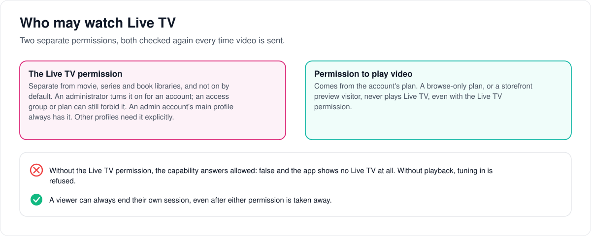
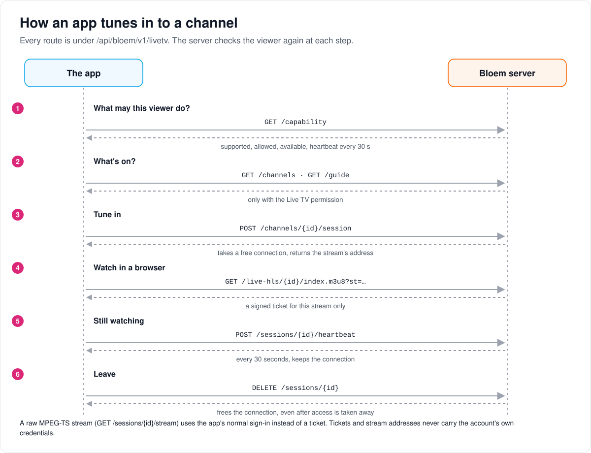

# How apps reach Live TV

> **Provenance and status.** Bloem page, rewritten on 2026-11-01 and checked against
> `main` at `b6039036d`. Silo has no Live TV. Bloem's tuner, guide and recording code
> is adapted from Prairie Server; the access rules on this page are Bloem's own. Every
> route, field, error code and invariant is in the [For developers](#for-developers)
> section.

Live TV is only in the web app and Bloem's own apps. This page walks through who may
watch, how an app finds out what it may show, how it tunes in to a channel and lets go
again, and how recordings are asked for from the web app.

## Who may watch

Watching Live TV takes two **permissions**, and Bloem checks both again every time it
sends video:

1. **The Live TV permission.** It is separate from movie, series and book libraries,
   and ordinary accounts don't have it until an administrator turns it on. An
   **access group** or a **plan** can still forbid it. An admin account's main profile
   always has it; other profiles need it explicitly.
2. **Permission to play video.** This comes from the account's plan. A browse-only plan,
   or a storefront preview visitor, never plays Live TV.

Without the Live TV permission the app shows no Live TV at all. A viewer can always end
their own session, even after a permission is taken away, so the connection is freed.

## How an app tunes in

1. **Ask what's allowed.** The app asks the server whether it supports Live TV, whether
   this viewer may watch, and whether any channel is switched on.
2. **List channels and the guide.**
3. **Tune in.** The server takes a free connection on the channel's source and starts a
   **session**, one viewer watching one channel.
4. **Fetch the stream.** In a browser, the stream address carries a signed **ticket**
   that is good for that one stream only. It never carries the account's own sign-in.
5. **Check in every 30 seconds,** to keep the connection.
6. **Leave.** Leaving the channel, closing the page or losing access releases the
   session, and the connection is free for someone else.

The app never tunes in again by itself after an error. A late answer to a tune request
is released even if the viewer has already left.

## Recordings from the web app

A viewer with the Live TV permission can record a channel between two times, or set up
a **recording rule** that records every programme whose title matches, optionally on one
channel or only new episodes, or one series from the guide. Removing a rule doesn't
cancel what it already scheduled.

A finished recording appears in the catalog only after an administrator adds the
recordings folder to a library and scans it.

## Who can change what

| Who | What they manage |
| --- | --- |
| Platform administrator, with the main profile selected and any PIN entered | Tuners, Xtream providers, channels and guides. Who has the Live TV permission. |
| An admin account's main profile | Other viewers' Live TV sessions and recordings in the household. |
| Viewer with the Live TV permission | Watching, and their own recordings and recording rules. |
| An app holding a stream ticket | Only the stream it was given: no browsing, tuning, recording or checking in. |

## Words used in the code

| On this page | In the code |
| --- | --- |
| Live TV permission | `watch_live_tv` (`internal/permissioncatalog`), resolved as `LiveTVAllowed` (`access.LiveTVAllowed`) |
| Permission to play video | `PlaybackAllowed` on the viewer's scope |
| Ask what's allowed | `GET /api/bloem/v1/livetv/capability`, advertised as `live_tv_access_v1` |
| Session | a Live TV session, `POST /api/bloem/v1/livetv/channels/{channelId}/session` |
| Ticket | the signed `st` query parameter, purpose `bloem_livetv_hls` |
| Recording, recording rule | DVR entries (`/recordings`) and series rules (`/series-rules`) |
| The routes | `mountLiveTVRoutes` in `internal/api/router_livetv.go` |

## For developers

- **API:** [Live TV](../bloem/api/live-tv.md): every route under
  `/api/bloem/v1/livetv`, with its credentials, fields and error codes.

History: Bloem's Live TV, OTA tuner, guide and DVR subsystem is adapted from Prairie
Server (`ef2d38171`, 2026-08-13; see [FORK.md](../../FORK.md#prairie-server-live-tv)).
The access contract on this page is Bloem's own: the `watch_live_tv` permission
(`internal/permissioncatalog`), `access.LiveTVAllowed`, the capability route and the
native `/api/bloem/v1/livetv` mount (`internal/api/router_livetv.go`, mounted from
`internal/api/router_bloem_client.go`). The contract was added in `8c612bd96`,
`31b857b2b` and `fdb002310` (all 2026-09-05). The web workflows came in `53534d9f0`
(2026-09-18) and the Xtream capability bit in `23ee4c1ac` (2026-09-19). Since
`61fc3cfd5` (2026-10-13), delivery requires the playback grant as well, and a
browse-only preview scope clears both grants (see
[browse-only content policy](bloem-browse-only-content-policy.md)). Bloem's Live TV on
the Jellyfin surface was removed on 2026-10-13
([protocol compatibility](bloem-compatibility-removal.md)).

### The permission

The separate `watch_live_tv` permission controls the Bloem app-facing Live TV surface.
It is not included in default user permissions and does not depend on movie, series or
book library grants. Admin account creation/editing exposes the grant; access groups
and entitlement templates expose the existing permission mask. A group mask permits or
restricts an account grant, rather than granting permissions by itself.

Both viewer resolvers derive `LiveTVAllowed` from the effective permission set. The
primary profile of an admin account has an implicit grant; other household profiles
need an explicit effective grant. Existing account/group persistence and revision
invalidation apply without a schema migration.

### Capability

`live_tv_access_v1` in the native capability document identifies this contract. An
authenticated, selected profile can request `GET /api/bloem/v1/livetv/capability`:

- `supported`: the server implements this contract.
- `xtream_supported`: this build supports authenticated Xtream live providers; absent
  on older builds. This does not replace the viewer grant or prove provider readiness.
- `allowed`: the current viewer has the separate Live TV grant.
- `available`: the viewer is allowed and at least one channel is enabled.
- `heartbeat_interval_seconds`: 30.

The response is not cacheable. A database failure is an error rather than a false
empty state; denied viewers do not trigger a channel lookup. Native clients should
distinguish denial, unsupported servers and network errors.

### Routes and their gates

Channel, guide, session, DVR and tuner-administration endpoints are mounted under
`/api/bloem/v1/livetv`, not `/api/v1/livetv` or Silo's `/api/v2`. The embedded web uses
this native prefix for reads, mutations, lease renewal and teardown. The app-facing
route group enforces the grant: without it, `RequireLiveTVAccess` answers
`403 live_tv_forbidden`. Delivery routes (`/sessions/{sessionId}/stream` and
`/live-hls/{playbackId}/{name}`) use `RequireLiveTVStreamAccess`, which also requires
playback (`403 playback_forbidden`); starting a channel session checks playback too, and
answers `503 unavailable` when the native delivery signing secret is missing. Session
start, stream, HLS, heartbeat, release, scheduling and rule changes also require a
selected profile (`requireBloemLiveTVProfile`). Owned session release
(`DELETE /sessions/{sessionId}`) remains available after revocation so the viewer can
free a tuner. Tuner, guide-source and channel administration sit behind the
acting-administrator gate.

The native constructor returns native media URLs and supplies the signing secret. Only
`GET /api/bloem/v1/livetv/live-hls/{id}/index.m3u8` and its segment paths accept
headerless `st` delivery, with the signed `bloem_livetv_hls` purpose, delivery ID, expiry
and freshly resolved tenant/profile grant. The raw MPEG-TS proxy retains normal
account/profile authentication. Tokens cannot authorize operational routes or broaden
direct-profile admission. The native household checker reads the authoritative profile
store before allowing a primary admin to manage another viewer's sessions or DVR
entries.

Session-bound signed delivery credentials retain their existing lifetime and ownership
semantics. They authorize only the existing delivery, never channel browsing, new
tuning, recording or session heartbeat. This change does not provide immediate
revocation of bytes already authorized by a signed session.

The DTO registry includes named channel/guide/session/DVR envelopes and request models.
Channel DTOs use the actual redacted response projection: `stream_url` is empty, never
the private tuner address. Do not bypass this projection when adding a new channel
response.

A sign-in that started before its organization revoked the account is ended with
`401 session_invalid` (`session_expired` on `/api/v2`) by the viewer-access gate, so a Live TV
client signs in again rather than treating its profile as missing
([security foundation](bloem-security-foundation.md)).

### Xtream providers

The Tuners tab supports encrypted, live-only Xtream provider accounts; the Guide tab can
attach their bounded XMLTV feed. The dedicated native creation endpoint, shared
physical-connection limits, pipe-only encoder input, destructive removal semantics and
deployment prerequisites are documented in [Xtream live TV providers](xtream-live-tv.md).
Creation requires an authenticated administrator with the account's selected primary
profile and any required PIN proof; account-only administration without a selected
profile does not suffice. Support advertisement is not encryption readiness or
successful provider authentication. [Operator setup](../wiki/admin-guide.md#210-live-tv)
uses the embedded web; sibling native-client provider administration is not
implemented.

### Integration status

Native Live TV uses freshly resolved account/profile authority. Live TV is not served
through Silo's Jellyfin-compatible server; Bloem's former compatibility streams and
gateway are removed, and their former tests do not establish native coverage. See
[protocol compatibility](bloem-compatibility-removal.md). Native delivery still requires
both effective Live TV and playback permission, including after revocation.

The web viewer consumes the native capability for its sidebar and guide/watch route
gates. Profile-bound requests discard late results after a profile switch. The live
watch route (`web/src/pages/LiveTVWatch.tsx`) negotiates browser codecs, renews the tuner
lease, and releases it on navigation, page teardown, lost access or fatal playback
errors. Tune requests are never automatically retried; late tune responses are released
even if the viewer has already left. The existing browser Live TV player is used. The
native-HLS fallback requires browser HLS support and a server-issued `st` stream ticket.
Account/profile credentials are never placed in media URLs, and HLS requests cannot
forward authorization to a foreign origin. Native fallback has automated coverage but
still needs real Safari/device playback acceptance.

The web exposes manual channel/time recordings and recurring rules (title substring,
channel/new-only filters, or an exact guide `series_id`). Mutations capture profile
authority, are not queued offline or replayed after uncertain failure, and await
authority-bound readback after success or uncertain failure before another action.
Manual drafts retain their original captured authority. Failed recording readback keeps
manual, guide and cancel actions blocked until an explicit Reload recordings action
succeeds, including active filtered lists; background refresh alone cannot clear the
block. Older list reads are cancelled so they cannot replace the reconciled result.
Recovery does not resend the write. The guard lives in the current QueryClient, so it
does not provide exactly-once execution across reloads, tabs or other clients. Rebuilt
browser acceptance passed real disposable scheduling and cancellation with readback,
including committed writes whose browser responses were dropped. Nine deliberately
injected GET `503`s verified that failed reads and failed explicit reload kept actions
blocked; successful explicit reload cleared the block and required a fresh manual
draft. The run observed two POSTs and two DELETEs, cancelled both created rows,
preserved captured authority and reported no browser runtime errors. This validates
reconciliation against the real backend, not exactly-once execution or actual tuner,
recording or Safari playback.

Rule removal requires confirmation; it does not cancel existing scheduled recordings.
There is no rule-update operation, and stored `keep_last` does not enforce retention.
Completed recordings link to their library item only when `library_item_id` is present.
The recorder does not automatically import recordings or populate that link; the UI
explains that an administrator must scan a recording folder through a library.

Server-owned Kotlin/Swift bindings include additive optional/default-false
`xtream_supported`; sibling v3 client integration remains separate work. Native
session/DVR ownership overrides require the primary admin profile; child, unknown and
unresolvable profiles keep owner-only access. The
[September 19 deployment](../operations/2026-09-19-xtream-deployment.md) passed
health/readiness and login smoke checks, not real-provider or device playback
acceptance.

Normal URL validation and dial-time SSRF guards reject loopback tuner destinations. Use
a permitted isolated network for media acceptance; never disable those guards to make a
local fixture pass. An offline transport-stream decode does not prove server-mediated
playback. Actual tuner, Safari, prolonged playback and multi-replica owner-loss checks
remain in the [completion handoff](bloem-web-completion-handoff.md).

### Related pages

- [How Live TV works](bloem-live-tv.md): sources, tuning in and recordings, in plain
  language.
- [Xtream live TV providers](xtream-live-tv.md): encrypted provider accounts,
  connection limits and guide limits.
- [Live TV tuner discovery](../livetv-tuner-discovery.md): finding HDHomeRun and
  Dispatcharr tuners.
- [Media ownership across API replicas](bloem-cluster-media.md): which server owns a
  Live TV session.
- [Security foundation](bloem-security-foundation.md#native-live-tv-and-xtream-authority):
  Live TV and Xtream authority.

The pictures are SVG files under `images/live-tv-client-access/`, drawn by
`scripts/bloem/draw-pictures.py`. Redraw them there, not by hand.
