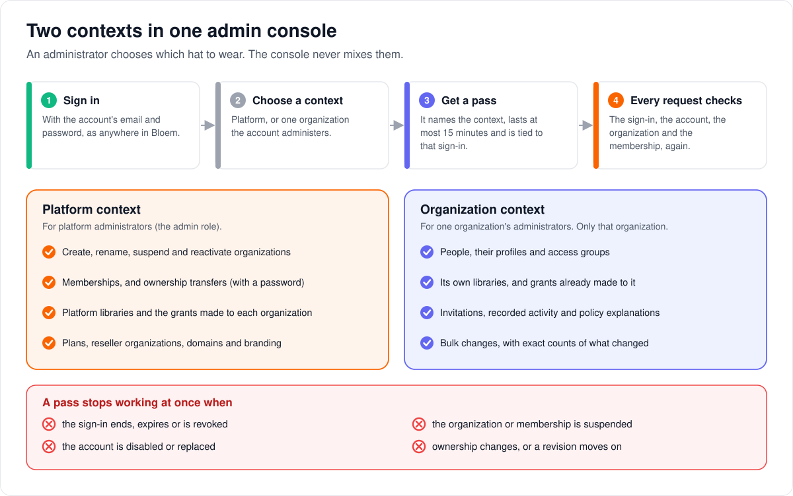
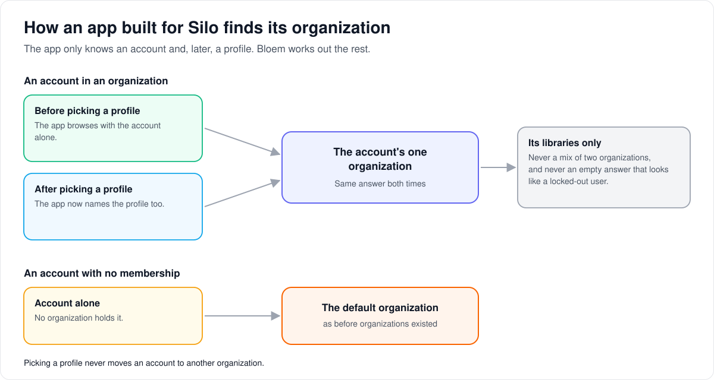
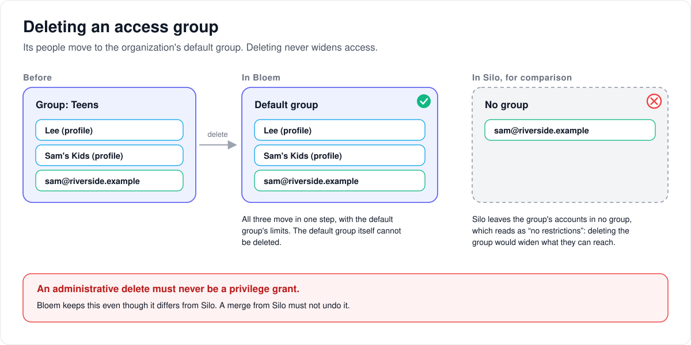

# How multitenant administration works

> **Provenance and status.** Bloem page, rewritten on 2026-11-01, updated on 2026-11-05
> and checked against `main` at `747960b29`. Multitenant administration is a Bloem addition: Silo has one
> set of accounts per server and one kind of administrator. This page explains it in
> plain language; the technical rules are in the [For developers](#for-developers)
> section.
> Its routes were checked again on 2026-11-11, after Silo retired its v1 API.

Bloem's admin console serves two kinds of administrator, one who runs the whole
platform and one who runs a single organization. This page walks through the two
contexts the console works in, how a context is opened and checked, what an
organization administrator can do, how apps built for Silo find their organization,
and why deleting an access group never widens anyone's access. For the tiers
themselves, read [How organizations work](bloem-organizations.md) first.

## Two contexts

The console always works in exactly one **context**:

- **The Platform context** manages every organization and the platform itself. Only
  a **platform administrator**, an account with the `admin` role, can open it.
- **An Organization context** manages one organization's people, profiles, groups,
  libraries and invitations, and nothing else. An **organization administrator**
  opens it through their membership in that organization.

The console asks which context you are acting in and never mixes them. Its menus,
lists and searches show only that context's data.

## Opening a context

1. **Sign in** with the account's email and password, as anywhere in Bloem.
2. **Choose a context:** Platform, or the organization the account administers.
3. **Get a pass.** Bloem gives the console a short-lived pass for that context. It
   lasts at most 15 minutes and is tied to the sign-in it came from, so an API key,
   which has no sign-in, cannot open one.
4. **Every request checks again.** Bloem looks at the sign-in, the account, the
   organization and the membership each time, not only when the pass was made.

A pass stops working at once when the sign-in ends, expires or is revoked, when the
organization or the membership is suspended, when the account is disabled or
replaced, when ownership changes, or when the organization's settings move on. The
context then has to be opened again.

The web app keeps the pass in memory only and remembers just which context was
chosen. When you switch context, it forgets the old context's data before showing
the new one.

A sign-in that started before its organization revoked the account can no longer
reach any of the account's profiles. Bloem ends that sign-in, and the app asks the
person to sign in again.

## What an organization administrator can do

There is one organization administrator role. Within their own organization, they
can:

- **People:** find people with filters, page through them, select a set and change
  it in bulk. Bulk changes report exactly what changed, what was skipped and what
  failed. A confirmation names the organization and how many people it affects.
- **Profiles and access groups:** move a profile to another group, and create,
  change and delete groups.
- **Library grants:** suspend, restore or withdraw a library the platform granted.
  Withdrawing cannot be undone from the console, and it cannot add new grants.
- **Invitations:** create an invitation, make a new link for one that is pending or
  expired, or revoke it. The console shows the link once, for the administrator to
  pass on; it sends no email.
- **Activity:** page through the organization's recorded changes, 50 at a time.
  Only recorded events appear, without the full before-and-after details.
- **Policy explanations:** see why a person could or could not reach something.

An organization administrator never writes policy code, and cannot reach another
organization or anything platform-wide. What a person can watch is always the
organization's libraries narrowed by their plan, group and profile.

## How apps built for Silo find their organization

Apps built for Silo know nothing about organizations. They sign in to an account
and, once the viewer picks one, name a profile. Bloem answers both from the
**account's one organization**:

1. Before a profile is picked, the account alone decides: its organization.
2. After a profile is picked, the answer is the same organization.
3. An account that no organization holds gets the default organization's answer
   from before organizations existed.

Picking a profile never moves an account to another organization. The app always
gets an answer, because an empty one would look like a locked-out user.

## Deleting an access group

An **access group** sets limits for the profiles and accounts in it. When someone
deletes one, Bloem moves its profiles and accounts to the organization's **default
group** in one step and says how many profiles moved. The default group itself
cannot be deleted.

Silo does this differently: it leaves the accounts in no group, which reads as "no
restrictions". Bloem keeps its own behaviour on purpose, because deleting something
in the console must never give anyone more access.

## Live updates

The apps keep live connections open for events and playback control. On Bloem's
newer connections, the ticket that opens one remembers the person's organization,
and Bloem checks that same organization again while the connection is open. Older
Silo-style connections work as they do in Silo.

## Who can change what

| Who | What they manage |
| --- | --- |
| Platform administrator | In the Platform context: create, rename, suspend and reactivate organizations, memberships, ownership transfers (after entering their password again), platform libraries and grants, plans, reseller organizations, and each organization's domains and branding. Any account's profiles and PINs, on the account's page in the admin console; only the Owner may change the Owner's or another administrator's. |
| Organization administrator | In their organization's context: people, profiles, groups, grants already made, invitations, activity and policy explanations. |
| The storefront (Bloem Garden) | Platform routes for reseller organizations and accounts, with a platform administrator's API key. It cannot open an administrative context. |
| An account's main profile | The household's profiles and PINs, through the account's own sign-in. |

## Words used in the code

| On this page | In the code and database |
| --- | --- |
| Context, pass | an administrative context token from `POST /api/bloem/v2/admin/session` (`internal/auth/admin_context.go`, `AdminContextTokenLifetime`) |
| Every request checks again | `internal/api/middleware/admin_context.go` |
| Platform context | `/api/bloem/v2/admin/platform/...` |
| Organization context | `/api/bloem/v2/admin/organization/...` |
| Organization administrator | the `organization_admin` membership role |
| Membership | `organization_memberships`, at most one per account |
| Organization settings moving on | the membership's and organization's policy and security revisions |
| Access group, default group | `access_groups`; deletion is `TenantGroupStore.DeleteWithImpact` |
| The account's one organization | `Store.AccountOrganization` (`internal/tenancy`) |
| Live connection tickets | Silo's socket tickets with `internal/api/handlers/bloem_socket_authority.go` |

## For developers

- **API:** [organizations and administration](../bloem/api/organizations.md):
  [exchanging a session for a context](../bloem/api/organizations.md#post-apibloemv2adminsession),
  the Organization context routes (`/api/bloem/v2/admin/organization/...`) and the
  Platform context routes (`/api/bloem/v2/admin/platform/...`).

### Session and authority boundary

Bloem has one administration shell with two explicit authority contexts. A Platform
context manages organizations and platform-wide operations. An Organization context
manages only the selected tenant's people, profiles, groups, libraries,
entitlements, invitations, and policy-decision evidence. Navigation never mixes
those scopes.

The Silo-compatible account session remains the authentication root. An
authenticated caller exchanges it at `POST /api/bloem/v2/admin/session` for a signed
administrative context token lasting no more than 15 minutes. The token contains
either Platform authority or one exact organization membership plus current policy
and security revisions. Organization authority never comes from a path, query,
request body, or caller-selected membership ID.

The token is bound to the login session it was exchanged from, so a credential
without a login session (an API key) cannot open a context. Since `68070f04b` the
context middleware also requires that login session to belong to the account the
token names (Silo's `ActiveSession` account binding).

Every request revalidates durable authority. A revoked or expired login session,
suspended organization or membership, disabled or replaced account (a different
account incarnation), ownership change, or revision mismatch therefore rejects an
already-minted context. Foreign IDs receive non-disclosing responses. The web client
keeps the token in memory, qualifies cache keys with `platform` or
`organization:<uuid>`, removes the old context's queries before switching, and
persists only the non-secret context key.

An account-login session that started before its organization revoked the account
cannot select any of the account's profiles. The viewer-access gate ends that session
and answers `401` with reason `session_invalid` (`session_expired` on `/api/v2`); its
refresh is then refused as revoked, and the client signs in again. See
`internal/api/bloem_org_session_revocation.go` and the
[security foundation](bloem-security-foundation.md).

### Websocket credentials

The v1 bridge sockets went with Silo's v1 API on 2026-11-11. They used Silo's handshake
unchanged: the socket authenticated with the ordinary login credential, and Silo's v1
`POST /events/ws-ticket` (profile required) bound only the profile. Bloem added no v1
ticket routes.

The v2 events and playback-control sockets use Silo's socket tickets with a Bloem
adapter (`internal/api/handlers/bloem_socket_authority.go`) on Silo's `Validate`
hook. Minting binds the caller's organization, membership and revisions to the
ticket server-side, and the handshake and periodic checks revalidate that same
tenant instead of resolving one from a bare account/profile. An unbound ticket fails
closed.

### Administrative controls

Platform administrators can create, rename, suspend, and reactivate organizations;
manage memberships; and transfer ownership after password reauthentication.
Suspension is the reversible lifecycle control. There is no hard organization
deletion.

The first release has one broad `organization_admin` role. Delegated roles are
absent. Organization administrators use structured controls and cannot upload, edit,
or activate Rego. Effective media access is always the intersection of the tenant's
owned or entitled library ceiling and narrower account, group, and profile policy.

People lists use server filtering, cursor pagination, and immutable, expiring,
organization-bound selections. Bulk work is durable, bounded, audited, and reports
exact successes, skips, and failures. Destructive confirmations name the
organization and affected count.

The embedded organization console provides three further bounded workflows:

- **Library grants:** suspend, restore or withdraw an existing grant after
  confirmation. `expected_revision` is the grant's security revision, not the
  organization's policy revision. Withdrawal cannot be undone from this screen; it
  does not create new grants.
- **Invitations:** create user invitations, regenerate a pending/expired link or
  revoke it with the selected organization's policy revision. Creation/regeneration
  returns a one-time handoff for manual delivery and sends no email. Foreign or admin
  invitations are outside this surface. Handoffs never enter query/mutation caches or
  persistent storage.
- **Activity:** explicitly load 50-event cursor pages from the selected
  organization's lifecycle and entitlement ledgers
  (`GET /api/bloem/v2/admin/organization/activity`). Responses contain redacted
  summaries, without raw before/after documents or platform-wide events. Only
  recorded events appear; the page does not imply complete auditing of every
  operation.

Drafts and confirmations capture administrative-context generation and the
applicable revision. An expired or replaced context cannot lend new credentials to
an old intent. The browser reloads after attempted writes and does not replay
uncertain mutations.

A platform administrator manages any account's profiles through Silo's
`/api/v2/admin/users/{id}/profiles` operations (Silo #3516): create, update,
delete, and set or remove a PIN, under Silo's Owner rules. The request's tenant
is the administrator's own organization, not the account's, so Bloem's profile
limit and profile count use the request tenant only when it is the account
itself (`profileOrganization` in `internal/api/handlers/bloem_profiles_ext.go`).
For another account, the account's own access group decides
(`GetForAccount`), and the store stamps the profile with the account's
organization. Taking the caller's default group instead would break
`user_profiles_organization_access_group_fkey`. Platform campaign/seasonal authoring and account-session
household credential management have separate authorities. See the
[native workflow contract](../bloem-api-reference.md#embedded-web-workflow-adapters)
and [web coverage](bloem-web-feature-coverage.md).

### Silo client compatibility

Silo clients are a supported caller against a multi-tenant deployment. They have no
concept of organizations: they authenticate as an account and ask account-shaped
questions. Two facts about them drive the design.

**They send `X-Profile-Id` conditionally.** silo-android guards it with
`activeProfileId?.let`, silo-apple with `if let profileId`, and the web client with
`if (profileId && ...)`. So a client browses profile-less until the viewer picks a
profile, and callers with no profile concept at all -- API keys, the audiobookshelf
surface -- never send it.

**They need an answer every time.** An empty account-level answer reads to a client
as "no entitlements", which is indistinguishable from a locked-out user.

The resulting contract, pinned by `TestSiloClientSubjectResolutionMatrix` in
`internal/tenancy`:

| Account | Without a profile | With a profile |
| --- | --- | --- |
| Member of an organization (a tenant or the default organization) | its organization | the same organization |
| No membership at all | the pre-tenancy default-organization answer | n/a |

Before `c60b7008e` (2026-10-26) an account could hold memberships in several
organizations, and the matrix carried rows for that case. The constraint
`organization_memberships_one_per_account` now allows one.

Two invariants hold this together:

- **Picking a profile must not move an account between organizations.** A client
  that browses before selection and then selects must see one tenant, not two.
- **One notion of "the account's organization".** `Store.AccountOrganization`
  answers with the account's one active membership, and the account's policy lives on
  Silo's `users` row, so entitlements and content come from the same organization.
  (Until `c60b7008e` a separate account-policy projection had to apply the same
  precedence rule; two independent rules would eventually have disagreed.)

`catalog.AccessFilter` carries a resolved library list rather than an organization,
so a client sees one organization's libraries and never a union across them.

#### Keeping it that way

Silo retired its v1 API on 11 November 2026 (Silo #3200, merged into Bloem in
`26cf9b3e4`), so there is no longer a v1 route contract to keep.
`TestV1RouteSurfaceWithADatabaseIsUnchanged` now holds the v1 prefix to exactly Silo's
tombstone, so a Bloem route added there fails.

Behaviour needs its own guard, because the route surface cannot see it. A client
broke once during this work with no route change at all: it browsed before the viewer
picked a profile, and the profile-less subject resolved through the deployment
default organization rather than the account's own tenant, so a tenant's end user
was told its tenant did not exist. That class of regression is what
`TestSiloClientSubjectResolutionMatrix` above exists to catch.

### Access group deletion

Deleting an access group reassigns its profiles (`user_profiles`) and its
organization's accounts (`users.access_group_id`) to the organization's default group
in one transaction, reports the number of profiles moved, and then deletes the group
(`TenantGroupStore.DeleteWithImpact`, `internal/access/bloem_group_mutation.go`). The
default group itself cannot be deleted. Profiles reference their group through
`user_profiles_organization_access_group_fkey` on `(organization_id, access_group_id)`,
which has no `ON DELETE` action, so a group that still holds a profile cannot be
dropped: the constraint is the proof that the reassignment covered every profile, not
a workflow the operator is expected to hit. Until `c60b7008e` (2026-10-26) a
membership column, `organization_memberships.access_group_id`, had an
`ON DELETE RESTRICT` key that played the same role for accounts; that column was
dropped when account policy returned to `users`.

This is a deliberate divergence from upstream Silo, which declares
`users.access_group_id REFERENCES access_groups(id) ON DELETE SET NULL` (that key is
still present in Bloem; the explicit reassignment runs first). In Silo, deleting a
group succeeds and silently detaches its members to no group at all, which
`GetPolicyForUser` reads as "no access-group restrictions" — so removing a group
quietly widens what its former members can reach. An administrative delete must
never be a privilege grant, which is why the reassign-to-default behaviour is kept
even though it costs a divergence from upstream. Do not resolve a future upstream
conflict here by taking Silo's `SET NULL`. The account reassignment is in
`internal/access/bloem_group_store.go`.

### Silo switching

An account's policy, including its access group, lives on `users`, as in Silo; its
one membership links it to its organization. A database shared with upstream Silo
has `public.bloem_silo_switching` enabled and is limited to a single organization.
See [Silo backend switching](silo-backend-switching.md).

### Compatibility and audit

The Silo bridge keeps its recorded contracts and
[reviewed Bloem exceptions](v1-scope.md), using the account/profile projection
described above. Legacy clients retain account login and profile switching; they do
not receive administrative context claims.

Lifecycle, membership, ownership, group, entitlement, invitation, and people
mutations record actor, authority context, target organization, revision change,
outcome, and request correlation. Tokens, credentials, invitation secrets, and
sensitive policy inputs are excluded or redacted.

### Release evidence

`TestMultitenantAdminTwoOrganizationIsolation`
(`internal/api/multitenant_admin_acceptance_test.go`) creates a disposable PostgreSQL
database, two organizations, each with its own administrator (an account belongs to
one organization), organization-only people, profiles, groups, owned and entitled
libraries, and decisions. It mints both contexts, proves every projection is
tenant-bounded, suspends one membership, proves its existing context is revoked, and
proves the other remains usable. Cleanup closes connections, drops the child
database, and verifies its absence.

The web release test (`web/src/pages/adminMultitenantAccessibility.test.tsx`) locks
keyboard context switching, live announcements, semantic people headers and
controls, bulk counts, the full-height narrow detail sheet, destructive confirmation
copy, and stable desktop/narrow DOM snapshots for Organizations, Organization
Overview, People, and Access Groups.

### History

The UI isolation tests and the first version of this page date from `0e6f7f03d`
(2026-08-13); the Silo client compatibility matrix and the access-group deletion
ruling from 2026-08-30 (`e566633db`, `c3b815996`, `4f5a8af62`). Later changes that
matter: the v1 sockets moved onto Silo's tickets (`a7436b4e5`, 2026-10-25); account
policy moved back onto Silo's `users` table and each account got at most one
membership (`c60b7008e`, 2026-10-26); Silo's token binding (#3140, merged in
`68070f04b`, 2026-10-27) also checks the administrative context's login session
against its account; a session predating its organization's revocation is ended
with `401 session_invalid` (`25129bcbd`, 2026-11-01); Silo's admin profile
management (#3516, merged in `747960b29`, 2026-11-05) takes the account's own
organization for a profile write on another account (`7768bb4a7`).

Technical pages:

- [How organizations work](bloem-organizations.md): the tiers in plain language.
- [OPA tenant authorization](opa-tenant-authorization.md): tenant facts, the policy
  engine and SQL scope.
- [Resource tenancy foundation](resource-tenancy-foundation.md): resource owners and
  grants.
- [How organization domains and branding work](bloem-organization-domains.md): the
  Platform routes for domains and branding.
- [Bloem native API security foundation](bloem-security-foundation.md): sessions,
  sign-in and household credentials.
- [Silo backend switching](silo-backend-switching.md).

The pictures are SVG files under `images/multitenant-administration/`, drawn by
`scripts/bloem/draw-pictures.py`. Redraw them there, not by hand.
