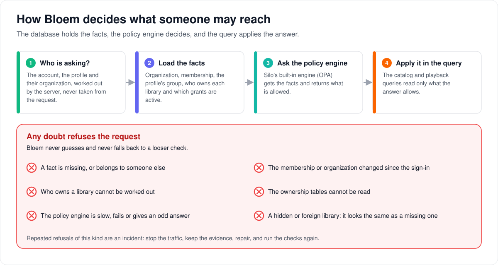
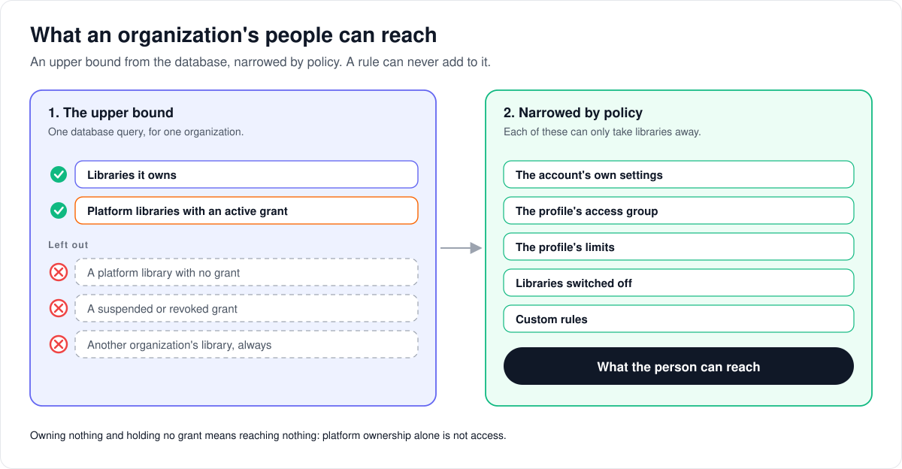

# How tenant authorization works

> **Provenance and status.** Bloem page, rewritten on 2026-11-01 and checked against
> `main` at `b6039036d`. The policy engine (OPA, the Open Policy Agent), access groups
> and the policy rules come from Silo; Bloem adds the tenant layer, which feeds
> organizations, memberships, ownership and grants into Silo's engine. This page
> explains it in plain language; the technical rules, the failure handling and the
> verification commands are in the [For developers](#for-developers) section.
> Its routes were checked again on 2026-11-11, after Silo retired its v1 API.

Every time someone browses, searches or presses play, Bloem decides what they may
reach. This page walks through how that decision is made, what an organization's
people can reach, how access groups fit in, how apps built for Silo are treated, and
what to do when the decision cannot be made.

## How a decision is made



1. **Who is asking?** The server works out the account, the profile and their
   organization from the sign-in. It never takes an organization from the request
   itself.
2. **Load the facts.** Bloem reads that organization's facts from the database: the
   organization and membership, the profile's access group, who owns each library
   and which grants are active. It reads only what this decision needs.
3. **Ask the policy engine.** Silo's built-in **policy engine** (OPA) receives the
   facts and returns what is allowed.
4. **Apply it in the query.** The database queries that list the catalog and start
   playback read only what the answer allows.

**Any doubt refuses the request.** A missing or mismatched fact, a membership that
changed since the sign-in, a library whose owner cannot be worked out, an
unreadable table, a slow or failing policy engine, or an answer the engine did not
define all refuse. A library someone may not see looks exactly like one that does not
exist.

## What an organization's people can reach



1. **The upper bound** is the libraries the organization owns, plus the platform
   libraries it holds an active grant for ([how library ownership and grants
   work](resource-tenancy-foundation.md)). A platform library with no grant, a
   suspended or revoked grant, and another organization's library are left out.
2. **Policy narrows it** by the account's own settings, the profile's access group,
   the profile's limits, libraries switched off and any custom rules. Each of these can
   only take libraries away; none can add one outside the upper bound.

Owning nothing and holding no grant means reaching nothing. That the platform owns a
library does not, by itself, let anyone in.

## Access groups belong to one organization

An **access group** belongs to one organization, so two organizations can each have a
group called "Kids" or "Default". Every profile is in exactly one group of its own
organization. Deleting a group moves its profiles to the organization's default group;
a profile is never left without one
([multitenant administration](multitenant-administration.md#deleting-an-access-group)).
A change to a group that affects access takes effect for everyone in it at once.

## Apps built for Silo

Apps built for Silo, and Silo's `/api/v2`, work as they do with Silo. When
organizations arrived, every existing account and profile was placed in the default
organization without changing profile IDs, PINs, sign-in or profile switching. Bloem
ignores any organization an old app sends and works it out from the account and
profile. A profile that signs in on its own stays tied to its organization. Old apps
and Bloem's own apps use the same policy and get the same answers.

## When something goes wrong

Repeated refusals because organization facts are unavailable or the policy engine fails are
an **authorization incident**. Do not work around the checks or switch to a looser
one. Stop the affected traffic, keep the evidence of the decisions, repair the
database or the policy, and run the checks in [For developers](#for-developers)
again.

## Rolling back

While the database holds nothing that a single-organization server could not
represent, the application and its schema can be rolled back together. Once anything
relies on a second organization, a profile group in a specific organization, a
library owner or a grant, a schema rollback would lose meaning. From then on, plan a
restore instead.

## Who can change what

| Who | What they manage |
| --- | --- |
| Platform administrator | Organizations, memberships, platform libraries and grants, and plans. |
| Organization administrator | Their organization's groups and which group each profile is in, and grants already made to it, through structured controls. They cannot upload, edit or switch on policy code (Rego). |
| Nobody in the console | The policy rules themselves, which ship with Silo's code. |

## Words used in the code

| On this page | In the code and database |
| --- | --- |
| Policy engine | Silo's embedded OPA engine and vendor Rego bundle (`internal/policy`, `internal/policy/vendor/*.rego`) |
| Facts | the tenant context and bounded facts from Bloem-owned adapters (`internal/policy/bloem_*.go`, `internal/access/bloem_group_store.go`, `internal/tenancy`) |
| Who is asking | the subject-bound tenant context (`tenancy.Context`, `access.GroupSubject`) |
| Upper bound | the tenant's media availability set (owned folders plus active entitlements) |
| Access group | `access_groups`; a profile's `organization_id` and `access_group_id` |
| Grant | `organization_entitlements` |
| Refusal on stale facts | `authorization_state_stale` |
| Policy decision evidence | the policy decision records and their decision generation |

## For developers

- **API:** the capability probe `GET /api/bloem/v2/capabilities` is described in the
  [native API reference](../bloem-api-reference.md); administrative contexts and
  policy-decision explanations are on the
  [organizations and administration](../bloem/api/organizations.md) page.

This is the operator boundary for Bloem's OPA-centered tenant authorization.
PostgreSQL supplies authoritative organization, membership, profile-group,
ownership, and entitlement facts. The application resolves a subject-bound tenant
context, loads the bounded facts, and sends typed input to OPA. SQL then applies the
returned scope to catalog and playback reads.

### Shipped boundary

`GET /api/bloem/v2/capabilities` advertises `organization_memberships` and
`tenant_bounded_media_scope` as `true`. Since Silo retired its v1 API (merged in
`26cf9b3e4`) it advertises `legacy_silo_v1` and direct-profile login
(`direct_profile_login`) as `false`: the profile sign-in route lived only on
Silo's v1 API. That capability does not admit direct sessions to the native namespace or the browser's
Silo v2 calls. Shared-device profile pairing (`shared_device_pairing`) and delegated
administrative roles (`delegated_admin_roles`) remain `false`. Household credential
management has its own capability and account/PIN/reauthentication boundary; see
[the security foundation](bloem-security-foundation.md).

Native administration is additive under `/api/bloem/v2/admin`: an authenticated
account exchanges its session for one short-lived Platform or Organization context
token. Every request that carries the token re-checks the login session it was
exchanged from (`internal/api/middleware/admin_context.go`). Since `68070f04b` that
check passes the token's account to Silo's `SessionRepository.ActiveSession`, so a
session that belongs to another account, or a revoked or remote-playback session, is
refused with `authorization_state_stale`. Platform routes operate on the
organization directory; Organization routes take their organization only from that
token and expose people, profiles, groups, libraries, entitlements, invitations,
redacted activity pages, and policy-decision explanations. Grant changes check the
grant security revision; invitation mutations check the organization policy
revision. See [multitenant administration](multitenant-administration.md).

Silo's `/api/v2` is the Silo-compatible surface; its alpha v1 API is retired. Existing users and profiles are
backfilled into the default organization without changing profile IDs, PINs, login
payloads, profile switching, or legacy token claims. Legacy account requests ignore
caller-supplied organization headers and use the server's account/profile tenant
projection. Direct-profile sessions revalidate their explicitly bound tenant and
cannot be projected into another organization. Bridge and native policy adapters use
the same live OPA bundle and expose the same decision generation in policy decision
evidence.

### Group and media scope

An access-group name, including a default-group name, is unique only within its
organization. A selected profile's `organization_id` and `access_group_id` are the
canonical assignment, and `user_profiles.access_group_id` is required. Deleting a
non-default group transactionally reassigns its profiles to that organization's
default group; it never creates an ungrouped, account-only profile.
Authorization-affecting group changes bump every assigned account's policy revision
in the same transaction. Resolution qualifies the profile, account, and group by the
server-resolved organization. The account's own `users.access_group_id` (Silo's
column, which again holds the account's group since `c60b7008e`) is used only for
profile-less legacy resolution in the default organization.

Snapshot-based services use `access.TenantGroupPolicyInTransaction` with the exact
organization, account, and profile subject (`access.GroupSubject`). Silo's
`access.GroupPolicyInTransaction(ctx, tx, userID)` is the account-level read and does
not take a subject. The subject must match the validated tenant context. The read
uses the caller-owned transaction and the same organization-qualified query as normal
policy resolution; it never substitutes an account group for a missing or foreign
profile. Callers remain responsible for loading and validating the other authority
facts in that snapshot.

`auth.UserRepository.GetByID` returns the account's `users` row, Silo's
account-shaped projection. Since `c60b7008e` and `d064644a8` (2026-10-26) an account
has exactly one membership (`organization_memberships` is unique on `account_id`), so
the earlier "default or earliest membership" selection no longer exists. The row is
still not a substitute for the profile's group and the tenant's revisions when
assembling a transactional authorization snapshot.

An organization has media availability for:

- folders owned by that organization; and
- platform-owned folders with an active organization entitlement.

Platform ownership alone is not access. A missing, suspended, or revoked entitlement
excludes the folder. A foreign organization-owned folder is always excluded. The
availability store performs one bounded query, and vendor OPA policy intersects that
upper bound with account, group, profile, disabled-library, and custom narrowing
restrictions. A later rule cannot add a folder outside the tenant availability set.

### Failure and incident behavior

Missing or subject-mismatched tenant facts, stale membership or organization
revisions, unresolved ownership, unavailable resource-tenancy state, OPA timeouts,
evaluation failures, and malformed or undefined decisions deny the request. Native
stale tenant sessions return `authorization_state_stale` (`401`); an unavailable
tenant store returns `tenant_unavailable` (`503`). Hidden, missing, foreign, and
non-entitled resources must not be distinguished in list results or error details.

Treat repeated `tenant_unavailable`, `policy_evaluation_failed`, or policy timeout
records as an authorization incident. Do not bypass the tenant store, substitute an
unrestricted resolver, or advertise the capability while the enforcement path is
degraded. Stop affected traffic, preserve policy decision evidence, repair the
database or policy bundle, and re-run the release gate.

### Rollback boundary

Rollback remains supported only while all durable state is representable by the
legacy single-organization schema. Before any non-default organization,
organization-specific profile group assignment, resource owner, or entitlement is
relied upon, stop writes, keep a tested backup, and roll the application and schema
back together using the procedure in
[Bloem native API security foundation](bloem-security-foundation.md). After that
boundary is crossed, use restore/recovery planning; schema rollback would discard
tenant meaning even if legacy rows survive.

### Verification

Commands assume the repository root is the current directory and a maintenance
database URL with `CREATE DATABASE` permission is exported as
`SILO_TEST_DATABASE_URL`. Required acceptance tests fail rather than skip when that
variable is absent. Every acceptance run creates a unique database, terminates its
test connections, drops it, and verifies absence after cleanup.

```sh
SILO_REQUIRE_TEST_DATABASE=1 SILO_TEST_DATABASE_URL="$SILO_TEST_DATABASE_URL" GOWORK=off go test ./internal/database ./internal/tenancy ./internal/resourcetenancy ./internal/access ./internal/policy ./internal/api ./internal/api/handlers ./internal/api/middleware -count=1 -v -timeout=45m
SILO_REQUIRE_TEST_DATABASE=1 SILO_TEST_DATABASE_URL="$SILO_TEST_DATABASE_URL" GOWORK=off go test -race ./internal/tenancy ./internal/resourcetenancy ./internal/access ./internal/policy -count=1 -v -timeout=45m
GOWORK=off go vet ./internal/tenancy ./internal/resourcetenancy ./internal/access ./internal/policy ./internal/api/...
GOWORK=off go build ./cmd/silo
git diff --check
git status --short
```

The tenant job in `.github/workflows/bloem-ci.yml` first migrates its empty
disposable PostgreSQL service (`go run ./cmd/silo --migrate-only`), then runs these
gates with the job-level database URL:

```sh
SILO_REQUIRE_TEST_DATABASE=1 go test ./internal/database -run 'TestTenantIdentityMigration|TestResourceTenancyMigration|TestOrganizationAccessGroupMigration|TestProfileAccessGroupRequired' -count=1 -v -timeout=30m
SILO_REQUIRE_TEST_DATABASE=1 go test ./internal/userstore/pgstore -run 'TestProfileOrganizationAndAccessGroupPersistence|TestProfileAccessGroupRejectsDifferentOrganization' -count=1 -v -timeout=30m
SILO_REQUIRE_TEST_DATABASE=1 go test -race ./internal/resourcetenancy ./internal/access ./internal/policy -count=1 -v -timeout=30m
SILO_REQUIRE_TEST_DATABASE=1 go test ./internal/api -run 'TestV1TenancyCompatibility|TestOPATenantFoundationWithDisposablePostgres' -count=1 -v -timeout=30m
SILO_REQUIRE_TEST_DATABASE=1 go test ./internal/api ./internal/tenancy ./internal/adminpeople ./internal/database -run 'TestMultitenantAdmin|TestAdminStore|TestService|TestAdminPeopleMigrations|TestOrganizationAdminProjectionMigration' -count=1 -v -timeout=30m
```

The same job also runs `TestBloemFunctionRebrandPreservesCanonicalNamesOnRollback` in
`./internal/database`. The race tests for `./internal/tenancy` run in a separate job,
"Tenant stores race", split across four shards (`scripts/ci/go-test-shard.sh`), each
with its own disposable PostgreSQL.

### History

The embedded OPA engine, access groups and the vendor Rego bundle are Silo's (Silo
#282, `42602b789`, 2026-07-05). The tenant layer and the first version of this page
date from the tenant foundation of 2026-08-13 (`94f88cc9c`, `fed275c71`,
`0e6f7f03d`). Later changes that matter: `654301e56` (2026-09-09) made the
transactional group read subject-bound, and `b14f34552` (2026-10-05) moved that read
into the Bloem-owned `access.TenantGroupPolicyInTransaction`, which returned Silo's
`GroupPolicyInTransaction` to its account-level form. `c60b7008e` and `d064644a8`
(2026-10-26) gave each account exactly one membership and moved its account policy
back onto `users`, where Silo keeps it. The Silo merge `68070f04b` (2026-10-27) binds
the administrative context check to the token's account.

Technical pages:

- [Multitenant administration](multitenant-administration.md): administrative
  contexts and how Silo clients resolve an organization.
- [How library ownership and grants work](resource-tenancy-foundation.md): owners,
  grants and the starting set.
- [Delivery boundary enforcement](delivery-boundary-enforcement.md): access rechecked
  when video and rows leave the server.
- [Bloem native API security foundation](bloem-security-foundation.md).
- [Silo backend switching](silo-backend-switching.md): the switch back to Silo's
  single-organization behavior.

The pictures are SVG files under `images/opa-tenant-authorization/`, drawn by
`scripts/bloem/draw-pictures.py`. Redraw them there, not by hand.
