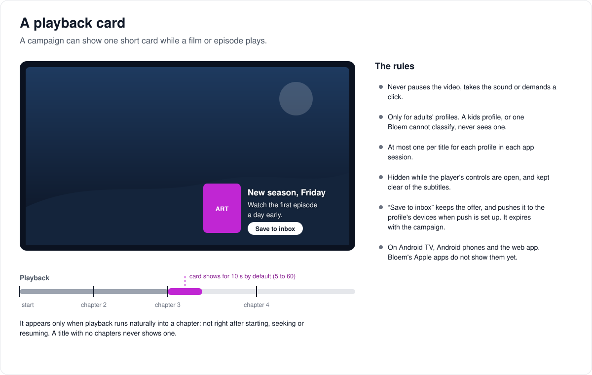
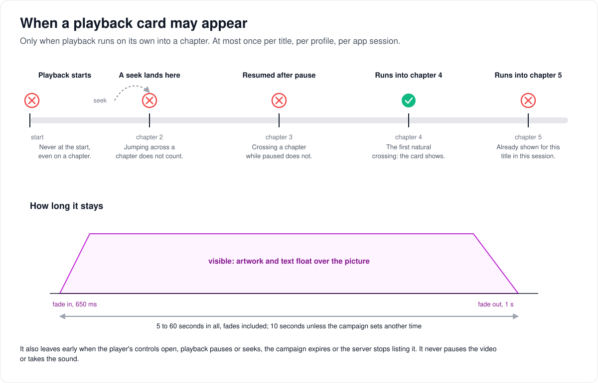

# How playback cards work

> **Provenance and status.** Bloem page, rewritten on 2026-11-01 and checked against
> `main` at `b6039036d`. Campaigns and playback cards are a Bloem addition with no
> Silo counterpart. This page explains them in plain language; the technical rules,
> including the client lifetime rules every app must follow, are in the
> [For developers](#for-developers) section.

A **playback card** is a short campaign message that floats over a film or episode
for a few seconds while it plays, such as "New season, Friday". This page walks
through what a card looks like, when it may appear, what a viewer can do with it,
and which apps show one.

## What a playback card looks like

A card is artwork and a line or two of text, softly shadowed, floating straight over
the picture with no panel around it. It belongs to a **campaign**: a promotion a
platform administrator or the storefront (Bloem Garden) writes once and Bloem shows on
one or more **surfaces**. Home, a title's page and the moment before playback are the
other surfaces; a playback card is the campaign shown during playback.

A campaign can show its card in one of two **styles**:

- **Card:** a still picture with the text.
- **Picture-in-picture:** a short silent video clip with the text, falling back to the
  picture when the clip cannot play.

## When a card may appear

1. **Only at a chapter.** A card can appear only when playback runs on its own into a
   new chapter. A title with no chapters never shows one.
2. **Never after a jump.** Starting playback, seeking, or resuming after a pause does
   not count, even when it lands on a chapter.
3. **Once.** At most one card per title, for each profile, in each app session.
4. **For a set time.** It stays 5 to 60 seconds, fades included; 10 seconds unless the
   campaign sets another time.
5. **Out of the way.** It hides while the player's controls are open and sits above
   the subtitles. It leaves early if playback pauses or seeks, or the campaign ends.

A card never pauses the video, takes the sound or demands a click. Only adults'
profiles see one: a kids profile, or one Bloem cannot classify, never does.

## What a viewer can do with it

- **Ignore it.** It fades away by itself.
- **Close it.** A close button, or Escape in the web app.
- **Save it to the inbox.** When the campaign has an action, the card offers to save
  it (the web app labels it "Send to my phone"). The offer lands in the profile's inbox
  and, where push notifications are set up, on the profile's devices. It expires with
  the campaign.

On a TV remote or keyboard, pressing Right moves to a visible card. A card never takes
the focus by itself.

## Which apps show it

The web app, Android TV and Android phones show playback cards. Bloem's Apple apps do
not yet: they never ask for them, so they cannot show one by accident. Jellyfin apps
have no playback cards.

## Example: a season launch

This example is made up. A platform administrator writes a campaign, "New season,
Friday", with a still picture and a **Watch the trailer** action, shown during the
previous season's episodes for one week, for 15 seconds. Anna, on her own profile,
watches episode 3. Twenty minutes in, the episode runs into its second chapter and the
card fades in at the corner, stays 15 seconds and fades out. She saves it, and the
offer waits in her inbox. When she skips back and plays through the same chapter
again, nothing appears: she has seen it this session. Her son's kids profile never
sees it.

## Who can change what

| Who | What they manage |
| --- | --- |
| Platform administrator | Campaigns, including playback cards, under **Campaigns & seasonal packs** in the Platform context. |
| The storefront (Bloem Garden) | The same campaigns, with a platform administrator's API key. |
| Organization administrator | Nothing: they cannot publish campaigns. |
| Viewer | Closing a card, saving it to the inbox. |

## Words used in the code

| On this page | In the code and database |
| --- | --- |
| Campaign | a promotion (`internal/promotions`, table `promotions`) |
| Surface | `surfaces`: `home`, `detail`, `pre_playback`, `in_playback` |
| Playback card | a promotion on `in_playback` with `placement.playback_style` `card` or `pip` |
| Card, picture-in-picture | `playback_style` `card`, `pip`; the clip is `placement.video_url` |
| Display time | `placement.duration_seconds`, projected as `duration_seconds` |
| Saving to the inbox | `POST /api/bloem/v1/promotions/{id}/save` |
| "Does this server have playback cards?" | `playback_overlays_v1` in `/api/bloem/v1/capabilities` |
| The web component | `web/src/components/engagement/PlaybackEngagement.tsx`, with `ChapterGate` in `playback-policy.ts` |

## For developers

- **API:** [messages and promotions](../bloem/api/messages.md): campaign authoring
  under `/api/bloem/v1/admin/platform/promotions`, and the viewer routes
  `GET /api/bloem/v1/promotions`, `POST /api/bloem/v1/promotions/{id}/save` and
  `PUT /api/bloem/v1/promotions/{id}/dismissals/{surface}` (`promotions_viewer_v1`).
  The phone apps still use the [old `/api/v1` routes](../bloem/api/v1-routes.md#campaigns).
  The [playback overlays API](../playback-overlays-api.md) page summarises who calls
  which route.

### History

Promotion cards (`internal/promotions`) arrived in `3ae12d9f2` (2026-09-01), specified
in the [client engagement spec](../specs/client-engagement.md) as "S-2". Timed playback
overlays and the first version of this page came in `eaa0b3a6b` (2026-09-06); the
embedded-web authoring and Home placements in `53534d9f0` (2026-09-18). Campaign
evaluation ran in a bundled worker from `85ba110f2` (2026-10-05) and returned
in-process in `310c545f9` (2026-10-26); see
[presentation evaluators](bloem-presentation-evaluators.md). On 2026-10-31 and
2026-11-01 (`3eb77be33`) the storefront and the web app moved to the native routes,
and `playback_overlays_v1` replaced the v1 capability check for them. The client
rendering and verification notes below date from September 2026.

### Authoring

- The storefront and the web console's platform **Campaigns & seasonal packs** page
  (`web/src/pages/admin-platform/EngagementPage.tsx`, route `/admin/platform/engagement`)
  write the same promotions registry through
  `/api/bloem/v1/admin/platform/promotions`. The routes take a Platform administrative
  context or an enabled administrator's unscoped API key (`RequireBloemPlatformAdmin`).
  There is no organization-admin publication authority and no revision locking: a
  later save overwrites an earlier one.
- A playback campaign uses `surfaces: ["in_playback"]` and
  `placement.playback_style: "card"` or `"pip"`. `in_playback` requires a dismissible
  campaign with a playback style (`in_playback requires a dismissible card or pip
  placement`).
- `image_url` is always required, and is the fallback for a clip: an `https://` URL or
  a server asset path (`ambience.IsAssetURL`). Declared image dimensions must be 16:9
  within ±1%.
- Optional `placement.video_url` is an HTTPS clip and is accepted only with `pip`
  (`video_url requires pip and HTTPS`).
- `placement.duration_seconds` configures a 5 to 60 second lifecycle, defaulting to 10
  when a playback style is set; it is refused without one.
- The approved presentation (2026-09-05) floats artwork and softly shadowed text
  directly over the video, with no enclosing panel. These are playback cards, not
  Home hero decorations. Display time is editable from 5 to 60 seconds, with a
  ten-second default, including both fades. Keep soft fades and deliberate focus.
- Server admin announcements are independent and need no storefront access
  ([announcements](admin-announcements.md)).
- Campaign artwork uploads need an asset store: the catalog Assets store, local or S3,
  or public S3 as the fallback
  ([campaign and seasonal asset storage](bloem-campaign-asset-storage.md)).

### Other surfaces

Home, detail and pre-playback placements reuse the registry but have their own
presentation rules: Home is off by default, children are suppressed, and **Continue to
content** is immediately available before playback. Once admitted, the player stays
mounted across campaign updates. See [web coverage](bloem-web-feature-coverage.md)
for these workflows and their evidence; they do not change the chapter-triggered
lifecycle below.

### Delivery

- `/api/bloem/v1/capabilities` lists `playback_overlays_v1` when the campaign registry
  is wired (`SetPlaybackOverlaysAvailable`, `internal/api/router_bloem.go`). For the
  phone apps, `GET /api/v1/notifications/capability` still advertises
  `promotions.playback_overlay` (`internal/api/handlers/bloem_notifications_ext.go`).
- `GET /api/bloem/v1/promotions?surface=in_playback&content_id=…` (and, for the phone
  apps, `GET /api/v1/promotions?surface=in_playback&content_id=…`) returns the card
  projection with `playback_style`, `video_url`, `duration_seconds` and an exclusive
  `expires_at`. `content_id` is required for `in_playback`.
- The native routes require authentication, native tenant resolution, the rate limit,
  viewer and PIN verification and a selected profile
  (`mountBloemPromotionsViewer`, `internal/api/bloem_promotions_viewer.go`); the
  default-deny route boundary excludes direct-profile sessions.
- The profile must be known and adult. A missing profile classification fails closed
  before any campaign lookup (`promotions.Service`, "Unknown profile classification
  must never deliver an overlay"). Scheduling, organization membership and audience
  filters still apply.

### Client lifetime rules

Every app that renders playback cards follows these:

- The duration includes a 650 ms entrance and a one-second exit fade.
- No campaign can pause the content, take audio focus or force interaction. A
  picture-in-picture creative is always muted; Android disables its audio track.
- Clients skip initial loads, seeks, paused or resumed crossings and stale samples.
  Only natural, positive chapter crossings can trigger a card. The web `ChapterGate`
  accepts a crossing only between two playing, non-seeking samples at most 2 seconds
  apart whose position advanced by more than 0 and at most `elapsed × 3 + 0.25`
  seconds, across a chapter start greater than 0.
- One overlay per content item and profile in the current application session. No
  chapters means no overlay.
- Visible controls, background playback, stale delivery data and expired campaigns
  suppress the card. The web player also hides it while detached or not in the
  foreground, and while ASS subtitles are active, because their positioned text may
  occupy any region. Otherwise the card sits above the ordinary bottom subtitle area.
- Right deliberately focuses a visible card; it never takes focus on arrival. Close,
  retirement and suppression restore player focus when the card owned it. Ordinary
  playback controls stay independent. Dismissing a playback card does not use the
  Home dismissal table.
- The web app refetches the cards every 30 seconds (stale after 20) and treats data
  older than 45 seconds as stale.

### Saving to the inbox

- `POST /api/bloem/v1/promotions/{id}/save?content_id=…` (or
  `POST /api/v1/promotions/{id}/save?content_id=…` for the phone apps) re-evaluates the
  authenticated profile's eligibility before saving that campaign to the same
  profile's inbox. Only a current `in_playback` card with a call to action for that
  `content_id` can be saved; otherwise `404 not_found`.
- The server projects the stored call to action rather than trusting a
  caller-supplied destination.
- A deterministic delivery ID, derived from the profile and campaign, makes retries
  idempotent across server instances.
- Existing enabled push channels notify the profile's devices; without push, the offer
  stays in its inbox. The action does not guarantee that a phone is registered or
  online. Saved offers expire with the campaign. No webhook broadcast is requested by
  this viewer action.

### Clients

Kotlin and Swift generated DTOs include the projection. Android TV, Android phone and
the web player implement rendering. Apple rendering remains a follow-up; an older
Apple client never requests `in_playback`, so it cannot accidentally show these cards
elsewhere. Jellyfin compatibility has no promotional playback surface and remains
unchanged.

### Verification

Verification covers validation, child and unknown-profile exclusion, chapter gates,
web focus and lifetime behaviour, the existing web player tests, storefront authoring
and native builds. A browser preview exercised the real web component against fixtures
and a moving sample video. Production publication, database-backed push delivery and
device playback still require integration testing against a deployed server with this
capability.

### Related pages

- [How messages and promotions work](bloem-messages-and-promotions.md).
- [Playback overlays API](../playback-overlays-api.md).
- [Presentation evaluators](bloem-presentation-evaluators.md) and
  [campaign and seasonal asset storage](bloem-campaign-asset-storage.md).

The pictures are SVG files under `images/playback-overlays/` and `images/messages/`,
drawn by `scripts/bloem/pictures/playback_overlays.py` and `messages.py` through
`scripts/bloem/draw-pictures.py`. Redraw them there, not by hand.
